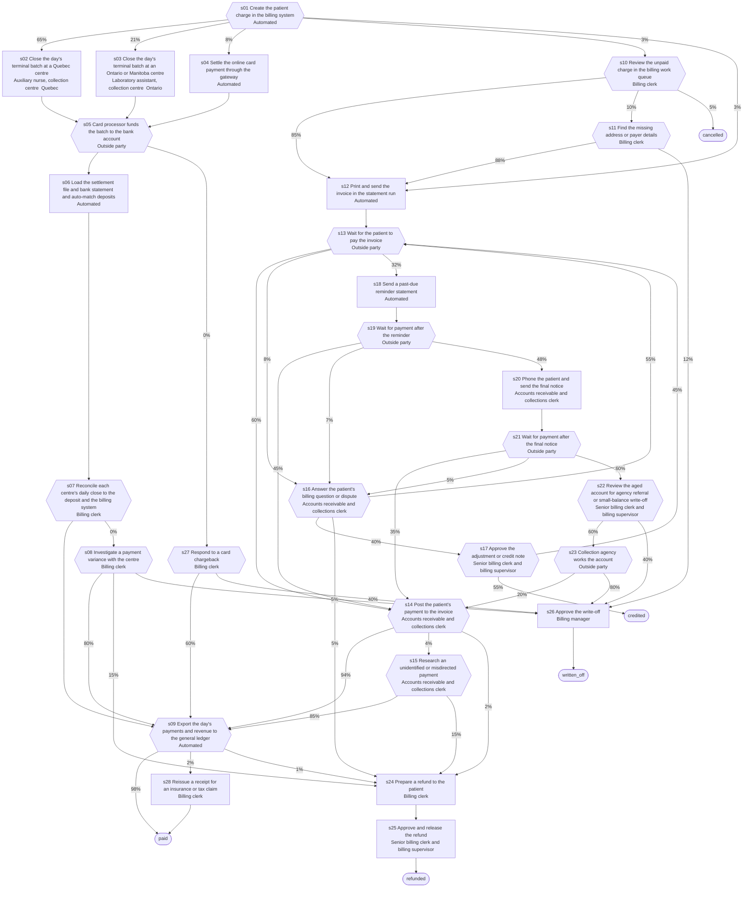

# Bill and collect from patients

`dls-fin-patient-billing` · medical laboratory services · finance (billing and revenue cycle) · part of `diagnostic-lab-services-co`

Patients pay the company for tests their provincial plan does not cover: most Quebec community tests, uninsured tests in Ontario and Manitoba, house calls, private genetic tests, self-pay tests bought online and portal subscriptions. Almost all charges are paid by card at the collection centre counter or online, so the main work is closing each centre's card batch every day and reconciling it to the processor deposit and the billing system. A small share of charges is invoiced, and those need statements, payment posting, calls, disputes, refunds, agency referral and write-offs, which take most of the clerks' time per charge and most of the elapsed time.

| | |
|---|---|
| Unit of work | one patient charge |
| Starts when | A patient charge reaches the billing system from a centre registration, an online order, a portal subscription, a house call booking, a private genetic test or a claim transferred from provincial billing. |
| Done when | The charge is paid and reconciled to the bank deposit and posted to the ledger, or credited, refunded or written off. |
| Organisation | A large Canadian community laboratory company with about 200 collection centres in Ontario, Quebec and Manitoba and a central billing department in Brampton. (3,300 employees, 2019-2022) |
| Volume | 140,000 cases a month (range 110,000 to 170,000) |

## Where it sits

- Starts with **patient_invoice** from cl-psc-registration (88% of cases)
- Starts with **billable_order** from fin-provincial-billing (3% of cases)
- Starts with **patient_payment** from cd-self-pay-order (4% of cases)
- Starts with **patient_invoice** from cd-portal-registration (2% of cases)
- Starts with **patient_invoice** from mb-house-call (2% of cases)
- Starts with **patient_invoice** from gs-genetic-testing (1% of cases)
- Starts with **patient_payment** from patient (1% of cases)
- Sends **patient_invoice** to patient (outcome: any)
- Sends **ledger_postings** to fin-month-end-close (outcome: paid)
- Sends **ledger_postings** to fin-month-end-close (outcome: written_off)
- Sends **ledger_postings** to fin-month-end-close (outcome: refunded)
- Sends **ledger_postings** to fin-month-end-close (outcome: credited)

## Flow

## Roles

| Role | Department | Layer | FTE on this process | Loaded cost per hour | Evidence |
|---|---|---|---:|---:|---|
| Billing clerk | Billing and revenue cycle | individual contributor | 9 | 33 CAD | B [pb_job] |
| Accounts receivable and collections clerk | Billing and revenue cycle | individual contributor | 5.5 | 33 CAD | B [pb_job] |
| Senior billing clerk and billing supervisor | Billing and revenue cycle | supervisor | 1 | 38 CAD | B [pb_job] |
| Billing manager | Billing and revenue cycle | manager | 0.2 | 66 CAD | C |
| Laboratory assistant, collection centre (Ontario) | Ontario collection centres | individual contributor | 1.5 | 31 CAD | C |
| Auxiliary nurse, collection centre (Quebec) | Quebec collection centres | individual contributor | 1.2 | 35 CAD | C |

## Steps

Hands-on time and the wait before each step show the most common value. Evidence tier A is a sourced number, B a sourced description, C the author's estimate.

| Step | Who | Kind | Hands-on | Wait before | Control | Evidence |
|---|---|---|---:|---:|---|---|
| **s01 Create the patient charge in the billing system.** The billing system receives the charge from the LIS registration, the online test shop, the portal subscription, the house call booking or a claim moved over from provincial billing, priced from the patient price list, and records whether it was already paid by card or still needs an invoice. | Automated | system auto | 0 min | 2 min |  | C [pb_ag17], [pb_dynqc], [pb_plus] |
| **s02 Close the day's terminal batch at a Quebec centre.** At closing the auxiliary nurse prints the day's payment report from the LIS and the terminal's end-of-day totals, compares card counts and totals, settles the batch, notes any voided or re-run transactions on the daily close sheet, signs it and scans it to billing. The time shown is one charge's share of the daily close. | Auxiliary nurse, collection centre (Quebec) | validation | 0.08 min | 5.0 h | Company cash handling and point-of-sale controls: terminal batch settled daily and the close sheet signed and sent to billing | B [pb_td], [pb_shift4], [pb_dynqc] |
| **s03 Close the day's terminal batch at an Ontario or Manitoba centre.** The lab assistant closing the centre compares the terminal's end-of-day totals with the LIS payment report for the few uninsured-test payments taken that day, settles the batch, records any void or refund on the close sheet and scans the signed sheet to billing. | Laboratory assistant, collection centre (Ontario) | validation | 0.3 min | 5.0 h | Company cash handling and point-of-sale controls: terminal batch settled daily and the close sheet signed and sent to billing | B [pb_td], [pb_ag17] |
| **s04 Settle the online card payment through the gateway.** Payments taken on the online shop, the portal, the hosted invoice payment page or by phone through the virtual terminal are authorised in real time and the gateway closes its batch automatically each night; the billing system marks the order paid from the gateway's confirmation. | Automated | system auto | 0 min | 10.0 h |  | B [pb_pay], [pb_shift4] |
| **s05 Card processor funds the batch to the bank account.** The processor clears the settled batch with the card networks and deposits the net amount in the company's bank account, usually the next business day; batches closed Friday to Sunday are funded on Monday and late batches a day later. | Outside party | external wait | 0 min | 1.0 d |  | A [pb_shift4] |
| **s06 Load the settlement file and bank statement and auto-match deposits.** Overnight the billing system imports the processor's settlement report and the bank statement, matches each deposit to a centre's batch by merchant number and amount, posts card fees and lists every unmatched batch and centre that did not close on an exception report. | Automated | system auto | 0 min | 6.0 h |  | C |
| **s07 Reconcile each centre's daily close to the deposit and the billing system.** A billing clerk works the reconciliation exception report: compares each centre's payments in the billing system with the processor batch and bank deposit, checks the scanned close sheet, chases centres that did not close their batch and records the day as reconciled in the reconciliation workbook. The time shown is one charge's share. | Billing clerk | validation | 0.15 min | 1.0 d | Internal control over financial reporting under the parent company's Sarbanes-Oxley section 404 program: daily reconciliation of point-of-sale and online receipts to processor settlements and bank deposits | B [pb_job] |
| **s08 Investigate a payment variance with the centre.** The clerk pulls the terminal receipt copies, the LIS payment entries and the close sheet, phones the centre team lead, finds the cause (payment keyed to the wrong visit, void not recorded, batch closed twice, duplicate charge) and posts a correcting entry or opens a refund. | Billing clerk | analysis | 15 min | 1.0 d |  | B [pb_job] |
| **s09 Export the day's payments and revenue to the general ledger.** Each night the billing system summarises the day's patient charges, payments, card fees, refunds and write-offs by business line and province and posts a journal to the ERP general ledger for the monthly close. | Automated | system auto | 0 min | 10.0 h |  | C |
| **s10 Review the unpaid charge in the billing work queue.** A billing clerk opens the charge with the requisition image, checks the patient's name and mailing address, the price-list amount and that the test really is uninsured or that the provincial rejection cannot be fixed, and decides whether the patient, an employer or another third party should be billed. | Billing clerk | validation | 3 min | 1.0 d | Ontario Health Insurance Act and Commitment to the Future of Medicare Act: insured services may not be charged to insured patients; only uninsured tests are billed | B [pb_ag17], [pb_job] |
| **s11 Find the missing address or payer details.** The clerk searches the LIS demographic record, the requisition image and earlier invoices for a mailing address or email, phones the patient or the collection centre when nothing is on file, and updates the patient record. | Billing clerk | lookup | 10 min | 1.0 d |  | C |
| **s12 Print and send the invoice in the statement run.** The billing system includes the charge in the next statement run; invoices go by email where the patient gave an address and otherwise to a print-and-mail run, each showing the invoice number patients need to pay online or through their bank. | Automated | system auto | 0 min | 2.0 d |  | B [pb_pay] |
| **s13 Wait for the patient to pay the invoice.** The patient receives the invoice and pays online by card, through online banking with the invoice number as the account number, by phone or by cheque, or calls with a question, or does nothing. | Outside party | external wait | 0 min | 10.0 d |  | B [pb_pay] |
| **s14 Post the patient's payment to the invoice.** Hosted card payments arrive already matched by invoice number; an accounts receivable clerk posts bank bill payments from the bank file and cheques from the mail, checks the amount against the balance and closes the invoice. | Accounts receivable and collections clerk | data entry | 1 min | 1.0 d |  | B [pb_job], [pb_pay] |
| **s15 Research an unidentified or misdirected payment.** The clerk works the unapplied cash list: bill payments made with an old invoice number, cheques without a stub and payments in a different name; she searches by name and amount, calls the patient and applies or refunds the money. | Accounts receivable and collections clerk | analysis | 15 min | 3.0 d |  | B [pb_pay], [pb_job] |
| **s16 Answer the patient's billing question or dispute.** On the billing line an accounts receivable clerk explains why a test was not covered, checks the requisition and price list, sends an itemised receipt for the patient's insurer, agrees a payment plan or records the patient's reason for a credit. | Accounts receivable and collections clerk | communication | 8 min | 1.0 d |  | B [pb_job], [pb_cra] |
| **s17 Approve the adjustment or credit note.** The billing supervisor reads the clerk's note and evidence (a valid health card for the date of service, a price error, a test not performed, a goodwill request), approves or rejects the credit in the billing system and records the reason code. | Senior billing clerk and billing supervisor | approval | 4 min | 1.0 d | Billing adjustment authority matrix: credits above a clerk's limit approved by a supervisor | C |
| **s18 Send a past-due reminder statement.** When the invoice is 30 days old the billing system prints or emails a past-due reminder showing the balance, the payment options and a request to call the billing department. | Automated | system auto | 0 min | 7.0 d |  | B [pb_aapc] |
| **s19 Wait for payment after the reminder.** The patient may pay after the reminder, call to dispute or arrange a plan, or not respond; most patient balances that are still unpaid at this point are small. | Outside party | external wait | 0 min | 7.0 d |  | C |
| **s20 Phone the patient and send the final notice.** An accounts receivable clerk reviews the aged account, phones the patient (often reaching voicemail), offers a payment plan and sends a final notice that names the date the account will go to a collection agency. | Accounts receivable and collections clerk | communication | 7 min | 5.0 d | Company credit and collection policy: final notice and a contact attempt before agency referral | B [pb_aapc], [pb_job] |
| **s21 Wait for payment after the final notice.** The patient has until the date on the final notice to pay or arrange a plan before the account is listed for referral to the agency. | Outside party | external wait | 0 min | 7.0 d |  | C |
| **s22 Review the aged account for agency referral or small-balance write-off.** Once a month the billing supervisor reviews accounts older than about 90 to 120 days on the aged trial balance, lists balances under the small-balance threshold for write-off and approves the rest for the collection agency file. | Senior billing clerk and billing supervisor | judgment | 2 min | 7.0 d | Company credit and collection policy: aging thresholds for agency referral and small-balance write-off | B [pb_job], [pb_hfma] |
| **s23 Collection agency works the account.** A registered collection agency receives the account file, sends the patient a written notice, waits the required days before calling, contacts the patient within the legal limits and remits what it collects net of its commission, returning uncollectible accounts after its work period. | Outside party | external wait | 0 min | 42.0 d | Ontario Collection and Debt Settlement Services Act (registered agency, written notice and 6-day wait, at most 3 contacts a week) and the Quebec Act respecting the collection of certain debts | B [pb_s2j] |
| **s24 Prepare a refund to the patient.** A billing clerk confirms the overpayment, duplicate charge or cancelled test, refunds the original card through the terminal or gateway, or raises a cheque request to accounts payable when the card cannot be refunded, and records the reason. | Billing clerk | data entry | 5 min | 2.0 d |  | C |
| **s25 Approve and release the refund.** The billing supervisor checks the refund against the original payment and the reason, approves it in the billing system or signs the cheque request, and the refund is released to the card or mailed. | Senior billing clerk and billing supervisor | approval | 2 min | 1.0 d | Cash disbursement control: the person who prepares a refund does not approve it | C |
| **s26 Approve the write-off.** Each month the billing manager reviews the list of small balances, untraceable patients, agency returns and unexplained variances recommended for write-off, approves those within delegated authority and the billing system posts them to bad debt. | Billing manager | approval | 1 min | 7.0 d | Delegated write-off authority and bad debt review under internal control over financial reporting | B [pb_job] |
| **s27 Respond to a card chargeback.** When the processor reports that a patient disputed a card payment, a billing clerk retrieves the terminal receipt, the registration record and the requisition showing the service was given, uploads the evidence to the processor portal before the deadline and records the outcome. | Billing clerk | drafting | 25 min | 21.0 d | Card network dispute rules in the merchant agreement: evidence within the response deadline | C [pb_pci] |
| **s28 Reissue a receipt for an insurance or tax claim.** A billing clerk finds the paid charge and emails or mails a duplicate itemised receipt showing the company name, tests, amounts and date, which the patient needs for a private insurance claim or the medical expense tax credit. | Billing clerk | communication | 4 min | 7.0 d |  | B [pb_cra] |

## Exceptions

| Exception | Share of cases | What happens |
|---|---:|---|
| Card batch variance | 0% | A centre's card batch does not match its payments in the billing system and the clerk traces the difference to the charge. |
| Invoice not paid on time | 2% | An invoiced charge passes the reminder, the phone call and the final notice and goes to the agency or is written off. |
| Billing dispute | 1% | The patient disputes an invoice, often saying the test should have been covered, and a supervisor approves a credit. |
| Refund after payment | 1% | A test is cancelled or found insured after the patient paid, or the patient paid twice, and the card is refunded. |
| Misdirected bank payment | 0% | The patient pays through online banking with an earlier invoice number and the clerk has to find the right invoice. |
| Card chargeback | 0% | A patient disputes the card charge with the bank weeks later and billing must send evidence. |

## Benchmarks

| Metric | Value | Unit | Population | Evidence |
|---|---|---|---|---|
| cycle_time_days | p50 3.5, p90 8 | calendar days from charge creation to payment reconciled and posted, or other closure | Author's derivation for this company's charge mix | B [pb_shift4], [pb_td] |
| ontario_uninsured_community_tests_per_year | 1100000 | tests (2015/16, all Ontario community laboratories) | Ontario community laboratory sector | A [pb_ag17] |
| uninsured_test_price_range | low 20, high 160 | CAD per test, sample of five tests at three providers | Ontario and British Columbia community laboratories, 2017 | A [pb_ag17] |
| quebec_sample_transport_fee_cap | blood 15, other 5 | CAD per transport to a laboratory | Quebec private facilities | A [pb_cmq] |
| portal_subscription_price | 9.99 | CAD per year | Company patient portal, 2020 | A [pb_plus] |

## Pain points

- Reconciliation of about 200 centres' card batches is done by hand from an exception report and a workbook, and centres that forget to close their batch create variances that take a clerk's time days later. (steps s02, s03, s07, s08; B [pb_td], [pb_job])
- Patients paying through online banking must change the account number to each new invoice number, so payments land on old invoices and need research. (steps s13, s14, s15; B [pb_pay])
- Small invoiced balances cost more to chase than they are worth; statements, calls and agency referral stretch over months and many end in write-off. (steps s18, s20, s22, s23, s26; B [pb_hfma], [pb_aapc])
- Disputes often turn on whether a test was insured, which needs the requisition image and the provincial rules and ends in credits and transfers. (steps s10, s16, s17; C)

## Assumptions

- The card payment at the counter is taken during registration (cl-psc-registration steps s17 and s20) and its hands-on time is not repeated here. This workflow starts when the charge reaches the billing system.
- Charge mix is estimated: 65 per cent paid at Quebec centres, 21 per cent uninsured tests paid at Ontario and Manitoba centres, 8 per cent paid online or by phone in advance (self-pay shop, portal subscriptions, house calls, NIPT), 6 per cent invoiced (claims moved from provincial billing, house calls and genetics billed later, office-collected uninsured tests), half of which a clerk reviews before invoicing and half of which are invoiced automatically because the address and price are already on file.
- That patients pay for most Quebec community testing at private centres is taken from the organisation file and is not confirmed by an opened source; the Quebec regulator page opened only confirms that sample transport fees not covered by the RAMQ may be charged.
- Daily batch close and reconciliation are done once for many charges; their hands-on time is spread across charges as fractions of a minute.
- Collection centre staff time for the daily close is kept small because lab assistants and auxiliary nurses are almost fully used by registration and collection in the existing workflows; the close happens at the end of a shift.
- The parent company is listed in the United States, so the group's Sarbanes-Oxley internal control program is assumed to cover cash reconciliation and write-off approvals in the Canadian subsidiary.
- Interfaces: the patient invoice to the patient is produced for any outcome because every charge gives the patient an invoice or receipt. Credits that reverse a charge the province should pay are closed here as credited; the organisation file does not list a link back to provincial billing.
- Roles: billing manager and billing supervisor are added for approvals; they are in the organisation file but not in this process's role list there.
- Loaded costs are from the organisation file (hourly wage times 1.35).

## Sources

- [pb_ag17] [2017 Annual Report, Volume 1, Section 3.07: Laboratory Services in the Health Sector](https://www.auditor.on.ca/en/content/annualreports/arreports/en17/v1_307en17.pdf) (Office of the Auditor General of Ontario, 2017). Ontario community laboratories performed about 1.1 million uninsured tests in 2015/16, generally paid by patients out of pocket or through private insurance; the Ministry does not set or monitor the prices; a sample of uninsured test prices ranged from CAD 20 to CAD 160 and varied between laboratories. Read from a text copy saved under scratch by earlier work.
- [pb_cmq] [Learn about medical fees](https://form.cmq.org/en/protect-the-public/contester-des-honoraires-médicaux/contester-honoraires-medicaux) (Collège des médecins du Québec, n.d.). A fee not covered by the RAMQ may be charged to an insured person for transporting biological samples collected at a private facility: at most CAD 15 for a blood sample and CAD 5 for other samples, once per laboratory.
- [pb_dynqc] Serving Quebec (link withheld) (The model laboratory, n.d.). 30+ the model laboratory locations in Montreal, Quebec City and Gatineau.
- [pb_pay] Make a payment (link withheld) (The model laboratory, n.d.). Patients pay invoices online by credit card through TD Merchant Services using the invoice number from the top right corner of the invoice, by online banking with the invoice number as the account number (changed for each invoice), by phone to the billing department or by mail to the Brampton billing department; a separate link takes payment for Harmony NIPT.
- [pb_plus] The consumer health service expands digital offerings with access to mental health therapy and virtual care (link withheld) (The model laboratory, 2020). The consumer health service portal available at CAD 9.99 per year.
- [pb_shift4] [Deposit Schedules Overview](https://shift4.zendesk.com/hc/en-us/articles/30446670804627-Deposit-Schedules-Overview) (Shift4 (merchant processor help centre), n.d.). Canadian next-day funding: Ontario and Quebec merchants should close the batch by 11:30 pm Eastern; a Monday batch closed in time is funded Tuesday, a late one Wednesday; Friday to Sunday batches are funded Monday.
- [pb_td] [Fee change summary](https://www.td.com/ca/en/business-banking/merchant-solutions/fee-change-summary) (TD Merchant Solutions, 2026). Merchants are advised to close their card batch daily; TD closes a batch after 48 hours where possible. The fee change described is from 2026 and is used only for the daily batch practice.
- [pb_pci] [PCI Data Security Standard (PCI DSS)](https://www.pcisecuritystandards.org/standards/pci-dss/) (PCI Security Standards Council, n.d.). PCI DSS is a baseline of technical and operational requirements to protect payment account data and applies to entities that store, process or transmit cardholder data, including merchants.
- [pb_cra] [Lines 33099 and 33199: Eligible medical expenses you can claim on your tax return](https://www.canada.ca/en/revenue-agency/services/tax/individuals/topics/about-your-tax-return/tax-return/completing-a-tax-return/deductions-credits-expenses/lines-33099-33199-eligible-medical-expenses-you-claim-on-your-tax-return.html) (Canada Revenue Agency, n.d.). Laboratory procedures or services are eligible medical expenses; receipts must show the name of the company paid and should be kept in case the CRA asks for them.
- [pb_job] Senior Billing Clerk, Winnipeg (job posting) (link withheld) (The model laboratory via Jobvite, 2026). Reports to the Manager of Billing; analyses client and patient invoices, posts payments, adjustments and transfers, answers billing queue calls on invoicing and collections, generates aging reports, follows up delinquent accounts, recommends write-offs, handles cash and bank deposits and reconciles balances, investigates delinquent or incomplete payments; pays CAD 40,000 to 46,000 a year.
- [pb_s2j] [What rules do collection agencies have to follow and what are my rights?](https://stepstojustice.ca/questions/debt-and-consumer-rights/what-rules-do-collection-agencies-have-follow-and-what-are-my/) (Steps to Justice (CLEO), n.d.). Ontario collection agencies must be registered, must usually send a written notice and wait at least 6 days before contacting the debtor, and may contact no more than 3 times a week.
- [pb_aapc] [Collections countdown](https://www.aapc.com/codes/coding-newsletters/my-practice-management-alert/collections-countdown-article) (AAPC Practice Management Alert, n.d.). Practice guidance: send two statements before in-house collections, make one phone call offering help, offer a signed payment plan and act promptly on past-due accounts; when to refer to an agency varies by practice.
- [pb_hfma] [Managing self-pay with a patient satisfaction mindset: 4 tips](https://www.hfma.org/revenue-cycle/self-payment-collection/managing-self-pay-with-a-patient-satisfaction-mindset-4-tips-fo/) (Healthcare Financial Management Association, n.d.). Collecting self-pay balances can cost up to three times as much as collecting commercial insurance accounts; unpaid self-pay balances can sit on the books for months or years.

Written by claude-opus on 2026-11-17.
