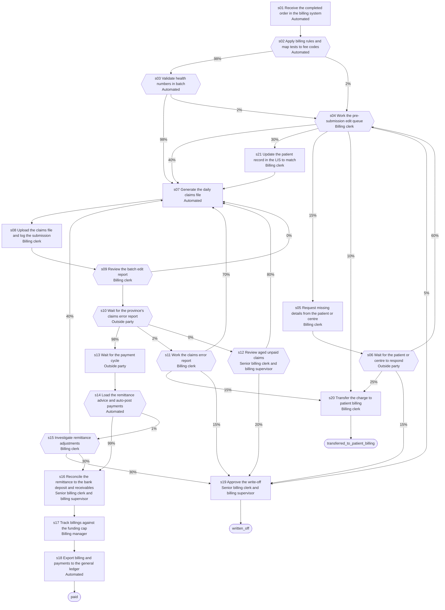

# Bill provincial health plans for community laboratory tests

`dls-fin-provincial-billing` · medical laboratory services · finance and billing · part of `diagnostic-lab-services-co`

Each completed community requisition for an insured patient in Ontario or Manitoba becomes an electronic claim to the provincial health plan, priced per test from the provincial laboratory price list. Most claims pass the billing system's rules and an overnight health number check and are paid in the next payment run without anyone touching them. Billing clerks work the few per cent that fail: invalid health numbers or version codes, missing practitioner numbers, uninsured tests, rejections on the province's error report and adjustments on the remittance. Ontario pays only up to the company's annual funding cap, so the billing manager tracks billings against the cap and finance accrues the difference, and the monthly payment cycle means each correction costs weeks.

| | |
|---|---|
| Unit of work | one billable requisition |
| Starts when | The LIS releases a completed community requisition with insured tests to the billing system. |
| Done when | The claim is paid, reconciled and posted to the ledger, or written off, or moved to patient billing. |
| Organisation | The provincial billing team of a large Canadian community laboratory company with capped Ontario funding and Manitoba provincial billing. (3,300 employees, 2019-2022) |
| Volume | 580,000 cases a month (range 500,000 to 660,000) |

## Where it sits

- Starts with **billable_order** from cl-result-reporting (100% of cases)
- Relies on **funding_agreement** from ex-government-funding-agreement (a standing input; it does not start a case)
- Relies on **payment_remittance** from ontario_moh (a standing input; it does not start a case)
- Relies on **payment_remittance** from manitoba_health (a standing input; it does not start a case)
- Sends **provincial_claim** to ontario_moh (outcome: any)
- Sends **provincial_claim** to manitoba_health (outcome: any)
- Sends **ledger_postings** to fin-month-end-close (outcome: paid)
- Sends **ledger_postings** to fin-month-end-close (outcome: written_off)

## Flow

## Roles

| Role | Department | Layer | FTE on this process | Loaded cost per hour | Evidence |
|---|---|---|---:|---:|---|
| Billing clerk | Billing and revenue cycle | individual contributor | 28 | 33 CAD | C |
| Senior billing clerk and billing supervisor | Billing and revenue cycle | supervisor | 4 | 38 CAD | B [dyn_billclerk] |
| Billing manager | Billing and revenue cycle | manager | 1.5 | 66 CAD | C |

## Steps

Hands-on time and the wait before each step show the most common value. Evidence tier A is a sourced number, B a sourced description, C the author's estimate.

| Step | Who | Kind | Hands-on | Wait before | Control | Evidence |
|---|---|---|---:|---:|---|---|
| **s01 Receive the completed order in the billing system.** When the final report is issued, the LIS interface sends the order to the billing system with test codes, collection date, patient demographics, health number and version code, ordering practitioner number, payer and a link to the scanned requisition. Orders arrive in a nightly batch. | Automated | system auto | 0 min | 8.0 h |  | C |
| **s02 Apply billing rules and map tests to fee codes.** The billing system maps each LIS test to its fee code on the provincial laboratory price list, drops tests that are uninsured or insured only when eligibility criteria are ticked on the requisition (such as vitamin D), checks the test is on the laboratory's licence and flags missing practitioner numbers, duplicates and out-of-province patients. | Automated | system auto | 0 min | 1 min | Ontario Schedule of Benefits for Laboratory Services (community laboratory price list) and OHIP eligibility criteria for restricted tests; Manitoba laboratory tariff | B [oag2017] |
| **s03 Validate health numbers in batch.** Overnight the billing system checks each health number and version code against the province's eligibility service for the date of service; claims with invalid numbers, old version codes or no coverage go to the edit queue. | Automated | system auto | 0 min | 5.0 h | Health Insurance Act (Ontario) and Health Services Insurance Act (Manitoba): only insured persons' insured services may be claimed; a valid health number is mandatory on every claim | B [mb_manual] |
| **s04 Work the pre-submission edit queue.** A billing clerk opens the edited claim beside the scanned requisition and the LIS registration, corrects keying errors in the health number, version code, date of birth or practitioner number, checks coverage online, and decides whether the test is billable to the province, should be charged to the patient or cannot be billed. | Billing clerk | validation | 3 min | 1.0 d | Laboratory and Specimen Collection Centre Licensing Act: tests only on the requisition of an authorized practitioner; billed tests must be supported by a signed requisition (Ministry audit right) | B [oag2017], [dyn_billclerk] |
| **s21 Update the patient record in the LIS to match.** The clerk re-keys the corrected health number, version code or name into the patient's LIS registration so the next requisition and any copy reports carry the right details, and notes the change in the order history. | Billing clerk | data entry | 2 min | 5 min |  | C |
| **s05 Request missing details from the patient or centre.** The clerk sends a letter or phones the patient to ask for a current health card, or emails the collection centre for a clearer requisition copy or the practitioner number, and sets a follow-up date on the claim. | Billing clerk | communication | 8 min | 8.0 h |  | C |
| **s06 Wait for the patient or centre to respond.** The claim sits in a pending status while the patient or centre replies. Patients who never provide valid coverage are billed directly; small amounts are written off. | Outside party | external wait | 0 min | 7.0 d |  | C |
| **s07 Generate the daily claims file.** Each evening the billing system collects all clean and corrected claims into the province's claim file format, one file for OHIP and one for Manitoba Health, with batch control totals. | Automated | system auto | 0 min | 12.0 h |  | B [mb_manual] |
| **s08 Upload the claims file and log the submission.** A billing clerk uploads the file through the province's secure electronic claims transfer service (MC EDT for OHIP, EPiCS for Manitoba) and records the file name, claim count and dollar total in the submission log. Hands-on time is spread across the day's claims. | Billing clerk | data entry | 0.001 min | 2.0 h |  | B [mb_manual] |
| **s09 Review the batch edit report.** The next business day the clerk downloads the province's batch acknowledgement and checks that the accepted claim count and value match the submission log; a rejected batch is rebuilt and resent. | Billing clerk | review | 0.001 min | 1.0 d | Internal control: reconcile submitted and accepted claim counts and totals for each batch | C |
| **s10 Wait for the province's claims error report.** The province adjudicates each claim against eligibility, fee code, licence and duplicate rules and returns an error report listing claims it refused, usually within days of submission. | Outside party | external wait | 0 min | 3.0 d |  | C |
| **s11 Work the claims error report.** The clerk reads the error code for each rejected claim (health number not eligible on the service date, invalid version code, duplicate, test not insured for this laboratory, invalid practitioner), looks up the requisition and coverage, corrects and resubmits, transfers the charge to the patient or proposes a write-off. | Billing clerk | validation | 4 min | 1.0 d | Claim correction and resubmission within the six-month submission limit (Manitoba Regulation 49/93 s. 4(2); Ontario equivalent rule) | B [mb_manual], [dyn_billclerk] |
| **s12 Review aged unpaid claims.** Each week a senior billing clerk runs the receivables aging report, finds claims that were neither paid nor rejected after two payment cycles, checks the submission log and remittances, and resubmits them or proposes a write-off before the six-month limit. | Senior billing clerk and billing supervisor | analysis | 6 min | 30.0 d |  | B [dyn_billclerk], [mb_manual] |
| **s13 Wait for the payment cycle.** Accepted claims wait for the province's payment run: monthly for OHIP and twice monthly for Manitoba Health. Ontario payments are limited by the company's corporate cap, so late in the funding year billed claims are recorded but not paid in full. | Outside party | external wait | 0 min | 21.0 d |  | B [mb_manual], [oag2017], [parent10k2018] |
| **s14 Load the remittance advice and auto-post payments.** The billing system imports the remittance file, matches each paid line to its claim, posts payments and flags lines paid at a different amount, adjusted or refused, with their explanation codes. | Automated | system auto | 0 min | 1.0 h |  | B [mb_manual] |
| **s15 Investigate remittance adjustments.** The clerk reviews each adjusted or refused line, compares it with the claim and the explanation code, and either resubmits a corrected claim, accepts the adjustment or proposes a write-off. | Billing clerk | analysis | 6 min | 3.0 d |  | B [dyn_billclerk], [mb_manual] |
| **s16 Reconcile the remittance to the bank deposit and receivables.** A senior billing clerk ties the remittance total to the deposit on the bank statement and to the receivables movement in the billing system, investigates differences and signs the reconciliation. Hands-on time is spread across all claims on the remittance. | Senior billing clerk and billing supervisor | validation | 0.002 min | 2.0 d | Sarbanes-Oxley section 404 internal control over financial reporting at the US-listed parent: monthly payer remittance to cash and receivables reconciliation | B [dyn_billclerk] |
| **s17 Track billings against the funding cap.** The billing manager updates the cap workbook with the month's billed and paid amounts by payer, projects when the Ontario corporate cap will be reached and estimates the amount billed above it, and sends the figures for the month-end accrual. | Billing manager | analysis | 0.001 min | 1.0 d | Ontario corporate funding cap and transfer payment agreement terms for community laboratory funding | B [oag2017], [healthydebate2015], [parent10k2018] |
| **s18 Export billing and payments to the general ledger.** The billing system produces the month's revenue, receivable, cash and cap adjustment summary and posts it to the ERP general ledger for the month-end close. | Automated | system auto | 0 min | 12.0 h |  | C |
| **s19 Approve the write-off.** A billing supervisor reviews proposed write-offs with the reason and amount, approves them within delegated limits or sends large items to the billing manager, and the system posts the adjustment. | Senior billing clerk and billing supervisor | approval | 2 min | 3.0 d | Write-off authority matrix: the clerk who worked the claim cannot approve its write-off | B [dyn_billclerk] |
| **s20 Transfer the charge to patient billing.** For a test that is not insured for this patient, the clerk changes the payer to the patient, applies the uninsured price and releases the charge to the patient billing queue with a note explaining why. | Billing clerk | data entry | 3 min | 1.0 d |  | B [oag2017] |

## Exceptions

| Exception | Share of cases | What happens |
|---|---:|---|
| Pre-submission edit | 4% | Rule edits or a failed health number check send the claim to a clerk, who corrects it, often re-keys the LIS record, or asks the patient or centre. |
| Missing coverage details | 1% | The clerk writes to the patient or centre; a quarter end up billed to the patient. |
| Rejected on the claims error report | 2% | The province refuses the claim; the clerk corrects and resubmits, adding a payment cycle. |
| Lost claim | 0% | Neither paid nor rejected; found on the aging report and resubmitted before the six-month limit. |
| Remittance adjustment | 1% | Paid at a different amount or refused on the remittance and investigated. |
| Write-off | 0% | Unbillable or past the limit; approved by a supervisor. |
| Transferred to patient billing | 1% | No valid coverage or test outside eligibility criteria; the patient is charged. |

## Benchmarks

| Metric | Value | Unit | Population | Evidence |
|---|---|---|---|---|
| cycle_time_days | p50 35, p90 55 | calendar days from completed order to payment posted and reconciled | Provincial laboratory claims, Ontario and Manitoba, 2019-2022 | C [mb_manual] |
| billings_above_cap | 0.3 | share by which community lab billings exceeded payments, 2011/12 to 2015/16 (over 30 per cent) | Ontario community laboratory sector | A [oag2017] |
| company_ontario_funding | 194700000 | CAD in 2015/16 (30.4 per cent of sector funding) | The modelled company | A [oag2017], [tvo2017] |
| ontario_community_tests | 121000000 | tests in 2015/16 (more than) | Ontario community laboratory sector | A [oag2017] |
| claim_submission_limit | 6 | months from date of service | Manitoba Health claims | A [mb_manual] |
| initial_claim_exception_rate | 0.055 | share of requisitions needing a clerk before payment (pre-submission edits plus error report rejections) | Modelled | C |

## Pain points

- Health number and version errors made at registration surface in billing days later and must be fixed in both the billing system and the LIS. (steps s03, s04, s21; B [mb_manual])
- Each rejection or adjustment costs another payment cycle of two to four weeks. (steps s10, s11, s13, s15; B [mb_manual])
- Ontario pays only up to the corporate cap, so late in the year corrected claims add recorded billings but little cash, and finance has to estimate the cap adjustment every month. (steps s13, s17; A [oag2017], [healthydebate2015])
- Every billed test must be traceable to a signed requisition image for Ministry audits, which the Ministry planned to reinstate under the transfer payment agreements. (steps s04, s11; B [oag2017])
- Lost or unanswered claims are found only on the weekly aging report and chased by hand before the six-month limit. (steps s12; B [dyn_billclerk], [mb_manual])
- Price list and eligibility rule changes (such as the 2017/18 price list) must be built into the billing rule table, and gaps show up as rejections. (steps s02, s11; B [oag2017])

## Assumptions

- One case is one requisition billed as one claim with several test lines; 88 per cent Ontario and 12 per cent Manitoba by the author's estimate from collection centre staffing in the organisation file.
- Ontario claims mechanics (MC EDT upload, batch edit report, claims error report, monthly remittance advice, six-month limit) are described from general knowledge because the Ministry's OHIP technical manuals could not be opened; the Manitoba manual is used as the documented analogue. These steps are tier C or B.
- Under the transfer payment agreements from 2017/18 the company still submits per-test claims, which set its volume and payments within the cap; the exact payment mechanics in 2019-2022 are not public and are simplified to a monthly payment limited by the cap.
- Health cards are checked at registration (cl-psc-registration), so provincial rejection rates here are low (about 1.5 per cent after a 4 per cent pre-submission edit rate); these rates are estimates.
- Daily uploads, batch checks, reconciliations and cap tracking are done once for thousands of claims; their hands-on time is spread across claims as fractions of a minute.
- The funding agreement and remittances are inputs rather than case starts, so they are listed in triggered_by with a share of 0.
- Claims moved to patient billing go to fin-patient-billing, but the organisation file does not list fin-provincial-billing as a source for fin-patient-billing, so that link is not in this workflow's interfaces.
- The 2026 Senior Billing Clerk posting pays CAD 40,000 to 46,000 a year (about CAD 28 to 32 an hour loaded), below the organisation file's cost range for billing supervisors; the organisation file's figures are kept.
- Web search capacity ran out during this workflow, so fewer sources were opened than for the other two.

## Sources

- [oag2017] 2017 Annual Report, Volume 1, Section 3.07: Laboratory Services in the Health Sector (link withheld) (Office of the Auditor General of Ontario, 2017). Community labs paid per test from a Ministry price list largely unchanged since 1999, subject to an industry cap (since 1993/94) and a corporate cap per company (since 1996/97); in 2015/16 community labs performed more than 121 million tests, billed about CAD 868 million and were paid about CAD 606 million under the cap plus CAD 34 million for separately funded tests; providers billed over 30 per cent more than they received from 2011/12 to 2015/16 and keep submitting bills after reaching the cap; the model laboratory received CAD 194.7 million (30.40 per cent); the Ministry stopped auditing that billed tests were supported by signed requisitions in 2013 and planned audit provisions in transfer payment agreements; short-term transfer payment agreements with annually revised caps based on relative volume planned for 2017/18; utilization discount modifier to be discontinued; vitamin D and AST insured only under eligibility criteria, otherwise the patient pays; 1.1 million uninsured community tests in 2015/16.
- [healthydebate2015] [Ontario's private outpatient lab sector needs overhaul, say critics](https://healthydebate.ca/2015/02/topic/private-medical-labs-ontario/) (Healthy Debate (Glauser and Remfry), 2015). Ontario pays seven private companies per test, about CAD 600 million a year; each company's annual maximum is based on its 1996 market share; executives said their companies always exceed their caps; 8 per cent of funding tied to patient access benchmarks.
- [tvo2017] There's a lot we don't know about Ontario's private medical labs (link withheld) (TVO Today (Reid), 2017). The model laboratory received more than 30 per cent (CAD 195.7 million) of 2015-16 community lab funding; fee-for-service from a price list not significantly updated since 1999; the Ministry had not verified that community labs billed OHIP accurately.
- [parent10k2018] The US parent Form 10-K for 2018 (link withheld) (U.S. Securities and Exchange Commission (EDGAR), 2019). Ontario Ministry licenses community laboratories and caps what each can bill the provincial plan; annual maximum for all community tests; rates subject to year-end review and adjustment for actual volume and mix; capitated revenue from the Ontario plan CAD 188.1 million in 2018.
- [mb_manual] [Manitoba Physician's Manual: claims submission and payment procedures](https://www.gov.mb.ca/health/documents/physmanual.pdf) (Manitoba Health, 2026). All fee-for-service claims submitted electronically (EPiCS); the PHIN is mandatory and claims without a correct PHIN are automatically rejected; claims adjudicated continually and paid by EFT twice monthly (mid-month and month end) with two cut-offs a month; remittance advice with Explanation of Benefits codes downloadable from the 3rd business day after cut-off and billing staff must reconcile it; claims more than 6 months after the service date rejected (code C2) under Regulation 49/93 s. 4(2); corrections resubmitted within six months; queries answered within 90 days.
- [dyn_billclerk] Senior Billing Clerk, Winnipeg (job posting 2026-12300) (link withheld) (The model laboratory via Jobvite, 2026). Duties: review, investigate and re-bill outstanding unpaid claims; reconcile non-payments and resubmit; recommend write-offs; generate receivables aging reports; post payments, adjustments and transfers; month-end reconciliation; answer billing calls; requisition entry for private accounts; 2+ years billing experience; CAD 40,000 to 46,000 a year, 37.5 hours a week.

Written by claude-opus on 2026-11-17.
