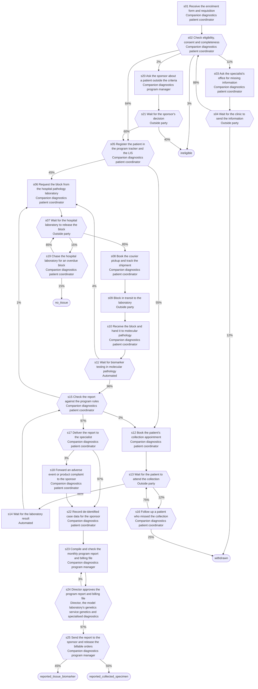

# Run sponsored companion diagnostics programs

`dls-gs-cdx-program` · health care: medical laboratory testing and health services · companion diagnostics programs · part of `diagnostic-lab-services-co`

Drug companies pay the laboratory to test patients for the biomarker or screening result that decides whether a targeted drug or biologic can be prescribed, because public funding for these tests is missing or uneven across provinces. Coordinators enrol each patient a specialist refers, check the program's criteria and consent, then either retrieve the tumour block from a hospital pathology laboratory or book a blood collection, track the specimen through testing, deliver the report to the specialist and record de-identified data for the sponsor's monthly report and invoice. Most of the elapsed time is spent waiting for clinics, hospital laboratories, couriers, patients and the testing laboratory, and every program has its own rules, forms and reports, which coordinators re-key between the LIS, a tracker and the sponsor portal.

| | |
|---|---|
| Unit of work | one enrolled patient |
| Starts when | A specialist's office sends a program enrolment form and requisition for a patient. |
| Done when | The report has been delivered to the specialist, the patient's de-identified data are in the sponsor's monthly report and the test is released for invoicing; or the patient is found ineligible, withdraws or no tissue can be obtained. |
| Organisation | A large Canadian laboratory company running several pharmaceutical-sponsored testing programs from a small coordination team inside its genetics and specialised diagnostics division. (3,300 employees, 2019-2022) |
| Volume | 1,500 cases a month (range 800 to 2,500) |

## Where it sits

- Starts with **cdx_enrolment** from specialist_physician (100% of cases)
- Relies on **cdx_program_contract** from cdx_sponsor (a standing input; it does not start a case)
- Relies on **biomarker_report** from gs-ihc-molecular-pathology (a standing input; it does not start a case)
- Sends **cdx_enrolment** to gs-ihc-molecular-pathology (outcome: reported_tissue_biomarker)
- Sends **biomarker_report** to specialist_physician (outcome: reported_tissue_biomarker)
- Sends **biomarker_report** to specialist_physician (outcome: reported_collected_specimen)
- Sends **program_report** to cdx_sponsor (outcome: reported_tissue_biomarker)
- Sends **program_report** to cdx_sponsor (outcome: reported_collected_specimen)
- Sends **billable_order** to fin-client-invoicing (outcome: reported_tissue_biomarker)
- Sends **billable_order** to fin-client-invoicing (outcome: reported_collected_specimen)

## Flow

## Roles

| Role | Department | Layer | FTE on this process | Loaded cost per hour | Evidence |
|---|---|---|---:|---:|---|
| Companion diagnostics patient coordinator | Companion diagnostics programs | individual contributor | 13 | 34 CAD | B [dyn_cdx] |
| Companion diagnostics program manager | Companion diagnostics programs | senior specialist | 0.8 | 70 CAD | C |
| Director, the model laboratory's genetics service genetics and specialised diagnostics | Genetics and specialised diagnostics (the model laboratory's genetics service) | director | 0.1 | 110 CAD | C |

## Steps

Hands-on time and the wait before each step show the most common value. Evidence tier A is a sourced number, B a sourced description, C the author's estimate.

| Step | Who | Kind | Hands-on | Wait before | Control | Evidence |
|---|---|---|---:|---:|---|---|
| **s01 Receive the enrolment form and requisition.** A coordinator picks up the program enrolment form and requisition that the specialist's office faxed, emailed or entered in the program portal, opens a row for the patient in the program tracker and notes the date received, the program and the referring specialist. | Companion diagnostics patient coordinator | intake | 5 min | 4.0 h |  | B [dyn_cdx] |
| **s02 Check eligibility, consent and completeness.** The coordinator compares the form with the program's eligibility rules (diagnosis, stage, line of therapy, province, test requested), checks that the patient's signed consent is attached and that the clinical details, pathology accession or collection details and physician contact are complete. | Companion diagnostics patient coordinator | validation | 8 min | 1.0 h | Sponsor program contract: eligibility criteria and signed patient consent before testing and data use | C |
| **s03 Ask the specialist's office for missing information.** The coordinator phones or faxes the clinic to request the missing consent page, pathology details, stage or physician signature, and records the request and a follow-up date in the tracker. | Companion diagnostics patient coordinator | communication | 8 min | 2.0 h |  | C |
| **s04 Wait for the clinic to send the information.** The case waits until the specialist's office faxes back the completed form; busy oncology clinics often answer after one or two reminders. | Outside party | external wait | 0 min | 2.0 d |  | C |
| **s05 Register the patient in the program tracker and the LIS.** The coordinator assigns the program identifier and de-identified code, keys the patient, specialist and sponsor client code into the LIS order, and copies the same details into the program tracker and portal, which are separate systems. | Companion diagnostics patient coordinator | data entry | 8 min | 1.0 h | Ontario Personal Health Information Protection Act: sponsor sees only de-identified program codes; identifiable data stay in the laboratory systems | B [dyn_cdx] |
| **s06 Request the block from the hospital pathology laboratory.** The coordinator faxes the hospital's pathology department a block request with the patient's surgical accession number, the program letter and the specialist's authorisation, and sends a prepaid shipping kit with packing instructions. | Companion diagnostics patient coordinator | communication | 12 min | 4.0 h |  | B [fleming2024], [cheung2019] |
| **s07 Wait for the hospital laboratory to release the block.** The hospital laboratory must pull the block from its archive, have a pathologist choose or approve the block, log the release and pack it, which it does around its own work. | Outside party | external wait | 0 min | 3.0 d |  | A [fleming2024], [grafham2024] |
| **s08 Book the courier pickup and track the shipment.** The coordinator books the pickup with the courier, enters the waybill number in the tracker and portal so the sponsor and clinic can see the status, and confirms the pickup time with the hospital laboratory. | Companion diagnostics patient coordinator | coordination | 6 min | 2.0 h |  | B [dyn_cdx] |
| **s09 Block in transit to the laboratory.** The courier collects the block and carries it to the molecular pathology laboratory by ground or overnight service; remote hospitals take longer. | Outside party | external wait | 0 min | 1.0 d |  | C |
| **s10 Receive the block and hand it to molecular pathology.** The coordinator opens the package, matches the block and pathology report to the enrolment, completes the program requisition and walks the block to molecular pathology receiving, then marks the case as in testing in the tracker. | Companion diagnostics patient coordinator | intake | 5 min | 4.0 h |  | C |
| **s11 Wait for biomarker testing in molecular pathology.** The block is in the molecular and cellular pathology laboratory for block selection, staining or mutation testing and pathologist sign-out; the coordinator sees only the pending status until the report posts. | Automated | external wait | 0 min | 5.0 d |  | A [fleming2024], [grafham2024], [bisson2025] |
| **s12 Book the patient's collection appointment.** The coordinator phones the patient, explains the program, books a time at a nearby collection centre or a mobile home visit, and sends the program requisition so the visit can be registered under the sponsor's client code. | Companion diagnostics patient coordinator | coordination | 12 min | 8.0 h |  | B [dyn_cdx] |
| **s13 Wait for the patient to attend the collection.** The patient attends the collection centre or receives the mobile collector on the booked day; some patients are unwell, start treatment elsewhere or forget. | Outside party | external wait | 0 min | 3.0 d |  | B [kheirkhah2016] |
| **s14 Wait for the laboratory result.** The specimen goes through the company's community or reference laboratory testing (for example a TB screening test, drug level or antibody test), and the coordinator waits for the result to appear in the LIS. | Automated | external wait | 0 min | 3.0 d |  | C |
| **s16 Follow up a patient who missed the collection.** The coordinator calls the patient, finds out why the visit was missed, rebooks the collection or a home visit, and tells the specialist's office if the patient no longer wants to take part. | Companion diagnostics patient coordinator | communication | 10 min | 1.0 d |  | B [dyn_cdx] |
| **s15 Check the report against the program rules.** The coordinator opens the released report, checks the patient, specimen and test against the enrolment, confirms the assay the program requires was used and every ordered component is reported, and flags insufficient or rejected specimens. | Companion diagnostics patient coordinator | validation | 5 min | 4.0 h | Program contract: the specified validated assay is used for the drug-disease purpose (CAP-ACP guideline GS02) | B [cheung2019] |
| **s17 Deliver the report to the specialist.** The coordinator faxes or posts the report to the specialist through the program route, confirms receipt by phone for urgent oncology cases, and records the delivery date in the tracker. | Companion diagnostics patient coordinator | communication | 5 min | 1.0 h |  | B [fleming2024] |
| **s18 Forward an adverse event or product complaint to the sponsor.** When a patient or clinic mentions a side effect, a pregnancy or a problem with the drug during any contact, the coordinator completes the sponsor's adverse event form and sends it to the sponsor's safety mailbox within one business day, and files the acknowledgement. | Companion diagnostics patient coordinator | communication | 15 min | 2.0 h | Food and Drug Regulations C.01.017: the sponsor must report serious adverse drug reactions within 15 days; the program contract requires forwarding within one business day | A [fdr_c01017] |
| **s19 Chase the hospital laboratory for an overdue block.** The coordinator calls the hospital pathology office, finds out whether the block is out on loan, exhausted or waiting for pathologist approval, and agrees a new date or asks the specialist to choose another specimen. | Companion diagnostics patient coordinator | communication | 10 min | 8.0 h |  | C |
| **s20 Ask the sponsor about a patient outside the criteria.** The program manager writes to the sponsor's program lead with the de-identified clinical details of a patient who narrowly misses the criteria and asks whether the program will fund the test as an exception. | Companion diagnostics program manager | communication | 15 min | 8.0 h | Sponsor program contract: tests outside the eligibility criteria need written sponsor approval | C |
| **s21 Wait for the sponsor's decision.** The sponsor's medical or program lead reviews the request and replies by email; the case stays on hold in the tracker until then. | Outside party | external wait | 0 min | 3.0 d |  | C |
| **s22 Record de-identified case data for the sponsor.** The coordinator enters the program code, region, test, result category, dates and turnaround into the program tracker that feeds the sponsor report, leaving out name, health card and date of birth. | Companion diagnostics patient coordinator | data entry | 5 min | 4.0 h |  | B [dyn_cdx] |
| **s23 Compile and check the monthly program report and billing file.** At month end the program manager pulls the month's cases from the tracker, reconciles them with LIS orders billed to the sponsor's client code, checks the report for identifiers and small counts that could identify a patient, and prepares the billing file of completed tests. | Companion diagnostics program manager | review | 2 min | 15.0 d | Ontario Personal Health Information Protection Act: no identifying information in reports to the sponsor | C |
| **s24 Director approves the program report and billing file.** The director reviews the month's program report, the volume against the sponsor's budget and the billing file, and approves them or sends questions back to the program manager. | Director, the model laboratory's genetics service genetics and specialised diagnostics | approval | 0.5 min | 2.0 d | Delegation of authority: director approval of sponsor reports and client billing | C |
| **s25 Send the report to the sponsor and release the billable orders.** The program manager uploads or emails the approved report to the sponsor and releases the billing file to client invoicing, which raises the sponsor's monthly invoice. | Companion diagnostics program manager | communication | 0.5 min | 4.0 h |  | B [dyn_cdx] |

## Exceptions

| Exception | Share of cases | What happens |
|---|---:|---|
| Incomplete enrolment form | 11% | Consent, stage or pathology details are missing; the coordinator queries the clinic and waits, and about one in eight such patients never completes enrolment. |
| Overdue block at the hospital | 7% | The hospital laboratory does not release the block by the expected date because it is on loan, exhausted or awaiting pathologist approval; the coordinator chases and sometimes no tissue is available. |
| Missed collection appointment | 7% | The patient misses the booked collection; the coordinator calls and rebooks, and a quarter withdraw. |
| Too little tumour in the block | 2% | Molecular pathology reports too little tumour and the coordinator requests another block from the hospital, restarting retrieval. |
| Out-of-criteria exception | 2% | A patient narrowly outside the criteria is referred to the sponsor for a funding exception, which takes several days. |
| Adverse event mentioned | 3% | A side effect or product problem mentioned during a contact is forwarded to the sponsor's safety mailbox within one business day. |

## Benchmarks

| Metric | Value | Unit | Population | Evidence |
|---|---|---|---|---|
| cycle_time_days | p50 30, p90 48 | calendar days from enrolment form received to the case being in an approved sponsor report and billing file | All enrolled patients, tissue and collected-specimen programs | C |
| time_to_report_tissue_days | p50 32.5, iqr_low 23, iqr_high 42 | calendar days from histopathology to biomarker report in the hospital record | Ontario hospital patients whose biomarkers were tested at an off-site reference laboratory | A [fleming2024] |
| pre_laboratory_interval_days | p50 5, iqr_low 3, iqr_high 8.75 | calendar days from histopathology to tissue arrival at the reference laboratory | Same Ontario cohort | A [fleming2024] |
| sponsor_adverse_reaction_reporting_limit | 15 | days | Drug manufacturers selling in Canada | A [fdr_c01017] |
| outpatient_no_show_rate | 0.188 | share of appointments | Ten outpatient clinics at a US veterans hospital | A [kheirkhah2016] |

## Pain points

- Retrieving blocks from hospital pathology laboratories depends on their staff and archive, needs repeated phone chases and is the largest source of delay before testing. (steps s06, s07, s19; A [fleming2024], [grafham2024])
- Each program has its own forms, criteria and reports, and coordinators re-key the same patient into the LIS, a tracker and the sponsor portal. (steps s02, s05, s22; B [dyn_cdx])
- Reports travel to specialists by fax and are scanned into hospital records days later, so results are often not in hand at the first oncology visit. (steps s17; A [fleming2024], [grafham2024])
- Programs exist because public funding for biomarker tests differs by province and is not standardised; when a province starts funding a test, a program can close and its patients move to the public route at short notice. (steps s02, s20; B [cda2025])
- Month-end batching of sponsor reports and billing delays revenue and makes the per-patient cycle look long even when testing is quick. (steps s23, s24; C)

## Assumptions

- About 45% of enrolled patients need a tissue biomarker test on an existing block and 55% need a collected specimen (for example TB screening before a biologic, a drug level or an antibody test). This gives about 675 program cases a month to molecular pathology, which matches that process's 17% program share.
- The sponsor contract and the biomarker report returned by molecular pathology are listed as inputs, not case triggers, because neither starts a new patient case. The organisation file lists both under triggered_by.
- The organisation file's process map also has this process sending new test requests to test validation. Those arise when a sponsor launches a new program, not for each patient, so they are left out of this per-patient workflow.
- Results of collected specimens come from the company's community or reference laboratory testing; the organisation file's process map does not link those processes to this one, so the wait is modelled inside this workflow.
- The case ends when the patient is included in an approved monthly sponsor report and billing file, so the median cycle includes on average about two weeks of month-end batching. Time from enrolment to the specialist receiving the report is about two weeks in the simulation.
- Waiting for the company's own testing laboratories is modelled as a system wait, not an external party, because the laboratory is internal.
- Loaded costs come from the organisation file (hourly wage times 1.35).

## Sources

- [dyn_cdx] Companion and complementary diagnostics programs (link withheld) (The model laboratory, undated). Program services for pharmaceutical clients: laboratory testing including companion diagnostics, IHC, biomarkers, antibody testing for biologics, therapeutic drug monitoring and TB screening; appointment management at collection sites or in-home collection by mobile health professionals; a dedicated specialty support team that follows up with patients; a dedicated client care team per program; a client portal to view requests, track shipping and specimen status and build reports; tailored sponsor reporting.
- [fleming2024] [Biomarker turnaround times and impact on treatment decisions in patients with advanced non-small cell lung carcinoma at a large Canadian community hospital with an affiliated regional cancer centre (Fleming KE et al., Current Oncology 31(3):1515-1528)](https://www.ebi.ac.uk/europepmc/webservices/rest/PMC10969576/fullTextXML) (Europe PMC (full text of PMC10969576), 2024). Hospital to off-site reference laboratory: histopathology to tissue arrival median 5 days (IQR 3 to 8.75); lab receipt to IHC report median 12 days; total to report in the hospital record median 32.5 days; reports scanned into the record 2 to 3 days after release; 17% of patients needed another biopsy; tissue preparation, bar-coding, packaging and ground transport described.
- [grafham2024] [Referred molecular testing as a barrier to optimal treatment decision making in metastatic non-small cell lung cancer: experience at a tertiary academic institution in Canada (Grafham GK et al., Cancer Medicine 13(3):e6886)](https://www.ebi.ac.uk/europepmc/webservices/rest/PMC10905241/fullTextXML) (Europe PMC (full text of PMC10905241), 2024). Send-out testing: request to lab receipt median 3 working days; lab receipt to report median 8 working days; results available at first oncology consult for 52% of send-out patients versus 88% in-house; insufficient samples 11.9% send-out.
- [cda2025] [Environmental scan of genetic and genomic biomarker testing assessment frameworks, processes, and inventories in cancer care (Canadian Journal of Health Technologies 5(3))](https://canjhealthtechnol.ca/index.php/cjht/article/view/CP0037) (Canada's Drug Agency (CDA-AMC), 2025). Funding approaches for biomarker tests vary across Canadian jurisdictions; some draw distinctions between companion diagnostic testing and other biomarker testing; approaches are not standardised, which creates inequities in timely access.
- [fdr_c01017] [Food and Drug Regulations, C.R.C., c. 870, section C.01.017 (serious adverse drug reaction reporting by manufacturers)](https://laws-lois.justice.gc.ca/eng/regulations/C.R.C.,_c._870/section-C.01.017.html) (Government of Canada, Justice Laws Website, current). A manufacturer must report serious adverse drug reactions that occur in Canada to the Minister within 15 days after receiving or becoming aware of the information.
- [cheung2019] [Fit-for-purpose PD-L1 biomarker testing for patient selection in immuno-oncology: guidelines for clinical laboratories from the Canadian Association of Pathologists (Cheung CC et al., Appl Immunohistochem Mol Morphol 27(10):699-714)](https://www.ebi.ac.uk/europepmc/webservices/rest/PMC6887625/fullTextXML) (Europe PMC (full text of PMC6887625), 2019). Kits must be used for the drug-disease purpose they were validated for (GS02); using a kit for another purpose makes it a laboratory-developed test (GS03); the most representative block should be tested (GS09).
- [kheirkhah2016] [Prevalence, predictors and economic consequences of no-shows (Kheirkhah P et al., BMC Health Services Research 16:13)](https://www.ebi.ac.uk/europepmc/webservices/rest/PMC4714455/fullTextXML) (Europe PMC (full text of PMC4714455), 2016). Mean outpatient no-show rate 18.8% across 10 clinics (range 12.6% to 25.7%); reminder letters did not change the rate and a centralised phone reminder system reduced it only modestly.
- [bisson2025] [Novel approach to proficiency testing reveals significant variations in biomarker practice leading to critical differences in lung cancer management (Bisson KR et al., JTO Clinical and Research Reports 6(7):100837)](https://www.ebi.ac.uk/europepmc/webservices/rest/PMC12192570/fullTextXML) (Europe PMC (full text of PMC12192570), 2025). Receipt-to-report turnaround in 13 Canadian laboratories ranged from 5 to 57 calendar days (median 22.5); every laboratory but one exceeded its self-reported turnaround.

Written by claude-opus on 2026-11-17.
