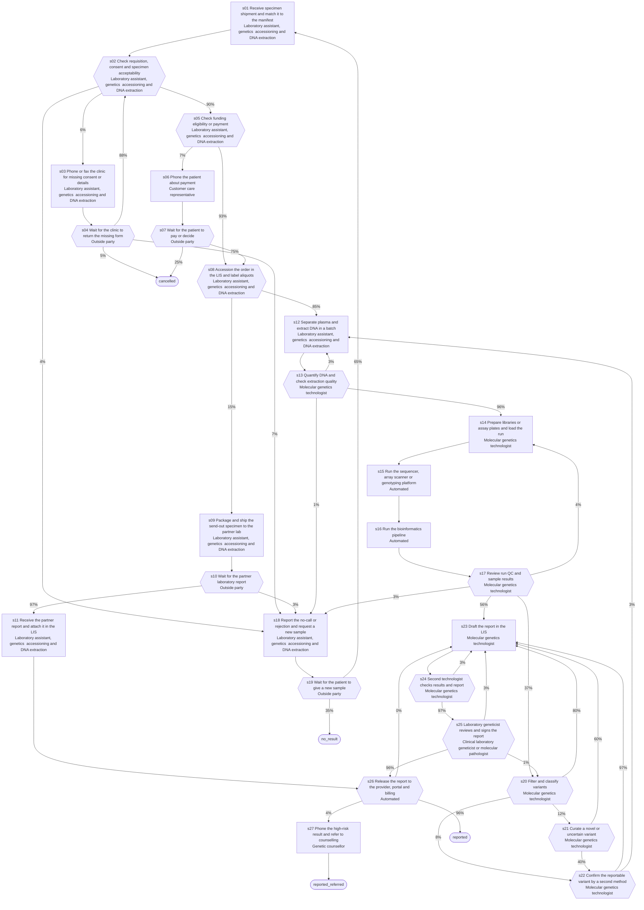

# Perform genetic and specialised tests (prenatal screening, carrier, pharmacogenomic and hereditary tests)

`dls-gs-genetic-testing` · medical laboratory services · genetics laboratory · part of `diagnostic-lab-services-co`

This process turns a genetic test order and its blood or saliva sample into a signed report for the ordering provider. Laboratory assistants check consent, funding or payment and the specimen, then technologists extract DNA, run sequencing, array or genotyping batches and review the results; panels need variant classification under the ACMG and AMP rules, and a certified laboratory geneticist signs every report. Most of the elapsed time is waiting for batches to fill and for sign-out, and incomplete consent forms, unpaid private orders, no-call prenatal screens that need a new blood draw and novel variants slow individual cases.

| | |
|---|---|
| Unit of work | one genetic test order |
| Starts when | A specimen with a genetic test requisition reaches the genetics laboratory from a collection centre, clinic or online purchase. |
| Done when | A signed report is delivered to the ordering provider (and to the patient portal where applicable), with high-risk results phoned and referred to counselling; or the order is cancelled or closed with no result. |
| Organisation | The genetics laboratories (Brampton and Laval) of a large Canadian community laboratory company, offering NIPT, carrier screening, pharmacogenomics, hereditary and somatic tests, some sent to partner laboratories. (3,300 employees, 2019-2022) |
| Volume | 6,000 cases a month (range 4,000 to 8,000) |

## Where it sits

- Starts with **specimen_shipment** from lg-interlab-transfer (55% of cases)
- Starts with **genetic_test_order** from ordering_physician (35% of cases)
- Starts with **consumer_order** from cd-self-pay-order (10% of cases)
- Sends **genetic_report** to ordering_physician (outcome: reported)
- Sends **genetic_report** to ordering_physician (outcome: reported_referred)
- Sends **genetic_report** to gs-genetic-counselling (outcome: reported_referred)
- Sends **patient_invoice** to fin-patient-billing (outcome: reported)

## Flow

## Roles

| Role | Department | Layer | FTE on this process | Loaded cost per hour | Evidence |
|---|---|---|---:|---:|---|
| Laboratory assistant, genetics (accessioning and DNA extraction) | Genetics laboratories | individual contributor | 9 | 30 CAD | C |
| Molecular genetics technologist | Genetics laboratories | individual contributor | 28 | 53 CAD | B [jobbank_32120] |
| Clinical laboratory geneticist or molecular pathologist | Genetics laboratories | senior specialist | 3 | 140 CAD | C |
| Manager, genetics and molecular laboratory | Genetics laboratories | manager | 0.6 | 78 CAD | C |
| Genetic counsellor | Genetic counselling and pharmacogenomics consults | senior specialist | 0.6 | 65 CAD | C |
| Customer care representative | Customer care contact centre | individual contributor | 0.5 | 29 CAD | C |

## Steps

Hands-on time and the wait before each step show the most common value. Evidence tier A is a sourced number, B a sourced description, C the author's estimate.

| Step | Who | Kind | Hands-on | Wait before | Control | Evidence |
|---|---|---|---:|---:|---|---|
| **s01 Receive specimen shipment and match it to the manifest.** A genetics laboratory assistant opens the inbound tote from the line haul or courier, checks the temperature indicator, counts tubes against the shipping manifest and scans each requisition barcode so the order shows as received in the LIS. Paper requisitions and consent or eligibility forms are scanned to the imaging system. | Laboratory assistant, genetics (accessioning and DNA extraction) | intake | 2 min | 18.0 h |  | B [dyn_prenatal], [fibke_cclm] |
| **s02 Check requisition, consent and specimen acceptability.** The assistant compares two patient identifiers on the tube with the requisition, checks that the provider signed the requisition and the patient signed the consent section, and checks gestational age for prenatal tests. The assistant also checks tube type, fill volume, haemolysis and days since collection against the specimen acceptance criteria. | Laboratory assistant, genetics (accessioning and DNA extraction) | validation | 3 min | 3.0 h | ISO 15189 and CAP specimen acceptance criteria; signed patient consent required on the genetics requisition by laboratory policy | B [dyn_harmony], [dyn_licences] |
| **s03 Phone or fax the clinic for missing consent or details.** The assistant puts the specimen on hold in the LIS, phones the ordering clinic and faxes a request for the missing consent page, provider signature, gestational age or provincial eligibility form, and logs the call in the order notes. If the patient bought the test online, the assistant emails the patient through the portal message tool. | Laboratory assistant, genetics (accessioning and DNA extraction) | communication | 10 min | 4.0 h |  | C |
| **s04 Wait for the clinic to return the missing form.** The specimen waits in the hold rack while the clinic or patient finds and faxes or uploads the missing page. The cfDNA tube keeps for only about a week, so if nothing arrives the specimen expires and a new sample is needed. | Outside party | external wait | 0 min | 1.0 d |  | C |
| **s05 Check funding eligibility or payment.** The assistant decides who pays. For a provincially funded prenatal screen, the assistant checks the eligibility form against the province's criteria (for Ontario, a positive first-tier screen, age 40 or over, twins, nuchal translucency of 3.5 mm or more, or another listed risk). For private-pay tests the assistant confirms an online or centre payment in the billing system, and for sponsored tests the sponsor code. | Laboratory assistant, genetics (accessioning and DNA extraction) | validation | 2 min | 2.0 h | Provincial funding criteria for publicly funded NIPT (Ontario Ministry of Health program, and the British Columbia, Manitoba and Newfoundland and Labrador programs) | B [huang2020], [dyn_prenatal], [dynplus_harmony] |
| **s06 Phone the patient about payment.** A customer care representative on the genetics line phones the patient, explains that the test is not covered or the payment did not go through, quotes the private price and takes a card payment or a decision to cancel. The call and outcome are logged against the order. | Customer care representative | communication | 10 min | 12.0 h |  | C |
| **s07 Wait for the patient to pay or decide.** The order sits on payment hold while the patient decides whether to pay out of pocket or calls back after a missed call. Patients who decline are offered other funded screening through their provider. | Outside party | external wait | 0 min | 2.0 d |  | C |
| **s08 Accession the order in the LIS and label aliquots.** The assistant keys or confirms the test codes, patient demographics, gestational details and payer in the genetics module of the LIS, re-keying from the paper requisition where the order did not come electronically. The assistant prints barcode labels for plasma or DNA aliquots and routes the order to the in-house bench or to a partner laboratory. | Laboratory assistant, genetics (accessioning and DNA extraction) | data entry | 4 min | 2.0 h |  | B [dyn_genetics] |
| **s09 Package and ship the send-out specimen to the partner lab.** The assistant enters the order again in the partner laboratory's web portal, prints its requisition, packs the tube to dangerous goods rules with a cold pack where required and books the courier for the daily pickup. The tracking number is recorded on the LIS order. | Laboratory assistant, genetics (accessioning and DNA extraction) | physical | 12 min | 8.0 h | Transportation of Dangerous Goods Regulations and IATA rules for UN3373 biological substances | C |
| **s10 Wait for the partner laboratory report.** The specimen travels to the partner laboratory, which runs the test and posts a report to its portal. Turnaround depends on the test: about one to two weeks for prenatal screens and two to three weeks for multi-gene panels. | Outside party | external wait | 0 min | 9.0 d |  | C |
| **s11 Receive the partner report and attach it in the LIS.** The assistant downloads the partner's PDF report, checks the identifiers against the LIS order, attaches the PDF and enters a summary result so the report can be released through the usual channels. | Laboratory assistant, genetics (accessioning and DNA extraction) | data entry | 6 min | 6.0 h |  | C |
| **s12 Separate plasma and extract DNA in a batch.** The assistant centrifuges cfDNA tubes twice to separate plasma, or loads whole blood or saliva onto the automated extractor, in a batch of 24 to 96 samples, scanning each tube into the batch worklist so identity is tracked. Extracts are stored in barcoded plates. | Laboratory assistant, genetics (accessioning and DNA extraction) | physical | 3 min | 12.0 h | CCMG NGS guideline and CAP molecular checklist: sample identity maintained through the testing process | B [ccmg2019] |
| **s13 Quantify DNA and check extraction quality.** A molecular technologist reads DNA or cfDNA concentration from the fluorometer export, compares it with the assay minimum and flags low yields. Low samples are re-extracted from the backup tube or sent for a new sample. | Molecular genetics technologist | validation | 1 min | 6.0 h |  | C |
| **s14 Prepare libraries or assay plates and load the run.** The technologist sets up the library preparation, array or genotyping plate on a liquid handler with controls, records reagent lots, and loads the sequencer or scanner once a batch is full. Prenatal screens run several times a week; arrays and panels wait for a weekly batch. | Molecular genetics technologist | physical | 4 min | 2.0 d |  | C |
| **s15 Run the sequencer, array scanner or genotyping platform.** The instrument runs unattended, generating sequence reads, array intensities or genotype calls for the whole batch, and writes run metrics to the run folder. | Automated | system auto | 0 min | 1.0 h |  | C |
| **s16 Run the bioinformatics pipeline.** The pipeline aligns reads, calls variants or computes trisomy risk scores and fetal fraction, annotates variants against population and disease databases and posts results to the analysis software. The wait before this step covers the instrument run time. | Automated | system auto | 0 min | 1.0 d |  | C |
| **s17 Review run QC and sample results.** The technologist checks the run against acceptance criteria (controls, coverage, call rate, fetal fraction) and reviews each sample's calls or risk result. Samples below thresholds are repeated or reported as no-call, and simple genotype and prenatal results go straight to the report. | Molecular genetics technologist | analysis | 2 min | 6.0 h | ISO 15189 and CAP: run and sample acceptance against validated QC criteria before results are reported | B [huang2020], [dyn_prenatal], [ccmg2019] |
| **s18 Report the no-call or rejection and request a new sample.** The assistant enters a no-result or rejected-specimen comment so the provider receives an interim report, phones or faxes the provider to ask for a new collection, and for online buyers messages the patient. The original order stays open, linked to the new collection. | Laboratory assistant, genetics (accessioning and DNA extraction) | communication | 12 min | 4.0 h |  | B [dyn_prenatal] |
| **s19 Wait for the patient to give a new sample.** The patient has to return to a collection centre for a new draw, usually within one to two weeks. Some patients decline, pass the gestational window or are referred straight to diagnostic testing and counselling instead. | Outside party | external wait | 0 min | 5.0 d |  | B [huang2020] |
| **s20 Filter and classify variants.** For panels and carrier screens the technologist filters the annotated variant list, looks up each candidate in population databases, ClinVar, the laboratory's own variant database and the literature, and applies the ACMG and AMP criteria to propose a five-tier classification. Variants already classified in the laboratory database are carried forward. | Molecular genetics technologist | analysis | 20 min | 1.0 d | ACMG/AMP 2015 variant classification standards, endorsed by the CCMG | B [richards2015], [ccmg2019] |
| **s21 Curate a novel or uncertain variant.** A senior technologist searches the literature and databases in depth for a variant not seen before, scores each ACMG criterion with its evidence, writes the classification rationale for the internal database and discusses close calls with the geneticist. | Molecular genetics technologist | judgment | 1.5 h | 2.0 d |  | A [mlo2016], [richards2015] |
| **s22 Confirm the reportable variant by a second method.** The technologist confirms each pathogenic or likely pathogenic variant with Sanger sequencing, MLPA or a repeat extraction, which waits for the weekly confirmation batch. Discordant results go back for re-extraction. | Molecular genetics technologist | physical | 25 min | 3.0 d | ACMG/AMP recommendation of orthogonal confirmation for pathogenic and likely pathogenic variants; laboratory validation policy | B [richards2015], [ccmg2019] |
| **s23 Draft the report in the LIS.** The technologist builds the report from the template: result, classification, interpretation, recommendations such as genetic counselling or diagnostic testing, methods and limitations. For prenatal and pharmacogenomic tests the software fills most fields and the technologist checks them. | Molecular genetics technologist | drafting | 4 min | 6.0 h |  | B [richards2015] |
| **s24 Second technologist checks results and report.** A second technologist compares the draft against the instrument output, the requisition and the patient identifiers, checks gestational age and sex, and initials the check in the LIS before it reaches the geneticist's queue. | Molecular genetics technologist | review | 2 min | 4.0 h | Laboratory procedure: independent second check of manually entered genetic results before sign-out | C |
| **s25 Laboratory geneticist reviews and signs the report.** A certified laboratory geneticist or molecular pathologist reviews the data, classification and wording, edits the interpretation if needed and electronically signs. Normal prenatal and pharmacogenomic reports are signed in batches; panels with findings take longer. | Clinical laboratory geneticist or molecular pathologist | approval | 1.5 min | 1.0 d | ACMG/AMP and CCMG: final interpretation and reporting by an appropriately certified clinical laboratory geneticist (FCCMG or ABMGG) or molecular pathologist | B [richards2015], [ccmg2019] |
| **s26 Release the report to the provider, portal and billing.** The LIS sends the signed report to the provider's EMR over HL7, to eResults or by fax, queues it for the consumer health service where the patient has an account, and posts the charge to the billing system for private-pay tests. | Automated | system auto | 0 min | 5 min |  | B [dyn_prenatal] |
| **s27 Phone the high-risk result and refer to counselling.** A genetic counsellor phones the ordering provider about a high-risk prenatal screen or pathogenic finding, explains the next steps such as diagnostic testing, records the call and books or offers a counselling session for the patient. | Genetic counsellor | communication | 25 min | 2.0 h | Laboratory policy for direct notification of high-risk prenatal and pathogenic hereditary results | B [huang2020], [dyn_harmony] |

## Exceptions

| Exception | Share of cases | What happens |
|---|---:|---|
| Missing consent, signature or eligibility form | 6% | The specimen is held while the clinic is phoned and faxed; a few expire and need a new sample. |
| Specimen rejected | 4% | Unlabelled, wrong tube, too old or haemolysed; an interim report asks for a new collection. |
| Prenatal screen no-call | 2% | Fetal fraction or coverage too low; the patient is asked for a new draw, which adds one to two weeks. |
| Private-pay order not paid | 7% | The patient is phoned for payment; a quarter decline and the order is cancelled. |
| Send-out to a partner laboratory | 15% | Tests not done in-house are re-entered in the partner's portal, shipped and the returned PDF attached. |
| Novel variant curation | 4% | A variant not in the internal database needs full ACMG curation and possibly confirmation. |
| Corrected report after release | 0% | An error found after release leads to a redrafted, re-signed corrected report. |
| High-risk result call | 4% | A genetic counsellor phones the provider and offers counselling. |

## Benchmarks

| Metric | Value | Unit | Population | Evidence |
|---|---|---|---|---|
| cycle_time_days | p50 11, p90 21 | calendar days from specimen collection to report release | Canadian genetics laboratory test mix, 2019-2022 | B [dyn_prenatal], [dynplus_harmony], [huang2020] |
| nipt_no_call_rate_first_sample | 0.033 | share of first samples | Sequencing-based cfDNA screening, Ontario cost model | A [huang2020] |
| nipt_no_call_rate_second_sample | 0.012 | share of repeat samples | Sequencing-based cfDNA screening, Ontario cost model | A [huang2020] |
| nipt_turnaround_business_days | low 7, high 10 | business days after reception of the sample | Harmony and MaterniT at the model laboratory | A [dyn_prenatal] |
| private_pay_price_harmony | 495 | CAD per test | The consumer health service online shop | A [dynplus_harmony] |
| variant_interpretation_time | novel_variant_min 30, reported_variant_min 120 | minutes per variant | Clinical NGS laboratories (vendor estimate) | A [mlo2016] |

## Pain points

- Missing consent pages, provider signatures and provincial eligibility forms put specimens on hold close to the cfDNA tube stability limit. (steps s02, s03, s04; B [dyn_harmony], [dyn_prenatal])
- Batch cadence for library preparation and sequencing adds two to four days before any analysis starts. (steps s12, s14, s16; C)
- A prenatal no-call needs a new draw, adding one to two weeks at a time-sensitive point in pregnancy. (steps s17, s18, s19; B [huang2020], [dyn_prenatal])
- Orders are keyed more than once: paper requisitions into the LIS and send-outs again into partner portals. (steps s08, s09, s11; C)
- Novel variant curation and geneticist sign-out are scarce expert time and form queues. (steps s21, s25; B [mlo2016], [richards2015])

## Assumptions

- The test mix (prenatal 45 per cent, pharmacogenomic 15, carrier and haemoglobin gene 15, other in-house 10, send-outs 15) is the author's estimate; the company publishes the menu but not volumes.
- Harmony is assumed to be run in-house; MaterniT and Invitae panels are assumed to be sent to partner laboratories in the United States.
- The process starts when the specimen arrives at the genetics laboratory, but the first step's wait includes transit from collection, so the cycle time is measured from collection.
- Instrument run time is placed in the wait before the pipeline step because system steps carry no hands-on time.
- Patient portal publication is part of cd-portal-results and the patient charge is collected in fin-patient-billing; here they are only queued.
- The genetic counsellor and customer care representative take part in this process but are not in the organisation file's process_map role list for gs-genetic-testing; they are taken from the organisation file's roles.
- Volume follows the organisation file's driver of 6,000 orders a month, which is an estimate; with 40 molecular technologists in the organisation file the staffing is consistent with roughly 45 to 60 minutes of hands-on time per order across the mix.
- Shares for missing forms, rejections, payment follow-ups, repeats and high-risk results are tier C estimates.

## Sources

- [huang2020] Prenatal screening for trisomy 21: a comparative performance and cost analysis of different screening strategies (link withheld) (BMC Pregnancy and Childbirth (Huang, Gibbons, Rashid, Priston, Bedford, Mak-Tam, Meschino), 2020). Ontario model: publicly funded cfDNA screening available since 2014 for a subset of pregnancies (positive first-tier screen, age 40 or over, NT of 3.5 mm or more, other risk factors); funded cfDNA providers in Ontario are the model laboratory and LifeLabs; sequencing-based cfDNA turnaround assumed 10 business days from receipt; no-call rate 3.3 per cent on the first sample and 1.2 per cent on the second; cfDNA test modelled at CAD 400, genetic counselling CAD 250; women with a high-risk or repeat no-call result receive counselling.
- [richards2015] [Standards and guidelines for the interpretation of sequence variants: a joint consensus recommendation of the ACMG and AMP](https://pmc.ncbi.nlm.nih.gov/articles/PMC4544753/) (Genetics in Medicine (Richards et al.), 2015). Five-tier classification (pathogenic, likely pathogenic, uncertain significance, likely benign, benign); results interpreted by a board-certified clinical molecular geneticist or molecular genetic pathologist or equivalent; evidence from population, disease and locus databases, literature and computational predictions; orthogonal confirmation recommended for pathogenic and likely pathogenic sequence variants; required report elements; laboratories should have reanalysis policies.
- [ccmg2019] [CCMG practice guideline: laboratory guidelines for next-generation sequencing](https://www.ebi.ac.uk/europepmc/webservices/rest/PMC6929709/fullTextXML) (Journal of Medical Genetics, Canadian College of Medical Geneticists (Hume et al.), 2019). Canadian laboratories shall use published variant classification guidelines (ACMG/AMP endorsed by CCMG); sample identity must be maintained throughout the NGS process; regions failing quality metrics are tested by an alternate method; professionals with final interpretation and reporting responsibility shall have appropriate credentials; laboratories may confirm variants orthogonally; reanalysis requires a request from the referring provider; VCF files kept at least 2 years.
- [dyn_genetics] Genetics (link withheld) (The model laboratory, undated). Genetic menu: non-invasive prenatal testing (Harmony and MaterniT), carrier screening, pharmacogenomic tests (OptimalRx Plus), genetic counselling, hemoglobinopathy screening, Invitae comprehensive genetic testing, somatic tumour profiling, HHT, paternity and relationship testing.
- [dyn_prenatal] Prenatal solutions (link withheld) (The model laboratory, undated). Harmony, MaterniT 21 PLUS and MaterniT GENOME results available within 7 to 10 business days after reception of the sample; about 3 per cent of Harmony cases give no result and a re-draw may be considered; Harmony funded high-risk programs in British Columbia, Manitoba, Newfoundland and Labrador and Ontario each with its own requisition and eligibility form; requisition completed by a provider or bought online and signed by a provider; collection at the model laboratory centres or partner sites; results to the ordering provider and viewable on the consumer health service; counselling by phone on request.
- [dyn_harmony] Harmony prenatal test (link withheld) (The model laboratory, undated). Patient must read and sign the patient consent section of the requisition; collection at centres in Ontario, Quebec or Manitoba; available from 10 weeks; results in the consumer health service 10 to 14 days after collection and sent to the provider; genetic counselling included.
- [dynplus_harmony] Harmony non-invasive prenatal test (online shop) (link withheld) (The consumer health service, undated). Private-pay price CAD 495 paid online; an approved requisition signed by the patient's doctor is required to collect and analyse the sample; allow 10 to 14 business days for the result to appear in the consumer health service; free genetic counselling included.
- [mlo2016] [Soaring demand for genetic testing highlights need for streamlined data interpretation](https://www.mlo-online.com/molecular/genomics/article/13008612/soaring-demand-for-genetic-testing-highlights-need-for-streamlined-data-interpretation) (Medical Laboratory Observer (Hadjisavas, QIAGEN), 2016). Variant interpretation takes about 30 minutes for each novel variant, a couple of hours for variants reported in the literature, and many days for the most complicated cases. Author is from an interpretation software vendor.
- [jobbank_32120] [Wages: Medical Technologist - Medical Laboratory in Ontario (NOC 32120)](https://www.jobbank.gc.ca/marketreport/wages-occupation/4203/ON) (Job Bank, Government of Canada, 2025). Ontario hourly wages low 23.00, median 42.00, high 50.00 (2023-2024); Toronto region median 40.50.
- [fibke_cclm] [Effect of preexamination conditions in a centralized-testing model of non-invasive prenatal screening](https://bcgsc.ca/publications/effect-preexamination-conditions-centralized-testing-model-non-invasive-prenatal) (Clinical Chemistry and Laboratory Medicine (Fibke et al.), abstract on BC Genome Sciences Centre site, 2021). 3,568 maternal blood samples collected across Canada and shipped to central laboratories; cfDNA quantity rose with blood shipment time in EDTA tubes, much less in Streck tubes; fetal fraction lower with higher maternal BMI.
- [dyn_licences] Licences and quality commitment (link withheld) (The model laboratory, undated). Brampton laboratory holds Accreditation Canada ISO 15189, Ontario licence and CAP accreditation; Impact Genetics holds CAP, CLIA and New York State certificates; Laval genetics and specialty testing holds ISO 15189; quality system includes specimen acceptability protocols, QC software, CAPA, change control, EQA and competency assessment.

Written by claude-opus on 2026-11-17.
