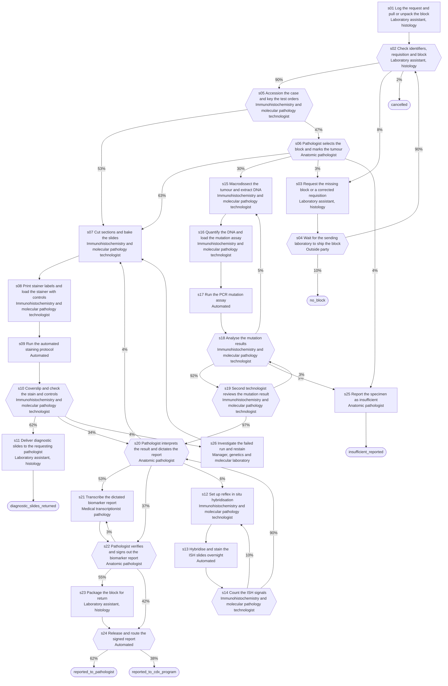

# Run IHC and molecular tests on tissue

`dls-gs-ihc-molecular-pathology` · health care: medical laboratory testing and health services · molecular and cellular pathology · part of `diagnostic-lab-services-co`

This process takes a request for immunohistochemistry (IHC), in situ hybridisation or a mutation test on a paraffin tissue block and returns stained slides or a signed biomarker report. About half the requests are diagnostic panels that the company's own pathologists order at sign-out; the rest are predictive markers and mutation tests for hospital referrals and sponsored drug programs, which need a pathologist to select the block and score or interpret the result. Technologists cut, label and load slides onto automated stainers or run PCR assays, and every slide is checked against its control. Most of the elapsed time is batching, overnight runs and waiting for pathologists, and missing blocks, too little tumour, failed controls and equivocal HER2 scores add days.

| | |
|---|---|
| Unit of work | one tissue biomarker case |
| Starts when | A pathologist orders IHC at sign-out, a hospital referral or inter-site shipment arrives with a block, or a sponsored program sends an enrolled patient's block. |
| Done when | Stained diagnostic slides are with the requesting pathologist, or a signed biomarker or insufficient-specimen report has been released to the pathologist or the program; or the request is cancelled because no block can be obtained. |
| Organisation | A large Canadian community and reference laboratory company with a specialised molecular and cellular pathology laboratory serving its own pathologists, more than 500 hospitals and sponsored companion diagnostic programs. (3,300 employees, 2019-2022) |
| Volume | 4,000 cases a month (range 3,000 to 5,500) |

## Where it sits

- Starts with **ihc_request** from cl-pathology-signout (53% of cases)
- Starts with **accessioned_specimen** from hs-referral-intake (20% of cases)
- Starts with **cdx_enrolment** from gs-cdx-program (17% of cases)
- Starts with **specimen_shipment** from lg-interlab-transfer (10% of cases)
- Sends **biomarker_report** to cl-pathology-signout (outcome: diagnostic_slides_returned)
- Sends **biomarker_report** to cl-pathology-signout (outcome: reported_to_pathologist)
- Sends **biomarker_report** to cl-pathology-signout (outcome: insufficient_reported)
- Sends **biomarker_report** to gs-cdx-program (outcome: reported_to_cdx_program)

## Flow

## Roles

| Role | Department | Layer | FTE on this process | Loaded cost per hour | Evidence |
|---|---|---|---:|---:|---|
| Immunohistochemistry and molecular pathology technologist | Molecular and cellular pathology | individual contributor | 15 | 53 CAD | B [dyn_molpath], [jobbank_32120] |
| Anatomic pathologist | Histology and anatomic pathology | senior specialist | 6 | 230 CAD | C |
| Laboratory assistant, histology | Histology and anatomic pathology | individual contributor | 4 | 30 CAD | C |
| Medical transcriptionist (pathology) | Histology and anatomic pathology | individual contributor | 0.8 | 32 CAD | C |
| Manager, genetics and molecular laboratory | Genetics laboratories | manager | 0.3 | 78 CAD | C |

## Steps

Hands-on time and the wait before each step show the most common value. Evidence tier A is a sourced number, B a sourced description, C the author's estimate.

| Step | Who | Kind | Hands-on | Wait before | Control | Evidence |
|---|---|---|---:|---:|---|---|
| **s01 Log the request and pull or unpack the block.** A laboratory assistant prints the day's IHC and molecular requests from the AP system work list or opens the referral and program shipments, scans the tracking label, and pulls the named block from the histology archive or takes it out of the shipping box. The block and paperwork go into a labelled tray for checking. | Laboratory assistant, histology | intake | 2 min | 2.0 h |  | B [bisson2025], [fleming2024] |
| **s02 Check identifiers, requisition and block.** The assistant compares the patient name, second identifier, specimen number and block number on the block with the request or referral requisition, checks that the requested test and ordering pathologist or program are named, and for breast specimens that the fixation time is recorded. Mismatches, missing blocks or missing forms are set aside. | Laboratory assistant, histology | validation | 1.5 min | 15 min | ISO 15189 and Accreditation Canada Diagnostics specimen identification requirements (two identifiers checked before testing) | C |
| **s03 Request the missing block or a corrected requisition.** The assistant phones or faxes the originating hospital laboratory, the other company laboratory or the program coordinator to ask for the right block, an extra block with more tumour, or a corrected requisition, and records the request and promised ship date in the AP system notes. | Laboratory assistant, histology | communication | 10 min | 4.0 h |  | B [fleming2024], [grafham2024] |
| **s04 Wait for the sending laboratory to ship the block.** The originating laboratory must find the block in its archive, decide whether it can release it, log it out and courier it, so the case waits in a pending list. The assistant follows up when the block does not arrive by the promised date. | Outside party | external wait | 0 min | 3.0 d |  | A [grafham2024], [fleming2024] |
| **s05 Accession the case and key the test orders.** A technologist opens the case in the AP system, creates the molecular pathology accession or adds the stains to the existing surgical case, and keys the requested markers or mutation tests from the referral requisition or program form. Referral and program cases need the patient and ordering physician re-keyed from paper. | Immunohistochemistry and molecular pathology technologist | data entry | 3 min | 1.0 h |  | C |
| **s06 Pathologist selects the block and marks the tumour.** A pathologist reviews the H&E slide of each available block under the microscope, chooses the block with the most viable tumour, circles the tumour area for macrodissection and estimates the percentage of tumour cells against the assay minimum. Cases with too little tumour are sent back for another block or reported as insufficient. | Anatomic pathologist | judgment | 5 min | 1.0 d | Assay instructions set the minimum tumour cells (CAP-ACP PD-L1 guideline GS10); tumour content assessment by a pathologist before molecular testing | A [fleming2024], [cheung2019] |
| **s07 Cut sections and bake the slides.** At the microtome the technologist faces the block, cuts thin sections for each marker plus spares, floats them onto charged slides next to the control tissue and bakes the rack. About 2.4 stains are cut per case, more for lymphoma or unknown-primary panels. | Immunohistochemistry and molecular pathology technologist | physical | 8 min | 8.0 h |  | B [newell_leica] |
| **s08 Print stainer labels and load the stainer with controls.** The technologist enters the accession number, block and stain into the stainer controller, which is not interfaced to the AP system, prints the bar-code labels, sticks them on the slides and loads them with the run controls into open drawers of the automated stainer. | Immunohistochemistry and molecular pathology technologist | data entry | 3 min | 30 min |  | B [newell_leica], [roche_bmk] |
| **s09 Run the automated staining protocol.** The stainer deparaffinises, retrieves antigen, applies the primary antibody, detection kit and counterstain at controlled temperatures with nobody working on the case. Late loads run overnight and wait in the instrument until morning. | Automated | system auto | 0 min | 4.0 h |  | C |
| **s10 Coverslip and check the stain and controls.** The technologist rinses and coverslips the slides, checks each case slide and its on-slide control under the microscope for the expected positive and negative staining, background and section quality, and records the QC result. Slides that fail are restained before release. | Immunohistochemistry and molecular pathology technologist | validation | 3 min | 1.0 h | CAP-ACP PD-L1 guideline GS31 and GS35: external on-slide controls on every slide, slides failed when controls are unacceptable; ISO 15189 examination quality | A [cheung2019] |
| **s11 Deliver diagnostic slides to the requesting pathologist.** The assistant sorts the released slides by case, matches them to the surgical case folder and walks the tray to the requesting pathologist's office at the next slide delivery round. The pathologist reads them as part of the diagnosis in the sign-out process. | Laboratory assistant, histology | physical | 1 min | 1.0 h |  | B [ucdavis_tat] |
| **s12 Set up reflex in situ hybridisation.** For a HER2 result scored as equivocal the pathologist's reflex order brings the block back to the bench: the technologist cuts new sections, pretreats them and applies the dual-probe HER2 and chromosome 17 probes with controls. | Immunohistochemistry and molecular pathology technologist | physical | 25 min | 1.0 d |  | C |
| **s13 Hybridise and stain the ISH slides overnight.** The ISH slides denature and hybridise in the instrument or hybridiser overnight and are washed and counterstained the next morning, with no one working on the case during the run. | Automated | system auto | 0 min | 16.0 h |  | C |
| **s14 Count the ISH signals.** The technologist scores the HER2 and chromosome 17 signals in at least 20 tumour nuclei in the area the pathologist marked, calculates the ratio and average copy number, and records the counts for the pathologist; failed hybridisation is repeated. | Immunohistochemistry and molecular pathology technologist | analysis | 20 min | 8.0 h |  | C |
| **s15 Macrodissect the tumour and extract DNA.** Using the pathologist's circled H&E as a guide, the technologist cuts unstained sections, scrapes the tumour area into a tube, digests it and extracts DNA in the next batch run, labelling each tube with the accession number. | Immunohistochemistry and molecular pathology technologist | physical | 25 min | 1.0 d |  | B [dyn_molpath], [grafham2024] |
| **s16 Quantify the DNA and load the mutation assay.** The technologist measures DNA concentration and quality, dilutes it, sets up the PCR plate or cartridge for the requested mutations with positive and negative controls, enters the plate map and starts the run. | Immunohistochemistry and molecular pathology technologist | physical | 10 min | 8.0 h |  | C |
| **s17 Run the PCR mutation assay.** The real-time PCR instrument or cartridge system amplifies and detects the mutation targets with no one attending, and the software writes the run file with amplification curves and calls. | Automated | system auto | 0 min | 2.5 h |  | C |
| **s18 Analyse the mutation results.** The technologist checks the run controls and each sample's internal control, reviews the amplification curves against the assay cut-offs, records detected or not detected for each target and flags low-input or invalid samples for repeat. | Immunohistochemistry and molecular pathology technologist | analysis | 10 min | 8.0 h |  | C |
| **s19 Second technologist reviews the mutation result.** A second technologist reopens the run file, checks the plate map against the accession numbers, confirms the calls and the controls, and initials the worksheet before the case goes to the pathologist. | Immunohistochemistry and molecular pathology technologist | review | 5 min | 8.0 h | Laboratory procedure: independent second review of molecular results before reporting | C |
| **s20 Pathologist interprets the result and dictates the report.** The pathologist scores the predictive marker (for example PD-L1 tumour proportion score, HER2, mismatch repair or ALK) on the stained slide, or reviews the mutation result with the tumour content, and dictates or enters a synoptic report naming the assay, clone, cut-off and result. Equivocal HER2 goes to ISH and poor or missing stains are sent back. | Anatomic pathologist | judgment | 10 min | 1.0 d | CAP-ACP PD-L1 guideline GS29 (readout validated for each reporting pathologist) and GS18 and GS19 (synoptic report naming assay, cut-off and result) | B [cheung2019], [bisson2025] |
| **s21 Transcribe the dictated biomarker report.** A medical transcriptionist plays back the dictation, types it into the biomarker report template in the AP system, checks the patient and case numbers and returns the draft to the pathologist's sign-out queue. | Medical transcriptionist (pathology) | drafting | 5 min | 8.0 h |  | C |
| **s22 Pathologist verifies and signs out the biomarker report.** The pathologist opens the draft from the sign-out queue, checks the result against the slide or result sheet and the patient details, corrects any typing errors and signs the report electronically. | Anatomic pathologist | approval | 3 min | 12.0 h | Ontario Laboratory and Specimen Collection Centre Licensing Act and accreditation standards: reports authorised by a licensed physician | B [ag2017] |
| **s23 Package the block for return.** The assistant logs the block out in the AP system, wraps it with a copy of the report or return slip and books the courier back to the originating hospital or program pathology laboratory. This runs alongside report release. | Laboratory assistant, histology | physical | 5 min | 0 min | Originating laboratory keeps custody of its blocks under record retention rules; loaned blocks are returned | C |
| **s24 Release and route the signed report.** The AP system releases the signed report: internal and hospital referral cases go to the pathologist's case and onward through the reporting interfaces, and program cases are posted to the program's portal queue for the coordinator. | Automated | system auto | 0 min | 10 min |  | C |
| **s25 Report the specimen as insufficient.** When no block has enough tumour or the DNA fails after a repeat, the pathologist signs a short report saying the test could not be done and why, and the requester is told that a new biopsy or another block is needed. | Anatomic pathologist | drafting | 6 min | 1.0 d | CAP-ACP PD-L1 guideline GS20: an inadequate specimen is reported with the reason | A [fleming2024], [cheung2019] |
| **s26 Investigate the failed run and restain.** The laboratory manager reviews the failed control slides with the technologist, checks reagent lots, instrument logs and protocol settings, logs a nonconformance in the quality system and approves the restain of the affected cases. | Manager, genetics and molecular laboratory | review | 15 min | 4.0 h | ISO 15189 control of nonconforming work: failed QC investigated and documented before patient slides are released | B [cheung2019] |

## Exceptions

| Exception | Share of cases | What happens |
|---|---:|---|
| Block not on hand or wrong block | 10% | The block is missing, has too little tumour or the requisition is incomplete, so the laboratory asks the originating laboratory and waits several days; about one in ten such requests ends without a block. |
| Control failure and restain | 4% | The on-slide control shows no signal or heavy background, the manager investigates and logs a nonconformance, and the cases are cut and stained again the next day. |
| Equivocal HER2 needing reflex ISH | 3% | An equivocal HER2 IHC score triggers dual-probe in situ hybridisation with an overnight run and signal counting before the pathologist can report. |
| Insufficient tumour or DNA | 4% | No block has enough tumour for the assay or the extracted DNA fails after a repeat, so an insufficient-specimen report is issued and a new biopsy may be needed. |
| Repeat mutation run | 1% | An invalid run or low DNA yield sends the case back to extraction and the next PCR batch. |

## Benchmarks

| Metric | Value | Unit | Population | Evidence |
|---|---|---|---|---|
| cycle_time_days | p50 2, p90 10 | calendar days from request receipt to slides delivered or report released | All cases of this process: about half diagnostic panels, the rest predictive IHC and mutation tests | C |
| referral_biomarker_lab_turnaround_working_days | p50 8, iqr_low 7, iqr_high 11 | working days from lab receipt to biomarker report | Lung cancer send-out testing (EGFR, ALK, PD-L1) at a central Canadian reference laboratory, 2019 to 2021 | A [grafham2024] |
| share_within_10_working_days | 0.744 | share of send-out cases | Same send-out cohort; the CAP/IASLC/AMP target is 10 working days from receipt to report | A [grafham2024] |
| ihc_partial_report_turnaround_days | p50 12, iqr_low 7, iqr_high 14 | calendar days from lab receipt to ALK and PD-L1 IHC report | Ontario community hospital patients tested at an off-site reference laboratory | A [fleming2024] |
| insufficient_tissue_rate | low 0.073, high 0.119 | share of cases | Canadian lung cancer biomarker testing (ALK 7.3%, PD-L1 8.1%, EGFR 11.4%; send-out 11.9%) | A [fleming2024], [grafham2024] |
| ihc_stains_per_case | 2.4 | stains | One US histology laboratory | A [newell_leica] |
| proficiency_challenge_turnaround_days | p50 22.5, low 5, high 57 | calendar days from receipt to all reports | 13 Canadian laboratories in a timed end-to-end lung biomarker challenge | A [bisson2025] |

## Pain points

- Blocks held by other laboratories take days to arrive, and the case sits in a pending list with manual follow-up. (steps s03, s04; A [fleming2024], [grafham2024])
- Predictive cases wait twice for a pathologist, once to select the block and once to score and sign, and dictated reports add a transcription queue. (steps s06, s20, s21, s22; C)
- Stainer labels are re-keyed because the stainers are not interfaced to the AP system, which costs technologist time and adds labelling risk. (steps s08; A [newell_leica])
- IHC and mutation tests are often run one after the other and reported separately, so the treating physician waits for the last result. (steps s06, s15, s20; A [fleming2024], [bisson2025])
- Failed controls or poor sections force a full recut and restain the next day. (steps s10, s26; B [cheung2019])

## Assumptions

- The case mix is set at 53% diagnostic panels ordered by the company's pathologists at sign-out, 30% predictive IHC (PD-L1, HER2, ER and PR, mismatch repair, ALK) and 14% mutation tests (KRAS, EGFR, BRAF), with the rest lost to cancellation or missing blocks. The organisation file does not give a split.
- The simulation is memoryless, so after the stain check the share going to the requesting pathologist versus to biomarker scoring is set to the expected mix of diagnostic and predictive cases (64% and 36%).
- Diagnostic panels end when the slides reach the requesting pathologist; interpretation is part of the pathology sign-out process. Hospital referral biomarker reports are also handed to the pathology sign-out and reporting processes, because the organisation file's process map routes biomarker reports only to sign-out and to the program process.
- Next-generation sequencing panels on tissue are not modelled here; the organisation file places sequencing in the genetics laboratory.
- The organisation file has no laboratory assistant in the molecular pathology unit; histology laboratory assistants are used for logging, block handling and slide delivery, and medical transcriptionists from histology for dictated reports.
- Failed-run nonconformances are logged in the quality system; the organisation file's process map does not list this process as a source for nonconformance management, so no interface is added.
- Loaded costs come from the organisation file (hourly wage times 1.35). Microscope work at the bench or on a pathologist's desk is counted as specimen work with a low desk_work_share, and instrument run time with nobody working is modelled as waiting.
- The simulated median (about 3.3 days) is above the author's blended benchmark of 2 days but within the accepted range: diagnostic panels finish in one to three calendar days once weekends are counted, while predictive and mutation cases take 5 to 12 days, consistent with the 8 working day and 12 calendar day referral laboratory figures.

## Sources

- [bisson2025] [Novel approach to proficiency testing reveals significant variations in biomarker practice leading to critical differences in lung cancer management (Bisson KR et al., JTO Clinical and Research Reports 6(7):100837)](https://www.ebi.ac.uk/europepmc/webservices/rest/PMC12192570/fullTextXML) (Europe PMC (full text of PMC12192570), 2025). Canadian Pathology Quality Assurance timed end-to-end biomarker challenge in 13 Canadian laboratories: receipt-to-report turnaround 5 to 57 calendar days (median 22.5, IQR 18.75 to 34.5); delivery to accessioning 0 to 12 days (median 1); 31% of labs issued separate IHC and molecular reports; PD-L1 concordance 100%, genotyping 97%; one missed EGFR exon 20 insertion.
- [grafham2024] [Referred molecular testing as a barrier to optimal treatment decision making in metastatic non-small cell lung cancer: experience at a tertiary academic institution in Canada (Grafham GK et al., Cancer Medicine 13(3):e6886)](https://www.ebi.ac.uk/europepmc/webservices/rest/PMC10905241/fullTextXML) (Europe PMC (full text of PMC10905241), 2024). Send-out to a central reference laboratory (EGFR qPCR, ALK and PD-L1 22C3 IHC), 2019 to 2021: request to lab receipt median 3 working days, lab receipt to report median 8 working days (IQR 7 to 11), 74.4% within 10 working days; in-house 3 working days; insufficient samples 11.9% send-out, 6.9% in-house; CAP/IASLC/AMP target of 10 working days from receipt to report.
- [fleming2024] [Biomarker turnaround times and impact on treatment decisions in patients with advanced non-small cell lung carcinoma at a large Canadian community hospital with an affiliated regional cancer centre (Fleming KE et al., Current Oncology 31(3):1515-1528)](https://www.ebi.ac.uk/europepmc/webservices/rest/PMC10969576/fullTextXML) (Europe PMC (full text of PMC10969576), 2024). Ontario hospital sending all biomarker tests reflexively to an off-site reference laboratory: histopathology to arrival median 5 days; lab receipt to IHC partial report (ALK, PD-L1) median 12 calendar days (IQR 7 to 14); lab receipt to final report 21 days; IHC then NGS carried out sequentially at two labs; insufficient tissue EGFR 11.4%, PD-L1 8.1%, ALK 7.3%; 17% of patients needed another biopsy; Ontario target 14 calendar days.
- [cheung2019] [Fit-for-purpose PD-L1 biomarker testing for patient selection in immuno-oncology: guidelines for clinical laboratories from the Canadian Association of Pathologists (Cheung CC et al., Appl Immunohistochem Mol Morphol 27(10):699-714)](https://www.ebi.ac.uk/europepmc/webservices/rest/PMC6887625/fullTextXML) (Europe PMC (full text of PMC6887625), 2019). External on-slide controls must be run for every slide (GS31); slides are checked by microscopy before release and failed if controls show background or no signal (GS35); readout accuracy validated for each reporting pathologist (GS29); minimum tumour cells set by each assay's interpretive manual (GS10); synoptic reporting (GS18); proficiency testing at least every six months (GS36).
- [newell_leica] [Eliminating rework through utilization of interfacing automated staining platforms (David Newell)](https://www.leicabiosystems.com/knowledge-pathway/eliminating-rework-through-utilization-of-interfacing-automated-staining-platforms/) (Leica Biosystems Knowledge Pathway, 2022). Average 2.4 IHC stains per case; with a non-interfaced LIS the histotechnologist re-keys accession number, block id, patient name and stain into the stainer controller and label preparation takes 3.8 times longer than with an interfaced LIS; manual entry adds risk of error.
- [ucdavis_tat] [Specimen turnaround time (surgical pathology)](https://health.ucdavis.edu/pathology/services/clinical/anatomic_pathology/surgical_pathology/clinical_services/turnaround_time.html) (UC Davis Health, Department of Pathology and Laboratory Medicine, undated). Turnaround counted in working days from accessioning: routine biopsies two to three days; immunohistochemistry or other special stains add one to two days.
- [roche_bmk] [BenchMark ULTRA IHC/ISH system (product page)](https://diagnostics.roche.com/us/en/products/instruments/benchmark-ultra.html) (Roche Diagnostics, undated). Automated IHC and ISH stainer with 30 independent slide drawers, continuous access so slides can be added without disrupting runs in progress, 35 reagent positions and per-slide time and temperature protocols.
- [dyn_molpath] Molecular and cellular pathology (link withheld) (The model laboratory, undated). The company's molecular and cellular pathology service offers immunohistochemistry, in situ hybridization (FISH, CISH), KRAS and other mutation testing by gel-based and real-time PCR, and array CGH in support of its pathology and genetics centres.
- [ag2017] 2017 Annual Report, Section 3.07: Laboratory Services in the Health Sector (link withheld) (Office of the Auditor General of Ontario, 2017). All licensed Ontario laboratories must take part in the Institute for Quality Management in Healthcare quality management program (accreditation against ISO 15189 based standards and proficiency testing); the model laboratory is one of the three largest community laboratories.
- [jobbank_32120] [Wages: Medical Technologist - Medical Laboratory in Ontario (NOC 32120)](https://www.jobbank.gc.ca/marketreport/wages-occupation/4203/ON) (Government of Canada Job Bank, 2025). Ontario hourly wages low $23.00, median $42.00, high $50.00 (2023-2024); Toronto region median $40.50.

Written by claude-opus on 2026-11-17.
