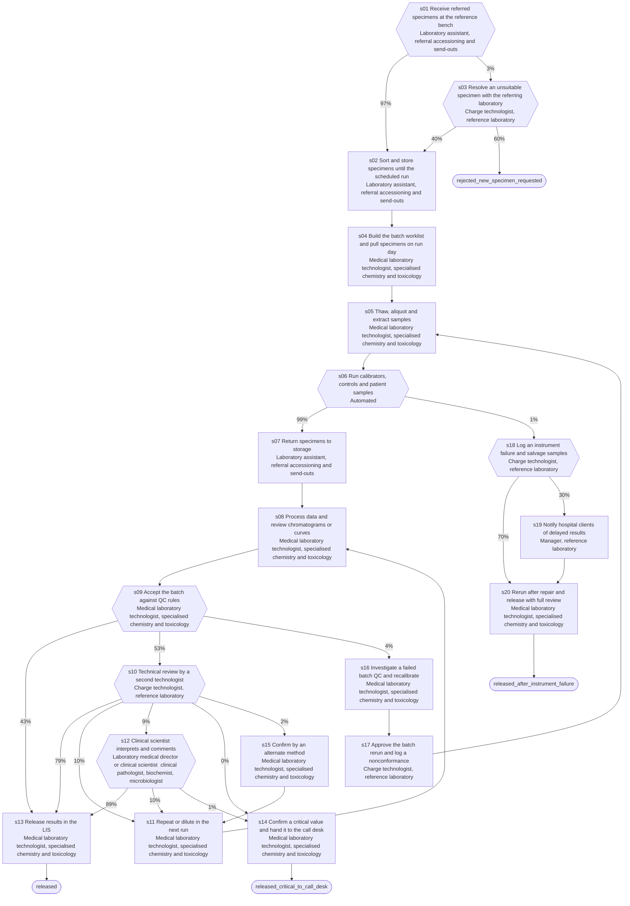

# Perform specialised reference tests

`dls-hs-reference-testing` · medical laboratory services · reference laboratory operations · part of `diagnostic-lab-services-co`

Hospital laboratories and the company's own community laboratories refer specialised chemistry, endocrinology, therapeutic drug and toxicology tests to the reference laboratory. Technologists hold the specimens until each assay's scheduled batch, prepare and extract them by hand for mass spectrometry and chromatography or load them on specialised immunoassay analysers, review the data and QC, and release results after a second technologist's review and, for interpretive tests, a clinical scientist's comment. Turnaround is set mainly by the batch schedule, overnight instrument runs and review queues; low-volume assays need careful QC and a failed batch costs a whole rerun.

| | |
|---|---|
| Unit of work | one reference requisition |
| Starts when | An accessioned referral specimen from hospital referral intake, or a specimen shipped from another company laboratory, arrives at the reference bench. |
| Done when | All reference tests on the requisition are released (with interpretive comments where needed) to hospital result delivery, a critical value is handed to the call desk, or the specimen is rejected and a new one requested. |
| Organisation | The reference laboratory of a large Canadian community laboratory company, serving more than 500 hospitals with specialised chemistry, endocrinology and toxicology testing. (3,300 employees, 2019-2022) |
| Volume | 60,000 cases a month (range 45,000 to 80,000) |

## Where it sits

- Starts with **accessioned_specimen** from hs-referral-intake (70% of cases)
- Starts with **specimen_shipment** from lg-interlab-transfer (30% of cases)
- Sends **test_result** to hs-result-delivery (outcome: any)
- Sends **critical_result** to cs-critical-result-notification (outcome: released_critical_to_call_desk)
- Sends **maintenance_request** to fac-instrument-maintenance (outcome: released_after_instrument_failure)

## Flow

## Roles

| Role | Department | Layer | FTE on this process | Loaded cost per hour | Evidence |
|---|---|---|---:|---:|---|
| Medical laboratory technologist, specialised chemistry and toxicology | Reference laboratory | individual contributor | 55 | 53 CAD | A [f_jobbank_mlt] |
| Laboratory assistant, referral accessioning and send-outs | Reference laboratory | individual contributor | 10 | 30 CAD | C |
| Charge technologist, reference laboratory | Reference laboratory | supervisor | 5 | 58 CAD | C |
| Manager, reference laboratory | Reference laboratory | manager | 0.5 | 72 CAD | C |
| Laboratory medical director or clinical scientist (clinical pathologist, biochemist, microbiologist) | Community laboratory testing (The model laboratory Laboratories) | senior specialist | 1.5 | 230 CAD | B [f_hospital] |

## Steps

Hands-on time and the wait before each step show the most common value. Evidence tier A is a sourced number, B a sourced description, C the author's estimate.

| Step | Who | Kind | Hands-on | Wait before | Control | Evidence |
|---|---|---|---:|---:|---|---|
| **s01 Receive referred specimens at the reference bench.** A laboratory assistant takes accessioned referral specimens from intake or the inter-laboratory shipment, checks storage temperature on arrival (frozen, refrigerated or ambient), tube type and volume against the test's requirements, and matches each to the bench pending list. | Laboratory assistant, referral accessioning and send-outs | physical | 0.4 min | 1.0 h | ISO 15189 sample acceptance criteria (documented requirements for sample type, volume and transport temperature) | B [f_arup_vitd] |
| **s02 Sort and store specimens until the scheduled run.** The assistant files each specimen in the freezer or refrigerator rack for its assay and run day, so that daily assays reach the bench the same day and weekly or twice-weekly assays wait for their batch. | Laboratory assistant, referral accessioning and send-outs | physical | 0.3 min | 15 min |  | C |
| **s03 Resolve an unsuitable specimen with the referring laboratory.** The charge technologist decides whether the specimen can be tested with a disclaimer or must be rejected, records the reason in the LIS and asks hospital client services to tell the referring laboratory and request a new specimen. | Charge technologist, reference laboratory | judgment | 6 min | 2.0 h | ISO 15189 sample rejection and acceptance with disclaimer | C |
| **s04 Build the batch worklist and pull specimens on run day.** On the assay's scheduled day the technologist prints the batch worklist from the LIS pending list, decides the run order with calibrators and controls, and pulls the specimens from storage; specimens arriving after the cut-off wait for the next batch. | Medical laboratory technologist, specialised chemistry and toxicology | coordination | 0.4 min | 1.0 d |  | B [f_arup_testo], [f_arup_vitd] |
| **s05 Thaw, aliquot and extract samples.** The technologist thaws and mixes the specimens, pipettes aliquots, and for mass spectrometry and chromatography assays adds internal standard and performs protein precipitation or solid-phase extraction before loading the plate; immunoassay samples are loaded directly with calibrators and controls. | Medical laboratory technologist, specialised chemistry and toxicology | physical | 2.5 min | 30 min | Validated examination procedure (ISO 15189 examination processes); calibration and QC run with each batch | B [f_arup_testo], [f_csmls] |
| **s06 Run calibrators, controls and patient samples.** The instrument runs the batch, often overnight for mass spectrometry; nobody works on the samples during the run, which takes from under an hour for an immunoassay rack to many hours for a full LC-MS/MS plate. | Automated | system auto | 0 min | 4.0 h |  | C |
| **s07 Return specimens to storage.** The assistant returns primary tubes and remaining aliquots to the dated freezer or refrigerator racks so they can be found for repeats, add-ons and the retention period. | Laboratory assistant, referral accessioning and send-outs | physical | 0.2 min | 30 min | ISO 15189 post-examination storage and retention of samples | C |
| **s08 Process data and review chromatograms or curves.** The technologist opens the run in the instrument software, checks the calibration curve, internal standard recovery, ion ratios and retention times, corrects peak integration where needed, and transfers the results to the LIS through the middleware. | Medical laboratory technologist, specialised chemistry and toxicology | analysis | 1.2 min | 2.0 h |  | B [f_krasowski] |
| **s09 Accept the batch against QC rules.** The technologist checks the controls in the QC software against the multirule limits and the peer data and accepts or rejects the run; for low-volume assays with few QC points the decision leans on bracketing controls and recent calibration history. | Medical laboratory technologist, specialised chemistry and toxicology | validation | 0.5 min | 10 min | Westgard multirule QC and ISO 15189 quality control of examination results; results reported only from accepted runs | B [f_westgard], [f_csmls], [f_ag2017], [f_acd] |
| **s10 Technical review by a second technologist.** The charge technologist or a senior technologist reviews the results against the worklist, previous results for the patient, measuring range and plausibility (for example drug level against dose timing), and approves them or sends them for a repeat, a dilution, an alternate method or a clinical scientist. | Charge technologist, reference laboratory | review | 1 min | 4.0 h | Laboratory procedure: second-person review of manual and mass spectrometry results | C |
| **s11 Repeat or dilute in the next run.** The technologist retrieves the stored specimen, prepares a dilution or repeat extraction and adds it to the next scheduled batch; the result comes back through data review. | Medical laboratory technologist, specialised chemistry and toxicology | physical | 4 min | 1.0 d |  | C |
| **s12 Clinical scientist interprets and comments.** The clinical biochemist or medical director reviews the result with the clinical details on the referral, writes an interpretive comment (for example on an electrophoresis pattern, an endocrine profile or a toxicology finding), and may recommend further tests or phone the referring laboratory. | Laboratory medical director or clinical scientist (clinical pathologist, biochemist, microbiologist) | judgment | 6 min | 12.0 h | ISO 15189 interpretation of results by qualified personnel; laboratory director responsibility | B [f_hospital] |
| **s13 Release results in the LIS.** The technologist releases the approved results with any comments under their own login, which sends them to hospital result delivery or community reporting. | Medical laboratory technologist, specialised chemistry and toxicology | approval | 0.5 min | 30 min | Medical Laboratory Technology Act, 1991 scope of practice: results evaluated and released by a registered MLT | B [f_cmlto_law] |
| **s14 Confirm a critical value and hand it to the call desk.** For a result beyond a critical limit (for example a toxic lithium, digoxin or acetaminophen level), the technologist checks the specimen and dose timing, releases the result and puts it on the critical call list with the referring laboratory's contact so it is phoned at once. | Medical laboratory technologist, specialised chemistry and toxicology | communication | 4 min | 10 min | OAML Guideline for Reporting Laboratory Test Results Level I drug and toxicology limits; ISO 15189 critical intervals | A [f_oaml], [f_cv2006] |
| **s15 Confirm by an alternate method.** When an immunoassay result is implausible (suspected heterophile antibody, cross-reacting drug or metabolite), the technologist arranges a blocking-reagent treatment, dilution linearity study or a mass spectrometry confirmation in the next run. | Medical laboratory technologist, specialised chemistry and toxicology | analysis | 10 min | 4.0 h |  | C |
| **s16 Investigate a failed batch QC and recalibrate.** The technologist reviews the QC pattern, checks reagent and calibrator lots, internal standard response and recent maintenance, recalibrates or cleans the source, and documents the cause before asking to rerun the batch. | Medical laboratory technologist, specialised chemistry and toxicology | judgment | 1 min | 2.0 h | CLSI C24 out-of-control procedure: find and correct the cause before patient testing resumes | B [f_clp_c24] |
| **s17 Approve the batch rerun and log a nonconformance.** The charge technologist reviews the troubleshooting record, approves re-extraction and rerun of the batch in the next available slot, and logs the QC failure as a nonconformance. | Charge technologist, reference laboratory | approval | 0.3 min | 4.0 h | ISO 15189 control of nonconforming examinations | B [f_clp_c24] |
| **s18 Log an instrument failure and salvage samples.** The charge technologist logs the failure in the maintenance system, calls the vendor's field service, checks which samples were injected and whether extracts can be re-injected, and plans the rerun. | Charge technologist, reference laboratory | coordination | 1 min | 30 min |  | C |
| **s19 Notify hospital clients of delayed results.** The reference laboratory manager approves overtime or a weekend run and asks hospital client services to tell referring laboratories which tests will be late and by how much. | Manager, reference laboratory | communication | 0.5 min | 4.0 h | Client service agreement: notice of turnaround delays | C |
| **s20 Rerun after repair and release with full review.** After the vendor repair and a passing calibration and QC, the technologist re-extracts or re-injects the samples, reviews every result and releases them. | Medical laboratory technologist, specialised chemistry and toxicology | review | 5 min | 1.0 d | Patient testing resumes only after QC meets acceptance criteria (CLSI C24) | B [f_clp_c24] |

## Exceptions

| Exception | Share of cases | What happens |
|---|---:|---|
| Unsuitable specimen | 3% | Wrong tube, thawed specimen or short volume; tested with a disclaimer or rejected with a request for a new specimen. |
| Failed batch QC | 4% | The run's controls break a multirule limit; the batch is troubleshot, recalibrated, logged as a nonconformance and re-extracted in the next slot. |
| Repeat, dilution or alternate method | 7% | Over-range, implausible or interference-suspect results go to the next batch for a dilution, repeat or confirmation by another method. |
| Instrument failure | 1% | A mass spectrometer or analyser fails during a run; samples wait for field service and are rerun with full review, with delay notices to hospitals for long outages. |
| Critical value | 0% | A toxic drug level or other critical result is confirmed and handed to the results call desk. |

## Benchmarks

| Metric | Value | Unit | Population | Evidence |
|---|---|---|---|---|
| cycle_time_days | p50 2.5, p90 6 | calendar days from arrival at the reference bench to release of the last result | Specialised chemistry, endocrine, drug and toxicology referrals at a reference laboratory | C [f_arup_vitd], [f_arup_testo] |
| lcmsms_testosterone_reported | low 1, high 5 | days | One large US reference laboratory | A [f_arup_testo] |
| specialised_immunoassay_reported | 1 | days (within 24 hours) | One large US reference laboratory (25-hydroxy and 1,25-dihydroxy vitamin D) | A [f_arup_vitd], [f_arup_125] |
| billable_tests_per_nonmanagement_fte_year | lowest_volume_p10 11233, lowest_volume_p90 66125 | billable tests per FTE per year | Lowest-volume chemistry, haematology and immunology peer group in a 151-institution Q-Probes study | A [f_qp_prod] |

## Pain points

- Batch schedules mean a specimen arriving just after the cut-off waits days for the next run of its assay. (steps s04; B [f_arup_testo])
- Manual extraction and chromatogram review make mass spectrometry assays labour-heavy and dependent on experienced technologists. (steps s05, s08; B [f_krasowski])
- A failed QC run or instrument failure costs a full batch re-extraction and adds at least one batch cycle to every sample in it. (steps s16, s17, s18, s20; B [f_clp_c24])
- Second review and clinical scientist interpretation queue behind daytime availability. (steps s10, s12; C)
- Critical values found in batch testing reach the clinician through an extra hand-off from the referring hospital laboratory, which can add hours. (steps s14; A [f_cv2006])

## Assumptions

- The assay mix is assumed to be about 45% specialised immunoassays that pass automated rules after an accepted run and 55% manual, chromatography or mass spectrometry results that get a second review.
- Batch frequency ranges from daily to weekly; the batch wait (one hour to five days) is the main driver of elapsed time and is the author's estimate.
- Instrument run time is waiting with zero hands-on time; batch-level work (worklist, QC acceptance, troubleshooting) is spread across the samples in the batch.
- Send-outs and referral accessioning are separate processes; when a test cannot be done in-house it is sent out from intake, so this workflow has no send-out branch.
- The lab_assistant_reference role is in the organisation file but not in the process map's role list for this process; it is used here for specimen sorting, storage and retrieval.
- Critical results go to the company's results call desk, following the organisation file; for hospital referrals the call goes to the referring laboratory.
- Critical values are about 0.3% of reference requisitions (about 180 a month), close to the 5% share of the organisation file's 2,500 monthly critical calls assumed in the critical result workflow.
- Organisation file check: hands-on time times volume implies about 80 FTE, most of the reference laboratory's roughly 100 bench staff (70 technologists, 25 assistants, 8 charge technologists), leaving little for QC, maintenance, method validation and proficiency testing. The reference laboratory headcount may be low for 60,000 requisitions a month of largely manual specialised testing, or the requisition volume may be high.
- Loaded costs come from the organisation file (hourly wage times 1.35).

## Sources

- [f_hospital] Hospital solutions (link withheld) (The model laboratory, undated). More than 2,000 tests and test combinations; clinical chemistry and biochemistry, drug analysis and toxicology among the listed specialties; nine laboratories; more than 500 hospitals; bi-directional hospital LIS interfaces; clinical pathologists and scientific leaders available to clients.
- [f_arup_vitd] [Vitamin D, 25-Hydroxy (test 0080379)](https://ltd.aruplab.com/Tests/Pub/0080379) (ARUP Laboratories test directory, undated). Chemiluminescent immunoassay performed Sunday to Saturday, reported within 24 hours; refrigerated stability one week, frozen six months.
- [f_arup_testo] [Testosterone, LC-MS/MS (test 0081058)](https://ltd.aruplab.com/Tests/Pub/0081058) (ARUP Laboratories test directory, undated). High performance liquid chromatography-tandem mass spectrometry; performed Sunday to Saturday; reported in 1 to 5 days.
- [f_arup_125] [Vitamin D, 1,25-Dihydroxy (test 0080385)](https://ltd.aruplab.com/Tests/Pub/0080385) (ARUP Laboratories test directory, undated). Chemiluminescent immunoassay performed Sunday to Saturday, reported within 24 hours.
- [f_krasowski] [Autoverification in a core clinical chemistry laboratory at an academic medical center (Krasowski et al.)](https://pmc.ncbi.nlm.nih.gov/articles/PMC4023033) (Journal of Pathology Informatics (PubMed Central), 2014). Drug levels (gentamicin, lithium, methotrexate) and serum free light chains autoverify least often, mainly because they need offline dilution and manual filing; all rules approved by the medical director.
- [f_westgard] [Westgard Rules: multirule QC](https://www.westgard.com/mltirule.htm) (Westgard QC, undated). Multirule QC rejection rules (1-3s, 2-2s, R-4s, 4-1s, 10x); a run is rejected if any is violated.
- [f_clp_c24] [The 7 best practices to recover from an out-of-control event](https://clpmag.com/lab-essentials/quality-systems/quality-control-programs/the-7-best-practices-to-recover-from-an-out-of-control-event/) (Clinical Lab Products, undated). CLSI C24-based steps: stop reporting, investigate root cause (calibration, reagent lot, maintenance), resume only after QC passes, re-analyse patient samples since the last acceptable QC, document and prevent recurrence.
- [f_oaml] Guideline for Reporting Laboratory Test Results (CLP-025), revised September 2009 (link withheld) (Ontario Association of Medical Laboratories (copy hosted by the model laboratory), 2009). Level I critical limits include drug levels (acetaminophen, carbamazepine, digoxin, lithium, phenobarbital, phenytoin, salicylate, theophylline, valproic acid) and toxic alcohols; Level I results phoned 24 hours a day.
- [f_cv2006] [Critical thinking on critical values](https://www.captodayonline.com/Archives/cover_stories/0906Critical_Values.html) (CAP Today (College of American Pathologists), 2006). A reference laboratory's hand-off of a critical value to customer service can delay notification by 12 to 24 hours.
- [f_ag2017] [2017 Annual Report, Section 3.07: Laboratory Services in the Health Sector](https://www.auditor.on.ca/en/content/annualreports/arreports/en17/v1_307en17.pdf) (Office of the Auditor General of Ontario, 2017). All licensed Ontario laboratories follow a quality management program of accreditation (on-site assessment every four years, self-assessment at two years) and proficiency testing.
- [f_jobbank_mlt] [Wages: Medical Technologist - Medical Laboratory in Ontario (NOC 32120)](https://www.jobbank.gc.ca/marketreport/wages-occupation/4203/ON) (Job Bank, Government of Canada, 2025). Ontario hourly wages low $23.00, median $42.00, high $50.00; London region median $45.00 (2023-2024).
- [f_cmlto_law] [Laws and legislation governing MLT practice](https://www.cmlto.com/laws-legislation-governing-mlt-practice/) (College of Medical Laboratory Technologists of Ontario, undated). MLT scope of practice includes the evaluation of the technical sufficiency of laboratory investigations and their results; protected title.
- [f_csmls] [Standards of practice](https://csmls.org/about-us/our-members/standards-of-practice/) (Canadian Society for Medical Laboratory Science, undated). MLTs validate results, adhere to QC protocols and review abnormal QC; assistants prepare reagents and handle specimens.
- [f_qp_prod] [Q-Probes study of laboratory staffing and productivity](https://www.captodayonline.com/Archives/feature_stories/1104QProbe.html) (CAP Today (College of American Pathologists), 2004). Productivity rises with volume: 11,233 to 66,125 billable tests per non-management FTE (10th to 90th percentile) in the lowest-volume chemistry group against 27,788 to 105,081 in the highest.
- [f_acd] [Accreditation Canada Diagnostics](https://diagnostics.accreditation.ca/) (Accreditation Canada Diagnostics, undated). Assesses medical laboratories against ISO 15189 Plus requirements.

Written by claude-opus on 2026-11-17.
