# Receive and accession hospital referrals

`dls-hs-referral-intake` · health care: medical laboratory testing and health services · hospital reference testing · part of `diagnostic-lab-services-co`

Hospital laboratories send the company specimens for specialised tests they do not perform themselves, packed in courier boxes with a manifest or an electronic order over a hospital LIS interface. At the reference laboratory, lab assistants check each box against its manifest, match each tube to its order, enter paper requisitions, check acceptability against each test's stability and specimen rules, label and aliquot, and route specimens to the reference benches, molecular pathology or send-out. Missing manifests, interface orders that never arrived, hospital test descriptions that do not map to the reference menu, and mismatched or unsuitable specimens cause holds and phone calls to the hospital, which make up most of the delay and coordinator effort.

| | |
|---|---|
| Unit of work | one hospital referral requisition |
| Starts when | A courier or overnight shipment containing the requisition's specimens and manifest arrives at reference receiving. |
| Done when | The specimen is accessioned and at its reference bench, in the molecular pathology queue or on the send-out bench, or its tests are rejected and the hospital informed. |
| Organisation | The reference laboratory of a large Canadian community laboratory company that tests specialised assays for more than 500 hospitals, with about 70 percent of referrals ordered over bi-directional hospital LIS interfaces. (3,300 employees, 2019-2022) |
| Volume | 50,000 cases a month (range 35,000 to 65,000) |

## Where it sits

- Starts with **reference_referral** from lg-route-pickup (100% of cases)
- Sends **accessioned_specimen** to hs-reference-testing (outcome: to_reference_bench)
- Sends **sendout_request** to hs-sendout-management (outcome: sent_out)
- Sends **accessioned_specimen** to gs-ihc-molecular-pathology (outcome: to_molecular)

## Flow

```mermaid
flowchart TD
    s01{{"s01 Receive the referral box at reference receiving<br/>Laboratory assistant, referral accessioning and send-outs"}}
    s02{{"s02 Check the box contents against the hospital's manifest<br/>Laboratory assistant, referral accessioning and send-outs"}}
    s03["s03 Sort specimens by temperature and priority<br/>Laboratory assistant, referral accessioning and send-outs"]
    s04{{"s04 Resolve a missing manifest or a count mismatch<br/>Hospital referral coordinator"}}
    s05{{"s05 Look up the order that came over the hospital interface<br/>Laboratory assistant, referral accessioning and send-outs"}}
    s06{{"s06 Confirm identifiers and tests against the specimen label<br/>Laboratory assistant, referral accessioning and send-outs"}}
    s07{{"s07 Trace an interface order that did not arrive<br/>Hospital referral coordinator"}}
    s08["s08 Enter the order from the paper requisition<br/>Laboratory assistant, referral accessioning and send-outs"]
    s09{{"s09 Check the entered order against the requisition<br/>Laboratory assistant, referral accessioning and send-outs"}}
    s10{{"s10 Check each specimen against the acceptance criteria<br/>Laboratory assistant, referral accessioning and send-outs"}}
    s11["s11 Hold the requisition and log the problem<br/>Laboratory assistant, referral accessioning and send-outs"]
    s12["s12 Label and aliquot for the reference benches<br/>Laboratory assistant, referral accessioning and send-outs"]
    s13{{"s13 Charge technologist decides on the problem specimen<br/>Charge technologist, reference laboratory"}}
    s14["s14 Call the hospital laboratory to resolve the discrepancy<br/>Hospital referral coordinator"]
    s15{{"s15 Wait for the hospital to correct the information or resend<br/>Outside party"}}
    s16{{"s16 Route the specimen to its testing destination<br/>Laboratory assistant, referral accessioning and send-outs"}}
    s17["s17 Prepare the send-out request<br/>Laboratory assistant, referral accessioning and send-outs"]
    s18["s18 Hand tissue blocks to molecular pathology<br/>Laboratory assistant, referral accessioning and send-outs"]
    s19{{"s19 Contain and document a damaged or warm package<br/>Laboratory assistant, referral accessioning and send-outs"}}
    s20["s20 Wait for the hospital to locate the specimen or resend the manifest<br/>Outside party"]
    s21["s21 Reject the test and notify the hospital<br/>Laboratory assistant, referral accessioning and send-outs"]
    s01 --> s02
    s01 -->|"0%"| s19
    s02 -->|"96%"| s03
    s02 -->|"4%"| s04
    s03 --> s05
    s04 -->|"85%"| s03
    s04 -->|"15%"| s20
    s05 -->|"70%"| s06
    s05 -->|"27%"| s08
    s05 -->|"3%"| s07
    s06 -->|"94%"| s10
    s06 -->|"6%"| s11
    s07 -->|"50%"| s06
    s07 -->|"50%"| s08
    s08 --> s09
    s09 -->|"95%"| s10
    s09 -->|"3%"| s08
    s09 -->|"2%"| s11
    s10 -->|"95%"| s12
    s10 -->|"5%"| s11
    s11 --> s13
    s12 --> s16
    s13 -->|"45%"| s12
    s13 -->|"40%"| s14
    s13 -->|"15%"| s21
    s14 --> s15
    s15 -->|"75%"| s12
    s15 -->|"25%"| s21
    s16 -->|"86%"| end0
    s16 -->|"11%"| s17
    s16 -->|"3%"| s18
    s17 --> end1
    s18 --> end2
    s19 -->|"80%"| s02
    s19 -->|"20%"| s21
    s20 --> s03
    s21 --> end3
    end0(["to_reference_bench"])
    end1(["sent_out"])
    end2(["to_molecular"])
    end3(["rejected"])
```

## Roles

| Role | Department | Layer | FTE on this process | Loaded cost per hour | Evidence |
|---|---|---|---:|---:|---|
| Laboratory assistant, referral accessioning and send-outs | Reference laboratory | individual contributor | 15 | 30 CAD | B [jb33101], [dyn_hospital] |
| Hospital referral coordinator | Hospital client services | individual contributor | 5 | 32 CAD | C |
| Charge technologist, reference laboratory | Reference laboratory | supervisor | 0.8 | 58 CAD | C |

## Steps

Hands-on time and the wait before each step show the most common value. Evidence tier A is a sourced number, B a sourced description, C the author's estimate.

| Step | Who | Kind | Hands-on | Wait before | Control | Evidence |
|---|---|---|---:|---:|---|---|
| **s01 Receive the referral box at reference receiving.** A lab assistant signs for the courier tote or overnight box from the hospital, scans the waybill or tracking barcode, checks that the package is an intact UN3373 Category B triple package with its temperature indicator in range, and logs the arrival time. | Laboratory assistant, referral accessioning and send-outs | intake | 0.1 min | 10 min | Transportation of Dangerous Goods Regulations s. 1.39 and CAN/CGSB-43.125 packaging for UN3373 Biological Substance, Category B | B [tdg_regs], [dyn_logistics], [uidl_pack] |
| **s02 Check the box contents against the hospital's manifest.** The assistant counts specimens and requisitions in each temperature bag and ticks them off the hospital's printed manifest or the electronic manifest that came over the interface, noting any specimen missing from the box or present without a manifest line. | Laboratory assistant, referral accessioning and send-outs | validation | 0.2 min | 10 min | ISO 15189 sample receipt requirements (traceable receipt of every sample against its request) as assessed by Accreditation Canada Diagnostics and CAP | B [dyn_licences], [acd] |
| **s03 Sort specimens by temperature and priority.** The assistant moves frozen specimens straight to a freezer rack, refrigerated ones to the cold rack and ambient ones to the bench, and pulls out anything marked STAT or time-critical so it is accessioned first. | Laboratory assistant, referral accessioning and send-outs | physical | 0.15 min | 5 min |  | B [arup_vitd], [uidl_pack] |
| **s04 Resolve a missing manifest or a count mismatch.** A referral coordinator phones the hospital laboratory's send-out bench, asks for the manifest to be faxed or reprinted from the hospital LIS, and confirms whether a missing specimen was sent, left behind or is in another box; the call and outcome are logged in the client record. | Hospital referral coordinator | coordination | 6 min | 45 min |  | C [capt_clarify] |
| **s05 Look up the order that came over the hospital interface.** The assistant scans the hospital's specimen barcode; for an interfaced hospital the LIS finds the electronic order sent by the hospital LIS and shows the patient, ordered tests and hospital accession number. | Laboratory assistant, referral accessioning and send-outs | lookup | 0.2 min | 20 min |  | B [dyn_hospital], [ag2017] |
| **s06 Confirm identifiers and tests against the specimen label.** The assistant checks that the two identifiers on the tube match the electronic order, that the specimen type and container suit each ordered test, and that test codes map to the reference menu; mapping gaps between the hospital's codes and the laboratory's codes are flagged. | Laboratory assistant, referral accessioning and send-outs | validation | 0.3 min | 0 min | Two-identifier patient and specimen identification required by ISO 15189 and the CAP Laboratory General checklist | B [uidl_pack], [psnet_sendout] |
| **s07 Trace an interface order that did not arrive.** A referral coordinator searches the interface engine's message log for the hospital accession number, asks the hospital to resend the order message if it failed, or obtains a printed requisition to enter manually. | Hospital referral coordinator | coordination | 6 min | 1.0 h |  | C |
| **s08 Enter the order from the paper requisition.** The assistant keys the hospital client code, patient identifiers, hospital accession number, ordering physician and each test into the LIS, choosing the reference test code that matches the hospital's description, and scans the requisition image. | Laboratory assistant, referral accessioning and send-outs | data entry | 2 min | 30 min |  | B [capt_clarify], [psnet_sendout] |
| **s09 Check the entered order against the requisition.** The assistant compares the order on screen with the requisition image and the tube labels, correcting any mismatch in identifiers or test codes before the specimen is labelled. | Laboratory assistant, referral accessioning and send-outs | review | 0.4 min | 0 min | Order-entry verification procedure under the laboratory quality management system | C |
| **s10 Check each specimen against the acceptance criteria.** For every test the assistant checks specimen type, volume, container, transport temperature and the time since collection against the test's stability limit, and looks for haemolysis, lipaemia or thawing. | Laboratory assistant, referral accessioning and send-outs | validation | 0.2 min | 2 min | Documented specimen acceptance and rejection criteria required by ISO 15189 and the laboratory's specimen acceptability protocol | B [dyn_licences], [arup_vitd] |
| **s11 Hold the requisition and log the problem.** The assistant puts the affected tests on hold in the LIS with a problem code, moves the specimen to the hold rack at the right temperature and records a nonconformance with the hospital client code. | Laboratory assistant, referral accessioning and send-outs | data entry | 1.5 min | 2 min | ISO 15189 control of nonconforming work: deviations are recorded and evaluated | B [dyn_licences] |
| **s12 Label and aliquot for the reference benches.** The assistant prints the laboratory accession labels, labels the primary tube or pours and labels aliquots when several benches or a send-out need the same specimen, and places them in the bench racks at the required temperature. | Laboratory assistant, referral accessioning and send-outs | physical | 0.3 min | 10 min | Labelling and traceability of primary samples and aliquots under ISO 15189 | C |
| **s13 Charge technologist decides on the problem specimen.** The charge technologist reviews the problem, the test's requirements and whether the specimen can be replaced, and decides to accept it with a qualifying comment, ask the hospital to correct identification or send a new specimen, or reject the test. | Charge technologist, reference laboratory | judgment | 3 min | 1.0 h | ISO 15189: acceptance of a compromised sample is authorised by competent staff and the report carries a disclaimer | B [uidl_pack] |
| **s14 Call the hospital laboratory to resolve the discrepancy.** The referral coordinator phones the hospital's send-out bench, explains the problem, asks for a signed identification correction form, the missing information or a new specimen, and records the call in the client record and the LIS hold comment. | Hospital referral coordinator | communication | 5 min | 1.0 h |  | A [capt_clarify] |
| **s15 Wait for the hospital to correct the information or resend.** The hospital laboratory looks up its own records, faxes a correction or completes identification forms, or arranges a recollection and a new shipment. | Outside party | external wait | 0 min | 10.0 h |  | C [capt_clarify] |
| **s16 Route the specimen to its testing destination.** The LIS routing and the assistant's check send each labelled specimen to the right place: the reference chemistry, endocrinology or toxicology bench, the molecular pathology laboratory for tissue tests, or the send-out bench for tests not done in-house. | Laboratory assistant, referral accessioning and send-outs | physical | 0.1 min | 5 min |  | B [dyn_hospital] |
| **s17 Prepare the send-out request.** The assistant creates the send-out order for the outside laboratory, prints its requisition or manifest line, and places the specimen in the send-out rack for packing on the next scheduled shipment. | Laboratory assistant, referral accessioning and send-outs | data entry | 2.5 min | 1.0 h | Transportation of Dangerous Goods Regulations: Category B packaging and marking for onward shipment | B [psnet_sendout], [tdg_regs] |
| **s18 Hand tissue blocks to molecular pathology.** The assistant logs the blocks or slides and their pathology report into the molecular pathology queue and walks or sends them with the paperwork to the molecular and cellular pathology laboratory. | Laboratory assistant, referral accessioning and send-outs | physical | 3 min | 2.0 h |  | C |
| **s19 Contain and document a damaged or warm package.** The assistant moves a leaking or broken package to the biosafety cabinet, salvages intact tubes, disinfects, records which specimens are lost or compromised and logs a transport nonconformance for the courier and the hospital. | Laboratory assistant, referral accessioning and send-outs | physical | 12 min | 5 min | Transportation of Dangerous Goods Regulations and laboratory biosafety procedures for spills of Category B substances | B [tdg_regs] |
| **s20 Wait for the hospital to locate the specimen or resend the manifest.** The hospital laboratory checks its send-out log, finds the missing specimen or manifest and sends it on the next courier or faxes the paperwork. | Outside party | external wait | 0 min | 8.0 h |  | C |
| **s21 Reject the test and notify the hospital.** The assistant cancels the affected test in the LIS with the rejection reason, which flows to the hospital as a cancelled result asking for a new specimen, and the coordinator phones the hospital when the specimen was irreplaceable or urgent. | Laboratory assistant, referral accessioning and send-outs | communication | 3 min | 1.0 h | ISO 15189: rejected samples are recorded and the requester is informed | B [uidl_pack] |

## Exceptions

| Exception | Share of cases | What happens |
|---|---:|---|
| Manifest missing or count mismatch | 4% | The box does not match its manifest; the coordinator calls the hospital and the specimen waits if the hospital must search or resend. |
| Interface order not received | 3% | An interfaced hospital's order message failed; the coordinator asks for a resend or a paper copy. |
| Identifier or test code discrepancy | 5% | Label and order disagree or a hospital test description does not map to the reference menu; the requisition is held and the hospital called. |
| Unsuitable specimen | 6% | Wrong tube, low volume, wrong temperature, beyond stability or haemolysed; accepted with a comment, corrected, or rejected. |
| Damaged package | 0% | A leaking or broken box is contained and the salvageable specimens processed. |

## Benchmarks

| Metric | Value | Unit | Population | Evidence |
|---|---|---|---|---|
| cycle_time_days | p50 0.15, p90 0.8 | calendar days from arrival at reference receiving to the specimen reaching its bench, molecular queue or send-out rack (0.15 days is about 3.6 hours) | Hospital referral requisitions at a large reference laboratory | C [capt_clarify] |
| orders_requiring_clarification | 0.018 | share of outpatient test orders (median) | CAP Q-Probes participants, small to medium hospitals | A [capt_clarify] |
| order_forms_with_test_codes | 0.43 | share of order forms received | CAP Q-Probes participants | A [capt_clarify] |
| clarification_time_minutes | 10 | minutes (median) to clarify an unclear order | CAP Q-Probes participants | A [capt_clarify] |
| example_reference_specimen_stability_hours | ambient 72, refrigerated 168 | hours (25-hydroxy vitamin D serum) | ARUP Laboratories test requirements | A [arup_vitd] |

## Pain points

- Paper requisitions describe tests in the hospital's own words, so assistants must find the matching reference test code, and the wrong choice is a common source of error. (steps s08, s09; B [capt_clarify], [psnet_sendout])
- Holds that need the hospital to correct an identifier or resend a specimen wait hours to days and take coordinator time on the phone. (steps s13, s14, s15; B [capt_clarify], [uidl_pack])
- Interface orders that fail silently leave specimens without orders until someone searches the message log. (steps s05, s07; C)
- Line hauls arrive in waves late in the day, so specimens queue for intake and frozen or time-limited specimens compete for attention. (steps s03, s05; C)

## Assumptions

- The case is one hospital referral requisition and starts when its box reaches reference receiving; transport belongs to lg-route-pickup. Referrals from distant hospitals that come by overnight carrier follow the same steps.
- About 70 percent of referrals arrive with an electronic order over a hospital LIS interface and 27 percent with a printed requisition or manifest; these shares are estimates.
- Box-level work (signing in, checking the package) is spread over about 20 requisitions per box.
- Destination shares (86 percent reference benches, 11 percent send-out, 3 percent molecular pathology) are set to match the organisation file's volumes for those processes.
- Referral coordinators (5 FTE here) also serve result delivery and send-out tracking, so their remaining headcount is shared with those workflows.
- The hospital laboratories' own time is counted as waiting only.
- Hands-on time times volume implies about 29 FTE against about 21 stated. The organisation file's 25 referral lab assistants (10 already claimed by reference testing) look low for 50,000 referral requisitions a month plus send-outs; either the referral volume (100 requisitions per hospital a month) is high or the role headcount is low. Stated FTE are capped at what the org file leaves.
- Hospital laboratories also refer work to each other at inconsistent prices (ag2017), which is why referral clients include both large interfaced hospitals and small ones sending paper.

## Sources

- [dyn_hospital] Hospital solutions (link withheld) (The model laboratory, 2022). More than 2,000 tests and test combinations, nine Canadian laboratories, more than 60 pathologists, testing for more than 500 teaching and community hospitals; bi-directional interfaces with hospital LIS for orders and results; logistics team for time-sensitive shipments.
- [dyn_logistics] The model laboratory Logistics (link withheld) (The model laboratory, 2022). Climate-controlled transport of specimens; all staff hold Transportation of Dangerous Goods certification; Ontario Laboratory Accreditation quality metrics; 24/7 dispatch; secure web-based order and tracking system.
- [dyn_licences] Licences and quality commitment (link withheld) (The model laboratory, 2024). Brampton, London, Ottawa and Peterborough laboratories accredited to ISO 15189 by Accreditation Canada and licensed by the Ontario ministry; CAP accreditation; quality system includes document control, corrective and preventive action, internal audits, management review, EQA, training and competency, and specimen acceptability protocols.
- [acd] [Accreditation Canada Diagnostics](https://diagnostics.accreditation.ca/) (Accreditation Canada, 2024). Assesses medical laboratories and specimen collection against ISO 15189 Plus requirements, with an external evaluation at the 2-year mark.
- [uidl_pack] [Packaging and shipping guidelines](https://uidl.medicine.uiowa.edu/sending-case/packaging-and-shipping-guidelines) (University of Iowa Diagnostic Laboratories, 2024). A reference laboratory requires each specimen to carry two identifiers that match the patient information on the requisition; noncompliance may lead to specimen rejection (test not performed) or return for correction, which delays testing; triple packaging with absorbent material, 500 mL maximum per primary container.
- [capt_clarify] [Labs' problem child: the difficult test order (Q-Probes, Monitoring of outpatient orders requiring clarification)](https://www.captodayonline.com/Archives/1109/1109b_labs_problem_child.html) (CAP Today, 2009). A median of 1.8 percent of outpatient test orders required clarification; only 43 percent of order forms contained test codes; median clarification time was 10 minutes and often over 30 minutes after the specimen was drawn; orders were abandoned about once per thousand; in 6 percent of unresolved cases staff guessed the intended order; send-out tests were overrepresented among unclear orders.
- [psnet_sendout] [Accuracy of send-out test ordering: a College of American Pathologists Q-Probes study of ordering accuracy in 97 clinical laboratories (Valenstein, Walsh, Stankovic, Arch Pathol Lab Med 2008)](https://psnet.ahrq.gov/issue/accuracy-send-out-test-ordering-college-american-pathologists-q-probes-study-ordering) (AHRQ Patient Safety Network, 2008). Errors in ordering send-out tests sent to specialised regional laboratories were common despite computerised ordering systems (97 laboratories).
- [arup_vitd] [Vitamin D, 25-hydroxy (test 0080379)](https://ltd.aruplab.com/Tests/Pub/0080379) (ARUP Laboratories, 2024). Reference test specimen requirements: 1 mL serum in a transport tube, refrigerated transport; unacceptable: EDTA plasma, grossly haemolysed or lipaemic; stability after separation ambient 72 hours, refrigerated 1 week, frozen 6 months; reported within 24 hours.
- [tdg_regs] [Transportation of Dangerous Goods Regulations (SOR/2001-286), full text](https://laws-lois.justice.gc.ca/eng/regulations/SOR-2001-286/FullText.html) (Government of Canada (Justice Laws), 2026). Section 1.39 sets the conditions for transporting UN3373 Biological Substance, Category B, including a means of containment that meets CGSB-43.125 packaging and the Category B mark.
- [ag2017] [2017 Annual Report, Section 3.07: Laboratory Services in the Health Sector](https://www.auditor.on.ca/en/content/annualreports/arreports/en17/v1_307en17.pdf) (Office of the Auditor General of Ontario, 2017). Hospital laboratories perform tests on behalf of other hospitals and charge them inconsistent prices; hospital laboratory services were not regionally co-ordinated.
- [jb33101] [Wages: Medical laboratory technical assistant in Ontario (NOC 33101)](https://www.jobbank.gc.ca/marketreport/wages-occupation/4210/ON) (Government of Canada Job Bank, 2025). Ontario hourly wages low 17.95, median 26.25, high 36.00 dollars (2023-2024).

Written by claude-opus on 2026-11-17.
