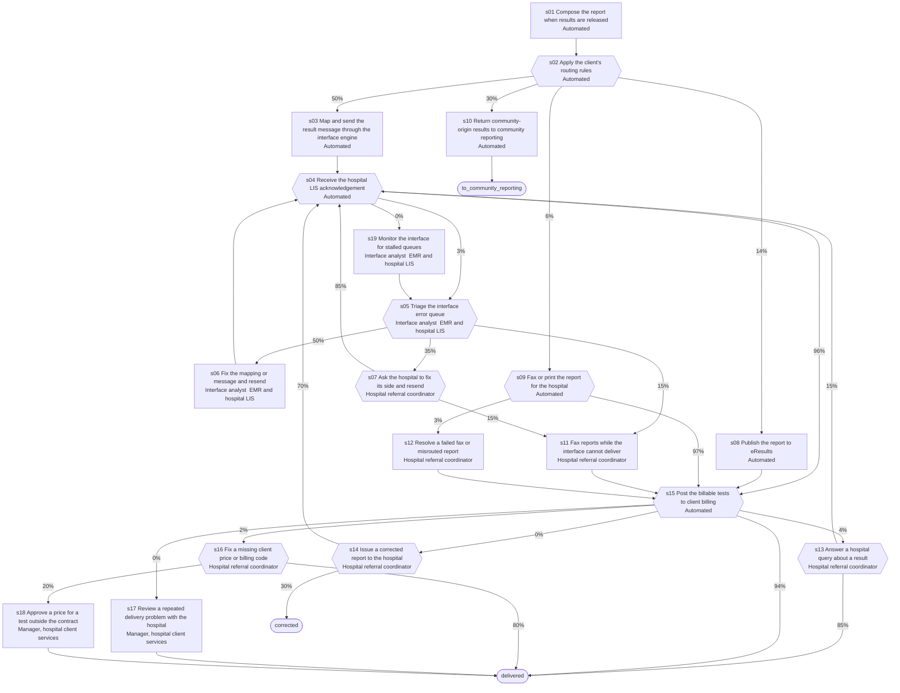

# Deliver reference results to hospitals

`dls-hs-result-delivery` · health care: medical laboratory testing and health services · hospital reference testing · part of `diagnostic-lab-services-co`

Once the reference laboratory releases a specialised test result, the report has to reach the hospital that referred it, usually straight into the hospital's own LIS over an HL7 interface, otherwise through the eResults web service or by fax. Most reports flow without anyone touching them; the work is in the exceptions: messages the hospital LIS rejects because of unmapped test codes or missing orders, interfaces that go down, failed faxes, hospital calls about results they cannot find, corrected reports that must be phoned, and tests with no price on the client's contract. Results on specimens from the company's own community laboratories go back to community reporting, and every delivered hospital report posts its billable tests for the monthly client invoice.

| | |
|---|---|
| Unit of work | one reference report |
| Starts when | The reference laboratory releases the results on a requisition (or a send-out result is entered), creating a report to deliver. |
| Done when | The report is in the hospital's LIS, on eResults or faxed, or handed to community reporting, and its billable tests are posted to client billing. |
| Organisation | The hospital reference services line of a large Canadian community laboratory company, delivering about 60,000 reference reports a month to more than 500 hospitals. (3,300 employees, 2019-2022) |
| Volume | 60,000 cases a month (range 45,000 to 80,000) |

## Where it sits

- Starts with **test_result** from hs-reference-testing (90% of cases)
- Starts with **test_result** from hs-sendout-management (10% of cases)
- Sends **lab_report** to hospital_client (outcome: delivered)
- Sends **lab_report** to hospital_client (outcome: corrected)
- Sends **billable_order** to fin-client-invoicing (outcome: delivered)
- Sends **test_result** to cl-result-reporting (outcome: to_community_reporting)

## Flow

## Roles

| Role | Department | Layer | FTE on this process | Loaded cost per hour | Evidence |
|---|---|---|---:|---:|---|
| Hospital referral coordinator | Hospital client services | individual contributor | 4 | 32 CAD | C |
| Interface analyst (EMR and hospital LIS) | LIS and integration | individual contributor | 1.5 | 62 CAD | B [dyn_hospital], [dyn_eresults] |
| Manager, hospital client services | Hospital client services | manager | 0.2 | 72 CAD | C |

## Steps

Hands-on time and the wait before each step show the most common value. Evidence tier A is a sourced number, B a sourced description, C the author's estimate.

| Step | Who | Kind | Hands-on | Wait before | Control | Evidence |
|---|---|---|---:|---:|---|---|
| **s01 Compose the report when results are released.** When the reference technologist releases the last result on a requisition, or an interim report is due for a long-running test, the LIS builds the report with the hospital's accession number, reference ranges, interpretive comments and the performing laboratory's details. | Automated | system auto | 0 min | 2 min |  | C |
| **s02 Apply the client's routing rules.** The LIS reads the client code: reports for hospitals with a results interface go to the interface engine, reports for hospitals that use the web service or fax go to eResults and the fax server, and results on specimens that came from the company's own community laboratories go back to community reporting. | Automated | system auto | 0 min | 0 min |  | B [dyn_hospital], [dyn_eresults] |
| **s03 Map and send the result message through the interface engine.** The interface engine translates the laboratory's test codes and units into the hospital's codes using the client's mapping table, builds the HL7 result message and sends it to the hospital LIS. | Automated | system auto | 0 min | 1 min |  | B [wiki_hl7], [dyn_eresults] |
| **s04 Receive the hospital LIS acknowledgement.** The hospital LIS files the result against its own order and returns an acknowledgement; a rejection (unknown test code, no matching order or patient, format error) or a missing acknowledgement puts the message in the engine's error queue. | Automated | system auto | 0 min | 1 min |  | C [wiki_hl7] |
| **s05 Triage the interface error queue.** An interface analyst works the error queue several times a day, opens each failed message, reads the hospital's rejection reason and decides whether the fix is on the laboratory side (code mapping, message format), on the hospital side (order or patient not found) or a connection outage. | Interface analyst (EMR and hospital LIS) | analysis | 5 min | 3.0 h |  | C |
| **s06 Fix the mapping or message and resend.** The analyst adds or corrects the hospital test code mapping or message rule under change control, tests it, and resends the held messages for that hospital. | Interface analyst (EMR and hospital LIS) | data entry | 10 min | 2.0 h | Laboratory change control and computerized system validation for interface mapping changes | B [dyn_licences] |
| **s07 Ask the hospital to fix its side and resend.** A referral coordinator calls or emails the hospital laboratory or its LIS team with the accession number and the rejection reason, waits for the hospital to create or merge the order or patient record, and then resends the message. | Hospital referral coordinator | coordination | 8 min | 8.0 h |  | C [capt_clarify] |
| **s08 Publish the report to eResults.** The report is published to the hospital's eResults account, where laboratory staff view and print it or batch-load it into their system. | Automated | system auto | 0 min | 5 min |  | B [dyn_eresults] |
| **s09 Fax or print the report for the hospital.** For hospitals that still want paper, the fax server sends the report to the hospital laboratory's registered fax number, or reports are printed for the courier bag on the next run. | Automated | system auto | 0 min | 10 min |  | B [alpha_report] |
| **s10 Return community-origin results to community reporting.** For specimens referred in from the company's community laboratories, the LIS hands the released result to the community reporting stream, which delivers it to the clinician's EMR, eResults and OLIS with the community report. | Automated | system auto | 0 min | 2 min |  | B [olis] |
| **s11 Fax reports while the interface cannot deliver.** When a hospital's interface is down or a message cannot be fixed soon, the coordinator prints or faxes the affected reports to the hospital laboratory, calls to confirm receipt of urgent ones and marks them so the later electronic resend is not filed as a duplicate. | Hospital referral coordinator | communication | 4 min | 1.0 h |  | C [alpha_report] |
| **s12 Resolve a failed fax or misrouted report.** The coordinator checks the fax log or routing error, confirms the hospital's correct fax number or client code with the hospital, corrects the client table and resends; a report sent to the wrong recipient is logged as a privacy incident. | Hospital referral coordinator | coordination | 6 min | 2.0 h | Personal Health Information Protection Act (Ontario): reports may only be disclosed to the intended custodian and misdirected reports are privacy breaches | C |
| **s13 Answer a hospital query about a result.** A hospital technologist or physician calls because a result is not showing in their LIS, a turnaround seems long or a comment needs explaining; the coordinator looks up the accession, explains the status, resends the report or passes the clinical question to the clinical scientist. | Hospital referral coordinator | communication | 5 min | 12.0 h |  | B [dyn_hospital] |
| **s14 Issue a corrected report to the hospital.** When a released result is amended by the testing laboratory, the coordinator phones the hospital laboratory to report the correction, records who was told and when, and the LIS sends a corrected report marked as amended through the same channel. | Hospital referral coordinator | communication | 10 min | 1.0 h | ISO 15189 requirements for amended reports: corrections are identified as such, the original is retained and the requester is informed | C [dyn_licences], [acd] |
| **s15 Post the billable tests to client billing.** The LIS posts each billable test on the delivered report to the billing system under the hospital's client account and contract price for the month-end invoice; tests with no price or billing code on the client's price list stop on an exception list. The nightly export does not hold up delivery. | Automated | system auto | 0 min | 0 min |  | B [ag2017] |
| **s16 Fix a missing client price or billing code.** The coordinator checks the hospital's contract and price list for the test, adds the agreed price or billing code in the billing system, or asks the client services manager to approve a price for a test not on the contract. | Hospital referral coordinator | data entry | 6 min | 1.0 d |  | B [ag2017] |
| **s17 Review a repeated delivery problem with the hospital.** The hospital client services manager reviews a pattern of failed messages, late reports or complaints for one hospital, agrees fixes with the hospital's laboratory manager and the interface team, and records actions in the client record. | Manager, hospital client services | review | 30 min | 3.0 d | ISO 15189 handling of complaints and corrective action | C [dyn_licences] |
| **s18 Approve a price for a test outside the contract.** The hospital client services manager approves a price for a test the hospital ordered that is not on its contract, or decides to bill at list price, and tells the coordinator. | Manager, hospital client services | approval | 5 min | 1.0 d | Client contract pricing authority | C |
| **s19 Monitor the interface for stalled queues.** Alongside the error queue, the analyst watches the engine's dashboards for hospitals whose connections have stopped acknowledging and opens an IT ticket for connection outages. | Interface analyst (EMR and hospital LIS) | coordination | 0.05 min | 0 min |  | C |

## Exceptions

| Exception | Share of cases | What happens |
|---|---:|---|
| Hospital LIS rejects the result message | 2% | Unknown test code, no matching order or patient, or a format problem; fixed by the analyst or by the hospital and resent. |
| Interface outage | 1% | The hospital connection stops acknowledging and reports are faxed until it is restored. |
| Failed fax or misrouted report | 0% | The fax fails or the client table routes the report wrongly; resent after the number or code is confirmed. |
| Hospital query | 3% | A hospital calls about a result it cannot find or a long turnaround. |
| Corrected report | 0% | A released result is amended; the hospital is phoned and a corrected report sent. |
| Missing client price | 1% | A test has no price on the client's contract and waits on the exception list. |

## Benchmarks

| Metric | Value | Unit | Population | Evidence |
|---|---|---|---|---|
| cycle_time_days | p50 0.02, p90 0.1 | calendar days from result release to delivery and billing post (0.02 days is about 30 minutes) | Reference reports delivered to hospitals | C [dyn_hospital], [alpha_report] |
| routine_result_communication_hours | 24 | hours (stated maximum for routine results) | An Ontario community laboratory | A [alpha_report] |
| hospitals_served | 500 | hospitals (more than) | Company hospital clients | A [dyn_hospital] |

## Pain points

- Every new test or hospital LIS change needs a code mapping on both sides; until it is done, results for that test bounce into the error queue and wait for an analyst. (steps s04, s05, s06; C [wiki_hl7])
- Rejections caused by missing orders or patients in the hospital LIS depend on the hospital to fix, so reports can wait a day or more. (steps s07; C)
- Paper fallbacks during outages create duplicate or missing reports when the electronic feed resumes. (steps s11; C)
- Tests ordered outside a hospital's contract stop billing until a price is found or approved, delaying invoices. (steps s15, s16, s18; B [ag2017])

## Assumptions

- Unit of work is one reference report (one requisition's results, or an interim report); its count follows reference testing.
- Delivery shares are estimates: 50 percent hospital interface, 14 percent eResults, 6 percent fax or print, 30 percent community-origin results returned to community reporting.
- Critical values are phoned by the call desk in a separate workflow (cs-critical-result-notification) and are not part of this delivery process.
- Corrected results are amended by the testing laboratory; this workflow covers notifying the hospital and sending the corrected report.
- Billing posts in a nightly export that runs alongside delivery; the cycle time ends at delivery plus the post, not at invoicing.
- OLIS submission for hospital patients is left to the hospital and community reporting streams; the share the reference laboratory submits directly was not established.
- Error, query and correction rates are the author's estimates; no published rates for reference-to-hospital interfaces were found within the search budget.

## Sources

- [dyn_hospital] Hospital solutions (link withheld) (The model laboratory, 2022). Bi-directional interfaces with hospital LIS for orders and results; hospitals access results through their own LIS; more than 500 hospitals served; clinical pathologists and scientists available for questions.
- [dyn_eresults] eResults (link withheld) (The model laboratory, 2022). Free online results service for healthcare providers and corporate clients to view and print results in a browser; batch delivery into EMRs that meet the company's conformance standards; connectivity by web service, HL7 and ACORD interfaces; IT service desk for conformance questions.
- [wiki_hl7] [Health Level 7](https://en.wikipedia.org/wiki/Health_Level_7) (Wikipedia, 2026). HL7 version 2 messages support hospital workflow including orders (ORM) and observation results (ORU) and link laboratory systems with other hospital systems; supported by every major health informatics vendor in the United States.
- [olis] [Ontario Laboratories Information System (OLIS)](https://ontariohealth.ca/digital/innovations/olis) (Ontario Health, 2024). OLIS holds patients' laboratory orders and results from hospitals, public health and community laboratories in one place for authorised providers.
- [alpha_report] [Test reporting](https://testdirectory.alphalabs.ca/Labs/TestReporting) (Alpha Laboratories (Ontario community laboratory), 2024). Routine results are communicated within 24 hours; ASAP results are faxed or phoned; critical values are called 24 hours a day; once results are delivered by phone, fax or hard copy no further direct attempts are made.
- [ag2017] [2017 Annual Report, Section 3.07: Laboratory Services in the Health Sector](https://www.auditor.on.ca/en/content/annualreports/arreports/en17/v1_307en17.pdf) (Office of the Auditor General of Ontario, 2017). Hospitals that perform tests on behalf of other hospitals charge them, with inconsistent billing practices and prices that differ widely for the same test.
- [dyn_licences] Licences and quality commitment (link withheld) (The model laboratory, 2024). ISO 15189 and CAP accredited laboratories; quality system covers document control, change control and computerized systems validation, corrective and preventive action and internal audits.
- [acd] [Accreditation Canada Diagnostics](https://diagnostics.accreditation.ca/) (Accreditation Canada, 2024). Accredits medical laboratories to ISO 15189 Plus requirements.
- [capt_clarify] [Labs' problem child: the difficult test order (Q-Probes)](https://www.captodayonline.com/Archives/1109/1109b_labs_problem_child.html) (CAP Today, 2009). Median clarification time for an unclear order was 10 minutes; used here only as a reference for the length of a lab-to-client clarification call.

Written by claude-opus on 2026-11-17.
