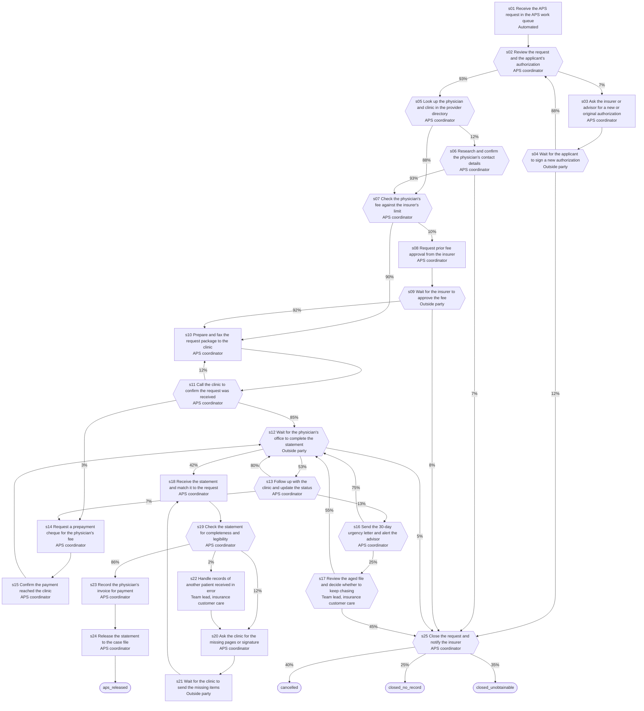

# Collect attending physician statements for life insurers

`dls-in-aps-collection` · health care: insurance medical evidence services · insurance solutions: APS collection · part of `diagnostic-lab-services-co`

When a life insurer wants to see what an applicant's own doctor has recorded, the company's APS collection team obtains an attending physician statement: the doctor's answers on the insurer's form or a copy of the chart for a period. An APS coordinator checks the applicant's signed authorization, finds the clinic, sends the request by fax, confirms it arrived, chases the office on the insurer's contact cycle, pays the physician's fee, checks the returned pages and releases the statement to the case file. Hands-on work is about half an hour per statement, but elapsed time is weeks because clinics fit these uninsured requests around patient care; rejected authorizations, lost faxes, prepayment demands and incomplete returns add loops.

| | |
|---|---|
| Unit of work | one APS |
| Starts when | The insurance order desk releases an APS request (physician details, request type and signed authorization) into the APS team's queue. |
| Done when | The complete statement is attached to the case and released for case review, or the request is closed as cancelled, no record or unobtainable with the insurer told why. |
| Organisation | The insurance medical evidence line of a large Canadian laboratory company, with a central APS team of about 35 coordinators requesting statements from clinics across Canada for every major life insurer. (3,300 employees, 2019-2022) |
| Volume | 8,000 cases a month (range 6,000 to 10,000) |

## Where it sits

- Starts with **aps_request** from in-order-management (97% of cases)
- Starts with **aps_document** from attending_physician (3% of cases)
- Sends **aps_request** to attending_physician (outcome: any)
- Sends **aps_document** to in-case-review-release (outcome: aps_released)
- Sends **aps_document** to in-case-review-release (outcome: closed_no_record)
- Sends **supplier_invoice** to fin-accounts-payable (outcome: aps_released)

## Flow

## Roles

| Role | Department | Layer | FTE on this process | Loaded cost per hour | Evidence |
|---|---|---|---:|---:|---|
| APS coordinator | APS collection team | individual contributor | 34 | 30 CAD | B [dyn_aps], [icontact_aps], [jobbank_13112] |
| Team lead, insurance customer care | Insurance order desk and case management | supervisor | 1.5 | 40 CAD | C |

## Steps

Hands-on time and the wait before each step show the most common value. Evidence tier A is a sourced number, B a sourced description, C the author's estimate.

| Step | Who | Kind | Hands-on | Wait before | Control | Evidence |
|---|---|---|---:|---:|---|---|
| **s01 Receive the APS request in the APS work queue.** When the order desk releases an APS request, the order management system creates an APS task with the insurer, applicant, physician details, request type (insurer form or chart copy for a period) and the image of the signed authorization, assigns it to the regional APS queue and posts an 'APS requested' status to iCARE for the advisor. | Automated | system auto | 0 min | 10 min |  | B [dyn_aps], [dyn_car] |
| **s02 Review the request and the applicant's authorization.** An APS coordinator opens the task, reads any special instructions from the insurer, and checks that the authorization is signed and dated within the insurer's validity period, names the applicant exactly as on the health card and covers release to the insurer and its agent. The coordinator also notes whether this physician or hospital is known to refuse copies or electronic signatures. | APS coordinator | validation | 3 min | 8.0 h | PIPEDA principle 3 (express consent for sensitive personal information) and provincial health privacy laws: the physician may disclose the record to the insurer only with the patient's signed consent | B [dyn_aps], [opc_consent], [brokerworld2017] |
| **s03 Ask the insurer or advisor for a new or original authorization.** The coordinator emails or faxes the insurer's new business area or the advisor, explaining what is wrong with the authorization (date, name, missing page, wet signature required by this office), puts the task on hold in the order management system and sets a reminder. | APS coordinator | communication | 5 min | 10 min |  | B [dyn_aps] |
| **s04 Wait for the applicant to sign a new authorization.** The advisor or insurer contacts the applicant, has a new authorization signed and sends the image or the original by courier. Some applicants are slow to respond or withdraw the application, in which case the insurer cancels the request. | Outside party | external wait | 0 min | 4.0 d |  | C |
| **s05 Look up the physician and clinic in the provider directory.** The coordinator searches the APS provider directory in the order management system for the physician or clinic, confirming the current fax number, whether records go through a hospital health records department or a copy service, the office's usual fee and whether it wants prepayment. A new physician is added to the directory. | APS coordinator | lookup | 2 min | 5 min |  | B [dyn_aps], [examone_mr] |
| **s06 Research and confirm the physician's contact details.** The coordinator searches the provincial college's physician register and clinic websites, phones the clinic or hospital to confirm the fax number and which office holds the chart, and if needed calls the advisor to ask the applicant for the clinic's name. A physician who retired or moved may have transferred records to a custodian. | APS coordinator | lookup | 10 min | 1.0 h |  | C |
| **s07 Check the physician's fee against the insurer's limit.** The coordinator compares the office's known fee for the requested report with the fee limit in the insurer's account set-up. Fees within the limit go ahead; a higher fee, a large chart copy or a specialist report needs the insurer's prior approval. | APS coordinator | judgment | 1 min | 0 min | Insurer service agreement: fee limits and prior approval of physician fees above them | B [dyn_aps] |
| **s08 Request prior fee approval from the insurer.** The coordinator sends the insurer's underwriting or requirements team the physician's quoted fee and the reason (chart copy size, specialist report, rush) by email or the insurer's portal and parks the task until an answer comes. | APS coordinator | communication | 5 min | 10 min |  | B [dyn_aps] |
| **s09 Wait for the insurer to approve the fee.** An underwriter at the insurer decides whether the information is worth the quoted fee, approves it, asks for a narrower request, or cancels the APS because other evidence is enough. | Outside party | external wait | 0 min | 2.0 d |  | C |
| **s10 Prepare and fax the request package to the clinic.** The coordinator generates the cover letter in English or French, attaches the insurer's APS form or the chart copy request with the period wanted, the authorization and the fee and payment instructions, faxes it through the fax server (or sends it by courier when the office insists on an original), records the send date and sets the follow-up date of the insurer's contact cycle. | APS coordinator | drafting | 4 min | 30 min |  | B [dyn_aps], [canhealth_fax] |
| **s11 Call the clinic to confirm the request was received.** A few business days after sending, the coordinator phones the clinic or health records office to confirm the request arrived and is in the queue, asks for an expected completion date and whether payment is wanted first, and notes the answer in the order management system, which updates iCARE. | APS coordinator | communication | 3 min | 3.0 d |  | B [brokerworld2017], [dyn_aps] |
| **s12 Wait for the physician's office to complete the statement.** The physician's staff find the chart, the physician completes the insurer's form or approves the chart copy, and staff or a copy service copy and send it, usually in order of receipt among other uninsured paperwork. The wait runs until the statement comes back or the next follow-up date in the contact cycle arrives. | Outside party | external wait | 0 min | 6.0 d |  | B [ipipeline], [wp2015], [doctorsmb], [cpso_tpr], [bcmj2023] |
| **s13 Follow up with the clinic and update the status.** On the follow-up date the coordinator phones or refaxes the clinic, asks for a status and expected date, resends any lost pages, and records the result so iCARE shows the advisor a current status. The diary is reset to the next date in the insurer's contact cycle. | APS coordinator | communication | 3 min | 1.0 h |  | B [dyn_aps], [bcmj2023], [icontact_aps] |
| **s14 Request a prepayment cheque for the physician's fee.** The coordinator records the office's fee and approval reference, completes a payment request with the office's invoice or fee letter and sends it to accounts payable for the next cheque or electronic payment run, noting the payment in the task. | APS coordinator | data entry | 6 min | 30 min | Company payables controls: a payment needs an approved amount and a set-up payee before accounts payable releases it | B [dyn_aps], [brokerworld2017] |
| **s15 Confirm the payment reached the clinic.** After the weekly payment run and mailing, the coordinator checks that the cheque or payment has been issued, phones the office to confirm it arrived and asks it to release the records. | APS coordinator | coordination | 3 min | 5.0 d |  | C |
| **s16 Send the 30-day urgency letter and alert the advisor.** When a file passes 30 days, the coordinator sends the office a letter stressing the urgency of the request and the possible liability for non-completion, and tells the advisor through iCARE and email that the applicant may want to call the physician. | APS coordinator | communication | 10 min | 1.0 h | Carrier contact cycle and APS service standard: letter to the office after 30 days without response | A [dyn_aps], [bcmj2023] |
| **s17 Review the aged file and decide whether to keep chasing.** A team lead reviews files outstanding for about 60 days or more in the weekly aged-file report, reads the contact history and, with the insurer's instruction, decides to keep chasing (for example after the applicant calls the physician) or close the request as unobtainable. | Team lead, insurance customer care | review | 10 min | 3.0 d | APS service standard: team lead review and insurer instruction before closing an unobtainable request | B [bcmj2023], [icontact_aps] |
| **s18 Receive the statement and match it to the request.** The statement arrives by fax to the fax server, through the physician APS portal or by courier. A coordinator matches it to the open task by applicant name, date of birth and request number, scans courier copies, and attaches the image to the order. | APS coordinator | intake | 2 min | 1.0 h |  | B [dyn_aps], [dyn_car] |
| **s19 Check the statement for completeness and legibility.** The coordinator pages through the statement or chart copy and checks it is for the right patient, signed, legible, complete (page count, all questions answered) and covers the period the insurer asked for. Chart copies can run to dozens of pages. | APS coordinator | validation | 5 min | 1.0 h | APS service standard agreed with carriers: check image quality and that all pages are received and legible before release | B [dyn_aps], [ipipeline] |
| **s20 Ask the clinic for the missing pages or signature.** The coordinator phones or faxes the office listing exactly what is missing (pages, signature, a question, the requested period) and keeps the task open. | APS coordinator | communication | 5 min | 10 min |  | C |
| **s21 Wait for the clinic to send the missing items.** The office finds and sends the missing pages or has the physician sign or complete the form, usually within days because the chart is already pulled. | Outside party | external wait | 0 min | 3.0 d |  | C |
| **s22 Handle records of another patient received in error.** A team lead removes the other patient's pages from the order, asks the clinic to confirm destruction or return of the misdirected copy, logs the incident for the privacy office's breach assessment and records what was done. The coordinator then asks for the correct records. | Team lead, insurance customer care | judgment | 40 min | 4.0 h | PIPEDA breach of security safeguards provisions: assess real risk of significant harm, report and notify where it exists, and keep a record of every breach for two years | B [opc_breach], [canhealth_fax] |
| **s23 Record the physician's invoice for payment.** If the office enclosed an invoice and was not prepaid, the coordinator checks the amount against the approved fee and keys a payment request with the invoice image for accounts payable; the insurer's fee is flagged for billing with the order. | APS coordinator | data entry | 1 min | 10 min | Company payables controls: invoice matched to an approved fee before payment | B [dyn_aps], [brokerworld2017] |
| **s24 Release the statement to the case file.** The coordinator marks the APS received in the order management system, which posts the image to the case for the evidence reviewer, sets the requirement complete in iCARE and closes the APS task. | APS coordinator | data entry | 1 min | 5 min |  | B [dyn_aps] |
| **s25 Close the request and notify the insurer.** For a cancelled order, a physician who reports no record of the patient, or a request closed as unobtainable, the coordinator records the reason, sends the insurer the office's no-record letter or the contact history, recalls any unpaid fee request and closes the task so iCARE shows the final status. | APS coordinator | communication | 5 min | 1.0 h |  | B [bcmj2023], [wp2015] |

## Exceptions

| Exception | Share of cases | What happens |
|---|---:|---|
| Authorization not accepted | 7% | The authorization is stale, names the applicant differently from the health card, lacks a page or carries an electronic signature the office will not accept; a new one is obtained through the advisor. |
| Physician not in the directory | 12% | The physician has moved, retired or is new; the coordinator researches the clinic and the records custodian before sending. |
| Fee above the insurer's limit | 10% | A large chart copy or specialist report costs more than the insurer's limit and needs its prior approval. |
| Request not received by the clinic | 12% | The receipt call finds the fax did not arrive or went to an old number and the package is sent again. |
| Prepayment demanded | 10% | The office will not start or release records until paid; a cheque goes out in the next payment run. |
| Aged file escalation | 13% | After 30 days the office gets an urgency letter and the advisor is alerted; files still open at the aged-file review are continued or closed as unobtainable. |
| Incomplete statement returned | 12% | Pages, a signature or the requested period are missing and the office is asked again. |
| Another patient's records received | 2% | The returned copy includes pages of a different patient; the pages are removed, the office is told and the incident is logged for breach assessment. |

## Benchmarks

| Metric | Value | Unit | Population | Evidence |
|---|---|---|---|---|
| cycle_time_days | p50 16, p90 40 | calendar days from APS request released to statement released or request closed | Life insurance APS requests in Canada and the US | B [ipipeline], [wp2015] |
| aps_average_collection_days | 19.8 | days | 62 life carriers, more than 3 million applications over two years to 2021 | A [ipipeline] |
| aps_average_days_canada | 18 | days | Some Canadian life insurers, as reported in 2015 | A [wp2015] |
| carrier_aps_review_days | 1.4 | days | 62 life carriers (review after the APS arrives, outside this process) | A [ipipeline] |
| escalation_letter_after | 30 | days without response | The company's APS collection service | A [dyn_aps] |
| physician_form_completion_expectation | manitoba 30, ontario_no_exam 45 | days | Physicians completing third party reports and forms | A [doctorsmb], [cpso_tpr] |
| ontario_doctors_using_fax | 0.9 | share of doctors (more than) | Ontario physicians (OMA figure reported in 2023) | A [canhealth_fax] |

## Pain points

- Most elapsed time is waiting for physicians' offices, which treat APS requests as uninsured paperwork behind patient care; APS collection is the slowest underwriting requirement. (steps s12, s13; A [ipipeline], [wp2015])
- Fax requests go missing or to old numbers, so receipt has to be confirmed by phone and packages resent; misdirected faxes of health information are privacy breaches. (steps s10, s11; B [brokerworld2017], [canhealth_fax])
- Offices reject authorizations with electronic signatures, old dates or names that differ from the chart, sending the request back to the advisor and applicant. (steps s02, s03, s04; B [brokerworld2017], [dyn_aps])
- Fee approvals and prepayment demands add an insurer decision and a payment run to the wait. (steps s08, s09, s14, s15; B [dyn_aps], [brokerworld2017])
- Repeated status calls and refaxes take much of the coordinators' time and still leave advisors calling for updates. (steps s13, s16; B [icontact_aps], [bcmj2023])

## Assumptions

- One case is one APS request to one physician or facility. An order that needs statements from two doctors creates two requests.
- The process map lists the physician's statement as a trigger. Statements normally arrive inside cases already open; the 3 percent trigger share stands for statements that arrive without a matching open request (sent after closure or by the applicant's doctor unprompted) and reopen a request at receipt. The step graph models only requests that start at the order desk.
- Physicians' offices are modelled with a follow-up cycle of about a week (range two days to two weeks): each cycle the statement comes back with probability 0.42. This reproduces published averages of 18 to 19.8 days but not the dependence of return chance on file age; the 30-day letter is approximated as 13 percent of follow-ups.
- The company pays physicians' fees and recovers them from the insurer through client invoicing; the payment itself is made by accounts payable in weekly runs. About 10 percent of requests need prepayment.
- Coordinator FTE (34 of 35) is about 8 FTE below the 42 that hands-on time (about 41 minutes per request) times 8,000 requests implies, so the organisation file's 35 coordinators look thin unless follow-up faxes go out automatically from the diary or volume is nearer the low end. Team leads are assumed to supervise the APS team although the organisation file places them in the order desk unit.
- Shares of authorization problems, directory misses, fee approvals, unreceived faxes, incomplete returns and closures are the author's estimates; no opened source gave rates.
- Loaded costs come from the organisation file (wage times 1.35).

## Sources

- [dyn_aps] APS collection (The model laboratory's insurance testing service brochure) (link withheld) (The model laboratory, undated). An APS request needs a current, valid authorization from the applicant (some hospitals or physicians require an original or handwritten signature) and the physician's name and address; orders come from carriers through the secure website; prior fee approval is requested from the insurer when required and prepayment is sent to the physician's office; forms go by fax or courier; follow-ups by phone or fax follow the carrier's contact cycle; after 30 days without response a letter warns the office of urgency and potential liability; reports come back by fax, secure site or courier, are handled as priority, checked for image quality and complete legible pages, and sent to the insurer; the applicant's name must match the health card; advisors track pending APS orders in iCARE. Text copy saved by earlier work and read for this file.
- [dyn_car] Insurance carriers (link withheld) (The model laboratory, undated). Carrier services include paramedicals, tele-interviews, attending physician statements, an APS collection service and a physician APS portal; orders online through the Order Management System, by email or phone.
- [ipipeline] [Five days to issue](https://uk.ipipeline.com/5days/) (iPipeline, 2021). Analysis of more than 3 million life applications at 62 carriers: APS orders are the top underwriting delay with an average collection time of 19.8 days; APS review by the carrier averages 1.4 days.
- [wp2015] [Why does it take so long to get my policies issued?](https://www.wealthprofessional.ca/investments/life-and-health-insurance/why-does-it-take-so-long-to-get-my-policies-issued/197115) (Wealth Professional, 2015). Canadian insurers: some companies report an average of 18 days to obtain an APS; the wait for the doctor is outside the underwriter's control; insurers try to reduce APS use; an applicant who does not list all doctors can force a second report.
- [bcmj2023] [A delay in the attending physician's statement can delay your insurance application](https://bcmj.org/node/9757) (British Columbia Medical Journal (Doctors of BC), 2023). The underwriting service sends the APS request to the physician and follows up about every couple of weeks; after several follow-ups the insurer may ask the applicant to step in; an outstanding APS can lead the insurer to close the application; applicants often finish testing in weeks and then wait weeks more.
- [brokerworld2017] [Why does that attending physician's statement take so darn long!?!](https://brokerworldmag.com/why-does-that-attending-physicians-statement-take-so-darn-long/) (Broker World, 2017). Worked example of an APS order: faxed request not received, refaxed, receipt confirmed after 9 days, office quotes 15 days to copy, several invoice follow-ups; offices invoice after copying and release records only after payment; some facilities reject insurer authorizations and electronic signatures; copy services queue requests in order of receipt; maiden names cause missed records.
- [examone_mr] [Medical records (reducing cycle time)](https://www.examone.com/reducing-cycle-time/medical-records/) (ExamOne, undated). APS vendor practice: requests to more than 800,000 doctors and facilities; written, signed and dated authorization required before records are accessed; electronic health record routing saves days to weeks of APS wait time where available.
- [icontact_aps] [APS retriever (job posting)](https://careers-page.com/icontactbpo/job/8X9WRRWV) (iContact BPO via careers-page.com, undated). APS retrievers contact medical facilities by phone and email, prioritise urgent and aging cases, schedule callbacks so cases are not neglected, keep case notes, escalate stalled cases and handle confidential information under authorization protocols; monthly productivity targets for closed cases.
- [doctorsmb] [Reports and forms: time frames for completion](https://doctorsmanitoba.ca/managing-your-practice/remuneration/uninsured-servicesx/reports-and-forms-time-frames-for-completion) (Doctors Manitoba, 2023). Absent unusual circumstances the time to complete a report or form should generally be 30 days; time depends on the complexity of the request; physicians who cannot meet the deadline should tell the requesting party why and when to expect it.
- [cpso_tpr] [Third party medical reports (Dialogue article on the new policy)](https://dialogue.cpso.on.ca/2020/09/third-party-medical-reports/) (College of Physicians and Surgeons of Ontario, 2021). Policy approved in 2021: outside legal proceedings, third party medical reports that do not require an independent medical examination must be completed within 45 days, and those that do within 60 days; covers treating physicians completing forms for their patients.
- [canhealth_fax] [Ontario plans to eliminate faxes in healthcare in 5 years](https://www.canhealth.com/2023/02/08/ontario-plans-to-eliminate-faxes-in-healthcare-in-5-years/) (Canadian Healthcare Technology, 2023). The Ontario Medical Association says more than 90 percent of doctors still use fax machines; misdirected faxes were the leading cause of unauthorized disclosure of health information, with nearly 5,000 such breaches reported to Ontario's privacy commissioner in 2021.
- [jobbank_13112] [Wages: Medical administrative assistant in Ontario (NOC 13112)](https://www.jobbank.gc.ca/marketreport/wages-occupation/25791/ON) (Job Bank, Government of Canada, 2025). Ontario hourly wages low 17.95, median 25.00, high 32.70 CAD (2023-2024).
- [opc_consent] [PIPEDA fair information principle 3: Consent](https://www.priv.gc.ca/en/privacy-topics/privacy-laws-in-canada/the-personal-information-protection-and-electronic-documents-act-pipeda/p_principle/principles/p_consent/) (Office of the Privacy Commissioner of Canada, undated). Meaningful consent is required; express consent is generally needed when the information is sensitive; individuals can withdraw consent at any time subject to legal or contractual restrictions.
- [opc_breach] [What you need to know about mandatory reporting of breaches of security safeguards](https://www.priv.gc.ca/en/privacy-topics/business-privacy/safeguards-and-breaches/privacy-breaches/respond-to-a-privacy-breach-at-your-business/gd_pb_201810/) (Office of the Privacy Commissioner of Canada, undated). Breaches posing a real risk of significant harm must be reported to the OPC and affected individuals notified as soon as feasible; health information is usually sensitive; records of every breach must be kept for two years.

Written by claude-opus on 2026-11-17.
