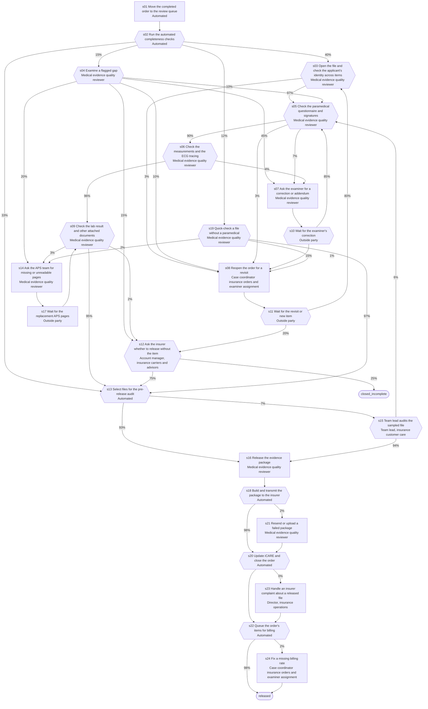

# Review and release the evidence file to the insurer

`dls-in-case-review-release` · health care: medical laboratory testing and health services · insurance medical evidence · part of `diagnostic-lab-services-co`

When every item a life insurer ordered on an applicant (paramedical exam, tele-interview, attending physician statement, lab result or inspection) is complete, a reviewer checks the file before it goes to the underwriter. The reviewer confirms that every item belongs to the same applicant, that the paramedical questionnaire, measurements, ECG and signatures are complete and that attached documents are readable; the system then sends the package in ACORD or the insurer's format, updates the advisor's status screen and queues the items for billing. Most files pass quickly, but missing signatures, unanswered questions, unreadable ECGs or APS pages and untested specimens send files back to examiners, the APS team or the insurer, and those loops make up most of the delay.

| | |
|---|---|
| Unit of work | one completed insurance order |
| Starts when | The last ordered evidence item is attached to the order and the order enters the review queue. |
| Done when | The evidence package is transmitted to the insurer, the advisor's status is updated and the items are queued for billing, or the order is closed incomplete on the insurer's instruction. |
| Organisation | The insurance medical evidence business of a large Canadian laboratory company, closing about 38,000 orders a month for all Canadian life insurers. (3,300 employees, 2019-2022) |
| Volume | 38,000 cases a month (range 28,000 to 48,000) |

## Where it sits

- Starts with **insurance_lab_result** from in-insurance-lab-testing (33% of cases)
- Starts with **ti_transcript** from in-tele-interview (32% of cases)
- Starts with **aps_document** from in-aps-collection (21% of cases)
- Starts with **paramedical_file** from in-paramedical-exam (10% of cases)
- Starts with **inspection_report** from in-inspection-reports (4% of cases)
- Sends **medical_evidence_package** to life_insurer (outcome: released)
- Sends **billable_order** to fin-client-invoicing (outcome: released)
- Sends **order_status** to insurance_advisor (outcome: any)

## Flow

## Roles

| Role | Department | Layer | FTE on this process | Loaded cost per hour | Evidence |
|---|---|---|---:|---:|---|
| Medical evidence quality reviewer | Insurance order desk and case management | individual contributor | 13.5 | 36 CAD | C |
| Case coordinator (insurance orders and examiner assignment) | Insurance order desk and case management | individual contributor | 5 | 30 CAD | B [dyn_adv] |
| Team lead, insurance customer care | Insurance order desk and case management | supervisor | 2 | 40 CAD | C |
| Account manager, insurance carriers and advisors | Insurance solutions (The model laboratory's insurance testing service) | individual contributor | 0.3 | 60 CAD | C |
| Director, insurance operations | Insurance solutions (The model laboratory's insurance testing service) | director | 0.05 | 105 CAD | C |

## Steps

Hands-on time and the wait before each step show the most common value. Evidence tier A is a sourced number, B a sourced description, C the author's estimate.

| Step | Who | Kind | Hands-on | Wait before | Control | Evidence |
|---|---|---|---:|---:|---|---|
| **s01 Move the completed order to the review queue.** When the last ordered item (paramedical file, tele-interview report, APS, lab result or inspection report) is attached to the order, the order management system marks the order complete and places it in the evidence review queue for its insurer. | Automated | system auto | 0 min | 0 min |  | B [dyn_para], [dyn_adv] |
| **s02 Run the automated completeness checks.** The order management system checks the insurer's requirement list against the attached items: required ePara sections and signatures captured, lab result attached, ECG tracing present when ordered, and documents attached as images; files with a gap are flagged. | Automated | system auto | 0 min | 2 min | Insurer service agreement requirement specifications for each evidence item | B [examone2016], [dyn_car] |
| **s03 Open the file and check the applicant's identity across items.** The reviewer opens the order and confirms the applicant's name, date of birth, policy number and insurer are the same on the paramedical file, lab result, tele-interview and any APS, so no other person's information goes into the package. | Medical evidence quality reviewer | validation | 0.6 min | 4.0 h | PIPEDA safeguards principle: protect sensitive personal information against unauthorized disclosure | B [opc_safeguards], [dyn_kit2020] |
| **s04 Examine a flagged gap.** The reviewer reads the flag (missing signature, unanswered question, missing ECG, untested lab result, APS pages missing) and decides whether the gap can be fixed from information already held, needs the examiner or APS team, or needs the insurer's decision. | Medical evidence quality reviewer | judgment | 2 min | 4.0 h |  | C [examone2016] |
| **s05 Check the paramedical questionnaire and signatures.** For files with a paramedical, the reviewer reads the ePara questionnaire for unanswered questions and 'yes' answers without the required details (dates, doctors, medications), and checks the applicant's and examiner's signatures and the consent and authorization. | Medical evidence quality reviewer | review | 1.8 min | 0 min | PIPEDA consent principle: express, signed consent of the applicant to collect and disclose health information to the named insurer | B [opc_consent], [dyn_kit2020] |
| **s06 Check the measurements and the ECG tracing.** The reviewer checks that height, weight, blood pressure and pulse are recorded and plausible, that repeat blood pressures are present when the first reading was high, and that an ordered ECG tracing is attached with all leads readable. | Medical evidence quality reviewer | review | 0.8 min | 0 min |  | B [dyn_para] |
| **s07 Ask the examiner for a correction or addendum.** The reviewer messages or phones the examiner with exactly what is missing (an answer detail, a repeat blood pressure, an ECG resend) and sets the order to pending correction so the advisor sees the status. | Medical evidence quality reviewer | communication | 2.5 min | 30 min |  | C |
| **s08 Reopen the order for a revisit.** A case coordinator reopens the order, tells the advisor why (missing signature, wrong applicant's item, ECG must be repeated), and books the examiner to revisit or the applicant to call back; the order returns to review when the new item arrives. | Case coordinator (insurance orders and examiner assignment) | coordination | 6 min | 2.0 h |  | B [dyn_adv] |
| **s09 Check the lab result and other attached documents.** The reviewer confirms that the lab result is attached and complete or carries a not-tested comment, and that any tele-interview report, APS or inspection report on the order is attached as a readable image with all pages. | Medical evidence quality reviewer | validation | 0.4 min | 0 min |  | B [soa2011] |
| **s10 Wait for the examiner's correction.** The contracted or employed examiner sends an addendum in ePara, resends the ECG tracing, or calls the applicant back to complete an unanswered question, then resubmits the file. | Outside party | external wait | 0 min | 1.0 d |  | C |
| **s11 Wait for the revisit or new item.** The applicant is revisited or called back, the new signature, ECG or item is collected and attached to the order, which returns to the review queue. | Outside party | external wait | 0 min | 3.0 d |  | B [ipipeline] |
| **s12 Ask the insurer whether to release without the item.** An account manager emails or calls the insurer's new business contact to ask whether to release the file without the missing item, order a recollection, or cancel that item, and records the decision on the order. | Account manager, insurance carriers and advisors | communication | 5 min | 1.0 d | Insurer service agreement: incomplete evidence is released only with the insurer's instruction | B [dyn_faq] |
| **s13 Select files for the pre-release audit.** The order management system flags a random sample of files, plus files from examiners on a quality watch, for a team lead to audit before release. | Automated | system auto | 0 min | 0 min | Company quality assurance sampling of evidence files before release | C [examone2016] |
| **s14 Ask the APS team for missing or unreadable pages.** The reviewer tells the APS team which pages are missing or unreadable so they can ask the clinic to resend; the order waits. | Medical evidence quality reviewer | communication | 3 min | 30 min |  | B [ipipeline], [soa2011] |
| **s15 Team lead audits the sampled file.** The team lead repeats the review against the insurer's checklist and the examiner's quality history, and either passes the file or returns it with the error for correction and examiner feedback. | Team lead, insurance customer care | review | 5 min | 8.0 h | Company quality assurance sampling of evidence files before release | C |
| **s16 Release the evidence package.** The reviewer marks the file reviewed and releases it, which tells the system to build the package in the insurer's format. | Medical evidence quality reviewer | approval | 0.25 min | 5 min |  | C |
| **s17 Wait for the replacement APS pages.** The APS team asks the attending physician's clinic to fax or upload the missing or clearer pages, and attaches them to the order when they arrive. | Outside party | external wait | 0 min | 2.0 d |  | C [ipipeline] |
| **s18 Build and transmit the package to the insurer.** The system assembles the paramedical data, images and any outstanding items into the insurer's ACORD or custom format and sends it through the secure insurer exchange; the insurer's system returns an acknowledgement. | Automated | system auto | 0 min | 15 min | PIPEDA safeguards principle: secure transmission of sensitive personal health information | A [dyn_car], [soa2011], [opc_safeguards] |
| **s19 Quick-check a file without a paramedical.** For orders with only a tele-interview, APS or inspection, the reviewer opens the order, confirms the item matches the applicant and is complete, and releases it. | Medical evidence quality reviewer | validation | 0.6 min | 4.0 h |  | C |
| **s20 Update iCARE and close the order.** The order management system marks the order released, shows the status to the advisor and the insurer in iCARE and sends the advisor's notification. | Automated | system auto | 0 min | 1 min |  | B [dyn_adv], [dyn_para] |
| **s21 Resend or upload a failed package.** The reviewer checks the insurer exchange error, resends after a fix, or uploads the package to the insurer's secure portal and records the method used. | Medical evidence quality reviewer | coordination | 6 min | 2.0 h |  | C |
| **s22 Queue the order's items for billing.** The order management system sends each completed item with the insurer's rate (paramedical, kit, ECG, interview, APS fee and any travel surcharge) to client invoicing; items without a rate stop on an exception list. | Automated | system auto | 0 min | 0 min |  | C |
| **s23 Handle an insurer complaint about a released file.** The director of insurance operations reviews an insurer's complaint about a wrong or incomplete file, has it corrected and resent, and agrees corrective action with the examiner network and reviewers. | Director, insurance operations | review | 45 min | 3.0 d | Company complaint handling and corrective action procedure | C |
| **s24 Fix a missing billing rate.** A case coordinator looks up the insurer's rate card or the approved surcharge, adds the rate and releases the item to invoicing. | Case coordinator (insurance orders and examiner assignment) | data entry | 4 min | 1.0 d |  | C |

## Exceptions

| Exception | Share of cases | What happens |
|---|---:|---|
| Examiner correction | 10% | A paramedical answer detail, repeat blood pressure or ECG is missing and the examiner sends an addendum. |
| Revisit needed | 4% | A missing applicant signature, an item from another applicant or a failed correction needs a revisit before release. |
| APS pages missing or unreadable | 4% | The APS team must get the clinic to resend pages. |
| Insurer decides on an incomplete file | 4% | An untested lab or unobtainable item goes to the insurer, which usually tells the company to release with a note. |
| Transmission failure | 2% | The insurer exchange rejects the package and it is resent or uploaded. |

## Benchmarks

| Metric | Value | Unit | Population | Evidence |
|---|---|---|---|---|
| cycle_time_days | p50 0.5, p90 3.0 | calendar days from the order becoming complete to the package transmitted and the order closed | Insurance medical evidence orders at a Canadian evidence provider | C [dyn_para], [ipipeline] |
| outstanding_requirement_collection_days | aps 19.8, paramedical 15.2, missing_application_data 10.3, aps_review 1.4 | average days to collect | 62 life carriers (iPipeline) | A [ipipeline] |
| insurers_receiving_lab_results_electronically | 0.87 | share of insurer respondents receiving all or virtually all lab results electronically | SOA 2010 survey of US and Canadian direct writers | A [soa2011] |
| results_reported_hours | 48 | hours or less from lab receipt to carrier | Company insurance laboratory | A [dyn_adv] |

## Pain points

- Gaps found at review (missing answer details, repeat blood pressures, unreadable ECGs) go back to examiners who are contractors in the field, so a small fix can hold a file for a day or more. (steps s05, s07, s10; B [examone2016])
- A missing applicant signature cannot be fixed at the desk and needs a revisit, adding days. (steps s05, s08, s11; B [opc_consent], [ipipeline])
- APS images arrive with missing or unreadable pages and depend on busy clinics to resend. (steps s14, s17; B [ipipeline])
- Paramedical and APS files are opened by a person even when they passed the system checks, which takes most of the reviewers' time. (steps s03, s19; C)

## Assumptions

- The case is one order and starts when its last item arrives; trigger shares by last item (lab 33 percent, tele-interview 32, APS 21, paramedical without fluids 10, inspection 4) are estimates from the organisation file's volumes.
- Tele-interview reports and lab results are also sent to the insurer as soon as they are released (see those workflows); this review covers the order as a whole, the paramedical file and documents, and the closing status and billing.
- About 42 percent of orders include a paramedical that gets a full review; APS and inspection files get a quick look at the images; orders with only tele-interview or lab items, already released to the insurer by those workflows, close automatically when they pass the system checks (33 percent).
- Hands-on time times volume implies more FTE than stated (see the validator staffing line); the organisation file's 15 evidence reviewers look low for reviewing about 25,000 files a month by hand, so either reviews are faster than estimated or case coordinators and team leads share the review work.
- Correction, revisit and APS page rates are estimates; no published rates were found within the search budget.

## Sources

- [dyn_car] Insurance carriers (link withheld) (The model laboratory, 2022). Health professionals submit applicant information through ePara on a tablet or laptop; secure online reporting to underwriters; automated data downloads in ACORD and customized formats; order management system with prompts, confirmations and reminders.
- [dyn_adv] Insurance advisors (link withheld) (The model laboratory, 2022). Advisors order online, by email or phone; status updates in real time in the iCARE online order tracking platform; results reported to carriers within 48 hours or less.
- [dyn_para] Paramedical services (link withheld) (The model laboratory, 2022). The applicant is contacted within 24 to 48 hours and booked within 72 hours; the carrier is notified as soon as the order has been completed; paramedical 25 to 35 minutes, blood profile 20 to 25, resting ECG about 20.
- [dyn_faq] Frequently asked questions: The model laboratory's insurance testing service order tracker (link withheld) (The model laboratory, 2025). Advisors follow order status in the order tracker; specimen results average three business days from collection to the carrier; carriers decide whether a non-viable specimen needs recollection.
- [dyn_kit2020] Instructions for blood/urine kit (insurance), version 6 (link withheld) (The model laboratory, 2020). The proposed insured must read and sign the notice, consent and chain of custody section; the examiner completes all sections and signs; names must be consistent throughout and match the applicant.
- [soa2011] [Report of the Society of Actuaries Improving the New Business Process Survey Subcommittee](https://www.soa.org/globalassets/assets/files/research/projects/research-2011-09-improving.pdf) (Society of Actuaries, 2011). 87 percent of insurer respondents received all or virtually all laboratory results electronically; electronic transmission of an image was the most common way of receiving underwriting evidence, in particular APS, paramedicals, ECGs and lab results; 88 percent said the company orders the APS.
- [ipipeline] [Five days to issue (iPipeline analysis of outstanding requirements)](https://uk.ipipeline.com/5days/) (iPipeline, 2021). Across 62 carriers the average collection time of outstanding requirements is 19.8 days for APS orders, 15.2 days for paramedical exams, 10.3 days for missing application data, 1.4 days for APS review and 1.3 days for data entry; underwriters wait on paramedicals, APS and agent responses.
- [examone2016] [Ask the experts: ensuring quality throughout the applicant exam process](https://blog.examone.com/blog/2016/07/26/ask-the-experts-ensuring-quality-throughout-the-applicant-exam-process/) (ExamOne (Quest Diagnostics), 2016). The examiner app is about 70 percent pre-populated from the ordering system and flags missing required fields, reducing unreadable or incomplete paper entries; a quality assurance department reviews applicant feedback daily.
- [opc_consent] [PIPEDA fair information principle 3: Consent](https://www.priv.gc.ca/en/privacy-topics/privacy-laws-in-canada/the-personal-information-protection-and-electronic-documents-act-pipeda/p_principle/principles/p_consent/) (Office of the Privacy Commissioner of Canada, 2020). Meaningful consent is required and express consent is generally required for sensitive information; consent can be withdrawn subject to legal or contractual restrictions.
- [opc_safeguards] [PIPEDA fair information principle 7: Safeguards](https://www.priv.gc.ca/en/privacy-topics/privacy-laws-in-canada/the-personal-information-protection-and-electronic-documents-act-pipeda/p_principle/principles/p_safeguards/) (Office of the Privacy Commissioner of Canada, 2020). Personal information must be protected in a way appropriate to its sensitivity against loss, theft and unauthorized access, disclosure, copying, use or modification, through physical, technological and organizational measures.

Written by claude-opus on 2026-11-17.
