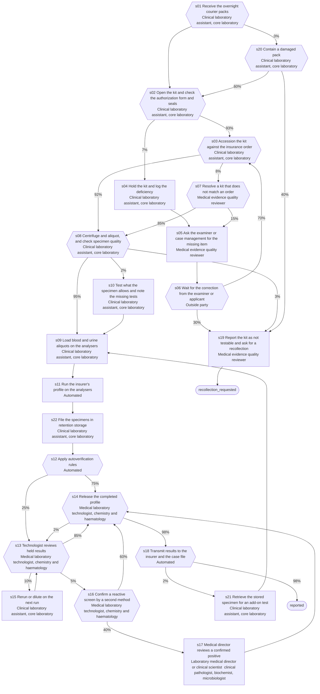

# Test insurance blood and urine profiles

`dls-in-insurance-lab-testing` · health care: medical laboratory testing and health services · insurance medical evidence · part of `diagnostic-lab-services-co`

Life insurers ask applicants for blood and urine so their underwriters can check lipids, glucose, liver and kidney function, PSA, HIV and hepatitis antibodies, nicotine and drugs. Kits collected at paramedical exams arrive by overnight courier; lab assistants check the signed consent, seals and insurer lab code, match the kit to its order, centrifuge and aliquot, and the profile runs on the shared core laboratory analysers. Technologists review held results, rerun and confirm reactive screens, and release the profile, which goes electronically to the insurer within about 48 hours of arrival. Kits with missing signatures, no matching order, no urine or spoiled serum cause holds, chases to examiners and recollections.

| | |
|---|---|
| Unit of work | one insurance specimen kit |
| Starts when | A blood and urine (or urine-only) kit from a paramedical exam arrives at the laboratory by overnight courier. |
| Done when | The insurer's profile is released and transmitted to the insurer and the case file, or the kit is reported not testable and a recollection requested. |
| Organisation | The insurance laboratory testing line of a large Canadian laboratory company, testing about 15,000 insurance kits a month in the core laboratory of its Brampton site. (3,300 employees, 2019-2022) |
| Volume | 15,000 cases a month (range 11,000 to 19,000) |

## Where it sits

- Starts with **insurance_specimen** from in-paramedical-exam (100% of cases)
- Sends **insurance_lab_result** to in-case-review-release (outcome: reported)
- Sends **insurance_lab_result** to in-case-review-release (outcome: recollection_requested)

## Flow

## Roles

| Role | Department | Layer | FTE on this process | Loaded cost per hour | Evidence |
|---|---|---|---:|---:|---|
| Clinical laboratory assistant, core laboratory | Core laboratory (chemistry, immunoassay, haematology, urinalysis) | individual contributor | 11 | 30 CAD | B [dyn_kit2020], [jb33101] |
| Medical laboratory technologist, chemistry and haematology | Core laboratory (chemistry, immunoassay, haematology, urinalysis) | individual contributor | 5 | 52 CAD | B [dyn_car], [jb32120] |
| Medical evidence quality reviewer | Insurance order desk and case management | individual contributor | 1.5 | 36 CAD | C |
| Laboratory medical director or clinical scientist (clinical pathologist, biochemist, microbiologist) | Community laboratory testing (The model laboratory Laboratories) | senior specialist | 0.15 | 230 CAD | C |

## Steps

Hands-on time and the wait before each step show the most common value. Evidence tier A is a sourced number, B a sourced description, C the author's estimate.

| Step | Who | Kind | Hands-on | Wait before | Control | Evidence |
|---|---|---|---:|---:|---|---|
| **s01 Receive the overnight courier packs.** In the morning a lab assistant signs for the bags of courier packs, scans each waybill, checks that packs are cool and not crushed or leaking, and moves them to the insurance bench in the refrigerator. | Clinical laboratory assistant, core laboratory | intake | 0.5 min | 30 min |  | B [dyn_kit2020], [dyn_faq] |
| **s02 Open the kit and check the authorization form and seals.** The assistant opens the clamshell and checks the laboratory authorization form: the applicant's signature on the notice, consent and chain of custody section, the examiner's signature, the insurer's lab code, the recorded urine temperature, the signed tamper-evident tape intact, and barcode labels on every tube matching the form. | Clinical laboratory assistant, core laboratory | validation | 1.5 min | 30 min | PIPEDA consent principle: express consent of the applicant before testing and disclosure of sensitive health information, evidenced by the signed notice and consent on the laboratory slip | B [dyn_kit2020], [crl_instr], [opc_consent] |
| **s03 Accession the kit against the insurance order.** The assistant scans the kit barcode; the LIS looks up the order sent from the order management system and the examiner's ePara upload to get the applicant's identity, the insurer and the insurer's test profile, and registers the specimens under that order. | Clinical laboratory assistant, core laboratory | data entry | 1 min | 10 min | ISO 15189 and CAP requirements for unique specimen identification and traceability | B [dyn_car], [hh2012] |
| **s04 Hold the kit and log the deficiency.** The assistant keeps the specimens refrigerated on the hold shelf, records the deficiency in the LIS against the kit barcode and opens a nonconformance for the examiner, so the evidence reviewer can chase it. | Clinical laboratory assistant, core laboratory | data entry | 2 min | 5 min | ISO 15189 control of nonconforming samples | B [dyn_licences] |
| **s05 Ask the examiner or case management for the missing item.** The evidence reviewer phones or messages the examiner for a missing signature page or lab code, or asks case management to confirm the insurer's lab code and profile; a missing applicant signature needs a signed consent obtained from the applicant. | Medical evidence quality reviewer | communication | 6 min | 4.0 h |  | C [crl_instr] |
| **s06 Wait for the correction from the examiner or applicant.** The examiner faxes or uploads the signed form or confirms the lab code; for a missing applicant signature the examiner must revisit or the insurer decides whether to reorder. | Outside party | external wait | 0 min | 1.0 d |  | C [dyn_faq] |
| **s07 Resolve a kit that does not match an order.** The evidence reviewer searches the order management system by applicant name, date of birth, examiner and insurer, links the kit to the right order or creates the lab order with the insurer's standard profile, and confirms with case management when the order details conflict. | Medical evidence quality reviewer | lookup | 6 min | 3.0 h |  | C |
| **s08 Centrifuge and aliquot, and check specimen quality.** The assistant centrifuges any unspun serum tube, checks that serum was separated and poured off, looks for haemolysis, lipaemia and low volume, checks the urine preservative tube volume, and pours aliquots for chemistry, immunoassay and urine testing. | Clinical laboratory assistant, core laboratory | physical | 2 min | 1.0 h | Documented specimen acceptance criteria (ISO 15189; laboratory specimen acceptability protocol) | B [dyn_kit2020], [examone2016], [crl_instr] |
| **s09 Load blood and urine aliquots on the analysers.** The assistant places the aliquots on the track or analyser racks in the shared core laboratory; the analysers download the insurer's profile from the LIS. | Clinical laboratory assistant, core laboratory | physical | 0.5 min | 30 min |  | C [hh2012] |
| **s10 Test what the specimen allows and note the missing tests.** When only part of the profile can be done (for example no urine, or too little serum for every assay), the assistant prioritises the tests the insurer marks as required, records the tests not done with a reason, and the evidence reviewer is alerted. | Clinical laboratory assistant, core laboratory | judgment | 2 min | 10 min |  | C |
| **s11 Run the insurer's profile on the analysers.** The analysers run lipids, glucose and HbA1c, liver and kidney tests, PSA for older men, HIV and hepatitis antibody screens, cotinine and drug screens and urinalysis as the profile requires; no one works on the specimens during the run. | Automated | system auto | 0 min | 1.0 h |  | B [hh2012], [equitable1343], [empire_fug] |
| **s12 Apply autoverification rules.** Middleware compares each result with the insurer's reporting rules, instrument flags and QC status, releases clean results to the final review queue and holds reactive screens, out-of-range values, instrument flags and specimen-quality comments for a technologist. | Automated | system auto | 0 min | 5 min | Validated autoverification rules under ISO 15189 and CAP | C |
| **s13 Technologist reviews held results.** A medical laboratory technologist looks at each held result with its flags, QC and specimen comments, accepts it, orders a rerun or dilution, or sends a reactive HIV, hepatitis or drug screen for confirmation. | Medical laboratory technologist, chemistry and haematology | judgment | 2 min | 1.5 h | Medical laboratory technologists registered with the College of Medical Laboratory Technologists of Ontario verify results | C |
| **s14 Release the completed profile.** The technologist checks that every test on the insurer's profile has a result or a not-done comment and that the results sit under the right applicant, then releases the profile in the LIS. | Medical laboratory technologist, chemistry and haematology | approval | 0.5 min | 3.0 h | Release of results by a registered technologist under the laboratory's licence | B [dyn_car] |
| **s15 Rerun or dilute on the next run.** The assistant retrieves the aliquot from the rack and reloads it with the dilution or repeat order; the new result returns to the technologist's queue. | Clinical laboratory assistant, core laboratory | physical | 2 min | 4.0 h |  | C |
| **s16 Confirm a reactive screen by a second method.** The technologist repeats the reactive HIV or hepatitis screen in duplicate and sends repeatedly reactive specimens for a confirmatory assay, or sends a positive drug screen for chromatography confirmation, recording each step. | Medical laboratory technologist, chemistry and haematology | analysis | 10 min | 1.0 d | Laboratory confirmation algorithm: screening-reactive infectious disease and drug results are confirmed before a positive is reported | C |
| **s17 Medical director reviews a confirmed positive.** The medical director or clinical scientist reviews the confirmed positive HIV or hepatitis result, adds the interpretive comment, and follows the rule for informing the insurer's medical director and, where the applicant consented, the applicant's physician, and any provincial reporting rule. | Laboratory medical director or clinical scientist (clinical pathologist, biochemist, microbiologist) | judgment | 10 min | 8.0 h | Provincial reportable disease rules and the applicant's signed consent on how positive results are disclosed | B [opc_consent], [dyn_kit2020] |
| **s18 Transmit results to the insurer and the case file.** The LIS sends the released profile through the insurer exchange in ACORD or the insurer's format to the underwriter and attaches it to the order in the order management system, which marks the lab item complete in iCARE. | Automated | system auto | 0 min | 30 min |  | A [dyn_car], [dyn_adv] |
| **s19 Report the kit as not testable and ask for a recollection.** The evidence reviewer records why the kit cannot be tested (no consent, quantity not sufficient, haemolysed, too old, no urine), sends a not-tested result to the case file and tells case management so the insurer can decide on a recollection. | Medical evidence quality reviewer | communication | 4 min | 2.0 h |  | B [dyn_faq] |
| **s20 Contain a damaged pack.** The assistant opens a leaking or crushed pack in the biosafety cabinet, salvages intact tubes, disinfects, and records which tubes are lost. | Clinical laboratory assistant, core laboratory | physical | 10 min | 5 min | Transportation of Dangerous Goods Regulations and laboratory biosafety procedures for Category B specimens | C |
| **s21 Retrieve the stored specimen for an add-on test.** Within the retention period an insurer may ask for an add-on or repeat test; the assistant finds the specimen in retention storage by rack position and loads it with the new order. | Clinical laboratory assistant, core laboratory | physical | 4 min | 5.0 d | Carrier service terms: specimens kept five weeks for repeat testing | A [dyn_car] |
| **s22 File the specimens in retention storage.** After the run the assistant files the tubes and aliquots by rack and position in refrigerated storage, where they stay for five weeks in case the insurer asks for repeat testing. | Clinical laboratory assistant, core laboratory | physical | 0.3 min | 15 min |  | A [dyn_car] |

## Exceptions

| Exception | Share of cases | What happens |
|---|---:|---|
| Missing consent, lab code or label | 7% | The authorization form or seals are incomplete; the kit is held while the evidence reviewer chases the examiner, and about 30 percent cannot be fixed in time. |
| Kit does not match an order | 8% | The kit arrives before the electronic order data or with mismatched details and is linked by the evidence reviewer. |
| Specimen not testable | 3% | No urine, quantity not sufficient, haemolysed or unspun too long; a not-tested result goes to the case and the insurer decides on recollection. |
| Reactive screen confirmation | 1% | A reactive HIV, hepatitis or drug screen is repeated and confirmed; confirmed positives go to the medical director. |
| Add-on test within retention | 2% | The insurer asks for an extra or repeat test on the stored specimen within five weeks. |

## Benchmarks

| Metric | Value | Unit | Population | Evidence |
|---|---|---|---|---|
| cycle_time_days | p50 1.0, p90 3.0 | calendar days from kit arrival at the laboratory to results transmitted to the insurer | Insurance blood and urine kits at a Canadian insurance laboratory | B [dyn_car], [dyn_faq] |
| results_reported_hours | 48 | hours or less (stated) | Company insurance laboratory | A [dyn_car], [dyn_adv] |
| collection_to_carrier_business_days | 3 | business days on average from collection to results at the carrier | Company insurance laboratory, Canadian testing | A [dyn_faq] |
| specimen_retention_weeks | 5 | weeks | Company insurance laboratory | A [dyn_car] |
| serum_centrifugation_window_hours | low 2, high 4 | hours after collection (recommended) | Company insurance kit instructions | A [dyn_kit2020] |

## Pain points

- Paper authorization slips arrive without a signature, lab code or matching labels, and because consent cannot be fixed at the bench the kit waits on the examiner and often ends in a recollection. (steps s02, s04, s05, s06; B [crl_instr], [examone2016])
- Serum left unspun at the examiner's home or delayed in shipping spoils glucose and other analytes and forces recollection. (steps s08, s19; B [dyn_kit2020], [examone2016])
- Kits that arrive before the order data or with mistyped details need manual searching in the order system. (steps s03, s07; C)
- Reactive screen confirmations add one to three days and need medical director time. (steps s16, s17; C)

## Assumptions

- Insurance kits come straight to the laboratory by overnight courier (organisation file assumption), so receiving is done by core laboratory assistants rather than community specimen processing.
- The analytical run uses the shared core laboratory analysers; instrument time with nobody working is counted as waiting (s11).
- About 7 percent of kits have a paperwork or seal deficiency, 8 percent need manual matching to an order, 3 percent are not testable and 25 percent of profiles have at least one held result; these are estimates.
- Results go to the insurer and to the case file at the same time; the process map lists only the case review process as the receiver, so the direct delivery to the insurer is described in s18 but not listed as an interface.
- Some carriers send their kits to US laboratories they prefer; those kits are outside this workflow (dyn_faq describes this routing in recent years).
- Disclosure of confirmed positive HIV and hepatitis results follows the applicant's consent and provincial rules; the exact rules were not opened, so s17 is described as common practice.

## Sources

- [dyn_car] Insurance carriers (link withheld) (The model laboratory, 2022). Samples are sealed and sent to the laboratory; results generally reported to carriers by electronic transmission within 48 hours or less; samples kept five weeks so repeat tests can be requested; full range of insurance tests and custom profiles; secure online reporting to underwriters and automated downloads in ACORD and custom formats; ePara used by health professionals.
- [dyn_adv] Insurance advisors (link withheld) (The model laboratory, 2022). Results generally reported to carriers within 48 hours or less; laboratories test 40,000 specimens every day; iCARE online order tracking.
- [dyn_faq] Frequently asked questions: The model laboratory's insurance testing service order tracker (link withheld) (The model laboratory, 2025). Average turnaround for blood and urine specimens is three business days from collection until results are delivered to the carrier's underwriting team, for specimens tested in the Canadian laboratories; specimens are couriered to the Brampton laboratory; specimens that become non-viable may need recollection, decided by the carrier.
- [dyn_kit2020] Instructions for blood/urine kit (insurance), version 6 (link withheld) (The model laboratory, 2020). Proposed insured reads and signs the Notice and Consent and Chain of Custody section and signs the tamper-evident seal; examiner completes the laboratory authorization form, labels tubes with the name and pre-printed barcodes and enters the insurer's lab code; urine temperature recorded; urinalysis preservative tube minimum 7 mL; SST clots upright 30 minutes and should be centrifuged within 2 to 4 hours with serum poured into an aliquot tube; kits stored at 2 to 8 C and shipped within one day by Purolator to the Brampton laboratory; specimens are for insurance purposes only, not diagnosis.
- [crl_instr] [Insurance collections: specific instructions for examiners](https://www.crlcorp.com/insurance-collections-specific-instructions/?hsLang=en) (Clinical Reference Laboratory, 2026). The applicant must read and sign the authorization slip and specimens are not drawn if the applicant declines or alters it; tamper-evident tape carries the applicant's signature and date; urine temperature recorded on the slip; a urine sample is required with all blood profile kits; specimens shipped within 24 hours or the next shipping day and refrigerated until shipped.
- [hh2012] [Hooper Holmes, Inc. annual report on Form 10-K for 2012](https://www.sec.gov/Archives/edgar/data/741815/000074181513000006/hh12311210-k.htm) (U.S. Securities and Exchange Commission (EDGAR), 2013). Heritage Labs tests blood, urine and oral fluid specimens mainly for life insurance underwriting: profiles detect HIV antibodies, cholesterol and lipids, liver or kidney disorders, hepatitis antibodies, prostate specific antigen, immune disorders, tobacco or nicotine use and certain medications, cocaine and other drugs; about 65 percent of its specimens came from its own paramedical exams; it assembles blood/urine and urine-only kits.
- [empire_fug] [Field underwriting guide for life and critical illness insurance](https://www.empire.ca/sites/default/files/2024-02/INS-1162-FieldUnderwritingGuide-EN-web.pdf) (Empire Life, 2024). Requirement abbreviations include blood profile and urine HIV; the laboratory uses a high threshold for nicotine detection in the urinalysis, so second-hand smoke does not cause a positive result.
- [equitable1343] [Evidence of insurability schedule (form 1343)](https://advisor.equitable.ca/advisor/getattachment/f89fbb4f-ad49-412a-a057-36aff7504628/1343-FINAL-EN.pdf) (The Equitable Life Insurance Company of Canada, 2024). Age and amount grid for paramedical, labs and APS; preferred classes need a paramedical and blood profile with urinalysis; PSA is ordered as part of the blood profile for males; newcomers to Canada need a blood profile with hepatitis screens and urinalysis.
- [examone2016] [Ask the experts: ensuring quality throughout the applicant exam process](https://blog.examone.com/blog/2016/07/26/ask-the-experts-ensuring-quality-throughout-the-applicant-exam-process/) (ExamOne (Quest Diagnostics), 2016). Delayed centrifugation causes specimen errors that service-centre exams avoid; about 70 percent of the lab slip is pre-populated from the ordering system and the examiner app flags missing required fields, reducing unreadable or incomplete paper entries.
- [opc_consent] [PIPEDA fair information principle 3: Consent](https://www.priv.gc.ca/en/privacy-topics/privacy-laws-in-canada/the-personal-information-protection-and-electronic-documents-act-pipeda/p_principle/principles/p_consent/) (Office of the Privacy Commissioner of Canada, 2020). Meaningful consent is required; express consent is generally required when the information collected, used or disclosed is sensitive; consent can be withdrawn subject to legal or contractual restrictions.
- [dyn_licences] Licences and quality commitment (link withheld) (The model laboratory, 2024). The Brampton laboratory holds ISO 15189 accreditation, an Ontario licence and CAP accreditation; the quality system includes specimen acceptability protocols, EQA and competency assessment.
- [jb32120] [Wages: Medical technologist, medical laboratory in Ontario (NOC 32120)](https://www.jobbank.gc.ca/marketreport/wages-occupation/4203/ON) (Government of Canada Job Bank, 2025). Ontario hourly wages low 23.00, median 42.00, high 50.00 dollars (2023-2024).
- [jb33101] [Wages: Medical laboratory technical assistant in Ontario (NOC 33101)](https://www.jobbank.gc.ca/marketreport/wages-occupation/4210/ON) (Government of Canada Job Bank, 2025). Ontario hourly wages low 17.95, median 26.25, high 36.00 dollars (2023-2024).

Written by claude-opus on 2026-11-17.
