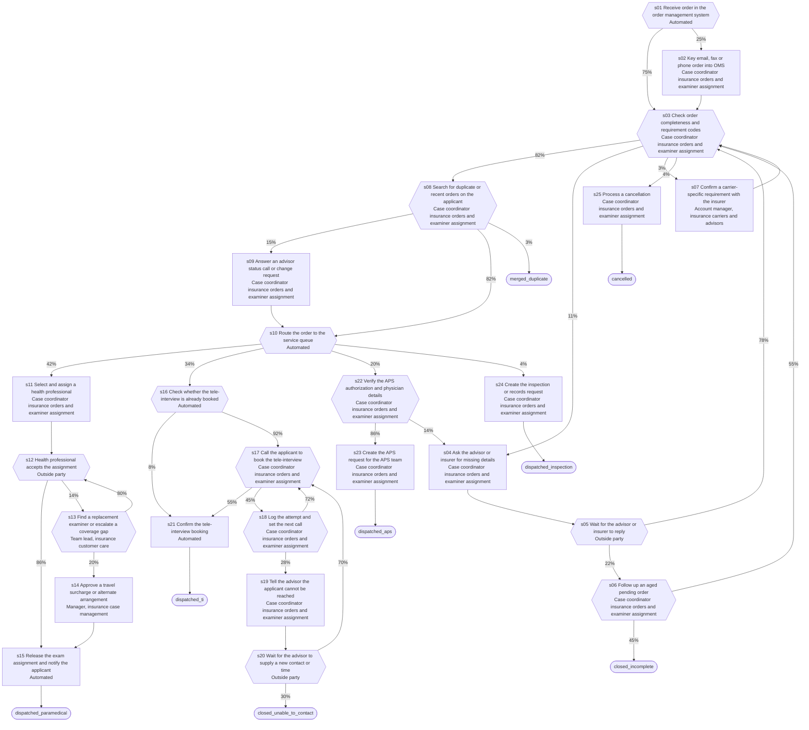

# Take and manage insurance medical evidence orders

`dls-in-order-management` · medical laboratory and health services (insurance medical evidence) · insurance solutions order desk and case management · part of `diagnostic-lab-services-co`

When a life insurer needs medical evidence before it can underwrite an application, the advisor or the insurer orders a paramedical exam, a tele-interview, an attending physician statement (APS) or an inspection report from the company. Case coordinators at the order desk check each order, key the ones that arrive by email, fax or phone, look for duplicates, assign a nearby health professional, phone applicants to book tele-interviews and set up APS and inspection requests, while keeping the advisor's status screen current. The work is fast per order but high volume, and most delay comes from incomplete orders, examiners who decline assignments in thin areas and applicants who do not answer scheduling calls.

| | |
|---|---|
| Unit of work | one insurance order |
| Starts when | An advisor or insurer submits a medical evidence order online, by insurer feed, email, fax or phone. |
| Done when | The order is assigned to an examiner who accepted it, booked as a tele-interview, released to the APS or inspection team, or closed as cancelled, duplicate, incomplete or unable to contact, with the status visible in iCARE. |
| Organisation | The insurance medical evidence business line of a large Canadian laboratory company, serving every Canadian life insurer through an order management system, a national network of employed and contracted examiners and a tele-interview centre. (3,300 employees, 2019-2022) |
| Volume | 38,000 cases a month (range 28,000 to 48,000) |

## Where it sits

- Starts with **insurance_order** from insurance_advisor (65% of cases)
- Starts with **insurance_order** from life_insurer (35% of cases)
- Sends **exam_assignment** to in-paramedical-exam (outcome: dispatched_paramedical)
- Sends **ti_booking** to in-tele-interview (outcome: dispatched_ti)
- Sends **aps_request** to in-aps-collection (outcome: dispatched_aps)
- Sends **inspection_request** to in-inspection-reports (outcome: dispatched_inspection)
- Sends **order_status** to insurance_advisor (outcome: any)

## Flow

## Roles

| Role | Department | Layer | FTE on this process | Loaded cost per hour | Evidence |
|---|---|---|---:|---:|---|
| Case coordinator (insurance orders and examiner assignment) | Insurance order desk and case management | individual contributor | 58 | 30 CAD | B [dyn_adv], [dyn_car], [jb13112] |
| Team lead, insurance customer care | Insurance order desk and case management | supervisor | 3 | 40 CAD | C |
| Manager, insurance case management | Insurance solutions (The model laboratory's insurance testing service) | manager | 0.5 | 66 CAD | C |
| Account manager, insurance carriers and advisors | Insurance solutions (The model laboratory's insurance testing service) | individual contributor | 0.5 | 60 CAD | C |

## Steps

Hands-on time and the wait before each step show the most common value. Evidence tier A is a sourced number, B a sourced description, C the author's estimate.

| Step | Who | Kind | Hands-on | Wait before | Control | Evidence |
|---|---|---|---:|---:|---|---|
| **s01 Receive order in the order management system.** An advisor or insurer submits a paramedical, tele-interview, APS or inspection order through the web ordering screens or an insurer's electronic feed, which creates an order record in the OMS with an order number and posts a 'received' status to iCARE. Email, fax and phone orders arrive in a shared intake queue instead and are not yet in the OMS. | Automated | intake | 0 min | 0 min |  | B [dyn_adv], [dyn_car], [dyn_paraweb] |
| **s02 Key email, fax or phone order into OMS.** A case coordinator opens the faxed requisition, email or phone notes, creates the order in the OMS and types the applicant's name, date of birth, address, phone numbers, language, insurer, policy or application number, advisor code and the requirement codes. Handwritten faxes are often hard to read, so the coordinator compares the fields with the insurer's requirement form. | Case coordinator (insurance orders and examiner assignment) | data entry | 6 min | 2.0 h |  | B [dyn_adv], [soa2011] |
| **s03 Check order completeness and requirement codes.** The coordinator opens the order, confirms that the applicant can be reached (at least one valid phone number and an address), that the insurer and policy number are present and that each requirement code matches a product the insurer has set up (for example its blood profile code, urine only, resting ECG, or the insurer's tele-interview script). Special instructions such as fasting, French-language service or a workplace visit are noted on the order. | Case coordinator (insurance orders and examiner assignment) | validation | 2 min | 2.0 h | Carrier service agreements and the order desk procedure: an order is assigned only when applicant identity, contact details, insurer, policy number and valid requirement codes are present | B [dyn_car], [dyn_tips], [soa2011], [wp2015] |
| **s04 Ask the advisor or insurer for missing details.** The coordinator sets the order to 'pending information' in the OMS, which shows on iCARE, and phones or emails the advisor's office or the insurer's new business area naming exactly what is missing, such as a working phone number, the policy number or which blood profile is wanted. | Case coordinator (insurance orders and examiner assignment) | communication | 4 min | 30 min |  | B [wp2015], [dyn_faq] |
| **s05 Wait for the advisor or insurer to reply.** The order waits in the pending queue until the advisor's assistant or the insurer's new business clerk replies by email, phone or by editing the order on the web, often after reaching the applicant first. The coordinator does nothing until a reply arrives or the follow-up date on the aging report comes up. | Outside party | external wait | 0 min | 1.0 d |  | B [ipipeline], [wp2015] |
| **s06 Follow up an aged pending order.** From the daily aging report of pending orders, the coordinator calls or emails the advisor again, records the attempt and, after the carrier's limit (often 30 days or three follow-ups), closes the order as incomplete and notifies the advisor and insurer through iCARE. | Case coordinator (insurance orders and examiner assignment) | communication | 4 min | 2.0 d |  | C |
| **s07 Confirm a carrier-specific requirement with the insurer.** When the requirement code or combination is not set up for that insurer, or looks inconsistent with the insurer's age and amount grid, the account manager emails or calls the carrier's underwriting or new business contact to confirm what to collect and updates the carrier's requirement table if it changed. | Account manager, insurance carriers and advisors | communication | 10 min | 1.0 d |  | B [equitable1343], [soa2011] |
| **s08 Search for duplicate or recent orders on the applicant.** The coordinator searches the OMS by applicant name and date of birth for open orders or requirements completed in the last 12 months, for the same or another insurer. A duplicate order is linked and cancelled, and when two insurers order at once the coordinator flags the orders so one visit covers both, with the applicant's consent for each insurer. | Case coordinator (insurance orders and examiner assignment) | lookup | 1 min | 2 min | Carrier billing terms: one charge per requirement; recent evidence (within 12 months) reused only when the insurer asks | B [equitable1343], [empire_fug] |
| **s09 Answer an advisor status call or change request.** The coordinator takes an advisor's call or email asking whether the order was received, who the examiner is or when the interview is, or asking to change the applicant's phone number, address or appointment preference, updates the OMS and confirms by email. Many of these questions could be answered in iCARE. | Case coordinator (insurance orders and examiner assignment) | communication | 4 min | 0 min |  | B [dyn_faq], [examone2021] |
| **s10 Route the order to the service queue.** The OMS places the order in the work queue for its service type: paramedical and lab collection orders go to the examiner assignment queue, tele-interviews to scheduling, APS orders to APS set-up and inspection or records orders to the inspection team's set-up queue. | Automated | system auto | 0 min | 0 min |  | B [dyn_paraweb], [dyn_car] |
| **s11 Select and assign a health professional.** The coordinator looks up the applicant's postal code on the territory map, opens the availability calendar of nearby employed and contracted health professionals, checks language and skills (phlebotomy, ECG equipment) and current load, and assigns the order. Rush and large-amount orders go to examiners with the shortest booking times. | Case coordinator (insurance orders and examiner assignment) | judgment | 2.5 min | 2.0 h | Examiner credentialing: only health professionals whose licence, phlebotomy and ECG training are on file may receive the requirement | B [dyn_adv], [dyn_car] |
| **s12 Health professional accepts the assignment.** The assigned examiner sees the order on the health professional portal or phone app and accepts it, or declines because of distance, workload or holidays. Contracted examiners are paid per visit and may leave an assignment unanswered for several hours. | Outside party | external wait | 0 min | 3.0 h |  | C |
| **s13 Find a replacement examiner or escalate a coverage gap.** The team lead reviews unaccepted assignments, calls other examiners in the region, widens the search radius or offers an appointment at a collection centre or partner clinic. For remote addresses the team lead may propose an examiner who charges travel time, which needs manager approval. | Team lead, insurance customer care | coordination | 8 min | 6.0 h |  | C |
| **s14 Approve a travel surcharge or alternate arrangement.** The case management manager reviews the proposed travel charge or out-of-network examiner against the carrier's fee schedule, approves it or asks the account manager to get the insurer's agreement, and records the approval on the order. | Manager, insurance case management | approval | 6 min | 8.0 h | Carrier fee schedules pay only the reasonable cost of required evidence at standard area rates (for example Equitable form 1343 note 6); extra charges need approval | B [equitable1343] |
| **s15 Release the exam assignment and notify the applicant.** The OMS marks the order 'assigned', sends the examiner the applicant's contact details and requirements, sends the applicant a text or email that an examiner will call, and updates iCARE for the advisor and insurer. | Automated | system auto | 0 min | 1 min |  | B [dyn_adv], [dyn_car] |
| **s16 Check whether the tele-interview is already booked.** The tele-interview scheduler checks whether the order already carries an agreed appointment time, which advisors sometimes arrange with the client and type into the order comments. In 2019-2022 there was no self-service booking portal, so all other orders wait for a coordinator to call the applicant. | Automated | system auto | 0 min | 0 min |  | B [dyn_sched], [dyn_tips] |
| **s17 Call the applicant to book the tele-interview.** The coordinator phones the applicant, confirms identity with date of birth and address before mentioning the insurance application, explains the interview, asks for a 30 to 45 minute window and the preferred language, and books the slot in the tele-interview scheduler. Many applicants do not answer calls from unknown numbers during the working day. | Case coordinator (insurance orders and examiner assignment) | communication | 3.5 min | 6.0 h | Privacy procedure: confirm the applicant's identity before discussing the application, consistent with PIPEDA safeguards and consent principles | B [dyn_adv], [dyn_ti], [dyn_sched], [opc_consent] |
| **s18 Log the attempt and set the next call.** The coordinator records the attempt in the OMS, leaves a voicemail with the call-back number and booking link, sends a text or email if the order has one, and sets the next call for a different time of day. After three to five failed attempts the order goes to the advisor. | Case coordinator (insurance orders and examiner assignment) | communication | 1.5 min | 2 min |  | B [examone2021], [wp2015] |
| **s19 Tell the advisor the applicant cannot be reached.** The coordinator sets the iCARE status to 'unable to contact', emails or phones the advisor with the numbers tried and the dates of each attempt, and asks for a better number or a time when the applicant can take a call. | Case coordinator (insurance orders and examiner assignment) | communication | 3 min | 1.0 h |  | B [examone2021] |
| **s20 Wait for the advisor to supply a new contact or time.** The advisor calls the client and replies with a new number or a time when the applicant can take a call, or tells the order desk to cancel because the client withdrew. Orders with no reply are closed after the carrier's limit. | Outside party | external wait | 0 min | 1.0 d |  | C |
| **s21 Confirm the tele-interview booking.** The scheduler confirms the slot, sends the applicant a confirmation and reminder by text or email with a list of what to have ready (doctor's name, medications), places the booking in the tele-interviewer's schedule and updates iCARE. | Automated | system auto | 0 min | 1 min |  | B [dyn_ti] |
| **s22 Verify the APS authorization and physician details.** The coordinator checks that the order carries the applicant's signed authorization to release medical information, that the signature date is within the insurer's validity period, and that the physician's name, clinic address and fax number are complete; missing items are requested from the insurer. | Case coordinator (insurance orders and examiner assignment) | validation | 2.5 min | 4.0 h | PIPEDA consent principle and provincial health information acts (for example Ontario PHIPA): a physician discloses a patient's records to an insurer only with the patient's express consent | B [dyn_aps], [opc_consent], [soa2011], [equitable1343] |
| **s23 Create the APS request for the APS team.** The coordinator enters the physician and clinic in the OMS, picks the request type the insurer wants (full chart copy, specific questionnaire or limited period), records whether the insurer pre-approved the physician's fee, attaches the authorization image and releases the request to the APS team's queue, which updates iCARE. | Case coordinator (insurance orders and examiner assignment) | data entry | 3 min | 5 min |  | B [dyn_aps], [bcmj2023], [dyn_paraweb] |
| **s24 Create the inspection or records request.** The coordinator checks which report the insurer wants (personal history or financial inspection interview, motor vehicle record or credit report), confirms the applicant's licence number or consent where needed and releases the request to the inspection team. | Case coordinator (insurance orders and examiner assignment) | data entry | 4 min | 4.0 h |  | B [dyn_car] |
| **s25 Process a cancellation.** When the advisor or insurer cancels the order (application withdrawn, declined on other evidence or moved to accelerated underwriting), the coordinator cancels it in the OMS, recalls any assignment, records the reason so no charge is billed and confirms the cancellation through iCARE. | Case coordinator (insurance orders and examiner assignment) | data entry | 3 min | 2.0 h |  | C [genre2021] |

## Exceptions

| Exception | Share of cases | What happens |
|---|---:|---|
| Incomplete order | 12% | A phone number, policy number, requirement code or APS authorization is missing; the order waits on the advisor or insurer and about 1 in 10 of these is closed incomplete. |
| Examiner declines or coverage gap | 6% | The assigned examiner declines or does not answer; the team lead finds another examiner and remote addresses need a manager-approved travel surcharge. |
| Applicant cannot be reached for tele-interview booking | 5% | Several calls go unanswered, the advisor is asked for a better number and some orders close as unable to contact. |
| Cancellation before dispatch | 4% | The application is withdrawn, declined on other evidence or moved to an accelerated path. |
| Requirement not set up for the insurer | 3% | The account manager confirms the requirement with the carrier before the order can proceed. |

## Benchmarks

| Metric | Value | Unit | Population | Evidence |
|---|---|---|---|---|
| cycle_time_days | p50 1.0, p90 4.0 | calendar days from order received to dispatch (examiner accepted, interview booked or request released) or closure | Canadian insurance medical evidence orders, 2019-2022 | C [dyn_para], [dyn_ti] |
| applicant_contact_standard_hours | 24 to 48 | hours from order receipt to first applicant contact (paramedical) | Company service standard | A [dyn_para] |
| ti_turnaround_saving_self_serve | 2 | business days saved on average when booked in the self-serve portal | Company tele-interview orders after the portal launched in January 2023 | A [dyn_ti] |
| requirement_collection_days | aps 19.8, paramedical 15.2, missing_application_data 10.3, data_entry 1.3 | average days to collect an outstanding requirement | 62 life carriers (US), iPipeline analysis | A [ipipeline] |
| full_underwriting_days_to_decision | 26 | average days from application to decision, full underwriting | 43 US individual life carriers, 2021 | A [genre2021] |

## Pain points

- Orders arrive without a working phone number, policy number or the right requirement code, so they sit pending while the advisor tracks down the client. (steps s03, s04, s05, s06; B [wp2015], [soa2011])
- Phone booking of tele-interviews takes several call attempts over days; the self-service scheduler that removed most callouts only arrived in January 2023. (steps s16, s17, s18, s19, s20; A [dyn_ti], [dyn_sched])
- Advisors phone the desk for status that is already on iCARE, taking coordinator time. (steps s09; B [dyn_faq])
- Contracted examiners decline or ignore assignments in rural areas, so team leads hunt for coverage and approve travel charges. (steps s12, s13, s14; C)
- Manual keying of faxed and emailed orders introduces typos in phone numbers and dates of birth that surface only when the examiner cannot reach the applicant. (steps s02, s03; C)

## Assumptions

- One order is one service order. The organisation file's monthly volumes for paramedical (16,000), tele-interview (13,000), APS (8,000) and inspection (1,500) work sum to about the 38,000 orders a month, so routing shares follow those volumes.
- Advisors place about 65 percent of orders (paramedicals and most tele-interviews) and insurers about 35 percent (APS and some tele-interviews), based on SOA 2011 and Equitable's rule that the insurer orders the APS and the advisor the other evidence.
- Booking the paramedical appointment with the applicant is placed in the paramedical exam process, as the organisation file describes the health professional calling the applicant; the company's web page says a customer care representative contacts the applicant, so in practice some bookings are made centrally.
- Tele-interview booking calls are made by case coordinators here; some companies use dedicated schedulers in the tele-interview centre. The self-service scheduler launched in January 2023, so only about 8 percent of 2019-2022 orders arrive with an agreed time.
- Partners at the same address are combined into one visit when the advisor notes it, as the ordering tips ask.
- Advisor status calls overlap the waits of other steps, so their wait is set near zero and they are marked concurrent with the duplicate check.
- Case coordinator FTE (58 of 70) is set close to what hands-on time times volume implies; the organisation file's 70 coordinators also cover examiner follow-up and file release, which leaves them thinly staffed if hands-on times are longer than estimated.
- Loaded costs come from the organisation file (hourly wage times 1.35).
- Weekend and evening orders wait until the desk opens, which sets the high end of the first queue at about 40 hours.

## Sources

- [dyn_adv] Insurance advisors (link withheld) (The model laboratory, 2022). Advisors order paramedicals, APS and tele-interviews online through the Order Management System, by email or by phone; the OMS offers applicant appointment availability, text and email confirmations and reminders and copying order details; a Customer Care Representative assigns an available Health Professional and contacts the applicant; iCARE order tracking; results to carriers within 48 hours or less.
- [dyn_car] Insurance carriers (link withheld) (The model laboratory, 2022). Carriers order online, by email or by phone; orders carry applicant, insurance type and company, advisor and agency; a Customer Care Representative identifies an available Health Professional and contacts the applicant; ePara; ACORD and custom result downloads; inspection reports, MVR and credit reports offered.
- [dyn_para] Paramedical services (link withheld) (The model laboratory, 2022). Client contacted within 24 to 48 hours of receiving the order and appointment booked within 72 hours subject to client availability; carrier notified when the order is completed; paramedical 25 to 35 minutes.
- [dyn_ti] Tele-interviews (link withheld) (The model laboratory, 2023). Advisors and applicants can self-serve tele-interview scheduling through a secure portal after registering on iCARE; booking through the portal reduces turnaround by 2 business days on average compared with the traditional contact method; interview about 25 minutes.
- [dyn_paraweb] Paraweb: place your order and review status (link withheld) (The model laboratory, 2022). Orders are placed separately for Paramedical Services (PARA), Attending Physician Statements (APS) and Telephone Interviews (TI); real-time web order placement and tracking are available 24/7; order tracking by order or policy number.
- [dyn_faq] Frequently asked questions: The model laboratory's insurance testing service order tracker (link withheld) (The model laboratory, 2025). Advisors can see order status in the order tracker and are asked not to call the customer care line for updates because care staff see the same information; specimens average three business days from collection to results delivered to the carrier.
- [soa2011] [Report of the Society of Actuaries Improving the New Business Process Survey Subcommittee](https://www.soa.org/globalassets/assets/files/research/projects/research-2011-09-improving.pdf) (Society of Actuaries, 2011). Survey of 43 US and Canadian direct writers (2010): 80 percent say the producer or their staff orders age and amount requirements, 63 percent the company, 27 percent a tele-interview vendor; 88 percent say the company orders the APS; average 37 percent of paper applications received not in good order; fax still the most common way to send paper applications.
- [equitable1343] [Evidence of insurability schedule (form 1343)](https://advisor.equitable.ca/advisor/getattachment/f89fbb4f-ad49-412a-a057-36aff7504628/1343-FINAL-EN.pdf) (The Equitable Life Insurance Company of Canada, 2024). Age and amount grid of paramedical, labs, APS, MVR and financial requirements; requirements based on total coverage applied for plus coverage issued in the past 12 months; evidence completed in the past 12 months may be used; the insurer orders the APS and the advisor is responsible for ordering any other required evidence; only the reasonable cost of required evidence at standard area rates is paid.
- [empire_fug] [Field underwriting guide for life and critical illness insurance](https://www.empire.ca/sites/default/files/2024-02/INS-1162-FieldUnderwritingGuide-EN-web.pdf) (Empire Life, 2024). Medical requirements completed in the past 12 months can usually be accepted subject to a current non-medical; requirements are shared with other companies only when specifically asked; age and amount requirements are not arranged for trial applications until eligibility is determined.
- [ipipeline] [Five days to issue (iPipeline analysis of outstanding requirements)](https://uk.ipipeline.com/5days/) (iPipeline, 2021). Across 62 life carriers, average collection time of outstanding requirements: APS orders 19.8 days, paramedical exam 15.2 days, missing application data 10.3 days, APS review 1.4 days, data entry 1.3 days.
- [genre2021] [U.S. Individual Life Accelerated Underwriting Survey 2021 summary results](https://genre.com/content/dam/generalreinsuranceprogram/documents/surveylhau21-en.pdf) (Gen Re, 2021). 43 carriers: full underwriting workflow averages 26 days from application submission to decision (range of averages 5 to 121), accelerated workflow 6 days; AU improves time by about 20 business days.
- [wp2015] [Why does it take so long to get my policies issued?](https://www.wealthprofessional.ca/investments/life-and-health-insurance/why-does-it-take-so-long-to-get-my-policies-issued/197115) (Wealth Professional (Munich Re chief underwriter), 2015). Canadian placement time fell by four to six days since 2012; some companies report an average of 18 days to obtain an APS; tele-interviews, paramedicals and inspections are rescheduled or need call backs when clients are not prepared; incomplete applications go to a pending queue while the advisor tracks down the client.
- [examone2021] [5 key enhancements that move the life insurance exam process forward](https://blog.examone.com/blog/2021/11/22/examone-is-redesigning-the-paramedical-experience/) (ExamOne (Quest Diagnostics), 2021). Agents can book through ScheduleNow when they submit an online exam order, removing follow-up calls to the applicant; texts with links to book, confirmations and reminders with cancel or reschedule options; agents follow open cases in carrier or vendor portals.
- [opc_consent] [PIPEDA fair information principle 3: Consent](https://www.priv.gc.ca/en/privacy-topics/privacy-laws-in-canada/the-personal-information-protection-and-electronic-documents-act-pipeda/p_principle/principles/p_consent/) (Office of the Privacy Commissioner of Canada, 2020). Meaningful consent is required to collect, use and disclose personal information; express consent is generally required for sensitive information; consent can be withdrawn subject to notice.
- [bcmj2023] [A delay in the attending physician's statement can delay your insurance application](https://bcmj.org/node/9757) (British Columbia Medical Journal, 2023). An underwriting service sends the APS request to the physician and follows up about every two weeks; insurers may close the application if the APS stays outstanding; applicants often finish health testing within a few weeks and then wait several more weeks for the APS.
- [jb13112] [Wages: Medical administrative assistant in Ontario (NOC 13112)](https://www.jobbank.gc.ca/marketreport/wages-occupation/25791/ON) (Government of Canada Job Bank, 2025). Ontario hourly wages low 17.95, median 25.00, high 32.70 dollars (Labour Force Survey 2023-2024); Toronto median 23.00.
- [dyn_sched] The model laboratory's insurance testing service scheduler user guide (link withheld) (The model laboratory, 2023). The self-service tele-interview scheduler launched on 9 January 2023 to remove callouts and telephone tag, improve turnaround and avoid no-shows; advisors can book for the applicant using order identifiers; applicants get email or text links and reminders 24 hours and 1 hour before.
- [dyn_tips] Order Management System user tips (link withheld) (The model laboratory, 2022). Advisors register as requestors or head office administrators; rush orders should give the applicant's primary phone, preferred location, availability and language; partners at the same address can be noted for one visit and orders duplicated; errors found after submission must be phoned in to the office.
- [dyn_aps] APS collection (link withheld) (The model laboratory, 2022). An APS request needs a current and valid authorization from the applicant (some hospitals or physicians require an original signature) and the attending physician's name and address; orders come from the insurer through the secure website; prior fee approval from the insurer and prepayment to the physician where required; forms faxed or couriered; follow-ups on the insurer's contact cycle.

Written by claude-opus on 2026-11-17.
