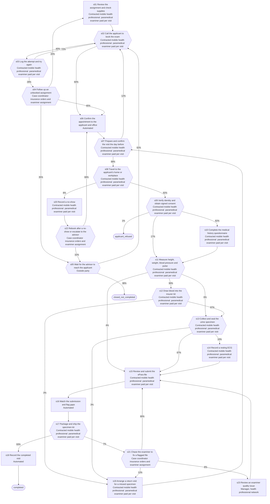

# Perform the paramedical exam

`dls-in-paramedical-exam` · medical laboratory and health services (insurance medical evidence) · insurance solutions health professional network · part of `diagnostic-lab-services-co`

A paramedical exam gives a life insurer measured evidence about an applicant's health: a medical history questionnaire, height, weight, blood pressure and pulse, blood and urine specimens and sometimes a resting ECG. A mobile health professional, usually a contractor paid per visit, phones the applicant to book, visits the home or workplace, obtains signed consent, collects the evidence into ePara and ships the specimen kit to the laboratory, while office coordinators chase unbooked assignments, no-shows and incomplete files. Most elapsed time is spent reaching the applicant and waiting for a convenient appointment; no-shows, failed draws and missing items send cases back for another call or visit.

| | |
|---|---|
| Unit of work | one paramedical exam |
| Starts when | An exam assignment accepted by a health professional appears in the health professional app. |
| Done when | The paramedical file is transmitted and matched to the order, the specimen kit is with the courier and the visit record is created for examiner pay, or the order is closed because the applicant withdrew, refused or could not be reached. |
| Organisation | The insurance medical evidence business line of a large Canadian laboratory company with a national network of about 60 employed and more than 1,200 contracted mobile health professionals. (3,300 employees, 2019-2022) |
| Volume | 16,000 cases a month (range 12,000 to 21,000) |

## Where it sits

- Starts with **exam_assignment** from in-order-management (100% of cases)
- Sends **insurance_specimen** to in-insurance-lab-testing (outcome: completed)
- Sends **paramedical_file** to in-case-review-release (outcome: completed)
- Sends **completed_visit_record** to in-hp-network-management (outcome: completed)
- Sends **exam_assignment** to contracted_health_professionals (outcome: any)

## Flow

## Roles

| Role | Department | Layer | FTE on this process | Loaded cost per hour | Evidence |
|---|---|---|---:|---:|---|
| Contracted mobile health professional (paramedical examiner paid per visit) | Health professional network (contracted) | individual contributor | 200 | 35 CAD | C [dyn_hp], [hh2012] |
| Mobile health professional (paramedical examiner, employed) | Health professional network | individual contributor | 55 | 38 CAD | B [dyn_para], [jb33101] |
| Case coordinator (insurance orders and examiner assignment) | Insurance order desk and case management | individual contributor | 5 | 30 CAD | B [dyn_car], [jb13112] |
| Manager, health professional network | Health professional network | manager | 0.5 | 66 CAD | C |

## Steps

Hands-on time and the wait before each step show the most common value. Evidence tier A is a sourced number, B a sourced description, C the author's estimate.

| Step | Who | Kind | Hands-on | Wait before | Control | Evidence |
|---|---|---|---:|---:|---|---|
| **s01 Review the assignment and check supplies.** The examiner opens the new assignment in the health professional app, reads which requirements the insurer ordered (paramedical questionnaire, vitals, blood profile, urine, resting ECG), notes fasting or language instructions and checks that the right insurer kit, urine cup and, if needed, the ECG machine and electrodes are on hand. | Contracted mobile health professional (paramedical examiner paid per visit) | intake | 3 min | 4.0 h |  | B [dyn_hp], [dyn_para] |
| **s02 Call the applicant to book the exam.** The examiner phones the applicant, confirms identity before naming the insurer, explains what will be collected, agrees a time and place (home or workplace, often early morning when fasting is required), tells the applicant how long to fast, to avoid alcohol beforehand and to have photo ID and the details of doctors seen in the last five years ready, asks about bigger cuff or scale needs, and records the appointment in the app. | Contracted mobile health professional (paramedical examiner paid per visit) | communication | 6 min | 10.0 h | Privacy procedure: confirm the applicant's identity before discussing the insurance application | A [dyn_para], [dyn_bro2018] |
| **s03 Log the attempt and try again.** The examiner records the attempt in the app, leaves a voicemail with a call-back number and tries again at a different time of day. When the 48-hour contact standard is about to pass without a booking, the assignment shows as unbooked on the office aging report. | Contracted mobile health professional (paramedical examiner paid per visit) | communication | 2 min | 8.0 h |  | B [dyn_para], [wp2015] |
| **s04 Follow up an unbooked assignment.** From the daily report of assignments not booked within 48 hours, the coordinator calls the examiner for an update and phones the applicant from the office line, books the appointment directly if reached, reassigns the order to another examiner if the first one is overloaded, or asks the advisor for help. | Case coordinator (insurance orders and examiner assignment) | coordination | 7 min | 16.0 h | Carrier service level: applicant contact within 24 to 48 hours and booking within 72 hours, monitored on the aging report | B [dyn_car], [examone2021] |
| **s05 Wait for the advisor to reach the applicant.** The advisor contacts the client and replies with a new number or a good time to call, or tells the office the client has withdrawn or chosen another insurer. The assignment waits on hold until then. | Outside party | external wait | 0 min | 2.0 d |  | C |
| **s06 Confirm the appointment to the applicant and office.** The app sets the order to 'scheduled', which shows on iCARE for the advisor and insurer, and sends the applicant a confirmation by text or email with the time, the fasting instructions and a reminder the day before. | Automated | system auto | 0 min | 1 min |  | B [examone2021] |
| **s07 Prepare and confirm the visit the day before.** The day before, the examiner loads the order into ePara on the laptop, plans the route between the day's appointments and calls or texts the applicant to confirm the time and the fasting instruction. Applicants who now cannot make it are rebooked on the spot. | Contracted mobile health professional (paramedical examiner paid per visit) | coordination | 3 min | 2.0 d |  | B [dyn_para], [examone2021] |
| **s08 Travel to the applicant's home or workplace.** The examiner drives from the previous appointment or home to the applicant's address with the kits, centrifuge if used, scale, blood pressure cuff and ECG machine. Travel time depends on the density of appointments; rural visits can take over an hour each way. | Contracted mobile health professional (paramedical examiner paid per visit) | physical | 30 min | 15.0 h |  | C [hh2012] |
| **s09 Verify identity and obtain signed consent.** The examiner checks the applicant's government photo ID against the order, confirms two identifiers, explains the exam and the tests, and has the applicant sign the insurer's authorization and the Notice and Consent and Chain of Custody section of the Lab ID slip, which permits collection, testing and release of results to the insurer. The examiner does not proceed if the applicant refuses or alters the slip. | Contracted mobile health professional (paramedical examiner paid per visit) | validation | 5 min | 2 min | PIPEDA consent principle and the insurer's authorization: express written consent before collecting health information and specimens; laboratory practice of two-identifier checks | A [dyn_para], [dyn_kit2020], [crl_instr], [opc_consent] |
| **s10 Complete the medical history questionnaire.** The examiner reads the insurer's medical questions in ePara (conditions, treatments, medications, doctors, family history, tobacco, alcohol), types the answers and details such as dates and physician names, then has the applicant review and sign the declaration. | Contracted mobile health professional (paramedical examiner paid per visit) | data entry | 12 min | 0 min |  | B [dyn_para], [dyn_during], [hh2012] |
| **s11 Measure height, weight, blood pressure and pulse.** The examiner weighs the applicant on a portable scale, measures height, takes the blood pressure and pulse after the applicant has rested, repeats the blood pressure when the first reading is high and records each reading in ePara. | Contracted mobile health professional (paramedical examiner paid per visit) | physical | 7 min | 0 min |  | B [dyn_para] |
| **s12 Draw blood into the insurer kit.** The examiner records the time of the last food and drink, performs the venipuncture, fills the two or three tubes in the insurer's kit, labels them with the barcodes from the Lab ID slip and enters the insurer's lab code. The serum tube clots upright for 30 minutes and is centrifuged within 2 to 4 hours, then the serum is poured into the aliquot tube. A difficult draw may take a second attempt. | Contracted mobile health professional (paramedical examiner paid per visit) | physical | 11 min | 0 min | Laboratory specimen collection requirements (ISO 15189 pre-examination rules applied by the receiving laboratory): correct tube, fill and labelling | A [dyn_para], [dyn_kit2020], [crl_instr] |
| **s13 Collect and seal the urine specimen.** The applicant provides urine in the kit cup; the examiner checks and records its temperature, pours it into the labelled tubes and seals them with tamper-evident tape that the applicant signs and dates. | Contracted mobile health professional (paramedical examiner paid per visit) | physical | 6 min | 0 min | Insurer and laboratory collection rules: urine with every blood kit, temperature recorded and tamper-evident seal signed by the applicant | A [crl_instr], [dyn_para] |
| **s14 Record a resting ECG.** The examiner asks the applicant to lie on a bed or couch, places the chest and limb electrodes, records the tracing on the portable ECG machine, checks it is free of artifact and attaches the tracing to the file or transmits it. | Contracted mobile health professional (paramedical examiner paid per visit) | physical | 18 min | 0 min |  | A [dyn_para] |
| **s15 Review and submit the ePara file.** Before leaving or that evening, the examiner checks the file in ePara, which flags any required field left blank, completes missing answers, confirms all signatures are captured and transmits the file; for carriers still on paper the forms are scanned and uploaded. | Contracted mobile health professional (paramedical examiner paid per visit) | review | 6 min | 1.0 h | ePara built-in completeness edits and insurer documentation rules: required fields and signatures before transmission | B [dyn_hp], [examone2016] |
| **s16 Match the submission and flag gaps.** The OMS matches the ePara file to the order, checks that every ordered requirement has a record (questionnaire, vitals, specimen barcode, ECG) and puts the order on a coordinator's exception list when something is missing or a specimen barcode does not match. | Automated | system auto | 0 min | 5 min |  | C [dyn_hp] |
| **s17 Package and ship the specimen kit.** The examiner places the tubes in the clamshell with absorbent sheets, puts the laboratory copy of the authorization form in the bag pocket, seals it in the courier envelope with its own waybill and keeps it refrigerated at 2 to 8 C until the courier picks it up or it is dropped at a depot, within one day of collection. Sharps go to the examiner's own sharps container, never in the kit. | Contracted mobile health professional (paramedical examiner paid per visit) | physical | 10 min | 3.0 h | Transportation of Dangerous Goods rules for exempt human specimens and laboratory instructions to ship within 24 hours | A [dyn_kit2020], [crl_instr], [dyn_faq], [dyn_car] |
| **s18 Record the completed visit.** The OMS sets the order to 'completed', posts the status to iCARE for the advisor and insurer, releases the paramedical file to the case review queue and creates the completed visit record that drives the examiner's per-visit pay. | Automated | system auto | 0 min | 5 min |  | B [dyn_para] |
| **s19 Arrange a return visit for a missed specimen.** When blood cannot be drawn or the applicant cannot give urine, the examiner submits what was completed, notes the reason in ePara and books a second visit, usually for the whole kit, at a time the applicant chooses. | Contracted mobile health professional (paramedical examiner paid per visit) | coordination | 5 min | 10 min |  | A [crl_instr] |
| **s20 Record a no-show.** The examiner waits about 15 minutes, calls the applicant, leaves a message or card, and records the no-show in the app so the office can rebook; the wasted trip is paid at a reduced fee or not at all, depending on the contract. | Contracted mobile health professional (paramedical examiner paid per visit) | communication | 15 min | 0 min |  | C [wp2015] |
| **s21 Chase the examiner to fix a flagged file.** The coordinator works the exception list, calls or messages the examiner about the missing answer, signature, tracing or mismatched barcode, and has the examiner correct and resubmit the file; a missing specimen means a return visit. | Case coordinator (insurance orders and examiner assignment) | coordination | 6 min | 8.0 h |  | C [examone2016] |
| **s22 Rebook after a no-show or escalate to the advisor.** The coordinator phones the applicant to rebook; after a second no-show or no reply, the coordinator notifies the advisor through iCARE and email, who decides with the client whether to continue. | Case coordinator (insurance orders and examiner assignment) | communication | 6 min | 16.0 h |  | C |
| **s23 Review an examiner quality issue.** The network manager reviews the examiner's recent files and any complaint, records the issue, arranges coaching or retraining, and for repeated problems restricts assignments or ends the contract. | Manager, health professional network | review | 20 min | 3.0 d | Network quality program: monitoring of examiner errors and complaints under the examiner service contract | C |

## Exceptions

| Exception | Share of cases | What happens |
|---|---:|---|
| Applicant hard to reach | 12% | The examiner cannot book within 48 hours; the coordinator calls from the office, reassigns the order or asks the advisor for help, and some orders close unbooked. |
| Applicant cancels the day before | 12% | The day-before confirmation finds the applicant cannot make it and the visit is rebooked. |
| No-show | 8% | The applicant is not home or turns the examiner away; the trip is wasted and the coordinator rebooks or escalates to the advisor. |
| Failed draw or applicant cannot void | 6% | The examiner submits what was collected and books a return visit for the kit. |
| Incomplete or mismatched submission | 7% | The OMS flags a missing answer, signature, tracing or barcode mismatch and the coordinator has the examiner correct it. |

## Benchmarks

| Metric | Value | Unit | Population | Evidence |
|---|---|---|---|---|
| cycle_time_days | p50 6, p90 16 | calendar days from accepted assignment to file transmitted and kit shipped | Canadian insurance paramedical exams, 2019-2022 | C [dyn_para], [ipipeline] |
| exam_duration_minutes | paramedical 25-35, blood_profile 20-25, urine 10-15, resting_ecg 20 | minutes per component | Company service descriptions | A [dyn_para] |
| visit_length_minutes | 45-60 | minutes on site for a paramedical with fluids | Company applicant brochure, 2018 | A [dyn_bro2018] |
| applicant_contact_and_booking_standard | contact_hours 24-48, booking_hours 72 | hours from order | Company service standard | A [dyn_para] |
| specimen_ship_standard_hours | 24 | hours from collection to shipment | Insurance laboratory examiner instructions | A [crl_instr] |
| lab_turnaround_business_days | 3 | business days from collection to results delivered to the carrier | Company insurance specimens tested in Canada | A [dyn_faq] |

## Pain points

- Reaching applicants and fitting the visit into their schedule takes most of the elapsed time; examiners and the office both make repeated calls. (steps s02, s03, s04, s07; B [dyn_para], [wp2015])
- No-shows waste examiner travel and add a rebooking cycle. (steps s08, s20, s22; C)
- Non-fasting applicants, failed draws and applicants who cannot void lead to return visits. (steps s12, s13, s19; B [crl_instr])
- Kits that miss the courier cut-off sit overnight and, if delayed further, can become non-viable and need recollection. (steps s17; B [dyn_faq], [crl_instr])
- Thin examiner coverage outside cities means long drives per visit. (steps s08; C)

## Assumptions

- Examiner steps are attributed to a contracted health professional role added with not_in_org_file, because the organisation file shows the 1,200+ contractors as an outside party. About 20 to 25 percent of exams are done by employed examiners following the same steps; a simulation should pool the two examiner roles for these steps.
- The applicant booking call is made by the examiner, as in the organisation file's process description; the company's web pages also say a customer care representative contacts the applicant, which is modelled as the office follow-up step.
- No published no-show, cancellation or failed-draw rates were found; 8 percent no-show, 12 percent day-before cancellation and about 6 percent return visits are the author's estimates.
- Exam content shares (questionnaire 82 percent, blood 90 percent, ECG about 10 percent of exams) are estimates; the blood share follows the organisation file's 15,000 specimen kits against 16,000 exams.
- Examiner hourly cost is an hourly equivalent of per-visit fees and mileage; no Canadian fee schedule was opened.
- The wait from booking to the appointment (mode 2 days, up to 7) and overnight waits before visits reflect applicant availability, not examiner capacity.
- Travel is counted once per visit (the leg to the applicant); the leg home at the end of the day is not counted.

## Sources

- [dyn_para] Paramedical services (link withheld) (The model laboratory, 2022). Client contacted within 24 to 48 hours of the order and booked within 72 hours subject to client availability; paramedical 25 to 35 minutes (history questionnaire, height, weight, blood pressure, pulse); vitals 10 to 15 minutes; urine 10 to 15 minutes, 2 to 3 vials; blood profile 20 to 25 minutes, 2 to 3 vials plus urine; resting ECG about 20 minutes; stress ECG only at a fixed facility; fasting stated at booking; client signs the Lab ID slip before any specimen is collected.
- [dyn_during] During the exam (link withheld) (The model laboratory, 2022). The exam usually takes 25 to 35 minutes; health and family history questionnaire; height, weight, blood pressure and pulse; urine sample; blood drawn with standard laboratory equipment; fasting may be required; applicant signs an authorization slip before urine, blood and saliva samples.
- [dyn_hp] Health professionals (link withheld) (The model laboratory, 2022). Mobile-friendly ordering system displays assigned paramedical appointments; health professionals enter and submit applicant information on laptops through ePara, whose integrated quality control is meant to ensure completion in one visit; a full schedule needs all supplies and equipment on hand and error-free sample collection.
- [dyn_car] Insurance carriers (link withheld) (The model laboratory, 2022). A Customer Care Representative identifies an available Health Professional and contacts the applicant; the Health Professional collects samples and applicant information, seals the samples and sends them to the laboratory; samples kept five weeks for repeat testing; ePara on tablet or laptop.
- [dyn_faq] Frequently asked questions: The model laboratory's insurance testing service order tracker (link withheld) (The model laboratory, 2025). After collection specimens are packaged and dropped off with a courier to the Brampton laboratory or to the US border depending on the carrier's lab; average three business days from collection to results delivered to the carrier; non-viable specimens may need recollection.
- [crl_instr] [Insurance collections: specific instructions for examiners](https://www.crlcorp.com/insurance-collections-specific-instructions/?hsLang=en) (Clinical Reference Laboratory, 2022). Confirm applicant identity with at least two identifiers and verify picture ID; do not draw if the applicant declines to sign or alters the authorization slip; urine required with every blood kit and its temperature recorded; tamper-evident tape signed by the applicant; if the applicant cannot void arrange a second appointment for the entire kit; ship within 24 hours or the next shipping day and refrigerate until shipped.
- [hh2012] [Hooper Holmes, Inc. annual report on Form 10-K for 2012](https://www.sec.gov/Archives/edgar/data/741815/000074181513000006/hh12311210-k.htm) (US Securities and Exchange Commission, 2013). Paramedical exams by a network of phlebotomists, nurses, EMTs and other professionals; an exam typically consists of medical history questions, height, weight, blood pressure and pulse and blood and urine specimens tested by a laboratory; branch offices replaced by integrated customer service centres.
- [ipipeline] [Five days to issue (iPipeline analysis of outstanding requirements)](https://uk.ipipeline.com/5days/) (iPipeline, 2021). Across 62 life carriers the average collection time for an outstanding paramedical exam requirement is 15.2 days, with agent and insured named as responsible parties.
- [wp2015] [Why does it take so long to get my policies issued?](https://www.wealthprofessional.ca/investments/life-and-health-insurance/why-does-it-take-so-long-to-get-my-policies-issued/197115) (Wealth Professional (Munich Re chief underwriter), 2015). Paramedical exams, blood draws and inspection calls are rescheduled or need call backs when clients are not prepared; advisors can reduce delays by telling clients what to expect.
- [examone2021] [5 key enhancements that move the life insurance exam process forward](https://blog.examone.com/blog/2021/11/22/examone-is-redesigning-the-paramedical-experience/) (ExamOne (Quest Diagnostics), 2021). Clients receive a reminder the day before the appointment; confirmation and reminder texts include cancel and reschedule options; agents are asked to remind clients when several contact attempts fail.
- [examone2016] [Ask the experts: ensuring quality throughout the applicant exam process](https://blog.examone.com/blog/2016/07/26/ask-the-experts-ensuring-quality-throughout-the-applicant-exam-process/) (ExamOne (Quest Diagnostics), 2016). Examiner app pre-populated from the order and health interview with about 70 percent of the lab slip pre-filled; app alerts examiners to missing required fields; specimens centrifuged immediately at service centres to avoid delayed-centrifugation errors.
- [opc_consent] [PIPEDA fair information principle 3: Consent](https://www.priv.gc.ca/en/privacy-topics/privacy-laws-in-canada/the-personal-information-protection-and-electronic-documents-act-pipeda/p_principle/principles/p_consent/) (Office of the Privacy Commissioner of Canada, 2020). Meaningful consent is required to collect, use and disclose personal information; express consent is generally required for sensitive information.
- [jb33101] [Wages: Medical laboratory technical assistant in Ontario (NOC 33101)](https://www.jobbank.gc.ca/marketreport/wages-occupation/4210/ON) (Government of Canada Job Bank, 2025). Ontario hourly wages low 17.95, median 26.25, high 36.00 dollars (Labour Force Survey 2023-2024).
- [jb13112] [Wages: Medical administrative assistant in Ontario (NOC 13112)](https://www.jobbank.gc.ca/marketreport/wages-occupation/25791/ON) (Government of Canada Job Bank, 2025). Ontario hourly wages low 17.95, median 25.00, high 32.70 dollars (Labour Force Survey 2023-2024).
- [dyn_kit2020] Instructions for blood/urine kit (insurance) (link withheld) (The model laboratory, 2020). Proposed insured reads and signs the Notice and Consent and Chain of Custody section and the tamper-evident seal; examiner completes the laboratory authorization form, labels tubes and enters the insurer lab code; urine temperature recorded, preservative tube minimum 7 mL; SST tube clots upright 30 minutes and should be centrifuged within 2 to 4 hours and serum poured into the aliquot tube; keep samples cool, store refrigerated at 2 to 8 C until courier pick-up; ship within one day of collection by Purolator in Canada.
- [dyn_bro2018] Everything you need to know about your insurance medical exam (link withheld) (The model laboratory, 2018). A paramedical exam is 45 to 60 minutes at home or work; fasting may be required and the applicant is told so a morning appointment can be booked; up to 3 vials of blood, urine and possibly saliva in a sealed sterile kit; portable ECG if required; vitals-only service 10 to 15 minutes; reschedule if the applicant has a cold, flu or menses; avoid alcohol 24 to 48 hours before; bring photo ID and the contact details of health professionals seen in the last 5 years.

Written by claude-opus on 2026-11-17.
