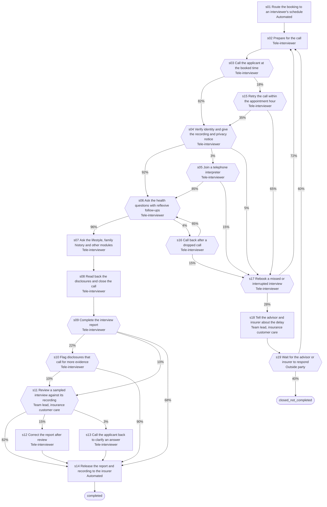

# Conduct insurance tele-interviews

`dls-in-tele-interview` · medical laboratory and health services (insurance medical evidence) · insurance solutions tele-interview centre · part of `diagnostic-lab-services-co`

A tele-interview replaces the paper health questions of a life insurance application with a recorded phone interview. A trained tele-interviewer calls the applicant at the booked time, confirms identity and gives the recording notice, reads the insurer's health, lifestyle and family history questions with reflexive follow-ups, types the answers and releases the report and recording to the insurer. A typical interview takes about 25 minutes, but missed calls, unprepared applicants and dropped lines force rebooking, and team leads review a sample of recordings before release.

| | |
|---|---|
| Unit of work | one tele-interview |
| Starts when | A tele-interview booking from the order desk appears in the tele-interview scheduler. |
| Done when | The interview report and recording are delivered to the insurer and the case review queue, or the order is closed after the advisor and insurer are told the applicant cannot be reached. |
| Organisation | The tele-interview centre of a large Canadian laboratory company's insurance medical evidence line, with about 65 bilingual and multilingual interviewers working from Brampton and remotely for every Canadian life insurer. (3,300 employees, 2019-2022) |
| Volume | 13,000 cases a month (range 9,000 to 17,000) |

## Where it sits

- Starts with **ti_booking** from in-order-management (100% of cases)
- Sends **ti_transcript** to in-case-review-release (outcome: completed)

## Flow

## Roles

| Role | Department | Layer | FTE on this process | Loaded cost per hour | Evidence |
|---|---|---|---:|---:|---|
| Tele-interviewer | Tele-interview team | individual contributor | 60 | 29 CAD | B [dyn_ti], [jb64409] |
| Team lead, insurance customer care | Insurance order desk and case management | supervisor | 4 | 40 CAD | C |

## Steps

Hands-on time and the wait before each step show the most common value. Evidence tier A is a sourced number, B a sourced description, C the author's estimate.

| Step | Who | Kind | Hands-on | Wait before | Control | Evidence |
|---|---|---|---:|---:|---|---|
| **s01 Route the booking to an interviewer's schedule.** The tele-interview scheduler places the booked slot in the calendar of an interviewer who speaks the applicant's language and is trained on the insurer's questionnaire, and sends the applicant a reminder before the appointment. | Automated | system auto | 0 min | 0 min |  | B [dyn_paraweb], [dyn_sched] |
| **s02 Prepare for the call.** Shortly before the slot the interviewer opens the order and the insurer's questionnaire in the interview software, reads the applicant's age, coverage amount and product, and checks which modules the insurer wants (health, lifestyle, vocation, travel, business or financial questions). | Tele-interviewer | lookup | 1.5 min | 1.0 d |  | C [dyn_ti] |
| **s03 Call the applicant at the booked time.** The interviewer dials the applicant within the booked hour on the recorded contact centre line. Interviews that run long push later calls toward the end of their window. | Tele-interviewer | communication | 1 min | 20 min |  | A [dyn_tibro], [dyn_prep] |
| **s04 Verify identity and give the recording and privacy notice.** The interviewer confirms the applicant's full name, date of birth and address against the order, states that the call is recorded and that the answers go to the named insurer for underwriting, and asks the applicant to confirm they agree to continue. Applicants who are driving, at work or without their medication list are offered a new time. | Tele-interviewer | validation | 2 min | 0 min | PIPEDA consent principle and Privacy Commissioner guidance on recording customer calls: notice of recording and its purpose and consent before collecting health information | A [opc_record], [opc_consent], [wp2015] |
| **s05 Join a telephone interpreter.** For a language no interviewer on shift speaks, the interviewer dials the interpreter service, briefs the interpreter on confidentiality and the call's purpose, and conferences the applicant back in; the interview then runs through the interpreter. | Tele-interviewer | coordination | 7 min | 5 min |  | C [dyn_paraweb] |
| **s06 Ask the health questions with reflexive follow-ups.** The interviewer reads each of the insurer's health questions word for word from the script; every 'yes' opens reflexive questions on dates, diagnosis, treatment, medications and doses, tests, time off work and the treating physician's name and address, and the interviewer types the answers into the questionnaire software as the applicant speaks. | Tele-interviewer | data entry | 12 min | 0 min |  | B [dyn_ti], [dyn_tibro] |
| **s07 Ask the lifestyle, family history and other modules.** The interviewer asks the family history (parents and siblings, ages and causes of death), height and weight and recent changes, tobacco, alcohol and drug use, driving record, travel and risky activities, and any vocation, business or financial questionnaire the insurer ordered. | Tele-interviewer | data entry | 4 min | 0 min |  | B [dyn_tibro], [dyn_ti] |
| **s08 Read back the disclosures and close the call.** The interviewer summarises the conditions, medications and physicians disclosed, corrects anything the applicant changes, confirms the family doctor's contact details for a possible APS, records the applicant's verbal confirmation that the answers are true and complete, and explains that the insurer may order other requirements. | Tele-interviewer | review | 2 min | 0 min |  | B [dyn_ti], [wp2015] |
| **s09 Complete the interview report.** After the call the interviewer finishes the report in the questionnaire software, adds notes on anything unclear, attaches the call recording, and runs the software's completeness check before marking the interview complete. | Tele-interviewer | drafting | 3 min | 2 min |  | B [dyn_sched] |
| **s10 Flag disclosures that call for more evidence.** Where the insurer's instructions say a disclosure needs more evidence (for example a heart condition or diabetes calls for an APS, or the applicant reports a new doctor), the interviewer records the flag and the physician details on the report so the underwriter or order desk can order it. | Tele-interviewer | judgment | 2 min | 0 min |  | B [soa2011] |
| **s11 Review a sampled interview against its recording.** The team lead listens to the recording of interviews picked by the quality sample (all interviews of new interviewers, a few percent of others), compares it with the report, checks the script was read as written and the recording notice given, and scores the interview. | Team lead, insurance customer care | review | 18 min | 6.0 h | Insurer service agreements and the company's quality program: sample review of recorded interviews before release | C [opc_record] |
| **s12 Correct the report after review.** The interviewer reads the reviewer's notes, replays the relevant part of the recording and corrects the report, for example a missed medication dose or a disclosure placed under the wrong question. | Tele-interviewer | data entry | 6 min | 4.0 h |  | C |
| **s13 Call the applicant back to clarify an answer.** When the recording leaves an answer unclear (a date, a medication, a physician), the interviewer phones the applicant, verifies identity again, asks only the open question on the recorded line and updates the report. | Tele-interviewer | communication | 6 min | 16.0 h |  | B [wp2015] |
| **s14 Release the report and recording to the insurer.** The system sends the completed report and the recording to the insurer in its format through the electronic delivery channel, marks the interview complete in iCARE for the advisor and passes the report to the case review queue. | Automated | system auto | 0 min | 15 min |  | B [dyn_sched] |
| **s15 Retry the call within the appointment hour.** The interviewer tries the applicant again, and any second number on the order, two or three times within the booked hour and leaves a voicemail saying when they will try again. | Tele-interviewer | communication | 2 min | 15 min |  | C [dyn_tibro] |
| **s16 Call back after a dropped call.** When the line drops, the interviewer calls the applicant back right away and resumes from the last completed question; if the applicant cannot continue, the rest of the interview is rebooked. | Tele-interviewer | communication | 2 min | 2 min |  | A [dyn_tibro] |
| **s17 Rebook a missed or interrupted interview.** Following the problem file procedure, the interviewer or scheduling desk calls, texts or emails the applicant to offer a new slot and books it; after repeated no-shows or no reply the file goes to the team lead. | Tele-interviewer | communication | 4 min | 8.0 h |  | A [dyn_sched] |
| **s18 Tell the advisor and insurer about the delay.** The team lead sets the order to a problem status in iCARE and emails or phones the advisor and the insurer's new business contact with the attempts made, asking them to have the applicant call in or confirm whether to close the order. | Team lead, insurance customer care | communication | 5 min | 8.0 h |  | A [dyn_sched] |
| **s19 Wait for the advisor or insurer to respond.** The advisor reaches the applicant and the applicant calls in or books a new time, or the insurer cancels the requirement because the application was withdrawn or decided without it. | Outside party | external wait | 0 min | 2.0 d |  | C |

## Exceptions

| Exception | Share of cases | What happens |
|---|---:|---|
| Applicant misses the call | 12% | The applicant does not answer within the booked hour; the interview is rebooked and repeated no-shows go to the advisor and insurer. |
| Applicant not ready | 5% | The applicant is driving, at work or without the medication list and asks for another time. |
| Interpreter needed | 3% | No interviewer on shift speaks the applicant's language, so an interpreter is conferenced in or the interview is rebooked with one. |
| Dropped call | 4% | The line drops mid-interview and the interviewer calls back to resume or rebooks. |
| Quality review finds an error | 2% | The reviewer finds a missed detail or misplaced answer; the report is corrected or the applicant called back. |

## Benchmarks

| Metric | Value | Unit | Population | Evidence |
|---|---|---|---|---|
| cycle_time_days | p50 2, p90 7 | calendar days from booking reaching the interviewer schedule to report released | Canadian insurance tele-interviews, 2019-2022 | C [dyn_ti], [dyn_tibro], [soa2011] |
| interview_length_minutes | 25 | minutes, typical | Company tele-interviews | A [dyn_ti], [dyn_prep] |
| call_window_minutes | 60 | minutes after the booked start within which the applicant is called | Company tele-interviews | A [dyn_tibro] |

## Pain points

- Applicants miss the booked call or are not prepared, so interviews are rebooked and some files stall until the advisor intervenes. (steps s03, s15, s17, s18, s19; B [dyn_sched], [wp2015])
- Answers typed while the applicant speaks miss dates, doses or physician details, which surface in review or later as underwriter questions. (steps s06, s08, s11; C)
- Quality review depends on listening to recordings, which takes about as long as the interview itself, so only a small sample is checked. (steps s11; C)
- Each insurer has its own script and follow-up rules, so interviewers must be trained on many questionnaires. (steps s02, s10; B [dyn_ti], [soa2011])

## Assumptions

- The 18 percent missed-call share, 5 percent not-ready share, 10 percent quality sample and 22 percent follow-up flag share are estimates; no published rates were found.
- Disclosures that call for more evidence are recorded on the report for the insurer or the order desk; the organisation file's process map has no link from tele-interviews back to order management, although in practice a disclosure often leads to a new APS or paramedical order.
- Applicants confirm their answers verbally on the recorded line; some insurers also send the transcript for signature with the policy, which is outside this process.
- Rebooking is done by the interviewer or the tele-interview scheduling desk; the organisation file has no separate scheduler role for this team.
- Phone work is given a desk work share of 0.7 to 0.9: it is done at a desk in the interview software but consists of talking with the applicant.
- Loaded costs come from the organisation file (hourly wage times 1.35).

## Sources

- [dyn_ti] Tele-interviews (link withheld) (The model laboratory, 2023). Tele-interview is the applicant's health history taken by phone by a trained professional for the insurer; questionnaires include reflex questions and may include lifestyle or vocation questionnaires; approximately 25 minutes depending on the history; applicants should have their physician's details, medications, ID, heights and weights and travel dates ready; a health professional may contact the applicant for other services the insurer requires.
- [dyn_prep] Prepare for your medical exam (applicant resources) (link withheld) (The model laboratory, 2022). The interviewer calls within the hour of the scheduled appointment; the interview usually runs 25 to 30 minutes and can take longer depending on answers and medical history.
- [dyn_tibro] Booking your telephone interview is easier than ever before (tele-interview brochure) (link withheld) (The model laboratory, 2023). Applicant is contacted within 1 hour of the start of the booking time because some conversations run long; if disconnected the interviewer calls back to continue; applicant should have the family doctor's contact details, current medications and doses, dates of diagnoses, height and weight, family history and lifestyle details (alcohol, tobacco, drugs, driving, risky activities).
- [dyn_sched] The model laboratory's insurance testing service scheduler user guide (link withheld) (The model laboratory, 2023). Self-service tele-interview scheduler launched 9 January 2023 to remove callouts and telephone tag, improve turnaround and avoid no-shows; reminders 24 hours and 1 hour before; interview transcripts and recordings are delivered to the carrier; for a no-show the team follows the standard problem file procedure, contacting the applicant to reschedule or the carrier to advise of the delay.
- [dyn_paraweb] Paraweb: place your order and review status (link withheld) (The model laboratory, 2022). Tele-interview service offers flexible appointment times and multilingual interviewers; orders and status available 24/7.
- [soa2011] [Report of the Society of Actuaries Improving the New Business Process Survey Subcommittee](https://www.soa.org/globalassets/assets/files/research/projects/research-2011-09-improving.pdf) (Society of Actuaries, 2011). Tele-interviews were added for protective value and because they decreased total turnaround; 27 percent of respondents let the tele-interview vendor order age and amount requirements and 10 percent let it order the APS; about a quarter said tele-interviews reduced turnaround.
- [opc_record] [Recording of customer telephone calls](https://www.priv.gc.ca/resource/fs-fi/02_05_d_14_e.asp) (Office of the Privacy Commissioner of Canada, 2008). Organizations must inform customers that a call is being recorded and why; consent is implied when the customer continues after notice, express consent may be needed for sensitive information; purposes must be stated narrowly; retention of recordings must be limited.
- [opc_consent] [PIPEDA fair information principle 3: Consent](https://www.priv.gc.ca/en/privacy-topics/privacy-laws-in-canada/the-personal-information-protection-and-electronic-documents-act-pipeda/p_principle/principles/p_consent/) (Office of the Privacy Commissioner of Canada, 2020). Meaningful consent is required to collect, use and disclose personal information; express consent is generally required for sensitive information.
- [wp2015] [Why does it take so long to get my policies issued?](https://www.wealthprofessional.ca/investments/life-and-health-insurance/why-does-it-take-so-long-to-get-my-policies-issued/197115) (Wealth Professional (Munich Re chief underwriter), 2015). Tele-interviews are rescheduled or need call backs for missing information when clients are not prepared; undisclosed doctors lead to a second APS; tele-interviewing is one of the changes that reduced turnaround.
- [jb64409] [Wages: Customer service representative, call centre in Ontario (NOC 64409)](https://www.jobbank.gc.ca/marketreport/wages-occupation/15201/ON) (Government of Canada Job Bank, 2025). Ontario hourly wages low 17.95, median 21.50, high 33.17 dollars (Labour Force Survey 2023-2024).

Written by claude-opus on 2026-11-17.
