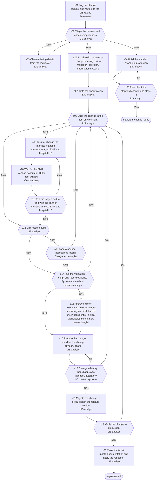

# Build and change the LIS and interfaces

`dls-it-lis-change` · medical laboratory services · information technology · part of `diagnostic-lab-services-co`

LIS analysts turn approved requests into configuration in the laboratory information system and its interfaces: new client and physician codes and report routing, new or changed tests, reference ranges and rules, report formats, and EMR, hospital and provincial repository mappings. Simple set-ups are done directly in production with a peer check; other changes are specified, built in a test environment, mapped to interfaces, tested with partners, validated by quality assurance, approved by a weekly change advisory board and released in a maintenance window. Changes wait longest in the analyst backlog, for partners' test windows and for weekly approval and release cycles, and failed validation sends about a fifth of normal changes back to the build.

| | |
|---|---|
| Unit of work | one LIS change request |
| Starts when | An approved request reaches the LIS queue: a new client account, a service desk change request, a clinical trial study build or a new test build with its validation report. |
| Done when | The change is live in production and verified, documentation and validation evidence are filed and the ticket is closed. |
| Organisation | A large Canadian laboratory company running a central LIS with middleware, an HL7 interface engine, provider and patient portals, and interfaces to hospital systems, EMRs and OLIS. (3,300 employees, 2019-2022) |
| Volume | 180 cases a month (range 120 to 250) |

## Where it sits

- Starts with **lis_change** from sl-client-onboarding (50% of cases)
- Starts with **lis_change** from it-service-desk (42% of cases)
- Starts with **lis_change** from ct-study-setup (5% of cases)
- Starts with **validation_report** from qa-new-test-validation (3% of cases)
- Sends **lis_change** to cl-core-testing (outcome: any)
- Sends **lis_change** to cl-result-reporting (outcome: any)
- Sends **lis_change** to ct-sample-testing (outcome: implemented)

## Flow

## Roles

| Role | Department | Layer | FTE on this process | Loaded cost per hour | Evidence |
|---|---|---|---:|---:|---|
| LIS analyst | LIS and integration | individual contributor | 9.4 | 60 CAD | B [s_dyn_sysval], [s_cln_2026] |
| Interface analyst (EMR and hospital LIS) | LIS and integration | individual contributor | 3.5 | 62 CAD | B [s_dyn_hospital], [s_dyn_eresults] |
| System and method validation analyst | Validation | individual contributor | 3.3 | 56 CAD | B [s_dyn_sysval] |
| Manager, laboratory information systems | LIS and integration | manager | 0.25 | 85 CAD | C |
| Charge technologist | Community laboratory testing (The model laboratory Laboratories) | supervisor | 0.6 | 58 CAD | B [s_cln_2026] |
| Laboratory medical director or clinical scientist (clinical pathologist, biochemist, microbiologist) | Community laboratory testing (The model laboratory Laboratories) | senior specialist | 0.05 | 230 CAD | C |

## Steps

Hands-on time and the wait before each step show the most common value. Evidence tier A is a sourced number, B a sourced description, C the author's estimate.

| Step | Who | Kind | Hands-on | Wait before | Control | Evidence |
|---|---|---|---:|---:|---|---|
| **s01 Log the change request and route it to the LIS queue.** A request arrives as a ticket from the service desk, a new client account form from onboarding, a study build request from clinical trials or a build request with a validation report; the ticketing system records it and places it in the LIS team's queue. | Automated | system auto | 0 min | 0 min |  | C |
| **s02 Triage the request and check completeness.** An LIS analyst reads the ticket, checks that the required fields are present (codes, ranges, routing, effective date, approver), classifies it as a pre-approved standard change or a normal change, and emails the requester when details are missing. | LIS analyst | validation | 10 min | 1.0 d |  | C |
| **s03 Obtain missing details from the requester.** The analyst waits for the requester's reply, chases once or twice by email or phone, then records the missing codes, ranges or routing details on the ticket and returns it to triage. | LIS analyst | communication | 15 min | 3.0 d |  | C |
| **s04 Build the standard change in production.** Following the work instruction, the analyst adds or changes the client or physician code, report routing (eResults, fax, EMR), courier stop link and billing account in the LIS dictionaries directly in production. | LIS analyst | data entry | 30 min | 3.0 d |  | B [s_dyn_eresults] |
| **s05 Peer check the standard change and close it.** A second analyst compares the dictionary entries with the request, checks a test order routes and bills correctly, and closes the ticket or sends it back for correction. | LIS analyst | review | 10 min | 1.0 d | Company LIS change procedure: a second analyst checks every production dictionary change | C |
| **s06 Prioritise in the weekly change backlog review.** At the weekly backlog meeting the LIS manager reviews new normal requests with their effort estimate, ranks them against client go-live dates, regulatory changes and test launches, and assigns an analyst. | Manager, laboratory information systems | approval | 10 min | 3.5 d |  | B [s_cln_2026] |
| **s07 Write the specification.** When the assigned analyst reaches the ticket in the backlog, they confirm requirements with the requester, list every dictionary, rule, report format, billing code and OLIS or EMR mapping affected, and write the build and test plan. | LIS analyst | drafting | 1.5 h | 10.0 d |  | B [s_cln_2026], [s_cln_2012] |
| **s08 Build the change in the test environment.** The analyst configures the change in the LIS test environment: test and result codes, specimen requirements, reference ranges, calculations, reflex or autoverification rules in middleware, report formats and billing codes. | LIS analyst | data entry | 3.0 h | 1.0 d |  | B [s_cln_2026] |
| **s09 Build or change the interface mapping.** An interface analyst maps the new or changed codes, units and comments into the HL7 order and result messages, updates OLIS and EMR code mappings and hospital LIS translation tables, and configures routes in the interface engine. | Interface analyst (EMR and hospital LIS) | data entry | 4.0 h | 3.0 d |  | B [s_caristix], [s_dyn_hospital] |
| **s10 Wait for the EMR vendor, hospital or OLIS test window.** The partner (an EMR vendor, a hospital laboratory or the provincial repository) has to schedule a tester and open its test environment before messages can be exchanged and checked. | Outside party | external wait | 0 min | 14.0 d |  | A [s_nirmitee] |
| **s11 Test messages end to end with the partner.** The interface analyst sends test orders and results through the interface engine, compares what the partner system displays with the expected codes, units, flags and comments, and fixes or logs discrepancies. | Interface analyst (EMR and hospital LIS) | validation | 2.0 h | 1.0 d |  | B [s_caristix] |
| **s12 Unit test the build.** The analyst places test orders on test patients, enters or loads results and checks that calculations, flags, rules and report layout behave as specified, recording the outcome against the test plan. | LIS analyst | validation | 1.0 h | 1.0 d |  | B [s_cln_2026] |
| **s13 Laboratory user acceptance testing.** A charge technologist runs the bench workflow on the test build (worklists, result entry, rerun and dilution handling, report preview) and signs off or lists problems. | Charge technologist | review | 1.5 h | 2.0 d |  | B [s_cln_2026] |
| **s14 Run the validation script and record evidence.** A system validation analyst runs a scripted test of the change and of related functions that could be affected, compares expected and actual results including output to EMRs, eResults and OLIS, captures screenshots as evidence and passes or fails the change. | System and method validation analyst | validation | 3.0 h | 4.0 d | Validation of LIS and interface changes before use (computerized system validation) under ISO 15189 and CAP; accreditation (ISO 15189 Plus, CAP, MANQAP) required for the provincial laboratory licence | B [s_dyn_sysval], [s_dyn_licences] |
| **s15 Approve rule or reference content changes.** For changes to reference intervals, critical limits, interpretive comments or autoverification and reflex rules, the medical director reviews the validation evidence and approves the clinical content. | Laboratory medical director or clinical scientist (clinical pathologist, biochemist, microbiologist) | approval | 20 min | 3.0 d | Laboratory director approval of reference intervals, critical values and result verification rules under ISO 15189 and CAP | C |
| **s16 Prepare the change record for the change advisory board.** The analyst completes the change record with risk and impact, validation evidence, implementation steps, back-out plan, the release window and the message to laboratories and clients. | LIS analyst | drafting | 30 min | 1.0 d |  | B [s_wiki_cab] |
| **s17 Change advisory board approves.** At the weekly change advisory board the LIS manager, infrastructure and laboratory representatives review the change record, check conflicts with other releases and approve, defer or reject it. | Manager, laboratory information systems | approval | 10 min | 3.5 d | ITIL-based change management policy: changes to production systems are approved by a change advisory board, separating builder and approver | B [s_wiki_cab], [s_dora2019] |
| **s18 Migrate the change to production in the release window.** In the scheduled evening or weekend release window the analyst moves the configuration from test to production, or re-keys it where the LIS has no transport tool, and activates the interface changes. | LIS analyst | data entry | 45 min | 3.0 d |  | C |
| **s19 Verify the change in production.** The analyst places an order on a production test patient, follows it to the report and the outbound interface message, and watches the interface error queue the next morning. | LIS analyst | validation | 20 min | 1.0 h |  | B [s_caristix] |
| **s20 Close the ticket, update documentation and notify the requester.** The analyst updates the LIS configuration documentation, links the validation evidence to the change record, closes the ticket and tells the requester and affected laboratories that the change is live. | LIS analyst | communication | 15 min | 12.0 h |  | C |

## Exceptions

| Exception | Share of cases | What happens |
|---|---:|---|
| Incomplete request | 15% | Required codes, ranges or routing are missing and the analyst waits for the requester. |
| Partner interface testing | 19% | The change affects an EMR, hospital or OLIS interface and must be tested with the outside partner. |
| Validation failure | 12% | The validation script finds a defect and the change returns to the build. |
| Medical director content approval | 8% | Reference interval, critical limit or rule content needs medical sign-off. |
| Defect after release | 4% | Production verification finds a problem and the change is fixed or rolled back. |

## Benchmarks

| Metric | Value | Unit | Population | Evidence |
|---|---|---|---|---|
| cycle_time_days | p50 12, p90 75 | calendar days from ticket logged to change live | Author's estimate for a mixed queue of standard set-ups and normal LIS changes | C [s_nirmitee], [s_caristix] |
| interface_share_of_implementation_time | low 0.2, high 0.4 | share of an implementation project timeline spent on interfacing | Health IT implementation projects (vendor view) | B [s_caristix] |

## Pain points

- Normal changes wait weeks in the analyst backlog behind client go-lives and test launches, which delays new tests and client set-ups. (steps s06, s07; C)
- Interface changes depend on outside partners' testers and test environments, which the laboratory cannot schedule. (steps s10; A [s_nirmitee])
- Weekly approval and release cycles add one to two weeks to every normal change regardless of risk. (steps s17, s18; B [s_dora2019], [s_wiki_cab])
- Ranges, units and codes are re-keyed from request to build to interface mapping, so a fifth of changes fail validation and loop back. (steps s08, s09, s14; C)

## Assumptions

- Request mix is the author's estimate: about 59% pre-approved standard set-ups (client and physician codes, report routing) and 41% normal changes (test builds, rules, report formats, interfaces), once incomplete requests are completed. Because the two groups have very different lead times, the median is sensitive to this split: with a 50/50 mix it would be about 30 days instead of about 10.
- Shares of triggers: client onboarding 50%, service desk 42%, clinical trial study builds 5% and new test builds 3%. The organisation file has about 250 new or changed client accounts a month, more than this process's 180 tickets, so not every account change is assumed to need an LIS ticket.
- Validation of normal changes is done by the system validation analysts in quality assurance, as the company's job posting describes; the same role validates new assay methods in qa-new-test-validation.
- Controls tied to accreditation are marked fixed_by_law because accreditation is a condition of the Ontario laboratory licence; the change advisory board and peer check are company policy.
- Hands-on time is about 1 hour for a standard change and 20 to 30 hours for a normal change including validation; the stated FTE (about 17, of which about 3.3 are validation analysts in quality assurance) is roughly a quarter of the LIS and integration team, the rest being support, upgrades, portal development and projects.
- Loaded costs come from the organisation file (hourly wage times 1.35).

## Sources

- [s_dyn_sysval] Manager, System Validations (job posting, Brampton) (link withheld) (The model laboratory via SimplyHired, 2026). Leads the System Validation Analysts in quality assurance, who validate information system changes for new assay methods, products and equipment across the LIS (AS400, Omnitech, national order entry, middleware, LabDirector, MedLab) and result outputs (EMRs, eResults, OLIS); product owner of the electronic QMS for document, occurrence and equipment management; supports external inspections by regulators, accreditation bodies and clients; internal audits and periodic reviews of information systems. Salary CAD 72,000 to 90,000.
- [s_dyn_licences] Licences and quality commitment (link withheld) (The model laboratory, undated). Accreditations by laboratory: Accreditation Canada ISO 15189 (Brampton, London, Ottawa, Peterborough), CAP (Brampton, London, Ottawa, Winnipeg, Impact Genetics), SCC ISO 15189 and ISO/IEC 17025 (Laval, Brampton, London, Edmonton), SAMHSA (London, Edmonton), MANQAP (Winnipeg), provincial licences. QMS components include management review, internal corporate quality audits, preventive and corrective action programs, equipment validation, change control and computerized systems validation, document and record control, and external quality assessment for all assays (CAP, QMP-LS, Healthmetrix).
- [s_dyn_eresults] eResults (link withheld) (The model laboratory, undated). Free online results; batch delivery into practice EMRs requires an EMR that meets the model laboratory conformance standards; web service, HL7 and ACORD interfaces; IT service desk handles conformance questions.
- [s_dyn_hospital] Hospital solutions (link withheld) (The model laboratory, undated). Bi-directional order and result interfaces with hospital LIS (Meditech, SCC Soft, QuadraMed, Sunquest); more than 2,000 tests and test combinations; nine laboratories; more than 500 hospitals served.
- [s_caristix] [8 stages in an HL7 interface lifecycle](https://caristix.com/8-stages-in-an-hl7-interface-lifecycle/) (Caristix, undated). Stages: scoping and gap analysis with sign-off by client, vendor and third parties; coding and configuration (days or weeks); simulation testing; client validation in a test system against clinical scenarios; go-live with close monitoring; monitoring; support; upgrade. Interfacing takes 20 to 40% of an implementation timeline.
- [s_nirmitee] [Planning a Mirth Connect implementation: timeline, team and budget (Y. Daga)](https://nirmitee.io/blog/planning-mirth-connect-implementation-timeline-team-budget/) (Nirmitee.io (integration vendor), 2026). Small projects: design 2-3 weeks, build 6-10, test 3-4, go-live 1-2; testing 25 to 30% of the timeline; HL7 specifications from an EHR or lab vendor take 2-8 weeks and access to a vendor test environment 4-12 weeks.
- [s_cln_2026] [Navigating the risks and benefits of implementing a new laboratory information system (Tsui, Venner)](https://myadlm.org/cln/articles/2026/sepoct/navigating-the-risks-and-benefits-of-implementing-a-new-laboratory-information-system) (Clinical Laboratory News (ADLM), 2026). LIS build covers tests, panels, reflex rules, reportable ranges, reference intervals, critical values and specimen requirements plus instrument and middleware interfaces; system testing of individual builds, interfaces and order-to-report workflows; user acceptance testing by front-line staff; issues documented and fixed before go-live with retesting; governance needed for requests that affect laboratory workflows.
- [s_cln_2012] [Practical considerations for implementing a new lab analyzer (J. Shaw)](https://myadlm.org/cln/Articles/2012/november/Lab-Analyzer) (Clinical Laboratory News (ADLM), 2012). Team with bench, senior technical and LIS staff; realistic and ideal go-live dates; notify IT of new tests, reference intervals, cut-offs, critical values and comments; check whether new tests need licensing; choose QC and quality goals; enrol each test in EQA or PT; write procedures; hands-on training; notify clients before go-live; post-go-live review.
- [s_wiki_cab] [Change-advisory board](https://en.wikipedia.org/wiki/Change-advisory_board) (Wikipedia, undated). A CAB of IT and business representatives advises on, assesses and prioritises requested changes to production systems under ITIL change control; an emergency CAB decides urgent changes; critics cite Accelerate: external approvals were negatively correlated with lead time, deployment frequency and restore time.
- [s_dora2019] [The 2019 Accelerate State of DevOps: elite performance, productivity and scaling](https://cloud.google.com/blog/products/devops-sre/the-2019-accelerate-state-of-devops-elite-performance-productivity-and-scaling) (Google Cloud blog, 2019). Heavyweight change processes do not work; enterprises with more than 5,000 employees performed worse, partly because of heavyweight process and controls and tightly coupled architectures.

Written by claude-opus on 2026-11-17.
