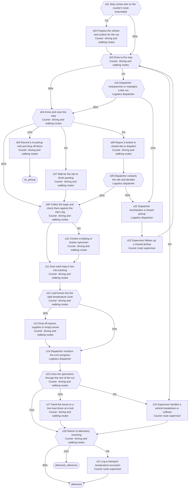

# Pick up and deliver specimens on scheduled courier routes

`dls-lg-route-pickup` · medical laboratory services · specimen logistics · part of `diagnostic-lab-services-co`

About 220 company couriers drive or walk fixed routes several times a day, stopping at collection centres, physician offices, long-term care homes, workplaces and hospital laboratories to collect bagged specimens and drop off reports and supplies. At each stop the courier checks and scans the bags, keeps them in the right temperature zone and carries them to the laboratory or to a hub for a line haul, while dispatch watches the runs by GPS. Traffic, late runs, sites that are closed or not ready, leaking containers and coolers that warm up cause missed pickups, delays and specimens that have to be recollected.

| | |
|---|---|
| Unit of work | one stop pickup |
| Starts when | A scheduled stop on a courier route comes due. |
| Done when | The stop's specimens are delivered and scanned at the laboratory (or hospital referrals at reference intake), or the stop is recorded as no pickup. |
| Organisation | A large private community laboratory company with its own courier fleet, TDG-certified drivers, 24/7 dispatch and web-based specimen tracking serving centres, clinics, homes and hospitals in Ontario, Quebec and Manitoba. (3,300 employees, 2019-2022) |
| Volume | 150,000 cases a month (range 120,000 to 180,000) |

## Where it sits

- Starts with **specimen_shipment** from ordering_physician (65% of cases)
- Starts with **specimen_shipment** from cl-psc-collection (14% of cases)
- Starts with **reference_referral** from hospital_client (10% of cases)
- Starts with **specimen_shipment** from mb-ltc-collection (8% of cases)
- Starts with **specimen_shipment** from mb-house-call (1% of cases)
- Starts with **specimen_shipment** from wp-occupational-health (2% of cases)
- Relies on **client_account** from sl-client-onboarding (a standing input; it does not start a case)
- Sends **specimen_shipment** to cl-specimen-accessioning (outcome: delivered)
- Sends **reference_referral** to hs-referral-intake (outcome: delivered_reference)
- Sends **safety_incident** to hrm-health-safety (outcome: any)

## Flow

## Roles

| Role | Department | Layer | FTE on this process | Loaded cost per hour | Evidence |
|---|---|---|---:|---:|---|
| Courier (driving and walking routes) | Courier operations | individual contributor | 185 | 27 CAD | B [dyn_job_courier], [dyn_job_walking], [jobbank75201] |
| Courier route supervisor | Courier operations | supervisor | 8 | 38 CAD | C |
| Logistics dispatcher | Logistics dispatch centre | individual contributor | 7 | 34 CAD | B [dyn_job_dispatcher], [dyn_logistics] |

## Steps

Hands-on time and the wait before each step show the most common value. Evidence tier A is a sourced number, B a sourced description, C the author's estimate.

| Step | Who | Kind | Hands-on | Wait before | Control | Evidence |
|---|---|---|---:|---:|---|---|
| **s01 Stop comes due on the courier's route.** The routing system holds each scheduled stop with its time window and sequence. When the run starts, the stop appears on the courier's handheld in order, with the client's address, access notes and what to collect or drop off. | Automated | system auto | 0 min | 0 min |  | B [dyn_logistics], [dyn_job_walking] |
| **s02 Prepare the vehicle and coolers for the run.** At the hub the courier checks the vehicle, loads conditioned ice or gel packs into refrigerated coolers and dry ice for frozen boxes where needed, collects reports and supplies to drop off and logs into the handheld. | Courier (driving and walking routes) | physical | 20 min | 0 min | Transportation of Dangerous Goods Regulations Part 6: driver holds a valid TDG training certificate; Part 5 and section 1.39 containment for UN3373 | B [dyn_job_courier], [dyn_logistics], [tdg_regs] |
| **s03 Drive to the stop.** The courier drives to the next stop in sequence, often a few minutes away in a city and much longer on rural routes; walking couriers push a cart between medical buildings downtown. Traffic and weather stretch the time. | Courier (driving and walking routes) | physical | 6 min | 0 min |  | B [dyn_job_walking] |
| **s04 Arrive and scan the stop.** The courier parks, walks into the clinic, collection centre, home or hospital lab, and scans the stop barcode or taps arrival on the handheld, which records the time and GPS position as proof of the visit. | Courier (driving and walking routes) | data entry | 1.5 min | 0 min | Ontario Laboratory Accreditation (ISO 15189 Plus) specimen transport requirements: traceable pickup times | C |
| **s05 Record a no-pickup visit and drop off items.** The courier marks the stop as no pickup on the handheld and leaves any reports, supplies or empty transport boxes for the site before moving on. | Courier (driving and walking routes) | data entry | 0.8 min | 0 min |  | C |
| **s06 Collect the bags and check them against the site's log.** The courier takes the bags or boxes from the pickup fridge, counter or lockbox, checks they are sealed, that requisitions are in the outer pockets and boxes are separated by temperature, and confirms the count on the site's pickup log. | Courier (driving and walking routes) | validation | 1.5 min | 0 min | ISO 15189 Plus and company chain of custody procedure: specimen count confirmed at each handoff | C |
| **s07 Wait for the site to finish packing.** Staff at the collection centre or clinic are still drawing, labelling or bagging, so the courier waits a few minutes or helps carry boxes rather than leave specimens for the next run. | Courier (driving and walking routes) | physical | 5 min | 0 min |  | C |
| **s08 Report a locked or closed site to dispatch.** The courier calls or messages dispatch that the office is closed, the lockbox code fails or nobody answers, and waits briefly for instructions. | Courier (driving and walking routes) | communication | 2 min | 0 min |  | C |
| **s09 Dispatcher contacts the site and decides.** The dispatcher calls the client, finds an alternate contact or lockbox code, and decides whether the courier waits, comes back later in the run, or the specimens wait for the next scheduled pickup. | Logistics dispatcher | coordination | 5 min | 2 min |  | B [dyn_job_dispatcher] |
| **s10 Contain a leaking or broken specimen.** The courier puts on gloves, places the leaking bag in an overpack or secondary bag with absorbent from the spill kit, wipes the surface, tells the site and dispatch, and notes the event so receiving can assess the specimen. | Courier (driving and walking routes) | physical | 10 min | 0 min | Transportation of Dangerous Goods Regulations Part 5: means of containment must prevent release; company biological spill procedure | B [tdg_regs] |
| **s11 Scan each bag or box into tracking.** The courier scans the barcode on each bag or box, or the stop's manifest, so the tracking system shows the specimens as picked up, by whom and when. | Courier (driving and walking routes) | data entry | 0.4 min | 0 min | Ontario Laboratory Accreditation (ISO 15189 Plus) specimen transport traceability | B [dyn_logistics] |
| **s12 Load boxes into the right temperature zone.** The courier places room temperature boxes in the ambient bin, refrigerated bags in the cooler with ice packs and frozen specimens on dry ice, keeping the Category B marked containers closed and secured. | Courier (driving and walking routes) | physical | 0.4 min | 0 min | Transportation of Dangerous Goods Regulations section 1.39: UN3373 Category B in Type P650 containment, marked, with 24-hour number; laboratory temperature requirements | A [tdg_regs], [dyn_logistics] |
| **s13 Drop off reports, supplies or empty boxes.** The courier leaves printed reports, supply orders and empty transport boxes for the site, and takes signatures where the client asks for proof of delivery. | Courier (driving and walking routes) | physical | 1 min | 0 min |  | B [dyn_job_courier] |
| **s14 Dispatcher monitors the run's progress.** The dispatcher watches GPS positions and scan times on the dispatch board for all active runs and checks this stop against its window, ready to resequence or reassign if the run falls behind. | Logistics dispatcher | coordination | 0.1 min | 0 min |  | B [dyn_job_dispatcher] |
| **s15 Carry the specimens through the rest of the run.** The specimens ride in the vehicle while the courier serves the remaining stops and drives back to the laboratory or hub. The courier's time is counted on those other stops, so this step only adds elapsed time. | Courier (driving and walking routes) | physical | 0 min | 1.0 h |  | B [tian22], [epmc_rejection], [ag17] |
| **s16 Dispatcher resequences or reassigns a late run.** When a run falls behind because of traffic, volume or a sick courier, the dispatcher moves stops to a nearby courier, changes the order of stops and calls clients whose pickup will be late. | Logistics dispatcher | coordination | 4 min | 5 min |  | B [dyn_job_dispatcher] |
| **s17 Hand the boxes to a line-haul driver at a hub.** On regional routes the courier meets a line-haul driver at a hub or meeting point, both scan the boxes as transferred, and the line haul carries them to the regional laboratory. | Courier (driving and walking routes) | physical | 2 min | 20 min |  | C |
| **s18 Deliver to laboratory receiving.** At the laboratory the driver unloads the boxes at receiving, scans them as delivered, hands over the run manifest and checks the cooler temperatures with the receiving assistant. The driver's time is shared across all stops on the run. | Courier (driving and walking routes) | physical | 0.4 min | 10 min | Ontario Laboratory Accreditation (ISO 15189 Plus) specimen transport requirements: proof of delivery and transport temperature checked at receipt | B [dyn_logistics] |
| **s19 Supervisor handles a vehicle breakdown or collision.** The courier secures the specimens and calls dispatch; the courier supervisor sends another courier or a replacement vehicle to take over the specimens, arranges a tow, and files the collision or injury report. | Courier route supervisor | coordination | 45 min | 10 min | Ontario Highway Traffic Act collision reporting and Workplace Safety and Insurance Act injury reporting | C |
| **s20 Supervisor follows up a missed pickup.** While the specimens wait at the site for the next scheduled run, the courier supervisor reviews why the stop was missed, calls the client to confirm the next pickup, and coaches the courier or adjusts the route if the stop is often missed. | Courier route supervisor | review | 10 min | 3.0 h | Company service-level procedure for missed pickups and client complaints | C |
| **s21 Log a transport temperature excursion.** The driver and receiving assistant record the out-of-range cooler, and the courier supervisor checks the cooler, packs and run timing, logs a nonconformance and tells the laboratory which specimens may be affected. | Courier route supervisor | review | 20 min | 30 min | ISO 15189 Plus: transport conditions monitored and deviations recorded as nonconformances | C |
| **s22 Dispatcher reschedules a missed pickup.** The dispatcher records the missed pickup, tells the client when the next scheduled run will come or books an extra pickup, and flags the stop for the courier supervisor. | Logistics dispatcher | coordination | 4 min | 5 min |  | B [dyn_job_dispatcher] |

## Exceptions

| Exception | Share of cases | What happens |
|---|---:|---|
| Nothing to pick up | 12% | The site has no specimens on this run; the courier records a no-pickup visit and drops off any items. |
| Specimens not ready | 4% | Centre or clinic staff are still packing; the courier waits a few minutes. |
| Site locked or closed | 2% | Dispatch contacts the client; half the time access is arranged, otherwise the pickup moves to a later run. |
| Late run | 1% | Traffic, volume or staffing puts the run behind; dispatch resequences or reassigns stops and some are missed. |
| Hub transfer to line haul | 25% | Regional routes hand their boxes to a line-haul driver at a hub. |
| Leaking container | 0% | The courier contains the spill and notes it for receiving. |
| Temperature excursion | 0% | A cooler is out of range at delivery; the supervisor logs a nonconformance and the laboratory assesses the specimens. |
| Vehicle breakdown or collision | 0% | A relief courier takes over the specimens and the supervisor files reports. |

## Benchmarks

| Metric | Value | Unit | Population | Evidence |
|---|---|---|---|---|
| cycle_time_days | p50 0.08, p90 0.17 | calendar days from the scheduled stop to delivery at the laboratory (0.08 days is about 2 hours) | Scheduled community specimen courier runs | C |
| courier_wage | low 18.5, high 21.0 | CAD per hour (2026 postings) | Company courier and walking courier postings | A [dyn_job_courier], [dyn_job_walking] |
| potassium_rise_after_cold_storage | 4h 0.05, 8h 0.2 | average relative increase | Case-based study of blood samples stored at low temperature | A [epmc_rejection] |

## Pain points

- Traffic and long rural runs make arrival times uncertain and cause late or missed pickups that clients complain about. (steps s03, s16, s22; B [dyn_job_dispatcher])
- Couriers lose time at sites that are closed, locked or not ready. (steps s07, s08, s09; C)
- Long runs and hub transfers add hours in transit, raising the risk of temperature excursions and degraded specimens. (steps s15, s17, s21; A [tian22], [epmc_rejection])
- Bags not scanned at pickup or transfer show as missing and trigger long searches at the laboratory. (steps s11, s17; C)

## Assumptions

- Courier time is counted on the drive and at-stop steps of each stop; the ride through the rest of the run (s15) adds elapsed time only, so a run's driving is not double counted.
- Run preparation and delivery at receiving are shared across about 14 stops per run.
- Stop mix (physician offices 65%, collection centres 14%, hospitals 10%, long-term care 8%, other 3%) is an estimate; the org file gives no breakdown.
- Mean courier hands-on time is about 17 minutes per stop including driving. At 150,000 stops a month this implies about 325 FTE at 130 productive hours, against 185 courier FTE stated; the org file's 220 couriers would need about 12 minutes a stop all-in, so either stops are fewer, routes denser or couriers more numerous than the org file states.
- Walking couriers in downtown Toronto follow the same steps on foot; they are not modelled separately.
- The new-stop input from client onboarding changes routes but does not trigger individual pickups, so its share is 0.
- Loaded costs come from the org file (hourly wage times 1.35).

## Sources

- [dyn_logistics] The model laboratory Logistics (link withheld) (The model laboratory, undated). Climate-controlled transport of specimens; highly trained, bonded drivers, all with Transportation of Dangerous Goods certification; follows Ontario Laboratory Accreditation standards; 24 hours a day, 7 days a week dispatch and emergency services; secure web-based order and tracking system.
- [dyn_job_courier] Courier (casual on-call), London ON (job posting #2026-12313) (link withheld) (The model laboratory via Jobvite, 2026). Pick up medical samples as scheduled and deliver them safely; deliver reports and mail to all locations on the route; shifts 7:00 am to 4:30 pm or 5:00 pm to 5:00 am; route starts and ends at a company hub in a company vehicle; G licence with clean 3-year abstract, TDG certification, 1 year courier experience, lift 30 lb; $20 an hour.
- [dyn_job_dispatcher] Bilingual Logistics Dispatcher (job posting #2026-12349) (link withheld) (The model laboratory via Jobvite, 2026). Monitor active routes continuously and act on risks to on-time performance; track drivers by GPS; reassign and resequence routes to prevent missed pickups; manage STAT and time-sensitive requests; process client pickup requests; primary contact for drivers; tell clients about delays; route planning, order management, GPS and call management software; $21 an hour.
- [dyn_job_walking] Walking Courier, Toronto (job posting #2026-12177) (link withheld) (The model laboratory via Jobvite, 2026). Follow stop sequences, times and instructions per route plan and tell dispatch of deviations; ensure all specimens, coolers and boxes are picked up and delivered on time; walk long distances with a flatbed cart, lift up to 50 lb; shifts between 7:00 am and 10:00 pm; $18.50 to $21.00 an hour.
- [jobbank75201] [Wages: Delivery Driver in Ontario (NOC 75201)](https://www.jobbank.gc.ca/marketreport/wages-occupation/21667/ON) (Job Bank, Government of Canada, 2025). Ontario hourly wages low $17.95, median $20.00, high $30.00 (2023-2024); Toronto median $21.00.
- [tdg_regs] [Transportation of Dangerous Goods Regulations (SOR/2001-286), full text](https://laws-lois.justice.gc.ca/eng/regulations/SOR-2001-286/FullText.html) (Justice Laws Website, Government of Canada, 2026). Section 1.39: UN3373 Biological Substance, Category B is exempt from most documentation and labelling parts if carried in CGSB-43.125 Type P650 containment with the Category B mark, shipping name and a 24-hour telephone number; Part 6 requires training certificates for people who handle or transport dangerous goods.
- [tian22] [The incidence rate and influence factors of hemolysis, lipemia, icterus in fasting serum biochemistry specimens](https://pmc.ncbi.nlm.nih.gov/articles/PMC8769349) (PLoS One (PMC8769349), 2022). Specimens with longer transfer time had higher haemolysis, lipaemia and icterus incidence; haemolysed specimens had a median transfer time of 1.48 hours against 1.34 hours.
- [epmc_rejection] [Europe PMC abstracts: pre-analytical error studies, including Uminska et al. 2026, Spurious hyperkalemia without hemolysis](https://www.ebi.ac.uk/europepmc/webservices/rest/search?query=TITLE%3A%28%22preanalytical+errors%22+OR+%22pre-analytical+errors%22+OR+%22preanalytical+error%22+OR+%22specimen+rejection%22+OR+%22sample+rejection%22%29+AND+%28outpatient+OR+outpatients+OR+%22primary+care%22%29&resultType=core&format=json&pageSize=8) (Europe PMC, 2026). Uminska et al.: after storage of blood samples at low temperature potassium rose on average by 5% at 4 hours and 20% at 8 hours, a risk for laboratories serving large areas with long transport.
- [ag17] [2017 Annual Report, Section 3.07: Laboratory Services in the Health Sector](https://www.auditor.on.ca/en/content/annualreports/arreports/en17/v1_307en17.pdf) (Office of the Auditor General of Ontario, 2017). Community collection centres collect and transport some specimens to designated laboratories further away, and the longer transport time can delay testing; Ontario had 356 community collection centres in 2017.

Written by claude-opus on 2026-11-17.
