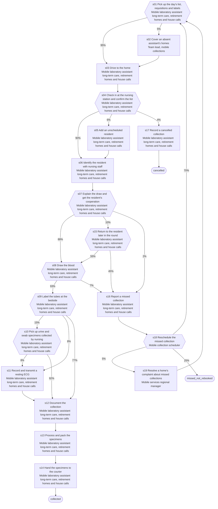

# Collect specimens and ECGs in long-term care and retirement homes

`dls-mb-ltc-collection` · medical laboratory and health services (community laboratory) · mobile collection services · part of `diagnostic-lab-services-co`

Residents of long-term care and retirement homes are often too frail to visit a collection centre, so the laboratory sends mobile lab assistants on early-morning runs to draw blood, pick up other specimens and record ECGs at the bedside. At each home the assistant checks the list with the charge nurse, identifies each resident with staff help, draws and labels the tubes, documents the collection and hands the cooled specimens to a courier within the processing window. Residents with dementia who refuse or are agitated, residents who are asleep or not fasting and fragile veins cause missed draws that must be reported and rebooked.

| | |
|---|---|
| Unit of work | one resident collection |
| Starts when | The resident appears on the day's collection schedule for a home, with a requisition and labels printed. |
| Done when | The resident's labelled specimens are handed to the courier (and any ECG transmitted), or the collection is recorded as cancelled or missed and rebooked or held. |
| Organisation | The mobile services division of a large Canadian community laboratory, with about 120 mobile lab assistants serving long-term care and retirement homes in Ontario and Manitoba on daily runs. (3,300 employees, 2019-2022) |
| Volume | 24,000 cases a month (range 18,000 to 30,000) |

## Where it sits

- Starts with **collection_schedule** from mb-ltc-scheduling (100% of cases)
- Sends **specimen_shipment** to lg-route-pickup (outcome: collected)
- Sends **ecg_tracing** to mb-ecg-reporting (outcome: collected)

## Flow

## Roles

| Role | Department | Layer | FTE on this process | Loaded cost per hour | Evidence |
|---|---|---|---:|---:|---|
| Mobile laboratory assistant (long-term care, retirement homes and house calls) | Mobile collection teams | individual contributor | 88 | 32 CAD | B [dyn_services], [dyn_hcp], [jb33101] |
| Team lead, mobile collections | Mobile collection teams | supervisor | 1.5 | 40 CAD | C |
| Mobile collection scheduler | Mobile scheduling desk | individual contributor | 2 | 30 CAD | C |
| Mobile services regional manager | Mobile and home collection (The model laboratory Mobile Services) | manager | 0.2 | 60 CAD | C |

## Steps

Hands-on time and the wait before each step show the most common value. Evidence tier A is a sourced number, B a sourced description, C the author's estimate.

| Step | Who | Kind | Hands-on | Wait before | Control | Evidence |
|---|---|---|---:|---:|---|---|
| **s01 Pick up the day's list, requisitions and labels.** Before the run the mobile lab assistant collects or prints the day's collection list for each home, the requisitions and the LIS barcode labels for every resident, checks that tubes, butterfly needles, tourniquets, coolers with cold packs and, if ECGs are booked, the ECG recorder and electrodes are stocked, and plans the order of homes so fasting draws come first. | Mobile laboratory assistant (long-term care, retirement homes and house calls) | intake | 1 min | 15.0 h |  | C [dyn_services] |
| **s02 Cover an absent assistant's homes.** When an assistant calls in sick, the team lead redistributes that assistant's homes among the others on shift or goes out personally, phones the homes to warn that collections will be later than usual and moves non-urgent residents to the next visit day. | Team lead, mobile collections | coordination | 2 min | 30 min |  | C |
| **s03 Drive to the home.** The assistant drives the planned route to the next long-term care or retirement home with the cooler and supplies; travel between homes is shared across the residents collected at each home. | Mobile laboratory assistant (long-term care, retirement homes and house calls) | physical | 2.5 min | 30 min |  | C [dyn_hcp] |
| **s04 Check in at the nursing station and confirm the list.** The assistant signs in (with infection-control screening in 2020-2022), finds the charge nurse, and goes through the list: residents transferred to hospital, discharged or deceased are crossed off, new orders written since the list was printed are added, and the nurse confirms which residents are fasting and who needs help or is on isolation. | Mobile laboratory assistant (long-term care, retirement homes and house calls) | coordination | 1.5 min | 10 min |  | C [fao2019] |
| **s05 Add an unscheduled resident.** For a new requisition the nurse hands over, the assistant checks it is signed and complete, phones the scheduling desk to have the order entered in the LIS or writes the details on a blank requisition with handwritten labels, and adds the resident to the round. | Mobile laboratory assistant (long-term care, retirement homes and house calls) | data entry | 5 min | 5 min |  | C |
| **s06 Identify the resident with nursing staff.** At the room the assistant matches the resident to the requisition using at least two identifiers, such as the name and date of birth on the medication record photo or wristband, confirmed by the nurse or personal support worker, because many residents cannot reliably state their own name. | Mobile laboratory assistant (long-term care, retirement homes and house calls) | validation | 1.5 min | 10 min | Patient identification with two identifiers before collection, required by ISO 15189 and Institute for Quality Management in Healthcare (OLA) accreditation that Ontario licensing depends on | B [crl_instr], [ag2017], [cihi_dementia] |
| **s07 Explain the draw and get the resident's cooperation.** The assistant explains the blood test to the resident, checks fasting status when the test requires it, and with a nurse or support worker calms residents who are anxious or agitated. A capable resident who refuses is not drawn; residents who are asleep, in the dining room or at therapy are left for later in the round. | Mobile laboratory assistant (long-term care, retirement homes and house calls) | communication | 1.5 min | 0 min | Health care consent law (Ontario Health Care Consent Act and equivalents): a capable person may refuse; a substitute decision-maker consents for an incapable resident | B [cmpa_consent], [cihi_dementia] |
| **s08 Draw the blood.** The assistant draws the ordered tubes in the correct order, usually with a butterfly needle because elderly residents often have fragile, rolling veins, mixes each tube and applies pressure to prevent bruising. Policy allows two attempts before the draw is abandoned. | Mobile laboratory assistant (long-term care, retirement homes and house calls) | physical | 8 min | 0 min |  | C [dyn_services] |
| **s09 Label the tubes at the bedside.** Before leaving the resident, the assistant sticks the LIS barcode labels on each tube, writes the collection time and initials, and checks the labels against the requisition and the resident's identifiers. | Mobile laboratory assistant (long-term care, retirement homes and house calls) | validation | 1.5 min | 0 min | Specimen labelling at the point of collection in the patient's presence (ISO 15189 pre-examination requirements and OLA accreditation) | B [dyn_kit2020], [ag2017] |
| **s10 Pick up urine and swab specimens collected by nursing.** The assistant collects urine containers or swabs that nursing staff collected earlier for the resident, checks that each carries the resident's label and matches a requisition, and places them in the cooler bag. | Mobile laboratory assistant (long-term care, retirement homes and house calls) | validation | 2 min | 0 min |  | C [dyn_hcp] |
| **s11 Record and transmit a resting ECG.** The assistant positions the resident in bed, places the limb and chest electrodes, records a 12-lead tracing on the portable recorder, repeats it if movement spoils the trace, and transmits it with the resident's details to the reading service. | Mobile laboratory assistant (long-term care, retirement homes and house calls) | physical | 15 min | 0 min |  | B [dyn_services], [dyn_homecare] |
| **s12 Document the collection.** The assistant ticks the resident off the list with the collection time, notes anything the laboratory should know (difficult draw, possible haemolysis, non-fasting), and writes a short note for the home's chart or the nurse that the collection was done. | Mobile laboratory assistant (long-term care, retirement homes and house calls) | data entry | 1 min | 0 min |  | C |
| **s13 Process and pack the specimens.** After the home's round, the assistant lets serum tubes clot upright, spins them in a portable centrifuge where the run allows or plans delivery within the processing window, and packs tubes and requisitions in sealed biohazard bags in the cooler with cold packs. | Mobile laboratory assistant (long-term care, retirement homes and house calls) | physical | 1.5 min | 10 min | Laboratory specimen handling requirements (clotting, centrifuging within 2 to 4 hours, temperature) under the laboratory's accredited pre-examination procedures | B [dyn_kit2020] |
| **s14 Hand the specimens to the courier.** At the arranged time and place the assistant hands the cooler bags to the company courier, who scans them into the tracking system, or drops them at the nearest collection centre for the next route pick-up; ECG tracings were sent electronically. | Mobile laboratory assistant (long-term care, retirement homes and house calls) | physical | 1.5 min | 2.0 h | Transportation of Dangerous Goods rules for diagnostic specimens and laboratory transport standards (temperature and time) | B [dyn_logistics], [dyn_hcp] |
| **s15 Return to the resident later in the round.** After the other residents in the home, the assistant goes back to residents who were asleep, away or refused, asks the nurse whether a second approach is appropriate and tries again. | Mobile laboratory assistant (long-term care, retirement homes and house calls) | communication | 2 min | 1.0 h |  | C [cihi_dementia] |
| **s16 Report a missed collection.** The assistant writes the reason on the requisition (refused, not fasting, unable to draw, unavailable), tells the nurse so the physician can be informed, and phones or texts the scheduling desk so the collection can be rebooked. | Mobile laboratory assistant (long-term care, retirement homes and house calls) | communication | 3 min | 5 min |  | C |
| **s17 Record a cancelled collection.** For a resident who is in hospital, discharged, deceased or whose order the physician cancelled, the assistant marks the requisition cancelled with the reason so the scheduler can close or hold the order. | Mobile laboratory assistant (long-term care, retirement homes and house calls) | data entry | 1 min | 0 min |  | C |
| **s18 Reschedule the missed collection.** The scheduler records the missed reason in the LIS, books the resident for the home's next visit day or the next fasting slot, or holds the order if the home says the physician will review it, and confirms with the home. | Mobile collection scheduler | coordination | 4 min | 8.0 h |  | C |
| **s19 Resolve a home's complaint about missed collections.** The regional manager calls the home's director of care, reviews the run records and the reasons for the misses, agrees changes such as an earlier fasting slot, a nurse assisting at the draw or a different assistant, and confirms the next collection. | Mobile services regional manager | communication | 20 min | 1.0 d | Service agreement with the home and complaint handling procedure | C |

## Exceptions

| Exception | Share of cases | What happens |
|---|---:|---|
| Resident refuses, is agitated or unavailable | 10% | The assistant returns later in the round; about half succeed and the rest are reported missed and rebooked. |
| Unable to draw | 7% | Fragile veins defeat two attempts; the miss is reported and rebooked, sometimes for a more experienced assistant. |
| Not fasting | 2% | The resident has eaten before a fasting test; the draw is rebooked for an early slot. |
| Resident not in the home or order cancelled | 4% | The resident is in hospital, discharged or deceased, or the physician cancelled the order. |
| Order added at the home | 6% | A new requisition is handed over at check-in and added to the round with the scheduling desk's help. |
| Assistant absent | 5% | The team lead redistributes the absent assistant's homes and collections run late. |

## Benchmarks

| Metric | Value | Unit | Population | Evidence |
|---|---|---|---|---|
| cycle_time_days | p50 0.8, p90 1.6 | calendar days from the schedule being issued (afternoon before) to specimens handed to the courier | Mobile long-term care collections, Ontario and Manitoba, 2019-2022 | C [dyn_kit2020], [dyn_logistics] |
| ontario_ltc_homes_and_residents | homes 626, residents 78000 | homes and residents | Ontario, 2018-19 | A [fao2019] |
| ltc_residents_with_dementia_share | 0.69 | share of residents | Canadian long-term care, 2015-2016 | A [cihi_dementia] |

## Pain points

- Residents with dementia refuse or are agitated, and residents asleep or away from their rooms must be revisited, so a share of draws is missed and rebooked. (steps s07, s15, s16, s18; B [cihi_dementia], [cmpa_consent])
- Fragile veins in elderly residents lead to failed or haemolysed draws. (steps s08; C)
- Lists printed the afternoon before go out of date overnight as residents go to hospital or new orders are written, causing rework at check-in. (steps s04, s05, s17; C)
- Specimens must reach processing within a few hours, so runs are tied to courier meeting times and missed hand-offs risk rejected specimens. (steps s13, s14; B [dyn_kit2020], [dyn_logistics])
- Waiting for the charge nurse during the morning medication pass and infection-control screening in 2020-2022 add unproductive time at each home. (steps s04; C)

## Assumptions

- Steps done once per home or per run (preparing, driving, checking in, packing, hand-off) are shown per resident with a share of the time, assuming 5 to 15 residents per home and 15 to 25 residents per run.
- Refusal, unavailability, failed-draw and cancellation shares are estimates; no published rates for long-term care collections were found. Overall about 9 percent of scheduled collections are missed and 4 percent cancelled.
- Handling limits (clot 30 minutes, centrifuge within 2 to 4 hours, 2 to 8 C) come from the company's insurance kit instructions and are assumed to reflect the same laboratory's handling rules for community specimens.
- Identification and labelling controls rest on ISO 15189 and Ontario's IQMH accreditation, which licensing requires; the exact clauses were not opened.
- The Ontario long-term care regulation that requires homes to arrange laboratory services could not be opened and is not cited.
- Mobile lab assistant FTE (88 of 120) leaves about 30 for house calls (2,500 a month) and training, which is tight; loaded costs come from the organisation file (hourly wage times 1.35).

## Sources

- [dyn_services] Services (link withheld) (The model laboratory, 2022). The model laboratory Mobile Services recruits certified health professionals to perform mobile blood and ECG collections in long-term care and retirement homes, plus private house call visits.
- [dyn_hcp] Healthcare provider solutions (link withheld) (The model laboratory, 2022). The company visits patients in long-term care facilities, homes and workplaces to collect specimens; mobile teams perform blood draws and ECGs; a specialised logistics team handles delivery timing, storage and compliance; results go electronically to EMRs and the eResults portal.
- [dyn_homecare] Home care (link withheld) (The model laboratory, 2022). Mobile lab work and ECGs at home or office in Ontario and Winnipeg, booked by phone, fax or requisition upload; mobile blood and ECG collections in long-term care and retirement homes by certified health professionals.
- [dyn_logistics] The model laboratory Logistics (link withheld) (The model laboratory, 2022). Climate-controlled transport of specimens; all team members hold Transportation of Dangerous Goods certification; quality metrics such as Ontario Laboratory Accreditation standards; 24/7 dispatch; web-based tracking of shipments.
- [dyn_kit2020] Instructions for blood/urine kit (insurance) (link withheld) (The model laboratory, 2020). Company collection instructions: label tubes with the patient's name and barcodes at collection; SST tube clots upright 30 minutes and should be centrifuged within 2 to 4 hours; keep samples cool and refrigerated at 2 to 8 C until courier pick-up; sharps never shipped with specimens.
- [crl_instr] [Insurance collections: specific instructions for examiners](https://www.crlcorp.com/insurance-collections-specific-instructions/?hsLang=en) (Clinical Reference Laboratory, 2022). Confirm the person's identity by checking at least two identifiers before collecting; refrigerate specimens that cannot be shipped the same day.
- [ag2017] [Laboratory services in the health sector (Annual Report 2017, section 3.07)](https://www.auditor.on.ca/en/content/annualreports/arreports/en17/v1_307en17.pdf) (Office of the Auditor General of Ontario, 2017). Laboratory services run from requisition to specimen collection, analysis and result reporting; under the Laboratory and Specimen Collection Centre Licensing Act community laboratories and collection centres must be licensed and must take part in the Institute for Quality Management in Healthcare accreditation and proficiency testing program to stay licensed.
- [fao2019] [Long-Term Care Homes Program: a review of the plan to create 15,000 new long-term care beds in Ontario](https://fao-on.org/en/report/ontario-long-term-care-program/) (Financial Accountability Office of Ontario, 2019). 626 long-term care homes in Ontario house over 78,000 residents; 78,664 beds in operation in 2018-19; over 80 percent of residents are over 75.
- [cihi_dementia] [Dementia in long-term care](https://www.cihi.ca/en/dementia-in-canada/dementia-care-across-the-health-system/dementia-in-long-term-care) (Canadian Institute for Health Information, 2018). 69 percent of long-term care residents had dementia in 2015-2016, and half of residents with dementia showed some aggressive behaviour (Aggressive Behaviour Scale of 1 or more).
- [cmpa_consent] [Consent: a guide for Canadian physicians](https://www.cmpa-acpm.ca/en/advice-publications/handbooks/consent-a-guide-for-canadian-physicians) (Canadian Medical Protective Association, 2021). A capable adult may refuse treatment or investigations; a substitute decision-maker ranked by provincial law consents for an incapable patient; refusals should be documented.
- [jb33101] [Wages: Medical laboratory technical assistant in Ontario (NOC 33101)](https://www.jobbank.gc.ca/marketreport/wages-occupation/4210/ON) (Government of Canada Job Bank, 2025). Ontario hourly wages low 17.95, median 26.25, high 36.00 dollars (Labour Force Survey 2023-2024).

Written by claude-opus on 2026-11-17.
