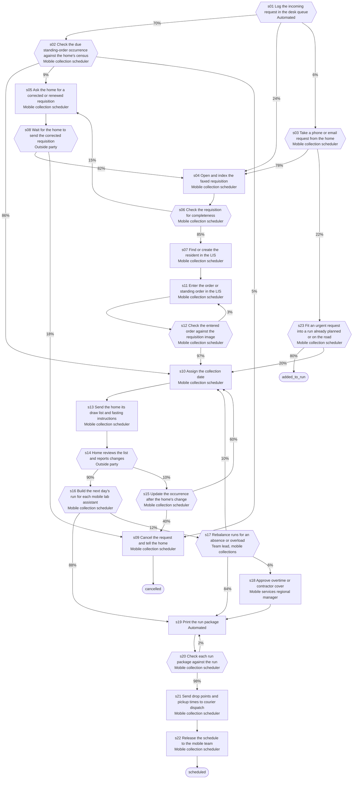

# Take LTC orders and schedule collection runs

`dls-mb-ltc-scheduling` · health care: medical laboratory testing and health services · mobile collection services · part of `diagnostic-lab-services-co`

Long-term care and retirement homes rely on the laboratory's mobile team to draw residents' blood and record ECGs on fixed visit days, and a central scheduling desk turns the homes' orders into those visits. Schedulers keep standing orders in the LIS, key and check new requisitions faxed by the homes, chase missing physician signatures and expired standing orders, send each home its draw list with fasting instructions, and build the next day's run for each mobile lab assistant. The work is a high-volume desk routine; delay comes mostly from waiting for each home's next visit day and for physicians to sign renewals, and errors come from incomplete faxed requisitions, residents who move to hospital and last-minute changes.

| | |
|---|---|
| Unit of work | one resident collection request |
| Starts when | A standing-order occurrence falls due in the LIS, or a home faxes, phones or emails a new collection request for a resident. |
| Done when | The resident is on a released collection run with requisition and labels printed, or the request is cancelled with a reason recorded. |
| Organisation | The mobile services division of a large Canadian community laboratory, serving long-term care and retirement homes in Ontario and Manitoba from a central scheduling desk of about 14 schedulers. (3,300 employees, 2019-2022) |
| Volume | 24,000 cases a month (range 18,000 to 30,000) |

## Where it sits

- Starts with **ltc_collection_request** from ltc_home (100% of cases)
- Sends **collection_schedule** to mb-ltc-collection (outcome: scheduled)
- Sends **collection_schedule** to mb-ltc-collection (outcome: added_to_run)

## Flow

## Roles

| Role | Department | Layer | FTE on this process | Loaded cost per hour | Evidence |
|---|---|---|---:|---:|---|
| Mobile collection scheduler | Mobile scheduling desk | individual contributor | 11 | 30 CAD | B [lifelabs_ltc], [apl_mobile], [jb13112] |
| Team lead, mobile collections | Mobile collection teams | supervisor | 0.8 | 40 CAD | C |
| Mobile services regional manager | Mobile and home collection (The model laboratory Mobile Services) | manager | 0.1 | 60 CAD | C |

## Steps

Hands-on time and the wait before each step show the most common value. Evidence tier A is a sourced number, B a sourced description, C the author's estimate.

| Step | Who | Kind | Hands-on | Wait before | Control | Evidence |
|---|---|---|---:|---:|---|---|
| **s01 Log the incoming request in the desk queue.** A resident collection request reaches the scheduling desk in one of three ways: the LIS lists a standing order whose next occurrence falls due, the fax server drops a new requisition from the home into the desk's electronic queue, or a nurse phones or emails. The system time-stamps the item and files it under the home. | Automated | intake | 0 min | 0 min |  | B [dbc_standing], [apl_mobile], [paltmed], [dyn_services], [dyn_hcp] |
| **s02 Check the due standing-order occurrence against the home's census.** Working through the LIS pending list for the home's next visit day, the scheduler confirms the standing order has not passed its expiry date, the resident is still on the home's census and not in hospital, and the tests, frequency and fasting flag are unchanged since the last draw. | Mobile collection scheduler | validation | 0.4 min | 8.0 h | Laboratory standing order policy: a standing order is valid only to its expiry date (one year maximum at a comparable Canadian laboratory before 2025) and cannot be extended in the LIS | A [dbc_standing] |
| **s03 Take a phone or email request from the home.** A nurse or unit clerk calls the desk line or emails to request a draw, ask for an earlier date or add a test. The scheduler notes the resident, tests and urgency, explains that a signed requisition is needed and asks the nurse to fax it, or flags the request as urgent for today's run. | Mobile collection scheduler | communication | 2.5 min | 5 min |  | B [lifelabs_ltc], [lifelabs_central] |
| **s04 Open and index the faxed requisition.** The scheduler opens the fax image from the queue, matches it to the home and resident, splits multi-page faxes that hold several residents, and files each requisition image in the imaging system so it can be printed for the collection and kept with the order. | Mobile collection scheduler | data entry | 0.6 min | 2.0 h |  | B [apl_mobile], [ccl_extended] |
| **s05 Ask the home for a corrected or renewed requisition.** For an expired standing order or a requisition with missing items, the scheduler faxes or phones the home naming what is missing (physician signature or billing number, health card number, test names, frequency, fasting instructions or the full facility address) and puts the request on hold in the LIS. | Mobile collection scheduler | communication | 2 min | 30 min |  | B [apl_mobile], [dbc_standing] |
| **s06 Check the requisition for completeness.** The scheduler reads the requisition for two resident identifiers and the health card number, the ordering physician's name, billing number and signature, the tests and any frequency for a standing order, the start and stop dates, fasting or timed-collection instructions and whether an ECG is requested. | Mobile collection scheduler | validation | 0.8 min | 5 min | Laboratory and Specimen Collection Centre Licensing Act (Ontario) and its general regulation: specimens are collected and tested only on the requisition of an authorised practitioner with required patient and practitioner details | B [apl_mobile], [ccl_extended] |
| **s07 Find or create the resident in the LIS.** The scheduler searches the LIS by health card number and date of birth, checks the match against the home and the name spelling, and creates a patient record for a new admission with the home as the location and the attending physician as the copy-to. | Mobile collection scheduler | lookup | 0.7 min | 2 min | ISO 15189 and Accreditation Canada Diagnostics requirements for positive patient identification with at least two identifiers | C |
| **s08 Wait for the home to send the corrected requisition.** The home's nurse has to reach the attending physician, who often signs orders only on the weekly visit to the home, and fax the corrected or renewed requisition back. The scheduler sees the reply arrive in the fax queue. | Outside party | external wait | 0 min | 1.0 d |  | C [dbc_standing] |
| **s09 Cancel the request and tell the home.** The scheduler cancels the occurrence or the standing order in the LIS with a reason (discharged, deceased, hospitalised, palliative, not renewed) and notes it on the home's next draw list or faxes a short notice so the nurses know no draw will happen. | Mobile collection scheduler | data entry | 1.5 min | 1.0 h |  | C |
| **s10 Assign the collection date.** The scheduler places the request on the home's next visit day that meets the due date, the fasting and timed-collection needs and the stability of the tests, and checks whether an ECG device must be on that run. Homes are visited on fixed weekdays by a regular team. | Mobile collection scheduler | judgment | 0.3 min | 2 min |  | B [lifelabs_ltc], [locus_phleb], [speedy_ltc] |
| **s11 Enter the order or standing order in the LIS.** From the requisition image the scheduler keys the test codes, the ordering physician and copy-to, the clinical notes and, for a standing order, the frequency, start and expiry dates so the LIS generates future occurrences. Fasting, timed-draw and ECG flags are set so they print on the collection list. | Mobile collection scheduler | data entry | 2.2 min | 0 min |  | B [dbc_standing], [lifelabs_ltc] |
| **s12 Check the entered order against the requisition image.** Before saving, the scheduler compares the order on screen with the requisition image line by line: tests, frequency, expiry, physician and flags. New standing orders get this check every time because one keying error repeats at every occurrence. | Mobile collection scheduler | review | 0.5 min | 0 min | Laboratory order-entry verification procedure under the quality management system | C |
| **s13 Send the home its draw list and fasting instructions.** A day or two before each visit day the scheduler prints or faxes the home a list of residents due, with tests that need fasting or timed collection, so the nurses can hold breakfasts, collect urines and prepare residents. Most of the request's elapsed time is spent waiting for the home's visit day. | Mobile collection scheduler | communication | 0.15 min | 1.0 d |  | B [paltmed], [apl_mobile] |
| **s14 Home reviews the list and reports changes.** The charge nurse checks the list against residents who are newly in hospital, isolated in an outbreak, refusing, palliative or newly admitted and calls or faxes the desk with changes before the cut-off the afternoon before the visit. | Outside party | external wait | 0 min | 10.0 h |  | C |
| **s15 Update the occurrence after the home's change.** The scheduler moves the occurrence to a later visit day, cancels it with a reason, or changes the fasting flag, and corrects the home's list and the run if it is already built. | Mobile collection scheduler | data entry | 1.5 min | 30 min |  | C |
| **s16 Build the next day's run for each mobile lab assistant.** Around midday the scheduler groups the next day's homes into runs of about 15 to 30 residents per assistant, orders them so fasting residents are drawn first and specimens reach the courier drop point inside the processing window, and allows for travel between homes and for ECGs. | Mobile collection scheduler | coordination | 0.4 min | 4.0 h |  | B [locus_phleb], [ccl_extended], [lifelabs_ltc] |
| **s17 Rebalance runs for an absence or overload.** The team lead moves homes between runs, calls a casual or contracted collector, or asks an assistant to take an extra home, and tells the scheduler which residents must move to another day. | Team lead, mobile collections | coordination | 1 min | 1.0 h |  | B [dyn_opps] |
| **s18 Approve overtime or contractor cover.** For a day that cannot be covered from the roster, the regional manager approves overtime or extra paid contractor visits within the budget and records the reason. | Mobile services regional manager | approval | 5 min | 2.0 h | Company overtime and contractor spending approval policy | C |
| **s19 Print the run package.** Once runs are final the LIS prints, for each assistant, the collection list in run order with fasting and ECG flags, the requisitions and the barcode specimen labels for every resident. | Automated | system auto | 0 min | 30 min |  | C |
| **s20 Check each run package against the run.** The scheduler counts labels and requisitions against the list for each run, adds reprints for missing items and places the package in the assistant's pickup slot or sends it to the assistant's printer. | Mobile collection scheduler | validation | 0.15 min | 15 min | Specimen labelling and identification requirements of the accreditation standard (labels must match the requisition) | C |
| **s21 Send drop points and pickup times to courier dispatch.** The scheduler enters or confirms each run's drop points and expected handover times in the courier tracking system so dispatch can place pickups on the next morning's routes. | Mobile collection scheduler | coordination | 0.1 min | 10 min |  | C |
| **s22 Release the schedule to the mobile team.** The scheduler marks the day's runs as released, which the assistants see when they collect their packages the afternoon or early morning before the run, and answers any questions from assistants about the order of homes. | Mobile collection scheduler | communication | 0.1 min | 30 min |  | C |
| **s23 Fit an urgent request into a run already planned or on the road.** For an urgent request, the scheduler checks the runs for today or tomorrow, phones the nearest assistant to add the resident and confirms with the home that the signed requisition is ready at the nursing station; labels are printed at the home or added to the package. | Mobile collection scheduler | coordination | 5 min | 20 min |  | B [paltmed], [ccl_extended] |

## Exceptions

| Exception | Share of cases | What happens |
|---|---:|---|
| Expired standing order | 6% | The standing order has passed its expiry date, so the desk holds the occurrence and asks the home to get a new signed requisition from the physician. |
| Incomplete faxed requisition | 4% | A faxed requisition lacks a signature, billing number, health card number, tests or frequency and goes back to the home. |
| Resident discharged, hospitalised or deceased | 5% | The resident is no longer at the home or not available and the occurrence is cancelled. |
| Home postpones or cancels before the visit | 9% | The home reports an outbreak, refusal, palliative status or hospital stay before the cut-off and the draw is moved or cancelled. |
| Assistant absent or run overloaded | 11% | The team lead moves homes between runs or arranges cover; some residents move to another day. |
| Urgent request | 1% | A home needs a draw today or tomorrow morning and the scheduler adds the resident to a planned or active run. |

## Benchmarks

| Metric | Value | Unit | Population | Evidence |
|---|---|---|---|---|
| cycle_time_days | p50 2.5, p90 7 | calendar days from the request reaching the desk (or the standing occurrence falling due) to release of the run that includes the resident | Long-term care and retirement home collection requests at a large community laboratory | C [apl_mobile], [lifelabs_ltc] |
| mobile_order_lead_time_days | 2 | days before the scheduled collection that a mobile order must be submitted | Alberta Precision Laboratories mobile collections | A [apl_mobile] |
| standing_order_maximum_validity_years | 1 | years (before 4 August 2025) | LifeLabs standing orders in British Columbia | A [dbc_standing] |
| monitoring_lab_frequency_months | low 1, high 3 | months between routine monitoring labs suggested as optimum | Nursing home residents (US guidance) | A [paltmed] |
| ontario_ltc_homes_and_residents | homes 626, residents 78000 | homes and residents | Ontario, 2019 | A [fao2019] |

## Pain points

- Faxed requisitions arrive incomplete or unreadable, and expired standing orders wait on physicians who sign orders only on weekly rounds, so requests sit on hold. (steps s05, s06, s08; B [apl_mobile], [dbc_standing])
- Runs are built by hand from LIS lists and spreadsheets, so balancing fasting residents, travel and courier cut-offs depends on a few experienced schedulers and breaks down when an assistant calls in sick. (steps s16, s17; B [locus_phleb])
- Late changes from homes (hospital transfers, outbreaks, refusals) arrive after lists are sent and force rework of lists and runs. (steps s14, s15; C)
- Every new standing order must be keyed and checked carefully because one keying error repeats at every occurrence for up to a year. (steps s11, s12; B [dbc_standing])

## Assumptions

- The case starts when the request reaches the desk or the standing occurrence falls due and ends when the run that includes the resident is released, normally the afternoon before collection. Collection, missed draws and their rescheduling belong to the mb-ltc-collection workflow, which already claims 2.0 scheduler FTE.
- About 70 percent of monthly requests are occurrences of standing orders already in the LIS, 24 percent are new faxed requisitions and 6 percent start with a phone or email request; these shares are estimates.
- Run building is shown per resident (about 0.4 minutes each, or 6 to 12 minutes per run of 15 to 30 residents). Routing software was not common at this desk in 2019-2022.
- The home's own staff time (nurses reviewing lists, physicians signing renewals) is outside the company and counted as waiting only.
- The fax and telephony systems are used here by the scheduling desk although the organisation file lists other units as their users; the org file's collection_list and phone systems belong to the field teams.
- Most elapsed time is waiting for the home's fixed visit day, so cycle time depends on how often each home is visited (one to five days a week); a single mixed distribution is used.
- Hands-on time times volume implies about 14 to 15 FTE against 11.9 stated. The organisation file gives the desk 14 schedulers, of whom 2.0 FTE are already claimed by the collection workflow, so the desk is fully loaded at these times; either standing occurrences are handled faster than estimated or the desk has a few more people (casual or float staff) than the org file lists. The desk also handles house call bookings, which are outside this workflow.

## Sources

- [dyn_services] Services (the five brands) (link withheld) (The model laboratory, 2022). The model laboratory Mobile Services performs mobile blood and ECG collections in long-term care and retirement homes plus private house call visits.
- [dyn_hcp] Healthcare provider solutions (link withheld) (The model laboratory, 2022). The company visits patients in long-term care facilities and collects specimens at homes and workplaces; results go to EMRs and the eResults service; menu offers requisition upload and printed forms.
- [dyn_opps] Opportunities for health professionals (link withheld) (The model laboratory, 2022). Mobile Services seeks registered nurses, LPNs and laboratory assistants or technicians, often as independent contractors, for blood and ECG collections in long-term care and retirement homes; needs a smartphone, email, vehicle, computer and printer, and ability to work independently.
- [lifelabs_ltc] [Long term care: mobile lab services](https://www.lifelabs.com/corporate-customers/ltc-retirement-residence/mobile-lab-services) (LifeLabs, 2023). A consistent team of mobile service technicians visits each long-term care or retirement facility on a regular schedule; booking is by telephone to a central number in Ontario.
- [lifelabs_central] [Update for homecare and MyVisit home services](https://lifelabs.com/notification/update-for-homecare-and-myvisit-home-services) (LifeLabs, 2023). The laboratory centralized its appointment booking for homecare and long-term care; home care visit prices for homebound patients rose to 55 dollars from 1 January 2024.
- [apl_mobile] [Mobile collection orders](https://www.albertaprecisionlabs.ca/hp/Page13822.aspx) (Alberta Precision Laboratories, 2024). Mobile collection orders are faxed or emailed on the mobile collection requisition with a coversheet giving the ordering provider's contact; orders must be submitted 2 days before the scheduled collection (Monday noon for a Wednesday collection); a preferred day may be noted and the lab notifies the provider if it cannot accommodate it; demographics, provider and full facility address are required and incomplete or incorrect addresses are a major deficiency that can prevent service.
- [dbc_standing] [Reducing burdens: Doctors of BC works with LifeLabs to extend standing order policy to two years](https://www.doctorsofbc.ca/advocacy/2025/reducing-burdens-doctors-bc-works-lifelabs-extend-standing-order-policy-two-years) (Doctors of BC, 2025). Until 4 August 2025 LifeLabs standing orders expired after a maximum of one year; standing orders live in the LIS until their expiry date and cannot be extended there, so physicians must issue a new standing order requisition; renewals created paperwork, with physicians submitting several orders for the same patient each year.
- [ccl_extended] [Extended care laboratory services](https://clevelandcliniclabs.com/healthcare-provider-resources/extended-care/) (Cleveland Clinic Laboratories, 2024). Nursing home clients order through a web system or interfaces with long-term care EMRs; a completed requisition is required for each specimen; routine draws can be scheduled as early as 4 a.m. with return visits on request; client services available 24 hours a day.
- [paltmed] [Everything you should know about lab work](https://paltmed.org/news-media/everything-you-should-know-about-lab-work) (Caring for the Ages (AMDA, the Society for Post-Acute and Long-Term Care Medicine), 2026). Nursing homes schedule standing lab tests as a monitoring mechanism; admission labs are drawn on the next lab day or within a week; a period of one to three months may be an optimum ordering frequency; it is unlikely that all residents warrant monthly CBC testing; stat orders carry different collection and reporting expectations.
- [locus_phleb] [Which of these 6 home phlebotomy software platforms fits your operations?](https://locus.sh/blogs/best-home-phlebotomy-software/) (Locus, 2026). Mobile phlebotomy appointments must align with fasting requirements, technician skill and lab cut-off times; samples that arrive beyond stability windows delay processing; spreadsheets and basic scheduling tools cannot keep pace as volumes grow; routes should be recalculated when delays occur.
- [speedy_ltc] [Phlebotomy for long-term care](https://www.speedysticks.com/services/phlebotomy-for-long-term-care) (Speedy Sticks, 2026). Long-term care phlebotomy runs on recurring weekly, bi-weekly or custom draw schedules by resident, with bedside collection, labelling and chain of custody to lab pickup.
- [fao2019] [Long-Term Care Homes Program: a review of the plan to create 15,000 new long-term care beds in Ontario](https://fao-on.org/en/report/ontario-long-term-care-program/) (Financial Accountability Office of Ontario, 2019). 626 long-term care homes in Ontario house over 78,000 residents; 78,664 beds in operation in 2018-19; over 80 per cent of residents are over 75.
- [jb13112] [Wages: Medical administrative assistant in Ontario (NOC 13112)](https://www.jobbank.gc.ca/marketreport/wages-occupation/25791/ON) (Government of Canada Job Bank, 2025). Ontario hourly wages low 17.95, median 25.00, high 32.70 dollars (2023-2024).

Written by claude-opus on 2026-11-17.
