# Prepare for and host accreditation assessments

`dls-qa-accreditation-inspection` · medical laboratory services · quality assurance · part of `diagnostic-lab-services-co`

Each regional laboratory is assessed every two years by one or more accreditation programs (Accreditation Canada Diagnostics ISO 15189 Plus in Ontario, CAP, MANQAP in Manitoba, SCC, and SAMHSA for drug testing). The quality assurance manager runs a readiness project from the notice of the visit: section leads self-assess against several hundred requirements, quality specialists audit records, gaps are fixed and the medical director signs procedures. Peer assessors spend two to three days on site, and the laboratory then has to answer every finding with cause, action and objective evidence by a deadline. Most elapsed time is the notice period and waiting for the accreditor's review, and most effort goes into finding and fixing record gaps such as overdue competency assessments.

| | |
|---|---|
| Unit of work | one assessment |
| Starts when | The accreditation body confirms an assessment (date, scope and assessor team) for one laboratory, typically about 90 days ahead. |
| Done when | The accreditor has accepted the corrective action evidence and issued the accreditation decision or surveillance letter, the licence register is updated and the readiness file is closed. |
| Organisation | A large Canadian community laboratory company with about nine accredited laboratories, several accreditation programs per site and a central quality department with site quality managers. (3,300 employees, 2019-2022) |
| Volume | 0.5 cases a month (range 0.2 to 1) |

## Where it sits

- Starts with **accreditation_report** from accreditation_body (100% of cases)
- Sends **corrective_action_plan** to accreditation_body (outcome: accredited)
- Sends **nonconformance** to qa-nonconformance-capa (outcome: any)
- Sends **accreditation_report** to lp-regulatory-compliance (outcome: accredited)

## Flow

```mermaid
flowchart TD
    s01["s01 Receive the assessment notice and open a readiness file<br/>Quality assurance manager"]
    s02["s02 Confirm scope, test menu and fees with the accreditor<br/>Licensing and regulatory affairs specialist"]
    s03["s03 Plan readiness and assign checklist sections<br/>Quality assurance manager"]
    s04["s04 Review findings from the previous assessment<br/>Quality assurance specialist"]
    s05["s05 Complete the self-assessment for each checklist section<br/>Charge technologist"]
    s06["s06 Audit document control, competency and PT records<br/>Quality assurance specialist"]
    s07["s07 Review section results and assign gap fixes<br/>Laboratory manager  discipline"]
    s08["s08 Close gaps before the visit<br/>Charge technologist"]
    s09{{"s09 Medical director approves revised procedures and records<br/>Laboratory medical director or clinical scientist  clinical pathologist, biochemist, microbiologist"}}
    s10["s10 Submit the self-assessment and pre-visit documents<br/>Licensing and regulatory affairs specialist"]
    s11["s11 Wait for the assessment date<br/>Outside party"]
    s12{{"s12 Run a mock assessment and brief staff<br/>Quality assurance manager"}}
    s13["s13 Fix gaps found in the mock assessment<br/>Charge technologist"]
    s14["s14 Arrange assessor logistics and records access<br/>Quality assurance specialist"]
    s15["s15 Escort assessors and answer questions on the benches<br/>Laboratory manager  discipline"]
    s16["s16 Coordinate the visit and retrieve records for assessors<br/>Quality assurance manager"]
    s17{{"s17 Attend the closing meeting and decide on challenges<br/>Vice president, quality and regulatory affairs"}}
    s18["s18 Wait for the written assessment report<br/>Outside party"]
    s19["s19 Log each finding as a nonconformance and assign owners<br/>Quality assurance specialist"]
    s20["s20 Investigate causes and plan corrective actions<br/>Laboratory manager  discipline"]
    s21["s21 Implement corrective actions and collect evidence<br/>Charge technologist"]
    s22{{"s22 Chase owners and compile the response package<br/>Quality assurance specialist"}}
    s23{{"s23 Medical director reviews and signs the responses<br/>Laboratory medical director or clinical scientist  clinical pathologist, biochemist, microbiologist"}}
    s24["s24 Vice president, quality approves the submission<br/>Vice president, quality and regulatory affairs"]
    s25["s25 Upload the evidence to the accreditor portal<br/>Licensing and regulatory affairs specialist"]
    s26{{"s26 Wait for the accreditor's review of the evidence<br/>Outside party"}}
    s27["s27 Receive the decision and update the licence register<br/>Licensing and regulatory affairs specialist"]
    s28["s28 Close the readiness file and report to management review<br/>Quality assurance manager"]
    s01 --> s02
    s02 --> s03
    s03 --> s04
    s04 --> s05
    s05 --> s06
    s06 --> s07
    s07 --> s08
    s08 --> s09
    s09 -->|"88%"| s10
    s09 -->|"12%"| s08
    s10 --> s11
    s11 --> s12
    s12 -->|"60%"| s13
    s12 -->|"40%"| s14
    s13 --> s14
    s14 --> s15
    s15 --> s16
    s16 --> s17
    s17 -->|"97%"| s18
    s17 -->|"3%"| s27
    s18 --> s19
    s19 --> s20
    s20 --> s21
    s21 --> s22
    s22 -->|"82%"| s23
    s22 -->|"18%"| s21
    s23 -->|"93%"| s24
    s23 -->|"7%"| s22
    s24 --> s25
    s25 --> s26
    s26 -->|"75%"| s27
    s26 -->|"22%"| s21
    s26 -->|"3%"| s14
    s27 --> s28
    s28 --> end0
    end0(["accredited"])
```

## Roles

| Role | Department | Layer | FTE on this process | Loaded cost per hour | Evidence |
|---|---|---|---:|---:|---|
| Quality assurance manager | Quality assurance operations | manager | 0.3 | 72 CAD | C |
| Quality assurance specialist | Quality assurance operations | individual contributor | 0.4 | 52 CAD | B [s_dyn_sysval] |
| Charge technologist | Community laboratory testing (The model laboratory Laboratories) | supervisor | 1.2 | 58 CAD | C |
| Laboratory manager (discipline) | Community laboratory testing (The model laboratory Laboratories) | manager | 0.4 | 72 CAD | C |
| Laboratory medical director or clinical scientist (clinical pathologist, biochemist, microbiologist) | Community laboratory testing (The model laboratory Laboratories) | senior specialist | 0.06 | 230 CAD | C |
| Vice president, quality and regulatory affairs | Quality and accreditation | executive | 0.02 | 170 CAD | C |
| Licensing and regulatory affairs specialist | Licensing and regulatory affairs | senior specialist | 0.06 | 65 CAD | C |

## Steps

Hands-on time and the wait before each step show the most common value. Evidence tier A is a sourced number, B a sourced description, C the author's estimate.

| Step | Who | Kind | Hands-on | Wait before | Control | Evidence |
|---|---|---|---:|---:|---|---|
| **s01 Receive the assessment notice and open a readiness file.** The quality assurance manager receives the accreditation body's letter or portal notice confirming the assessment dates, scope and assessor team, logs it as a project in the quality management system and informs the vice president, quality, the laboratory director and the discipline managers. | Quality assurance manager | intake | 1.0 h | 0 min |  | A [s_ag2017], [s_cap_lap] |
| **s02 Confirm scope, test menu and fees with the accreditor.** The licensing and regulatory affairs specialist compares the laboratory's licence and current test menu with the scope held by the accreditor, updates the activity menu and site contacts in the client portal, and arranges payment of the assessment fee. | Licensing and regulatory affairs specialist | data entry | 2.0 h | 3.0 d |  | B [s_cap_lap], [s_acd_home] |
| **s03 Plan readiness and assign checklist sections.** The quality assurance manager downloads the current requirements and checklists, maps each requirement to a discipline section owner, sets internal deadlines working back from the visit date and holds a kick-off meeting with managers and charge technologists. | Quality assurance manager | coordination | 8.0 h | 2.0 d |  | B [s_labmgr_17025], [s_cln_2018] |
| **s04 Review findings from the previous assessment.** A quality assurance specialist pulls the previous assessment report and the CAPA records it generated, checks that each corrective action was completed and has not recurred, and flags any repeat risk to the section owners. | Quality assurance specialist | lookup | 8.0 h | 2.0 d |  | B [s_mlo_eden], [s_labmgr_17025] |
| **s05 Complete the self-assessment for each checklist section.** Charge technologists acting as section leads work through every requirement for their discipline, open the procedure, QC, maintenance, competency and proficiency testing records that show compliance, mark each item compliant or not, and note gaps in the self-assessment workbook around their bench duties. | Charge technologist | analysis | 3.3 d | 7.0 d |  | B [s_acd_journey], [s_ag2017], [s_cln_2018] |
| **s06 Audit document control, competency and PT records.** A quality assurance specialist samples procedures for current annual review signatures, checks that bench copies match controlled versions, that every technologist's competency assessment is current, that PT attestation pages are signed and graded results were reviewed, and that correlations and maintenance records are complete. | Quality assurance specialist | validation | 1.7 d | 12.0 h |  | A [s_cln_2018], [s_mlo_eden] |
| **s07 Review section results and assign gap fixes.** Each discipline manager reviews the self-assessment and records audit for their area, decides which gaps can be fixed before the visit and which need a formal CAPA, and assigns each fix with a due date in the tracker. | Laboratory manager (discipline) | review | 8.0 h | 3.0 d |  | C |
| **s08 Close gaps before the visit.** Section leads revise procedures, complete overdue competency assessments, run missing instrument correlations, fill gaps in maintenance logs and retrain staff, then file the evidence in the quality management system against each gap. | Charge technologist | drafting | 2.5 d | 5.0 d |  | B [s_labmgr_17025] |
| **s09 Medical director approves revised procedures and records.** The laboratory medical director reviews the revised procedures, method comparison and validation records flagged for signature, approves them electronically in document control or returns them with comments when content is clinically wrong. | Laboratory medical director or clinical scientist (clinical pathologist, biochemist, microbiologist) | approval | 10.0 h | 5.0 d | ISO 15189 Plus and CAP requirement that the laboratory director approves procedures and their annual review; Accreditation under the Ontario provincial quality management program (Accreditation Canada Diagnostics ISO 15189 Plus), a condition of the Ontario laboratory licence; CAP and MANQAP accreditation where held | C |
| **s10 Submit the self-assessment and pre-visit documents.** The regulatory affairs specialist uploads the completed self-assessment, quality manual, organisation chart, test menu and any documents the accreditor requested to the client portal before the due date and confirms receipt. | Licensing and regulatory affairs specialist | data entry | 4.0 h | 2.0 d | Accreditor's pre-assessment submission requirements; Accreditation under the Ontario provincial quality management program (Accreditation Canada Diagnostics ISO 15189 Plus), a condition of the Ontario laboratory licence; CAP and MANQAP accreditation where held | B [s_acd_journey], [s_acd_home] |
| **s11 Wait for the assessment date.** Nothing more is due to the accreditor until the visit; the laboratory waits for the confirmed date while routine testing continues and section leads keep records current. | Outside party | external wait | 0 min | 30.0 d |  | A [s_ag2017] |
| **s12 Run a mock assessment and brief staff.** About two weeks before the visit the quality assurance manager walks each bench with a sample of checklist items, traces a few patient results from requisition to report, asks staff the questions assessors ask and briefs everyone on the agenda and how to answer. | Quality assurance manager | review | 20.0 h | 1.0 d |  | B [s_labmgr_17025] |
| **s13 Fix gaps found in the mock assessment.** Section leads fix the quick items the mock assessment found, such as an unsigned record, an expired reagent left on a shelf or a staff member unsure where a procedure is kept, and record what was done. | Charge technologist | data entry | 10.0 h | 2.0 d |  | C |
| **s14 Arrange assessor logistics and records access.** A quality assurance specialist confirms the agenda with the lead assessor, books rooms, sets up read-only access to the LIS and quality management system, schedules staff for interviews and observation, and assigns an escort to each assessor. | Quality assurance specialist | coordination | 8.0 h | 2.0 d |  | B [s_labmgr_17025] |
| **s15 Escort assessors and answer questions on the benches.** Over two to three days, discipline managers escort the peer assessors through their sections, open records on request, let them observe testing and interview technologists, and note every concern raised so it can be fixed on site or answered later. | Laboratory manager (discipline) | communication | 1.2 d | 3.0 d | External on-site assessment by peer assessors; Accreditation under the Ontario provincial quality management program (Accreditation Canada Diagnostics ISO 15189 Plus), a condition of the Ontario laboratory licence; CAP and MANQAP accreditation where held | B [s_cap_lap], [s_acd_journey] |
| **s16 Coordinate the visit and retrieve records for assessors.** During the visit the quality assurance manager holds daily debriefs with the lead assessor, retrieves records from the quality system and archives within minutes, logs each finding as it is raised and fixes small items on site with documentation. | Quality assurance manager | coordination | 1.0 d | 0 min |  | C |
| **s17 Attend the closing meeting and decide on challenges.** The vice president, quality, the laboratory director and the quality managers hear the preliminary findings and their grading at the closing meeting, ask for clarification and decide whether any finding should be challenged because the laboratory was compliant at the time. | Vice president, quality and regulatory affairs | judgment | 2.0 h | 1.0 h |  | B [s_ag2017], [s_cln_2018] |
| **s18 Wait for the written assessment report.** The accreditor's lead assessor writes up the findings with requirement references and grading and releases the report through the client portal; the response clock usually starts from the visit or the report date. | Outside party | external wait | 0 min | 7.0 d |  | C |
| **s19 Log each finding as a nonconformance and assign owners.** A quality assurance specialist enters every finding in the quality management system as a nonconformance linked to the assessment, sets the response due date and assigns each one to the responsible discipline manager. | Quality assurance specialist | data entry | 5.0 h | 2.0 d |  | A [s_ag2017] |
| **s20 Investigate causes and plan corrective actions.** Discipline managers investigate each finding, look for the cause in the process rather than the person, check whether the same gap exists at other sites, and write a corrective action plan with owner and completion date for each finding. | Laboratory manager (discipline) | analysis | 2.5 d | 3.0 d | Accreditor requirement that each nonconformity response shows cause, corrective action and evidence; Accreditation under the Ontario provincial quality management program (Accreditation Canada Diagnostics ISO 15189 Plus), a condition of the Ontario laboratory licence; CAP and MANQAP accreditation where held | A [s_cln_2018], [s_yang2026] |
| **s21 Implement corrective actions and collect evidence.** Section leads carry out the actions, such as revising a procedure, retraining staff and recording competency, rerunning a correlation or changing a log sheet, and collect copies of the signed procedure, training records and new records as objective evidence. | Charge technologist | data entry | 3.3 d | 5.0 d |  | B [s_cln_2018] |
| **s22 Chase owners and compile the response package.** A quality assurance specialist tracks each finding against the deadline, chases owners whose evidence is late, checks that every response states cause, action and evidence, and assembles the package in the format the accreditor requires. | Quality assurance specialist | coordination | 20.0 h | 3.0 d |  | C |
| **s23 Medical director reviews and signs the responses.** The laboratory medical director reads the response package, checks that clinical risks such as possible effects on released patient results are addressed, and signs the responses or sends specific findings back for more work. | Laboratory medical director or clinical scientist (clinical pathologist, biochemist, microbiologist) | approval | 4.0 h | 2.0 d | ISO 15189 Plus and CAP: the laboratory director is responsible for the quality management system and signs off accreditation responses | C |
| **s24 Vice president, quality approves the submission.** The vice president, quality reviews the summary of findings and responses, checks the deadline and any finding with business or licensing risk, and approves the package for submission. | Vice president, quality and regulatory affairs | approval | 1.0 h | 2.0 d | Company quality policy that the executive responsible for quality approves submissions to accreditors and regulators | C |
| **s25 Upload the evidence to the accreditor portal.** The regulatory affairs specialist uploads each response and its evidence files to the accreditor's portal against the matching finding, submits before the deadline and saves the confirmation. | Licensing and regulatory affairs specialist | data entry | 2.0 h | 12.0 h | Accreditor's response deadline (CAP: 30 calendar days from the inspection); late responses delay the accreditation decision | B [s_acd_home], [s_cln_2018] |
| **s26 Wait for the accreditor's review of the evidence.** The lead assessor reviews each response and its evidence and either accepts it, asks for more evidence on specific findings or, for serious findings, requires a focused follow-up visit before the accreditation decision. | Outside party | external wait | 0 min | 21.0 d |  | B [s_acd_journey] |
| **s27 Receive the decision and update the licence register.** When the accreditation decision and certificate or surveillance letter arrive, the regulatory affairs specialist updates the licence and certification register, posts the certificate and sends the report summary to legal and compliance for regulatory reporting. | Licensing and regulatory affairs specialist | data entry | 2.0 h | 14.0 d |  | B [s_acd_journey], [s_dyn_licences] |
| **s28 Close the readiness file and report to management review.** The quality assurance manager closes the readiness project, records lessons learned and open CAPAs, schedules the next self-assessment or surveillance date and summarises the outcome for the quarterly management review. | Quality assurance manager | communication | 2.0 h | 3.0 d |  | B [s_dyn_licences] |

## Exceptions

| Exception | Share of cases | What happens |
|---|---:|---|
| Procedures returned by the medical director | 12% | Revised procedures or validation records are sent back before the visit and must be reworked. |
| Weak evidence caught internally | 18% | The quality specialist finds evidence that shows an action planned but not done and returns it to the section lead. |
| Accreditor asks for more evidence | 22% | The lead assessor rejects one or more responses, so new evidence is collected, signed and resubmitted. |
| Focused follow-up visit | 3% | A serious finding requires a focused on-site visit before the decision. |
| No findings | 3% | The visit ends with no findings needing a written response. |

## Benchmarks

| Metric | Value | Unit | Population | Evidence |
|---|---|---|---|---|
| cycle_time_days | p50 200, p90 280 | calendar days from the confirmed assessment notice to the accreditation decision | Accreditation Canada Diagnostics and CAP assessments of Canadian laboratories | B [s_ag2017], [s_acd_journey] |
| nonconformances_per_assessment | 15 | findings per on-site visit (Ontario average 2013-2016, range 8 to 28 by region) | Ontario licensed laboratories assessed by the Institute for Quality Management in Healthcare | A [s_ag2017] |
| conformance_rate | 0.97 | share of applicable requirements met (more than 400 requirements) | Ontario licensed laboratories 2012-2016 | A [s_ag2017] |

## Pain points

- Record gaps (overdue competency assessments, unsigned reviews, missing correlations) are found late, so section leads spend weeks before the visit catching up instead of keeping records current. (steps s05, s06, s08; A [s_cln_2018])
- Responses fail because the stated cause is superficial, often 'retrain staff', and evidence shows a plan rather than completed action, so the accreditor asks for more and the decision slips. (steps s20, s21, s26; A [s_yang2026], [s_cln_2018])
- Several programs (AC Diagnostics, CAP, SCC, SAMHSA, MANQAP) assess the same laboratories on different cycles with different checklists, so the same evidence is prepared several times a year. (steps s03, s05; B [s_dyn_licences])
- Bench supervisors do readiness work around full testing workloads, so self-assessment and gap fixes queue for days. (steps s05, s08, s21; C)

## Assumptions

- The process map triggers this process with an accreditation_report from the accreditation body; the organisation file has no separate 'assessment notice' object, so the notice is treated as the first document of the report cycle and the written findings arrive at s18.
- Volume follows the organisation file (0.2 to 1 assessment a month). The licences page shows about 20 accreditations across the laboratories and SAMHSA certification requires periodic on-site inspections (s_fr_nlcp), which suggests 10 or more external visits a year; the smaller SAMHSA and SCC surveillance visits may be under-counted in the process map.
- The workflow describes a full Accreditation Canada Diagnostics or CAP assessment. Surveillance years with a self-assessment only, and SAMHSA semiannual inspections, follow the same steps with less effort.
- Controls tied to accreditation are marked fixed_by_law because Ontario licensing requires participation in the provincial quality management program (s_ag2017); in Manitoba and Quebec the equivalent requirements come from MANQAP and provincial licensing.
- Hands-on time totals about 600 to 650 hours per assessment across all roles (simulated median about 620); with 0.5 assessments a month that is about 2.5 FTE, spread thinly across many people. Continuous readiness work outside an assessment cycle is not counted.
- Loaded costs come from the organisation file (hourly wage times 1.35).
- The 30-day CAP response deadline is stated from the author's knowledge of CAP instructions; the CAP PDF could not be read, so the step evidence is tier B through the general sources.

## Sources

- [s_ag2017] [2017 Annual Report, Section 3.07: Laboratory Services in the Health Sector](https://www.auditor.on.ca/en/content/annualreports/arreports/en17/v1_307en17.pdf) (Office of the Auditor General of Ontario, 2017). Read from the text copy saved under scratch by earlier work. All licensed laboratories must follow the provincial quality management program of accreditation and proficiency testing (Institute for Quality Management in Healthcare, now Accreditation Canada Diagnostics): on-site assessment every four years, a self-assessment two years after the previous visit (ISO 15189 Plus labs get a surveillance visit at two years instead), next visit confirmed about 90 days ahead. 2012-2016: about 800 non-conformances a year, average 15 per assessment visit (8 to 28 by region), conformance about 97% against more than 400 requirements; most common categories point-of-care testing (17%), laboratory systems for tracking issues with testing (16%), equipment and supplies (12%). Proficiency testing error rate below 1% (0.04% pathology to 1.8% bacteriology). CAP and the Joint Commission make unannounced visits. Community laboratories are not licensed to perform some tests; the Ministry had no process to evaluate new tests for the Schedule of Benefits. Community specimen rejection rates 0.9% and 0.2% in 2016/17.
- [s_acd_journey] [Start your accreditation journey (medical laboratory and diagnostic imaging)](https://diagnostics.accreditation.ca/Diagnostic-Assessment-Programs/Medical-Laboratory-and-Diagnostic-Imaging/Start-Your-Accreditation-Journey) (Accreditation Canada Diagnostics, undated). Four-year accreditation cycle with an assessment every two years (surveillance visit at two years, full reassessment at four); self-assessment for new applicants; initial assessment as early as four months after the self-assessment; corrective actions and certificate about five months after the initial assessment; extra focused surveillance visits may be required for cause.
- [s_acd_home] [Benefits of ISO 15189 Plus through Accreditation Canada Diagnostics](https://diagnostics.accreditation.ca/) (Accreditation Canada Diagnostics, undated). Facilities are assessed against ISO 15189 Plus requirements and receive an external evaluation at the two-year mark; the site links to the QView client portal and an assessor eBinder.
- [s_cap_lap] [Laboratory Accreditation Program](https://www.cap.org/laboratory-improvement/accreditation/laboratory-accreditation-program) (College of American Pathologists, undated). On-site inspections every two years by teams of trained, practising laboratory professionals; checklists updated annually and delivered through e-LAB Solutions Suite; for laboratories outside the US subsequent inspections are announced.
- [s_mlo_eden] [Getting ready for your laboratory inspection (P. R. Eden)](https://mlo-online.com/diagnostics/poct/article/13008694/getting-ready-for-your-laboratory-inspection) (Medical Laboratory Observer, 2016). Preparation: re-evaluate prior deficiencies and close calls, follow your own SOPs, address every graded PT result and sign PT attestation pages, assess competency by all six methods, maintain point-of-care oversight. CAP inspects unannounced within a three-month window; CLIA requires biennial inspections.
- [s_cln_2018] [Top laboratory deficiencies across accreditation agencies (Chittiprol, Bornhorst, Kiechle)](https://myadlm.org/cln/articles/2018/july/top-laboratory-deficiencies-across-accreditation-agencies) (Clinical Laboratory News (ADLM), 2018). Competency assessment was the top CAP deficiency in 2016, followed by instrument correlations and method comparisons, procedure manual review, PT evaluation and maintenance records. Self-inspection recommended. A CMS plan of correction is due within 10 business days, must address every deficiency with a responsible person and completion date, and compliance is expected within 30 to 45 days; a citation closes only after acceptable evidence of correction.
- [s_labmgr_17025] [Preparing for an ISO/IEC 17025 accreditation assessment (J. Mensingh)](https://www.labmanager.com/preparing-for-an-iso-iec-17025-accreditation-assessment-33478) (Lab Manager, undated). Preparation steps: internal audit of management and technical requirements, corrective action on internal findings before the visit, review of past findings, document and record readiness, staff training and mock audits, agreeing the schedule and key staff availability, pre-assessment meeting.
- [s_dyn_licences] Licences and quality commitment (link withheld) (The model laboratory, undated). Accreditations by laboratory: Accreditation Canada ISO 15189 (Brampton, London, Ottawa, Peterborough), CAP (Brampton, London, Ottawa, Winnipeg, Impact Genetics), SCC ISO 15189 and ISO/IEC 17025 (Laval, Brampton, London, Edmonton), SAMHSA (London, Edmonton), MANQAP (Winnipeg), provincial licences. QMS components include management review, internal corporate quality audits, preventive and corrective action programs, equipment validation, change control and computerized systems validation, document and record control, and external quality assessment for all assays (CAP, QMP-LS, Healthmetrix).
- [s_fr_nlcp] Current list of HHS-certified laboratories and instrumented initial testing facilities (notice 2026-10884) (link withheld) (Federal Register (US Department of Health and Human Services), 2026). Certified laboratories must take part in a quarterly performance testing program and undergo periodic on-site inspections; lists the model laboratory, London, Ontario as a certified urine laboratory and the model laboratory Edmonton as an IITF.
- [s_dyn_sysval] Manager, System Validations (job posting, Brampton) (link withheld) (The model laboratory via SimplyHired, 2026). Leads the System Validation Analysts in quality assurance, who validate information system changes for new assay methods, products and equipment across the LIS (AS400, Omnitech, national order entry, middleware, LabDirector, MedLab) and result outputs (EMRs, eResults, OLIS); product owner of the electronic QMS for document, occurrence and equipment management; supports external inspections by regulators, accreditation bodies and clients; internal audits and periodic reviews of information systems. Salary CAD 72,000 to 90,000.
- [s_yang2026] [The 'Double Helix' model of quality monitoring during initial ISO 15189 implementation (Yang et al.)](https://www.ebi.ac.uk/europepmc/webservices/rest/search?query=PMCID:PMC12871953&resultType=core&format=json) (PLoS One (record read through Europe PMC), 2026). One laboratory, 2021-2024: 35 internal-audit and 67 external-assessment nonconformities. Root causes: personnel negligence (40%) and training deficiencies (31%) internally; training deficiencies (40%) and document and record deficiencies (22%) externally. Personnel training was the most common corrective action (47% internal, 41% external). External assessments raised more nonconformities than internal audits.

Written by claude-opus on 2026-11-17.
