# Validate and introduce new tests

`dls-qa-new-test-validation` · medical laboratory services · quality assurance · part of `diagnostic-lab-services-co`

When a new or changed test is approved, a validation analyst in quality assurance plans the studies, technologists run precision, method comparison, reportable range and reference interval experiments, and the medical director approves the report. The LIS team then builds the test, technologists write the procedure and are trained, the test is enrolled in proficiency testing and, if needed, added to the laboratory licence before go-live. Most of the five months or so a test takes is waiting: for reagents and vendor installation, for enough patient samples, for outside comparison results, for approvals and above all for the LIS build backlog.

| | |
|---|---|
| Unit of work | one new or changed test |
| Starts when | A new test or method change is approved by strategy, sales or a companion diagnostics program and handed to the validation team. |
| Done when | The test is live: validation report and procedure approved, LIS build accepted, staff trained, proficiency testing in place and change control released; or the project is stopped because performance is unacceptable. |
| Organisation | A large Canadian community laboratory company with regional laboratories, specialty and genetics laboratories, and a central quality department with a validation team. (3,300 employees, 2019-2022) |
| Volume | 4 cases a month (range 2 to 7) |

## Where it sits

- Starts with **new_test_request** from ex-strategic-planning (45% of cases)
- Starts with **new_test_request** from sl-physician-account-mgmt (35% of cases)
- Starts with **new_test_request** from gs-cdx-program (20% of cases)
- Sends **validation_report** to it-lis-change (outcome: live)

## Flow

```mermaid
flowchart TD
    s01["s01 Open the validation project from the approved request<br/>System and method validation analyst"]
    s02["s02 Check licensing and funding status<br/>Licensing and regulatory affairs specialist"]
    s03["s03 Draft the validation plan with acceptance criteria<br/>System and method validation analyst"]
    s04{{"s04 Medical director approves the validation plan<br/>Laboratory medical director or clinical scientist  clinical pathologist, biochemist, microbiologist"}}
    s05["s05 Order reagents, calibrators and controls<br/>System and method validation analyst"]
    s06["s06 Wait for supplier delivery and assay installation<br/>Outside party"]
    s07["s07 Collect and bank patient samples for the studies<br/>Medical laboratory technologist, chemistry and haematology"]
    s08["s08 Run precision and reportable range studies<br/>Medical laboratory technologist, chemistry and haematology"]
    s09{{"s09 Run the method comparison and send split samples out<br/>Medical laboratory technologist, chemistry and haematology"}}
    s10["s10 Wait for comparison results from the outside laboratory<br/>Outside party"]
    s11["s11 Verify the reference interval<br/>Medical laboratory technologist, chemistry and haematology"]
    s12{{"s12 Analyse the data against acceptance criteria<br/>System and method validation analyst"}}
    s13["s13 Write the validation report<br/>System and method validation analyst"]
    s14{{"s14 Quality specialist reviews the report and records<br/>Quality assurance specialist"}}
    s15{{"s15 Medical director approves the validation report<br/>Laboratory medical director or clinical scientist  clinical pathologist, biochemist, microbiologist"}}
    s16["s16 Submit the LIS build request with the validation report<br/>System and method validation analyst"]
    s17["s17 Write the bench procedure<br/>Medical laboratory technologist, chemistry and haematology"]
    s18["s18 Wait for the LIS build and its system validation<br/>Automated"]
    s19["s19 Medical director approves the procedure<br/>Laboratory medical director or clinical scientist  clinical pathologist, biochemist, microbiologist"]
    s20{{"s20 Laboratory user acceptance of the built test<br/>Charge technologist"}}
    s21["s21 Train technologists and record competency<br/>Charge technologist"]
    s22{{"s22 Enrol the test in proficiency testing<br/>Quality assurance specialist"}}
    s23["s23 File the licence amendment<br/>Licensing and regulatory affairs specialist"]
    s24["s24 Wait for the licence amendment<br/>Outside party"]
    s25["s25 Release change control and set the go-live date<br/>Quality assurance specialist"]
    s01 --> s02
    s02 --> s03
    s03 --> s04
    s04 -->|"90%"| s05
    s04 -->|"10%"| s03
    s05 --> s06
    s06 --> s07
    s07 --> s08
    s08 --> s09
    s09 -->|"40%"| s10
    s09 -->|"60%"| s11
    s10 --> s11
    s11 --> s12
    s12 -->|"82%"| s13
    s12 -->|"15%"| s08
    s12 -->|"3%"| end0
    s13 --> s14
    s14 -->|"80%"| s15
    s14 -->|"20%"| s13
    s15 -->|"90%"| s16
    s15 -->|"10%"| s13
    s16 --> s17
    s17 --> s18
    s18 --> s19
    s19 --> s20
    s20 -->|"85%"| s21
    s20 -->|"15%"| s18
    s21 --> s22
    s22 -->|"15%"| s23
    s22 -->|"85%"| s25
    s23 --> s24
    s24 --> s25
    s25 --> end1
    end0(["abandoned"])
    end1(["live"])
```

## Roles

| Role | Department | Layer | FTE on this process | Loaded cost per hour | Evidence |
|---|---|---|---:|---:|---|
| System and method validation analyst | Validation | individual contributor | 1.2 | 56 CAD | B [s_dyn_sysval] |
| Medical laboratory technologist, chemistry and haematology | Core laboratory (chemistry, immunoassay, haematology, urinalysis) | individual contributor | 1.4 | 52 CAD | C |
| Laboratory medical director or clinical scientist (clinical pathologist, biochemist, microbiologist) | Community laboratory testing (The model laboratory Laboratories) | senior specialist | 0.1 | 230 CAD | C |
| Quality assurance specialist | Quality assurance operations | individual contributor | 0.16 | 52 CAD | C |
| Charge technologist | Community laboratory testing (The model laboratory Laboratories) | supervisor | 0.32 | 58 CAD | C |
| Licensing and regulatory affairs specialist | Licensing and regulatory affairs | senior specialist | 0.07 | 65 CAD | B [s_ag2017], [s_cln_2012] |

## Steps

Hands-on time and the wait before each step show the most common value. Evidence tier A is a sourced number, B a sourced description, C the author's estimate.

| Step | Who | Kind | Hands-on | Wait before | Control | Evidence |
|---|---|---|---:|---:|---|---|
| **s01 Open the validation project from the approved request.** The validation analyst receives the approved new test request with its intended use, expected volume, platform and chosen kit, opens a change control record in the quality management system and classifies the work as verification of an unmodified licensed kit or full validation of a modified or laboratory-developed method. | System and method validation analyst | intake | 1.0 h | 3.0 d |  | B [s_dyn_licences], [s_ladwig2018] |
| **s02 Check licensing and funding status.** The licensing and regulatory affairs specialist checks whether the test falls within the laboratory's licensed tests in its province, whether a licence amendment will be needed, whether the kit holds a Health Canada device licence and whether the test is insured or will be patient-paid. | Licensing and regulatory affairs specialist | lookup | 1.0 h | 3.0 d | Ontario Laboratory and Specimen Collection Centre Licensing Act and equivalent Quebec and Manitoba licensing: a laboratory performs only the tests its licence covers | A [s_ag2017], [s_cln_2012] |
| **s03 Draft the validation plan with acceptance criteria.** The validation analyst chooses the experiments (precision, method comparison, reportable range, detection limit, carry-over, interference and reference interval), sets the number of samples, runs and days for each, and writes acceptance criteria from allowable total error and the manufacturer's claims. | System and method validation analyst | drafting | 8.0 h | 3.0 d |  | A [s_westgard_mv], [s_ladwig2018] |
| **s04 Medical director approves the validation plan.** The medical director reviews the intended use, the experiments and the acceptance criteria, asks for changes where a clinical decision level is not covered, and approves the plan in the change control record. | Laboratory medical director or clinical scientist (clinical pathologist, biochemist, microbiologist) | approval | 45 min | 4.0 d | Laboratory director responsibility for method selection and validation under ISO 15189 and CAP; plan approval before studies is company policy | C |
| **s05 Order reagents, calibrators and controls.** The validation analyst raises purchase requisitions for evaluation kits, calibrators and third-party QC material, and asks the vendor to install the assay application file on the analyser. | System and method validation analyst | data entry | 40 min | 12.0 h |  | B [s_cln_2012] |
| **s06 Wait for supplier delivery and assay installation.** The laboratory waits for the supplier to deliver the reagents and controls and for the vendor's field application specialist to load and check the assay on the analyser. | Outside party | external wait | 0 min | 14.0 d |  | C |
| **s07 Collect and bank patient samples for the studies.** A technologist pulls leftover de-identified patient specimens from routine work that span the measuring range and decision levels, aliquots and freezes them with a log, and keeps collecting until rare high or positive samples are found. | Medical laboratory technologist, chemistry and haematology | physical | 5.0 h | 3.0 d |  | B [s_westgard_mv] |
| **s08 Run precision and reportable range studies.** Technologists run control and patient pools in replicate across several days and operators for precision, and a dilution series of five or more levels in triplicate for the reportable range, recording lot numbers and maintenance as they go. | Medical laboratory technologist, chemistry and haematology | physical | 10.0 h | 3.0 d |  | A [s_westgard_mv] |
| **s09 Run the method comparison and send split samples out.** Technologists test the banked specimens on the new method and the current or reference method within two hours of each other, a few each day over the study period, and ship split samples to an outside laboratory when no in-house comparator exists. | Medical laboratory technologist, chemistry and haematology | physical | 8.0 h | 10.0 d |  | A [s_westgard_mv] |
| **s10 Wait for comparison results from the outside laboratory.** The split samples travel to the outside laboratory, are tested in its normal workflow and the results come back by report or file for matching to the in-house results. | Outside party | external wait | 0 min | 10.0 d |  | C |
| **s11 Verify the reference interval.** A technologist tests about 20 specimens from healthy donors or suitable banked samples and checks that no more than a few fall outside the manufacturer's or literature reference interval, or flags that a new interval must be established. | Medical laboratory technologist, chemistry and haematology | physical | 4.0 h | 2.0 d |  | B [s_westgard_mv], [s_ladwig2018] |
| **s12 Analyse the data against acceptance criteria.** The validation analyst enters the raw data into the statistics workbook, calculates imprecision, bias, regression, linearity and total error, compares each with the acceptance criteria and decides whether the method passes, needs troubleshooting and repeat runs, or should be abandoned. | System and method validation analyst | analysis | 8.0 h | 3.0 d |  | B [s_westgard_mv] |
| **s13 Write the validation report.** The validation analyst writes the report with the plan, raw data references, statistics, deviations, conclusions, reference interval, reportable range and QC rules to use, and attaches it to the change control record. | System and method validation analyst | drafting | 8.0 h | 2.0 d |  | B [s_ladwig2018] |
| **s14 Quality specialist reviews the report and records.** A quality assurance specialist checks the report against the plan, traces a sample of results back to instrument printouts, confirms lot numbers and dates and that every deviation is explained, and returns gaps to the analyst. | Quality assurance specialist | review | 2.0 h | 3.0 d |  | C |
| **s15 Medical director approves the validation report.** The medical director reviews the report, the reference interval and the clinical comments, decides on critical limits and reporting rules, and signs the report so that patient testing may start once the build and training are done. | Laboratory medical director or clinical scientist (clinical pathologist, biochemist, microbiologist) | approval | 1.0 h | 5.0 d | ISO 15189 and CAP: the laboratory director approves method validation before patient results are reported; accreditation (ISO 15189 Plus, CAP, MANQAP) required for the provincial laboratory licence | B [s_ladwig2018], [s_dyn_sysval] |
| **s16 Submit the LIS build request with the validation report.** The validation analyst completes the LIS change request: test and result codes, specimen requirements, units, reference intervals by age and sex, critical limits, reportable range, report comments, billing code and order mappings for EMRs and OLIS, and attaches the approved report. | System and method validation analyst | data entry | 1.0 h | 1.0 d |  | B [s_cln_2012], [s_cln_2026] |
| **s17 Write the bench procedure.** A technologist writes the procedure for the new test in the document control module, covering specimen requirements, calibration, QC rules, analysis, result review, reporting and troubleshooting, using the validation report and kit insert. | Medical laboratory technologist, chemistry and haematology | drafting | 8.0 h | 2.0 d |  | B [s_cln_2012], [s_westgard_mv] |
| **s18 Wait for the LIS build and its system validation.** The LIS and integration team builds the test, rules and interface mappings and the validation team tests the build under the LIS change process; the new test waits in that backlog. | Automated | external wait | 0 min | 21.0 d |  | C |
| **s19 Medical director approves the procedure.** The medical director reviews the draft procedure in the document control workflow and approves it so it can be issued to the bench on the go-live date. | Laboratory medical director or clinical scientist (clinical pathologist, biochemist, microbiologist) | approval | 30 min | 3.0 d | ISO 15189 document control: procedures approved by an authorised person before use; accreditation (ISO 15189 Plus, CAP, MANQAP) required for the provincial laboratory licence | C |
| **s20 Laboratory user acceptance of the built test.** The charge technologist orders the test on test patients, runs it through the analyser and middleware, checks worklists, flags, reference ranges, comments and the report as it appears in eResults, and sends defects back to the LIS team. | Charge technologist | validation | 3.0 h | 1.0 d |  | B [s_cln_2026] |
| **s21 Train technologists and record competency.** The charge technologist trains each technologist who will run the test on the procedure and analyser, observes them testing samples, and records training and competency in the quality management system before they report patient results. | Charge technologist | coordination | 5.0 h | 3.0 d | ISO 15189 and CAP: staff are trained and assessed as competent before performing patient testing; accreditation (ISO 15189 Plus, CAP, MANQAP) required for the provincial laboratory licence | B [s_cln_2012] |
| **s22 Enrol the test in proficiency testing.** A quality assurance specialist adds the test to the laboratory's proficiency testing subscriptions with the provider, or sets up an alternative assessment such as inter-laboratory sample exchange where no PT program exists. | Quality assurance specialist | data entry | 1.0 h | 1.0 d | Ontario quality management program: licensed laboratories must take part in proficiency testing for the tests they perform | A [s_ag2017], [s_cln_2012], [s_dyn_licences] |
| **s23 File the licence amendment.** The regulatory affairs specialist prepares and files the application to add the test or test class to the laboratory licence, with the validation summary and director attestation the ministry requires. | Licensing and regulatory affairs specialist | data entry | 4.0 h | 2.0 d | Ontario Laboratory and Specimen Collection Centre Licensing Act and provincial equivalents | B [s_ag2017], [s_cln_2012] |
| **s24 Wait for the licence amendment.** The provincial licensing office reviews the application and issues the amended licence; the test cannot go live for patients until it arrives. | Outside party | external wait | 0 min | 30.0 d |  | C |
| **s25 Release change control and set the go-live date.** A quality assurance specialist checks that the validation report, procedure, LIS build sign-off, training, PT enrolment and any licence are all complete, closes the change control record and confirms the go-live date with the laboratory and client communications. | Quality assurance specialist | approval | 1.0 h | 2.0 d | Change control within the company QMS required by ISO 15189 Plus and CAP | B [s_dyn_licences], [s_cln_2012] |

## Exceptions

| Exception | Share of cases | What happens |
|---|---:|---|
| Study fails acceptance criteria | 15% | Bias or imprecision exceeds the criteria; the technologists troubleshoot with the vendor and repeat the studies. |
| Project abandoned | 3% | The method cannot meet the criteria and the request is closed. |
| Outside comparison laboratory | 40% | No in-house comparator exists, so split samples go to an outside laboratory. |
| LIS build defects | 15% | User acceptance finds a wrong range, flag or report format and the build goes back to the LIS team. |
| Licence amendment | 15% | The test is outside the current licence and must be added before go-live. |

## Benchmarks

| Metric | Value | Unit | Population | Evidence |
|---|---|---|---|---|
| cycle_time_days | p50 140, p90 220 | calendar days from approved request to go-live | Mixed verifications and validations in a community and specialty laboratory network | B [s_lefeuvre2020], [s_thermo2022] |
| method_comparison_specimens | 40 | minimum patient specimens for a comparison of methods | General laboratory method validation guidance | A [s_westgard_mv] |

## Pain points

- New tests wait weeks in the LIS build backlog after validation is finished. (steps s18; C)
- Validation studies run around routine bench work, so sample banking and multi-day runs stretch out, and rare high or positive samples take longest to find. (steps s07, s08, s09; B [s_thermo2022])
- Medical director approvals for plan, report and procedure each queue behind clinical duties. (steps s04, s15, s19; C)
- Reference intervals, units and critical limits are re-keyed from the report to the LIS request and build, a common source of build defects caught only at user acceptance. (steps s16, s20; B [s_cln_2012], [s_cln_2026])

## Assumptions

- The LIS build and its formal system validation are counted in it-lis-change; this workflow waits for them (s18) and adds only the laboratory's user acceptance (s20).
- Technologist steps use the core laboratory technologist role; specialty and genetics validations would use reference or molecular technologists at similar cost.
- About 15% of new tests need a licence amendment and 40% need an outside comparison laboratory; both shares are the author's estimate.
- The validation report is handed to it-lis-change at s16, before go-live; the interface lists it under the 'live' outcome because abandoned projects never send one.
- Hands-on time is about 100 to 110 hours per test, typical for verification of a commercial kit; full validations of laboratory-developed tests can take several times more.
- Loaded costs come from the organisation file (hourly wage times 1.35).

## Sources

- [s_westgard_mv] [Method validation: the real world applications](https://www.westgard.com/qc-applications/method-validation-qc/qcapp14.html) (Westgard QC, undated). Define allowable total error, plan experiments and schedule staff time; reportable range with at least 5 specimens in triplicate; replication with at least 20 determinations on two control levels (reduced studies over at least ten days); comparison of methods with at least 40 patient specimens (20 for reduced studies); detection limit with a blank and spiked specimen 20 times each; interference studies; verify reference intervals; then write the procedure, training material and QC rules.
- [s_cln_2012] [Practical considerations for implementing a new lab analyzer (J. Shaw)](https://myadlm.org/cln/Articles/2012/november/Lab-Analyzer) (Clinical Laboratory News (ADLM), 2012). Team with bench, senior technical and LIS staff; realistic and ideal go-live dates; notify IT of new tests, reference intervals, cut-offs, critical values and comments; check whether new tests need licensing; choose QC and quality goals; enrol each test in EQA or PT; write procedures; hands-on training; notify clients before go-live; post-go-live review.
- [s_ladwig2018] [Establishing and implementing LDTs utilizing the Test Life Cycle Model (P. Ladwig)](https://www.mlo-online.com/diagnostics/assays/article/13009457/establishing-and-implementing-ldts-utilizing-the-test-life-cycle-model) (Medical Laboratory Observer, 2018). Establishment (feasibility, development, validation with a written plan and acceptance criteria: precision EP05, accuracy EP09, detection EP17, specificity EP07, stability EP25, measuring and reference intervals EP06 and EP28, validation summary) and implementation (preliminary evaluation, verification on a smaller scale with a written plan, launch, maintenance, retirement).
- [s_lefeuvre2020] [Practical approach to method verification and validation under accreditation using a flexible scope in molecular virology (Lefeuvre et al.)](https://www.ebi.ac.uk/europepmc/webservices/rest/search?query=DOI:10.1515/cclm-2019-0502&resultType=core&format=json) (Clinical Chemistry and Laboratory Medicine (record read through Europe PMC), 2020). Verification of three CE/IVD viral load assays on a new platform under an ISO 15189 flexible scope could be set up in less than two weeks; repeatability, method comparison (R2 0.96) and measurement uncertainty studies.
- [s_thermo2022] [7 things to know before establishing an LDT (M. Gandhi)](https://www.thermofisher.com/blog/behindthebench/7-things-to-know-before-establishing-an-ldt) (Thermo Fisher Scientific, 2022). Depending on the technology it can take up to 12 months to develop and validate a laboratory developed test; the analytical validation period is the most variable and often runs longer than planned because of limited technical resources.
- [s_ag2017] [2017 Annual Report, Section 3.07: Laboratory Services in the Health Sector](https://www.auditor.on.ca/en/content/annualreports/arreports/en17/v1_307en17.pdf) (Office of the Auditor General of Ontario, 2017). Read from the text copy saved under scratch by earlier work. All licensed laboratories must follow the provincial quality management program of accreditation and proficiency testing (Institute for Quality Management in Healthcare, now Accreditation Canada Diagnostics): on-site assessment every four years, a self-assessment two years after the previous visit (ISO 15189 Plus labs get a surveillance visit at two years instead), next visit confirmed about 90 days ahead. 2012-2016: about 800 non-conformances a year, average 15 per assessment visit (8 to 28 by region), conformance about 97% against more than 400 requirements; most common categories point-of-care testing (17%), laboratory systems for tracking issues with testing (16%), equipment and supplies (12%). Proficiency testing error rate below 1% (0.04% pathology to 1.8% bacteriology). CAP and the Joint Commission make unannounced visits. Community laboratories are not licensed to perform some tests; the Ministry had no process to evaluate new tests for the Schedule of Benefits. Community specimen rejection rates 0.9% and 0.2% in 2016/17.
- [s_dyn_sysval] Manager, System Validations (job posting, Brampton) (link withheld) (The model laboratory via SimplyHired, 2026). Leads the System Validation Analysts in quality assurance, who validate information system changes for new assay methods, products and equipment across the LIS (AS400, Omnitech, national order entry, middleware, LabDirector, MedLab) and result outputs (EMRs, eResults, OLIS); product owner of the electronic QMS for document, occurrence and equipment management; supports external inspections by regulators, accreditation bodies and clients; internal audits and periodic reviews of information systems. Salary CAD 72,000 to 90,000.
- [s_dyn_licences] Licences and quality commitment (link withheld) (The model laboratory, undated). Accreditations by laboratory: Accreditation Canada ISO 15189 (Brampton, London, Ottawa, Peterborough), CAP (Brampton, London, Ottawa, Winnipeg, Impact Genetics), SCC ISO 15189 and ISO/IEC 17025 (Laval, Brampton, London, Edmonton), SAMHSA (London, Edmonton), MANQAP (Winnipeg), provincial licences. QMS components include management review, internal corporate quality audits, preventive and corrective action programs, equipment validation, change control and computerized systems validation, document and record control, and external quality assessment for all assays (CAP, QMP-LS, Healthmetrix).
- [s_cln_2026] [Navigating the risks and benefits of implementing a new laboratory information system (Tsui, Venner)](https://myadlm.org/cln/articles/2026/sepoct/navigating-the-risks-and-benefits-of-implementing-a-new-laboratory-information-system) (Clinical Laboratory News (ADLM), 2026). LIS build covers tests, panels, reflex rules, reportable ranges, reference intervals, critical values and specimen requirements plus instrument and middleware interfaces; system testing of individual builds, interfaces and order-to-report workflows; user acceptance testing by front-line staff; issues documented and fixed before go-live with retesting; governance needed for requests that affect laboratory workflows.

Written by claude-opus on 2026-11-17.
