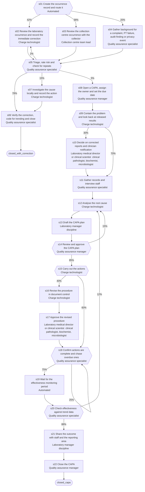

# Manage nonconformances and corrective actions

`dls-qa-nonconformance-capa` · medical laboratory services · quality assurance · part of `diagnostic-lab-services-co`

Staff across collection centres and laboratories record every deviation in the electronic quality management system: rejected and mislabelled specimens, QC run rejections, complaints, proficiency testing failures, audit findings and privacy events. Area supervisors record the immediate correction, quality assurance specialists triage the records weekly and most close with the correction alone, while repeats and high-risk events become formal corrective and preventive actions (CAPA) with root cause analysis, actions, procedure changes and an effectiveness check. The process is slow where it depends on busy bench supervisors and managers, where actions go overdue, and where root causes stop at 'retrain staff' so the same events recur.

| | |
|---|---|
| Unit of work | one nonconformance |
| Starts when | A staff member saves an occurrence in the quality management system, or a complaint, PT failure, audit finding or privacy incident is referred to quality. |
| Done when | The record is closed with its correction coded for trending, or the CAPA is closed after an effectiveness check, and it is counted in the monthly CAPA summary. |
| Organisation | A large Canadian community laboratory company with about 200 collection centres, nine laboratories and a central quality department running an electronic QMS with occurrence management. (3,300 employees, 2019-2022) |
| Volume | 900 cases a month (range 600 to 1,300) |

## Where it sits

- Starts with **nonconformance** from cl-specimen-accessioning (50% of cases)
- Starts with **nonconformance** from cl-daily-qc (30% of cases)
- Starts with **nonconformance** from cs-complaint-handling (14% of cases)
- Starts with **nonconformance** from qa-proficiency-testing (2% of cases)
- Starts with **nonconformance** from qa-accreditation-inspection (1% of cases)
- Starts with **nonconformance** from lp-privacy-incident (3% of cases)
- Sends **capa_summary** to qa-management-review (outcome: any)

## Flow

## Roles

| Role | Department | Layer | FTE on this process | Loaded cost per hour | Evidence |
|---|---|---|---:|---:|---|
| Charge technologist | Community laboratory testing (The model laboratory Laboratories) | supervisor | 5.8 | 58 CAD | C |
| Collection centre team lead | Laboratory and Health Services Centres network | supervisor | 0.7 | 40 CAD | C |
| Quality assurance specialist | Quality assurance operations | individual contributor | 4 | 52 CAD | B [s_dyn_sysval] |
| Quality assurance manager | Quality assurance operations | manager | 0.4 | 72 CAD | C |
| Laboratory manager (discipline) | Community laboratory testing (The model laboratory Laboratories) | manager | 0.6 | 72 CAD | C |
| Laboratory medical director or clinical scientist (clinical pathologist, biochemist, microbiologist) | Community laboratory testing (The model laboratory Laboratories) | senior specialist | 0.15 | 230 CAD | C |

## Steps

Hands-on time and the wait before each step show the most common value. Evidence tier A is a sourced number, B a sourced description, C the author's estimate.

| Step | Who | Kind | Hands-on | Wait before | Control | Evidence |
|---|---|---|---:|---:|---|---|
| **s01 Create the occurrence record and route it.** When a staff member in another process saves an occurrence (a rejected or mislabelled specimen, a QC run rejection, a complaint, a PT failure, an audit finding or a privacy event), the quality management system creates a numbered record and notifies the supervisor of the area named on it. | Automated | system auto | 0 min | 0 min |  | B [s_dyn_sysval], [s_labmgr_nc] |
| **s02 Review the laboratory occurrence and record the immediate correction.** The charge technologist opens the record, confirms the facts with the technologist or assistant involved, records the immediate correction such as a rerun, recalibration or recollection request, picks a category and an initial impact rating and checks whether any result was released. | Charge technologist | review | 10 min | 8.0 h |  | B [s_labmgr_nc], [s_clsi_nce] |
| **s03 Review the collection centre occurrence with the collector.** The collection centre team lead reads the rejection or labelling notice, identifies the collector from the requisition and LIS audit trail, talks the error through with them, and records the correction and any coaching given. | Collection centre team lead | review | 12 min | 2.0 d |  | A [s_ag2017] |
| **s04 Gather background for a complaint, PT failure, audit finding or privacy event.** A quality assurance specialist collects the complaint file, graded PT report, audit report or privacy incident summary, pulls the related LIS and QC records and writes a short description of what happened before triage. | Quality assurance specialist | lookup | 30 min | 1.0 d |  | A [s_ag2017] |
| **s05 Triage, rate risk and check for repeats.** At the weekly review of new records a quality assurance specialist checks the category and risk rating (impact by frequency), searches the trend for the same collector, site, assay or instrument in the last 90 days, and decides whether the record can close with its correction, needs a local investigation or needs a formal CAPA. | Quality assurance specialist | judgment | 6 min | 3.0 d | ISO 15189 requirements for control of nonconforming work and corrective action, applied through Accreditation Canada Diagnostics ISO 15189 Plus, CAP and MANQAP accreditation; the triage thresholds are company policy | B [s_labmgr_nc], [s_clsi_nce] |
| **s06 Verify the correction, code for trending and close.** The quality assurance specialist checks that the correction is recorded and complete, sets the final category codes used in the monthly trend and CAPA summary, and closes the record. | Quality assurance specialist | review | 5 min | 12.0 h | ISO 15189 requirements for control of nonconforming work and corrective action, applied through Accreditation Canada Diagnostics ISO 15189 Plus, CAP and MANQAP accreditation: records of nonconformities and actions are kept and reviewed | B [s_clsi_nce] |
| **s07 Investigate the cause locally and record the action.** For a medium-risk event the area supervisor checks the procedure, the records and the people involved, records a probable cause and a local action such as a bench reminder, a worksheet change or a one-to-one retraining, and returns the record to quality. | Charge technologist | analysis | 45 min | 3.0 d |  | B [s_labmgr_nc], [s_labmgr_rca] |
| **s08 Open a CAPA, assign the owner and set the due date.** The quality assurance manager confirms that the event needs a formal corrective action, opens the CAPA linked to the occurrence, assigns an owner in the affected discipline and sets the due date by risk class. | Quality assurance manager | coordination | 10 min | 2.0 d |  | B [s_ifactory] |
| **s09 Contain the problem and look back at released results.** The charge technologist stops the affected process if it is still running, identifies patient results released since the last good QC or known good state, and lists the reports that may need correcting. | Charge technologist | analysis | 1.0 h | 1.0 d |  | C |
| **s10 Decide on corrected reports and clinician notification.** The medical director reviews the affected results and their clinical significance, decides which reports must be corrected and which clinicians must be phoned, and records the decision; corrected reports are issued through result reporting. | Laboratory medical director or clinical scientist (clinical pathologist, biochemist, microbiologist) | judgment | 30 min | 1.0 d | Laboratory director responsibility for amended reports under provincial laboratory licensing and ISO 15189 | C |
| **s11 Gather records and interview staff.** A quality assurance specialist pulls the LIS audit trail, QC data, maintenance log, training and competency records and the procedure version in use, interviews the staff involved and reconstructs a timeline of the event. | Quality assurance specialist | lookup | 2.0 h | 3.0 d |  | B [s_labmgr_rca], [s_clsi_nce] |
| **s12 Analyse the root cause.** The charge technologist and the quality specialist work through the timeline with 5 whys or a fishbone diagram, ask how the system allowed the error rather than who made it, and check whether the same failure could occur at other benches or sites. | Charge technologist | analysis | 2.0 h | 2.0 d |  | A [s_labmgr_nc], [s_labmgr_rca], [s_yang2026] |
| **s13 Draft the CAPA plan.** The discipline manager writes the corrective and any preventive actions against the root cause, with an owner and due date for each, and states how effectiveness will be measured, for example no recurrence in 90 days. | Laboratory manager (discipline) | drafting | 40 min | 12.0 h |  | B [s_cln_2018], [s_labmgr_nc] |
| **s14 Review and approve the CAPA plan.** The quality assurance manager checks that the actions address the stated root cause, that they are realistic and that the effectiveness measure can be checked, then approves the plan or sends it back. | Quality assurance manager | approval | 30 min | 3.0 d | ISO 15189 requirements for control of nonconforming work and corrective action, applied through Accreditation Canada Diagnostics ISO 15189 Plus, CAP and MANQAP accreditation: corrective actions appropriate to the effects of the nonconformity, reviewed by quality management | C |
| **s15 Carry out the actions.** The charge technologist carries out the actions: retrains staff and records it, changes a worksheet, label or bench layout, raises an IT ticket for a system fix, or sends written feedback and refresher material to collection centres. | Charge technologist | data entry | 3.0 h | 7.0 d |  | A [s_yang2026] |
| **s16 Revise the procedure in document control.** The charge technologist checks out the procedure in the document control module, edits the affected steps, marks the changes and routes the new version for approval with a training requirement attached. | Charge technologist | drafting | 2.0 h | 3.0 d |  | B [s_dyn_licences] |
| **s17 Approve the revised procedure.** The medical director reviews the revised procedure in the document control workflow and approves it, after which the system issues it and assigns read-and-acknowledge training to affected staff. | Laboratory medical director or clinical scientist (clinical pathologist, biochemist, microbiologist) | approval | 20 min | 4.0 d | ISO 15189 document control: procedures approved by an authorised person before issue; accreditation required for the Ontario licence | C |
| **s18 Confirm actions are complete and chase overdue ones.** A quality assurance specialist works the overdue list in the quality management system, checks the evidence for each action marked complete, and emails or escalates owners whose actions are late. | Quality assurance specialist | coordination | 20 min | 5.0 d |  | B [s_ifactory] |
| **s19 Wait for the effectiveness monitoring period.** The CAPA stays open while the laboratory runs with the change, so that the trend data for the following weeks can show whether the problem has recurred. | Automated | system auto | 0 min | 42.0 d |  | B [s_labmgr_nc], [s_ifactory] |
| **s20 Check effectiveness against trend data.** The quality assurance specialist compares the number of similar occurrences before and after the change in the trend report, reviews any follow-up audit or QC data, and records whether the action worked. | Quality assurance specialist | analysis | 30 min | 1.0 d | ISO 15189 requirements for control of nonconforming work and corrective action, applied through Accreditation Canada Diagnostics ISO 15189 Plus, CAP and MANQAP accreditation: review of the effectiveness of corrective actions | B [s_labmgr_rca], [s_labmgr_nc] |
| **s21 Share the outcome with staff and the reporting area.** The discipline manager tells the staff involved and the area that reported the event what was found and changed, at a huddle or by email, so that the reporter sees the result. | Laboratory manager (discipline) | communication | 20 min | 1.0 d |  | C |
| **s22 Close the CAPA.** The quality assurance manager reviews the completed record, signs the closure in the quality management system and the CAPA is counted in the monthly CAPA summary for management review. | Quality assurance manager | approval | 10 min | 2.0 d | ISO 15189 requirements for control of nonconforming work and corrective action, applied through Accreditation Canada Diagnostics ISO 15189 Plus, CAP and MANQAP accreditation: closure of corrective action records | B [s_dyn_licences] |

## Exceptions

| Exception | Share of cases | What happens |
|---|---:|---|
| Released results affected | 2% | A CAPA look-back finds released results that may be wrong; the medical director decides on corrected reports and calls. |
| Plan sent back | 1% | The quality manager rejects a CAPA plan whose actions do not match the root cause. |
| Overdue actions | 1% | Actions miss their due date and the specialist chases the owner again each week. |
| CAPA not effective | 1% | The same event recurs during monitoring and the CAPA goes back to root cause analysis. |
| Record returned for information | 2% | Triage cannot rate the record and sends it back to the area supervisor. |

## Benchmarks

| Metric | Value | Unit | Population | Evidence |
|---|---|---|---|---|
| cycle_time_days | p50 6, p90 14 | calendar days from record creation to closure, all nonconformances | Author's estimate for a large community laboratory network | C [s_ifactory], [s_labmgr_nc] |
| capa_closure_target_days | critical 30, major 60, minor 90 | days from opening to closure by risk class | Pharmaceutical plants (vendor guidance) | B [s_ifactory] |
| specimen_rejection_rate | provider_1 0.009, provider_2 0.002 | share of community specimens that could not be tested, 2016/17 | Two Ontario community laboratory providers | A [s_ag2017] |

## Pain points

- Root cause analysis stops at 'staff not trained' or 'human error', so retraining is the default action and the same events recur. (steps s12, s15, s20; A [s_yang2026], [s_labmgr_rca])
- Collection-related records wait days for team leads who work the counter, and coaching notes are too vague to spot repeat collectors. (steps s03, s05; C)
- CAPA actions go overdue because owners are bench supervisors and managers with full workloads; specialists spend time chasing. (steps s15, s18; B [s_ifactory])
- Tracking systems are a common accreditation finding, which suggests occurrence records are often incomplete or poorly linked. (steps s05, s06; A [s_ag2017])

## Assumptions

- Triage shares (78% closed with correction, 15% local investigation, 5% formal CAPA, 2% returned) are the author's estimate. Five percent of 900 records is about 540 CAPAs a year across the network.
- Interface shares follow the process map sources; specimen accessioning and daily QC dominate. Result amendments in cl-result-reporting also open nonconformances, but the organisation file does not list that link, so those records are folded into the laboratory route (s02).
- Logging the occurrence is counted in the reporting process (for example the accessioning workflow logs rejections), so s01 is a system step with no hands-on time.
- Local investigations of collection-centre events are shown as done by a charge technologist; in practice a collection centre team lead or regional manager may do some of them.
- The effectiveness monitoring period (3 to 13 weeks) keeps CAPAs open; laboratories that close CAPAs at implementation and check effectiveness later would show shorter CAPA cycle times.
- Controls tied to accreditation are marked fixed_by_law where the requirement itself is mandatory under licensing (records, effectiveness review, document approval) and needs_policy_change where the company sets the method (triage thresholds, plan approval).
- Loaded costs come from the organisation file (hourly wage times 1.35).

## Sources

- [s_ag2017] [2017 Annual Report, Section 3.07: Laboratory Services in the Health Sector](https://www.auditor.on.ca/en/content/annualreports/arreports/en17/v1_307en17.pdf) (Office of the Auditor General of Ontario, 2017). Read from the text copy saved under scratch by earlier work. All licensed laboratories must follow the provincial quality management program of accreditation and proficiency testing (Institute for Quality Management in Healthcare, now Accreditation Canada Diagnostics): on-site assessment every four years, a self-assessment two years after the previous visit (ISO 15189 Plus labs get a surveillance visit at two years instead), next visit confirmed about 90 days ahead. 2012-2016: about 800 non-conformances a year, average 15 per assessment visit (8 to 28 by region), conformance about 97% against more than 400 requirements; most common categories point-of-care testing (17%), laboratory systems for tracking issues with testing (16%), equipment and supplies (12%). Proficiency testing error rate below 1% (0.04% pathology to 1.8% bacteriology). CAP and the Joint Commission make unannounced visits. Community laboratories are not licensed to perform some tests; the Ministry had no process to evaluate new tests for the Schedule of Benefits. Community specimen rejection rates 0.9% and 0.2% in 2016/17.
- [s_dyn_licences] Licences and quality commitment (link withheld) (The model laboratory, undated). Accreditations by laboratory: Accreditation Canada ISO 15189 (Brampton, London, Ottawa, Peterborough), CAP (Brampton, London, Ottawa, Winnipeg, Impact Genetics), SCC ISO 15189 and ISO/IEC 17025 (Laval, Brampton, London, Edmonton), SAMHSA (London, Edmonton), MANQAP (Winnipeg), provincial licences. QMS components include management review, internal corporate quality audits, preventive and corrective action programs, equipment validation, change control and computerized systems validation, document and record control, and external quality assessment for all assays (CAP, QMP-LS, Healthmetrix).
- [s_dyn_sysval] Manager, System Validations (job posting, Brampton) (link withheld) (The model laboratory via SimplyHired, 2026). Leads the System Validation Analysts in quality assurance, who validate information system changes for new assay methods, products and equipment across the LIS (AS400, Omnitech, national order entry, middleware, LabDirector, MedLab) and result outputs (EMRs, eResults, OLIS); product owner of the electronic QMS for document, occurrence and equipment management; supports external inspections by regulators, accreditation bodies and clients; internal audits and periodic reviews of information systems. Salary CAD 72,000 to 90,000.
- [s_clsi_nce] [Manage nonconforming events in the lab with a quality management system](https://clsi.org/resources/insights-blog/manage-nonconforming-events-in-the-lab-with-a-quality-management-system/) (Clinical and Laboratory Standards Institute, undated). A nonconforming event program reports each nonconformance, investigates its cause, decides whether action is needed and carries it out, and tracks and trends all nonconformances; refers to CLSI QMS11.
- [s_labmgr_nc] [Transforming nonconforming work into laboratory success (K. Mulholland)](https://www.labmanager.com/transforming-nonconforming-work-into-laboratory-success-32864) (Lab Manager, undated). Log every deviation with date, finder, issue, immediate fix and a quick risk rating (impact by frequency); a corrective action request is always completed for high risk and discussed for medium risk; root cause by 5 whys (two to ten iterations) or fishbone; effectiveness reviewed with reminders at three and six months; trend all nonconforming work.
- [s_labmgr_rca] [Root cause analysis: the fix for recurring lab errors (L. Everett)](https://www.labmanager.com/root-cause-analysis-the-fix-for-recurring-lab-errors-34044) (Lab Manager, undated). Focus on how the system allowed the error; 'lack of training' is over-used as a default root cause; check whether the problem could occur elsewhere; set a review interval by risk; absence of recurrence is the clearest sign the true root cause was fixed; verify through internal audits and management review.
- [s_yang2026] [The 'Double Helix' model of quality monitoring during initial ISO 15189 implementation (Yang et al.)](https://www.ebi.ac.uk/europepmc/webservices/rest/search?query=PMCID:PMC12871953&resultType=core&format=json) (PLoS One (record read through Europe PMC), 2026). One laboratory, 2021-2024: 35 internal-audit and 67 external-assessment nonconformities. Root causes: personnel negligence (40%) and training deficiencies (31%) internally; training deficiencies (40%) and document and record deficiencies (22%) externally. Personnel training was the most common corrective action (47% internal, 41% external). External assessments raised more nonconformities than internal audits.
- [s_ifactory] [Deviation and CAPA management for pharma plants (D. Cook)](https://ifactoryapp.com/article/pharma-deviation-capa-management) (iFactory AI (software vendor), 2026). Vendor page for pharmaceutical plants: closure windows of 30 days (critical), 60 (major) and 90 (minor); effectiveness review at 60, 90 or 180 days after closure; open-item ageing under manual tracking 45% within 30 days, 25% at 31-60, 18% at 61-90 and 12% over 90 days.
- [s_cln_2018] [Top laboratory deficiencies across accreditation agencies (Chittiprol, Bornhorst, Kiechle)](https://myadlm.org/cln/articles/2018/july/top-laboratory-deficiencies-across-accreditation-agencies) (Clinical Laboratory News (ADLM), 2018). Competency assessment was the top CAP deficiency in 2016, followed by instrument correlations and method comparisons, procedure manual review, PT evaluation and maintenance records. Self-inspection recommended. A CMS plan of correction is due within 10 business days, must address every deficiency with a responsible person and completion date, and compliance is expected within 30 to 45 days; a citation closes only after acceptable evidence of correction.

Written by claude-opus on 2026-11-17.
