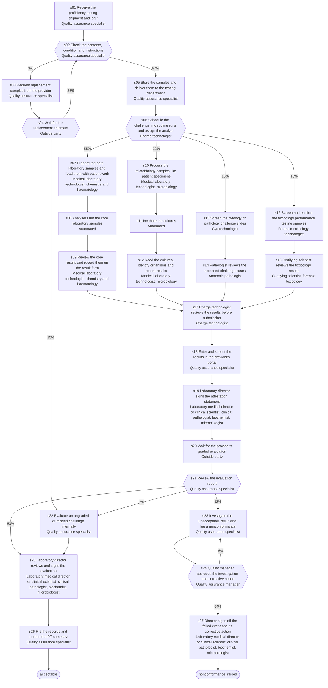

# Run proficiency testing

`dls-qa-proficiency-testing` · health care: medical laboratory testing and health services · quality assurance · part of `diagnostic-lab-services-co`

Several times a year outside programs send each laboratory blind samples, slides or blocks, the laboratory tests them as if they were patient samples and reports the results, and the program grades them against other laboratories or a known answer. Quality specialists log and distribute each shipment, technologists in the core, microbiology, cytology and toxicology sections test the samples in routine runs, a supervisor and the laboratory director check and attest the results, and the specialist submits them before the deadline. Graded reports return weeks later; most are acceptable, but an unacceptable result triggers an investigation, a patient impact decision and corrective action. Delays come from fixed testing windows, waits for directors' signatures and the provider's grading, and transcription errors cause a share of failures.

| | |
|---|---|
| Unit of work | one proficiency testing event |
| Starts when | A proficiency testing provider or the SAMHSA program delivers a shipment of challenge samples to one laboratory section. |
| Done when | Results have been submitted, the graded evaluation reviewed and signed, and either filed as acceptable or passed to corrective action as a nonconformance. |
| Organisation | A large Canadian laboratory company with nine laboratories accredited to ISO 15189, CAP, ISO/IEC 17025, MANQAP and SAMHSA, enrolled in IQMH (QMP-LS), CAP and other proficiency testing programs. (3,300 employees, 2019-2022) |
| Volume | 40 cases a month (range 25 to 60) |

## Where it sits

- Starts with **eqa_challenge** from eqa_provider (92% of cases)
- Starts with **eqa_challenge** from samhsa (8% of cases)
- Sends **eqa_results** to eqa_provider (outcome: any)
- Sends **nonconformance** to qa-nonconformance-capa (outcome: nonconformance_raised)

## Flow

## Roles

| Role | Department | Layer | FTE on this process | Loaded cost per hour | Evidence |
|---|---|---|---:|---:|---|
| Quality assurance specialist | Quality assurance operations | individual contributor | 0.8 | 52 CAD | B [dyn_licences] |
| Charge technologist | Community laboratory testing (The model laboratory Laboratories) | supervisor | 0.15 | 58 CAD | C |
| Medical laboratory technologist, chemistry and haematology | Core laboratory (chemistry, immunoassay, haematology, urinalysis) | individual contributor | 0.15 | 52 CAD | B [jobbank_32120] |
| Medical laboratory technologist, microbiology | Microbiology laboratory | individual contributor | 0.1 | 52 CAD | C |
| Cytotechnologist | Cytology laboratory | individual contributor | 0.04 | 53 CAD | C |
| Anatomic pathologist | Histology and anatomic pathology | senior specialist | 0.02 | 230 CAD | C |
| Forensic toxicology technologist | Forensic toxicology laboratories | individual contributor | 0.03 | 47 CAD | C |
| Certifying scientist, forensic toxicology | Forensic toxicology laboratories | senior specialist | 0.01 | 70 CAD | C |
| Laboratory medical director or clinical scientist (clinical pathologist, biochemist, microbiologist) | Community laboratory testing (The model laboratory Laboratories) | senior specialist | 0.05 | 230 CAD | C |
| Quality assurance manager | Quality assurance operations | manager | 0.02 | 72 CAD | C |

## Steps

Hands-on time and the wait before each step show the most common value. Evidence tier A is a sourced number, B a sourced description, C the author's estimate.

| Step | Who | Kind | Hands-on | Wait before | Control | Evidence |
|---|---|---|---:|---:|---|---|
| **s01 Receive the proficiency testing shipment and log it.** A quality specialist collects the provider's box from receiving, records the survey, lot, shipment date and due date in the proficiency testing log in the quality system and opens the instructions to see the storage conditions and the testing window. | Quality assurance specialist | intake | 10 min | 4.0 h |  | B [iqmh_schedule], [cap_pt] |
| **s02 Check the contents, condition and instructions.** The specialist compares the vials or slides with the packing list, checks for breakage, leaks and thawing, reads the instructions for reconstitution and the result form, and notes the test list the laboratory is enrolled for. | Quality assurance specialist | validation | 10 min | 1.0 h | ISO 15189 (Accreditation Canada Diagnostics ISO 15189 Plus) external quality assessment: handle PT material as the provider instructs | B [acd], [iqmh_overview] |
| **s03 Request replacement samples from the provider.** The specialist emails or phones the provider's customer service with the survey and kit numbers, describes the damage and asks for a replacement shipment before the due date, and records the request. | Quality assurance specialist | communication | 10 min | 2.0 h |  | C |
| **s04 Wait for the replacement shipment.** The provider ships replacement material, often from limited stock, and the laboratory waits; if it arrives too late the challenge cannot be graded and the laboratory evaluates itself. | Outside party | external wait | 0 min | 5.0 d |  | B [iqmh_schedule] |
| **s05 Store the samples and deliver them to the testing department.** The specialist puts the material in the refrigerator or freezer the instructions require, then hands it to the department's charge technologist with the instructions, result form and due date, and records the handover. | Quality assurance specialist | physical | 5 min | 1.0 h |  | C |
| **s06 Schedule the challenge into routine runs and assign the analyst.** The charge technologist picks a testing day inside the window, assigns the challenge to a technologist on the rotation who routinely runs those tests, and reminds the team that results must not be discussed with other laboratories. | Charge technologist | coordination | 6 min | 8.0 h | 42 CFR 493.801(b)(1) and CAP accreditation requirements: PT samples tested with the regular patient workload by staff who routinely test patients, rotated among analysts | A [cfr493_801] |
| **s07 Prepare the core laboratory samples and load them with patient work.** The technologist reconstitutes or thaws the samples exactly as instructed, waits the stated time, labels them like patient samples with accession numbers and loads them onto the analysers in the routine run. | Medical laboratory technologist, chemistry and haematology | physical | 20 min | 1.0 d |  | A [cfr493_801] |
| **s08 Analysers run the core laboratory samples.** The track and analysers measure the challenge samples among the patient work with no one attending them, and results post to the middleware and LIS under the challenge accession numbers. | Automated | system auto | 0 min | 1.0 h |  | C |
| **s09 Review the core results and record them on the result form.** The technologist checks that the run's quality control passed, reviews flags and units, and copies each result with the method and instrument codes onto the provider's result worksheet, rerunning only where a patient sample would also be rerun. | Medical laboratory technologist, chemistry and haematology | data entry | 20 min | 4.0 h |  | C |
| **s10 Process the microbiology samples like patient specimens.** The microbiology technologist rehydrates the lyophilised material, plates it on the media used for that specimen type, sets up smears or molecular panels and logs the cultures in the LIS like patient work. | Medical laboratory technologist, microbiology | physical | 25 min | 1.0 d |  | C |
| **s11 Incubate the cultures.** The cultures incubate for one to several days with nobody working on them, as patient cultures do, before they can be read. | Automated | system auto | 0 min | 2.0 d |  | B [iqmh_schedule] |
| **s12 Read the cultures, identify organisms and record results.** The technologist reads the plates, identifies organisms by MALDI-TOF or biochemical tests, runs susceptibility tests where asked and records identifications, susceptibilities and interpretations on the result worksheet. | Medical laboratory technologist, microbiology | analysis | 40 min | 8.0 h |  | A [ag2017] |
| **s13 Screen the cytology or pathology challenge slides.** A cytotechnologist screens the glass slides or images in the challenge as patient cases, dots abnormal cells, records a provisional interpretation and passes abnormal or pathology cases to a pathologist. | Cytotechnologist | analysis | 40 min | 3.0 d |  | B [iqmh_schedule] |
| **s14 Pathologist reviews the screened challenge cases.** A pathologist examines the dotted slides or stained sections, gives the final interpretation in the provider's categories and initials the worksheet. | Anatomic pathologist | judgment | 15 min | 1.0 d |  | A [ag2017] |
| **s15 Screen and confirm the toxicology performance testing samples.** A toxicology technologist accessions the performance testing samples like donor specimens, runs the immunoassay screen and the GC-MS or LC-MS/MS confirmation for non-negatives and assembles the data package. | Forensic toxicology technologist | physical | 40 min | 1.0 d |  | B [dyn_drugtest] |
| **s16 Certifying scientist reviews the toxicology results.** A certifying scientist reviews the screening and confirmation data, chromatograms and custody records for each sample, as for donor results, and signs the result sheet. | Certifying scientist, forensic toxicology | review | 15 min | 12.0 h | SAMHSA Mandatory Guidelines for Federal Workplace Drug Testing Programs: certifying scientist review of results at HHS-certified laboratories | C |
| **s17 Charge technologist reviews the results before submission.** The charge technologist compares the worksheet with the instrument or culture records, checks units, method codes and that no sample was sent to another laboratory or discussed outside, and returns any transcription error to the analyst to correct. | Charge technologist | review | 15 min | 1.0 d | 42 CFR 493.801(b)(4) and (b)(5): no inter-laboratory communication about results before the deadline and no referral of PT samples | A [cfr493_801] |
| **s18 Enter and submit the results in the provider's portal.** The quality specialist keys the reviewed results, method codes and instrument codes into the provider's web portal, has a second person check the entries against the worksheet, submits before the due date and saves the submission receipt. | Quality assurance specialist | data entry | 30 min | 2.0 d | Ontario requires every licensed laboratory to take part in the IQMH proficiency testing program and submit results by the due date | A [ag2017], [iqmh_overview], [cap_pt] |
| **s19 Laboratory director signs the attestation statement.** The laboratory director reads and signs the provider's attestation that the samples were tested like patient samples by the laboratory's own routine staff and methods, beside the analyst's signature, and the signed page is filed with the submission. | Laboratory medical director or clinical scientist (clinical pathologist, biochemist, microbiologist) | approval | 2 min | 1.0 d | 42 CFR 493.801(b)(6) and CAP accreditation: attestation signed by the analyst and the laboratory director | A [cfr493_801] |
| **s20 Wait for the provider's graded evaluation.** The provider closes the survey, compares each laboratory's results with the target or peer-group consensus, and publishes the individual evaluation and participant summary in its portal, usually a few weeks after the due date. | Outside party | external wait | 0 min | 14.0 d |  | C |
| **s21 Review the evaluation report.** The quality specialist downloads the evaluation, compares each graded result with the acceptable range and the peer group, records the scores in the PT log, and flags unacceptable results, ungraded challenges and results that are acceptable but drifting from the peer mean. | Quality assurance specialist | review | 25 min | 3.0 d | ISO 15189 external quality assessment: results reviewed and acted on; Ontario quality management program | A [ag2017] |
| **s22 Evaluate an ungraded or missed challenge internally.** When the provider could not grade a challenge (no consensus, late or damaged material), the specialist compares the laboratory's results with the peer data or intended values, or tests retained material, and documents the self-evaluation. | Quality assurance specialist | analysis | 30 min | 2.0 d | CAP and ISO 15189 requirement to evaluate ungraded PT challenges or use an alternative assessment | C |
| **s23 Investigate the unacceptable result and log a nonconformance.** The specialist and the department open a nonconformance, classify the cause (clerical, method, equipment, technical or PT material), check calibration, quality control and patient results from the same period, retest retained material if stable, and propose corrective action. | Quality assurance specialist | analysis | 3.0 h | 2.0 d | ISO 15189 nonconforming work and corrective action; 42 CFR 493.803(c)(2) evidence that the laboratory has corrected the problem | B [cfr493_803], [dyn_licences] |
| **s24 Quality manager approves the investigation and corrective action.** The quality manager reviews the investigation, decides whether patient results need a look-back or corrected reports, approves the corrective action and its due date, and assigns an effectiveness check. | Quality assurance manager | approval | 30 min | 2.0 d | Quality management system: manager approval of PT investigations and patient impact decisions | B [dyn_licences] |
| **s25 Laboratory director reviews and signs the evaluation.** The laboratory director reviews the evaluation with any self-evaluation notes, signs and dates it to show the results were reviewed, and adds comments for the department. | Laboratory medical director or clinical scientist (clinical pathologist, biochemist, microbiologist) | review | 5 min | 3.0 d | CAP accreditation checklist: laboratory director review and sign-off of PT evaluations | C |
| **s26 File the records and update the PT summary.** The specialist files the evaluation, worksheets, attestation and instrument printouts in the quality system for at least two years and updates the PT performance summary used in quality reports and management review. | Quality assurance specialist | data entry | 10 min | 1.0 d | 42 CFR 493.801(b)(6) and accreditation record rules: keep PT records at least two years | A [cfr493_801], [dyn_licences] |
| **s27 Director signs off the failed event and its corrective action.** The laboratory director reviews the investigation, corrective action and any patient look-back for the unacceptable result, signs the evaluation and the nonconformance, and the specialist files them and passes the open action to corrective action tracking. | Laboratory medical director or clinical scientist (clinical pathologist, biochemist, microbiologist) | approval | 10 min | 3.0 d | CAP accreditation and ISO 15189: director responsibility for PT performance and corrective action | C |

## Exceptions

| Exception | Share of cases | What happens |
|---|---:|---|
| Unacceptable result or adverse trend | 12% | One or more results fall outside the acceptable range, or results drift from the peer mean; the specialist and department investigate, the quality manager approves the corrective action and patient look-back, and the director signs. |
| Damaged or late kit | 3% | Samples arrive broken, leaking or warm; a replacement is requested and, if it cannot arrive before the deadline, the laboratory evaluates itself. |
| Ungraded challenge | 5% | The provider cannot grade a challenge because participants did not agree; the laboratory documents its own evaluation against peer data. |

## Benchmarks

| Metric | Value | Unit | Population | Evidence |
|---|---|---|---|---|
| cycle_time_days | p50 40, p90 70 | calendar days from shipment received to evaluation signed and filed | All PT events across disciplines | C |
| ship_to_due_date_days | low 10, mode 18, high 39 | calendar days | IQMH surveys (routine chemistry 11, IHC 17 to 18, bacteriology 25, mycology 39) | A [iqmh_schedule] |
| pt_error_rate_ontario | average_below 0.01, pathology 0.0004, bacteriology 0.018 | share of results not meeting standards | Ontario licensed laboratories, 2011/12 to 2015/16 | A [ag2017] |
| pt_record_retention | 2 | years | CLIA-certified laboratories | A [cfr493_801] |
| pd_l1_pt_frequency | 6 | months between PT rounds (at most) | Canadian PD-L1 IHC laboratories | A [cheung2019] |
| biomarker_pt_turnaround_days | p50 22.5, low 5, high 57 | calendar days from receipt to report upload | 13 Canadian laboratories in an end-to-end lung biomarker challenge | A [bisson2025] |

## Pain points

- Results are copied by hand from instruments to worksheets and then into provider portals, and clerical errors are a common cause of unacceptable grades. (steps s09, s17, s18; C)
- Director signatures on attestations and evaluations wait for busy medical directors and can take weeks. (steps s19, s25, s27; C)
- Graded evaluations arrive weeks after testing, so a real analytical problem may have affected patient results for a month before it is seen. (steps s20, s23; C)
- Failure investigations take hours of specialist and technologist time and include a patient look-back decision. (steps s23, s24; B [cfr493_803])

## Assumptions

- An event is one shipment of one survey to one laboratory section; departments are split 55% core laboratory, 22% microbiology, 13% cytology and anatomic pathology and 10% toxicology. The organisation file does not give the mix.
- US CLIA rules (42 CFR 493.801 and 493.803) are cited because the company's CAP-accredited and CLIA-certified sites follow them and CAP builds them into its checklists; Canadian accreditation under ISO 15189 has equivalent EQA requirements but the standard text was not opened.
- The organisation file's process map lists only proficiency testing providers as recipients of results; SAMHSA performance testing results go to the SAMHSA program, which is treated as part of that flow.
- Charge technologists, pathologists, toxicology technologists, certifying scientists and medical directors are added from the organisation file although the process map lists only quality specialists, MLTs, cytotechnologists and the quality manager; the extra roles sign, review or test in their own sections.
- Bench testing, slide screening and sample handling are physical work with low desk_work_share; instrument runs and culture incubation with no one working are modelled as waits.
- Loaded costs come from the organisation file (hourly wage times 1.35).

## Sources

- [ag2017] [2017 Annual Report, Section 3.07: Laboratory Services in the Health Sector](https://www.auditor.on.ca/en/content/annualreports/arreports/en17/v1_307en17.pdf) (Office of the Auditor General of Ontario, 2017). The Ministry requires all licensed laboratories to take part in the proficiency testing program of the Institute for Quality Management in Healthcare, which sends materials several times a year and treats any result that misses its handling or analysis standards as an error; average error rate below 1% from 2011/12 to 2015/16, ranging from 0.04% for pathology to 1.8% for bacteriology in 2015/16; Alberta targets 5% or lower.
- [iqmh_overview] [Proficiency testing overview](https://iqmh.org/Proficiency-Testing/Overview) (Institute for Quality Management in Healthcare (IQMH), undated). IQMH proficiency testing is ISO/IEC 17043 accredited, covers 8 disciplines and 148 surveys, serves 600+ Canadian laboratories (about 217 licensed under the Ministry of Health contract), and all Ontario licensed laboratories are mandated by the Ministry to participate.
- [iqmh_schedule] [Proficiency testing schedule (2027)](https://iqmh.org/Proficiency-Testing/Testing-Schedule) (Institute for Quality Management in Healthcare (IQMH), 2026). Each survey lists shipment, testing and due dates with results closing at 11:59 pm on the due date: routine chemistry 3 rounds a year due 11 days after shipment; haematology 4 rounds, due 11 to 18 days after shipment; bacteriology 6 surveys due 25 days after shipment; immunohistochemistry 5 rounds due 17 to 18 days after shipment; rotational cytology surveys due months after shipment.
- [cfr493_801] [42 CFR 493.801: Condition: Enrollment and testing of samples](https://www.law.cornell.edu/cfr/text/42/493.801) (Legal Information Institute, Cornell Law School (US Code of Federal Regulations), current). Proficiency samples must be tested with the laboratory's regular patient workload by personnel who routinely test patients using routine methods, the same number of times as patient samples; no inter-laboratory communication about results before the deadline; no referral of samples to another laboratory; attestation signed by the analyst and the laboratory director; records kept at least two years.
- [cfr493_803] [42 CFR 493.803: Condition: Successful participation](https://www.law.cornell.edu/cfr/text/42/493.803) (Legal Information Institute, Cornell Law School (US Code of Federal Regulations), current). Laboratories must successfully participate in an approved proficiency testing program for each specialty and test; unsuccessful performance leads to sanctions unless the laboratory gives satisfactory evidence that it has taken steps to correct the problem.
- [cap_pt] [Proficiency testing](https://www.cap.org/laboratory-improvement/proficiency-testing) (College of American Pathologists, undated). CAP PT and EQA programs span 16 disciplines; results are submitted through the e-LAB Solutions Suite online portal or by direct transmission; participants receive individual evaluations, participant summary reports and educational discussions.
- [dyn_licences] Licences and quality commitment (link withheld) (The model laboratory, undated). The company's laboratories hold Accreditation Canada ISO 15189, CAP, SAMHSA, ISO/IEC 17025 and MANQAP accreditations; it uses CAP, QMP-LS and Healthmetrix EQA surveys and trace metal and toxicology EQA programs covering all assays; its quality system includes internal audits, corrective and preventive action, management review and key performance indicators.
- [acd] [Accreditation Canada Diagnostics](https://diagnostics.accreditation.ca/) (Accreditation Canada Diagnostics, undated). Accredits medical laboratories against ISO 15189 Plus requirements, with an external evaluation at the 2-year mark.
- [cheung2019] [Fit-for-purpose PD-L1 biomarker testing for patient selection in immuno-oncology: guidelines for clinical laboratories from the Canadian Association of Pathologists (Cheung CC et al., Appl Immunohistochem Mol Morphol 27(10):699-714)](https://www.ebi.ac.uk/europepmc/webservices/rest/PMC6887625/fullTextXML) (Europe PMC (full text of PMC6887625), 2019). Laboratories should take part in fit-for-purpose proficiency testing at least every six months where available (GS36); PT ideally reports accuracy against central expert assessment (GS37); PT does not replace validation (GS38).
- [bisson2025] [Novel approach to proficiency testing reveals significant variations in biomarker practice leading to critical differences in lung cancer management (Bisson KR et al., JTO Clinical and Research Reports 6(7):100837)](https://www.ebi.ac.uk/europepmc/webservices/rest/PMC12192570/fullTextXML) (Europe PMC (full text of PMC12192570), 2025). Canadian Pathology Quality Assurance sent three challenge blocks by tracked courier to 13 laboratories; reports were uploaded to a portal and scored by expert assessors; 3 laboratories were rated suboptimal for long turnaround and 1 failed for a missed EGFR variant.
- [dyn_drugtest] Drug testing solutions (link withheld) (The model laboratory, undated). The company operates Canada's only SAMHSA-certified laboratories; its London forensic toxicology laboratory is accredited to ISO/IEC 17025:2017; initial screening separates negatives from specimens needing confirmation.
- [jobbank_32120] [Wages: Medical Technologist - Medical Laboratory in Ontario (NOC 32120)](https://www.jobbank.gc.ca/marketreport/wages-occupation/4203/ON) (Government of Canada Job Bank, 2025). Ontario hourly wages low $23.00, median $42.00, high $50.00 (2023-2024).

Written by claude-opus on 2026-11-17.
