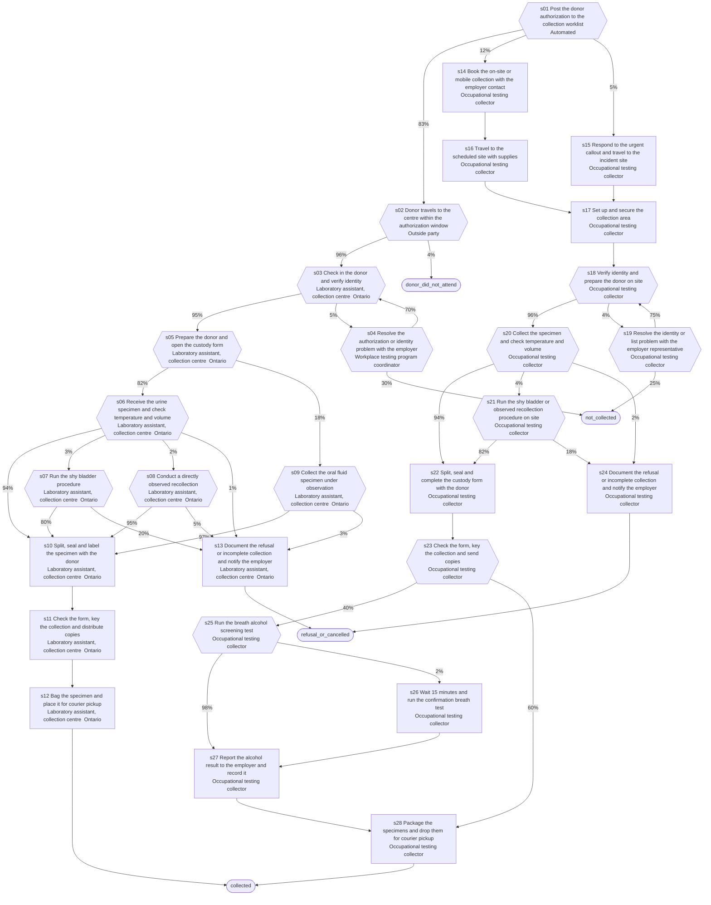

# Collect chain of custody specimens for workplace drug and alcohol tests

`dls-wp-collection` · medical laboratory services (workplace drug and alcohol testing) · workplace testing collections · part of `diagnostic-lab-services-co`

An employer orders a drug test for an applicant or employee and the company's staff collect the specimen under chain of custody, either at a company collection centre or on the employer's site. The collector checks identity, has the donor provide urine or oral fluid, checks temperature and volume, splits and seals the specimen in front of the donor, completes the multi-part custody form and ships the specimen to the toxicology laboratory, adding a breath alcohol test when ordered. Most elapsed time is the donor deciding when to attend and the collector's travel to sites; shy bladders, out-of-range temperatures, refusals and form errors are the usual problems, each governed by set rules.

| | |
|---|---|
| Unit of work | one chain of custody collection |
| Starts when | A donor authorization from the test ordering process reaches a company collection centre or an on-site collector. |
| Done when | The sealed split specimen with copy 1 of the custody form is in the courier pickup and the other copies have gone to the MRO and employer, with any breath alcohol result reported; or the collection is stopped as a refusal, an insufficient specimen, a no-show or an unresolved identity problem. |
| Organisation | The workplace testing line of a large Canadian laboratory company with about 300,000 drug tests a year, 70+ company collection centres, a team of certified on-site collectors and SAMHSA-certified toxicology laboratories. (3,300 employees, 2019-2022) |
| Volume | 15,000 cases a month (range 13,000 to 17,000) |

## Where it sits

- Starts with **donor_authorization** from wp-test-ordering (100% of cases)
- Sends **ccf_specimen** to lg-interlab-transfer (outcome: collected)
- Sends **breath_alcohol_result** to wp-result-reporting (outcome: collected)

## Flow

## Roles

| Role | Department | Layer | FTE on this process | Loaded cost per hour | Evidence |
|---|---|---|---:|---:|---|
| Laboratory assistant, collection centre (Ontario) | Ontario collection centres | individual contributor | 51 | 31 CAD | B [dyn_dts], [jobbank_33101], [cfr4033] |
| Occupational testing collector | Chain of custody collections | individual contributor | 27.5 | 31 CAD | B [dyn_dts], [cfr4033], [jobbank_33101] |
| Workplace testing program coordinator | Workplace program management | individual contributor | 0.6 | 36 CAD | C |

## Steps

Hands-on time and the wait before each step show the most common value. Evidence tier A is a sourced number, B a sourced description, C the author's estimate.

| Step | Who | Kind | Hands-on | Wait before | Control | Evidence |
|---|---|---|---:|---:|---|---|
| **s01 Post the donor authorization to the collection worklist.** The drug testing case system publishes the authorization issued by the program coordinator: donor name, employer, reason for test, panel, specimen type, whether a breath alcohol test is added, and the expiry time. It is emailed or texted to the donor with the site address, or placed on the on-site collector's job list. | Automated | system auto | 0 min | 0 min |  | C |
| **s02 Donor travels to the centre within the authorization window.** The donor (an applicant or employee) decides when to attend within the window the employer set, usually the same or next day for pre-employment and immediately for random selections. Applicants who do not attend before the authorization expires are dropped and the employer is told by the ordering process. | Outside party | external wait | 0 min | 15.0 h |  | B [doi_sched] |
| **s03 Check in the donor and verify identity.** The laboratory assistant calls the donor from the centre queue, asks for government photo identification, looks up the authorization in the drug testing case system and compares name, employer, reason and panel. Workplace donors share the queue with community patients, so the wait depends on the centre's load. | Laboratory assistant, collection centre (Ontario) | validation | 5 min | 25 min | Donor identity check before collection: US DOT 49 CFR Part 40 collection procedures, required by law for cross-border carriers and adopted by the Canadian Model and by employer contracts for non-regulated tests | B [teamsters], [cfr4063] |
| **s04 Resolve the authorization or identity problem with the employer.** The assistant phones the workplace coordinator line, and the coordinator checks the order, reissues or extends the authorization, or calls the employer's designated representative to approve an alternative identification. If nobody can be reached the donor is sent away and the test is re-ordered later. | Workplace testing program coordinator | coordination | 10 min | 30 min |  | C |
| **s05 Prepare the donor and open the custody form.** The assistant explains the procedure, has the donor leave outer clothing and bags outside and empty pockets, has the donor wash and dry hands, and completes the collector part of Step 1 of the custody and control form with the donor's ID number and reason. The donor picks a sealed collection cup or oral fluid device. | Laboratory assistant, collection centre (Ontario) | physical | 5 min | 1 min | Pre-collection steps in 49 CFR 40.63: US DOT 49 CFR Part 40 collection procedures, required by law for cross-border carriers and adopted by the Canadian Model and by employer contracts for non-regulated tests | B [cfr4063], [teamsters] |
| **s06 Receive the urine specimen and check temperature and volume.** The donor voids alone without flushing while the assistant waits outside with water sources blocked. Within four minutes the assistant reads the temperature strip, checks there are at least 45 mL and looks for unusual colour, odour or foreign matter, then ticks the temperature box on the form. | Laboratory assistant, collection centre (Ontario) | physical | 6 min | 3 min | Temperature, volume and tampering checks in 49 CFR 40.65: US DOT 49 CFR Part 40 collection procedures, required by law for cross-border carriers and adopted by the Canadian Model and by employer contracts for non-regulated tests | B [cfr4065], [cfr4063] |
| **s07 Run the shy bladder procedure.** The assistant discards the short specimen, offers up to 40 ounces of fluid spread over up to three hours, records the start and end times in Remarks and asks the donor to wait in the centre. When the donor is ready a new collection is attempted with fresh supplies. | Laboratory assistant, collection centre (Ontario) | physical | 12 min | 1.2 h | Insufficient specimen procedure in 49 CFR 40.193: US DOT 49 CFR Part 40 collection procedures, required by law for cross-border carriers and adopted by the Canadian Model and by employer contracts for non-regulated tests | B [cfr40193], [teamsters] |
| **s08 Conduct a directly observed recollection.** Because the first specimen was out of temperature range or showed tampering, the assistant arranges an immediate second collection watched by an observer of the same gender, which may mean waiting for a colleague, or collects oral fluid instead. Both specimens are kept and the reason is written in Remarks. | Laboratory assistant, collection centre (Ontario) | physical | 12 min | 15 min | Directly observed collection after temperature or tampering findings, 49 CFR 40.65: US DOT 49 CFR Part 40 collection procedures, required by law for cross-border carriers and adopted by the Canadian Model and by employer contracts for non-regulated tests | B [cfr4065] |
| **s09 Collect the oral fluid specimen under observation.** The assistant watches the donor for the device maker's waiting period with nothing in the mouth, has the donor place the collection pad until the volume indicator changes, then splits or seals the A and B tubes. If the volume is short one more attempt is made, then the insufficient specimen rule applies. | Laboratory assistant, collection centre (Ontario) | physical | 15 min | 1 min | Observed oral fluid collection with a certified laboratory's device (Canadian Model oral fluid procedure; 49 CFR 40.73 for comparison) | B [cfr4073], [coaa_2011], [cfr40193] |
| **s10 Split, seal and label the specimen with the donor.** In front of the donor the assistant pours at least 30 mL into bottle A and 15 mL into bottle B, caps them, applies the tamper-evident seals from the form, dates them and has the donor initial them. The donor reads and signs the certification on the form and may list medications on the donor copy. | Laboratory assistant, collection centre (Ontario) | physical | 5 min | 0 min | Split specimen preparation in 49 CFR 40.71: US DOT 49 CFR Part 40 collection procedures, required by law for cross-border carriers and adopted by the Canadian Model and by employer contracts for non-regulated tests | B [cfr4071], [teamsters], [hri_policy], [cfr40199] |
| **s11 Check the form, key the collection and distribute copies.** The assistant checks the form for missing signatures, times and IDs, keys the specimen ID, collection time and observations into the drug testing case system, faxes or scans the MRO and employer copies, gives the donor copy 5 and files the collector copy. | Laboratory assistant, collection centre (Ontario) | data entry | 5 min | 1 min | Completion and distribution of CCF copies within 24 hours, 49 CFR 40.79: US DOT 49 CFR Part 40 collection procedures, required by law for cross-border carriers and adopted by the Canadian Model and by employer contracts for non-regulated tests | B [cfr4079], [dyn_mroa] |
| **s12 Bag the specimen and place it for courier pickup.** The assistant puts the bottles and copy 1 in the two-pouch bag, seals it, adds it to the workplace specimen box and the courier manifest, and locks it in the pickup area for the next scheduled route. | Laboratory assistant, collection centre (Ontario) | physical | 2 min | 5 min | Packaging and shipment within 24 hours or the next business day, 49 CFR 40.79: US DOT 49 CFR Part 40 collection procedures, required by law for cross-border carriers and adopted by the Canadian Model and by employer contracts for non-regulated tests | B [cfr4079], [dyn_dts] |
| **s13 Document the refusal or incomplete collection and notify the employer.** The assistant stops the collection, writes the facts in Remarks (shy bladder after three hours, refusal to be observed, leaving the site, adulterant seen), discards or keeps specimens as the rules require and calls the coordinator line so the employer's designated representative is told at once. The employer decides whether it is a refusal; a shy bladder goes to a medical evaluation. | Laboratory assistant, collection centre (Ontario) | communication | 10 min | 2 min | Refusal and insufficient specimen documentation, 49 CFR 40.193: US DOT 49 CFR Part 40 collection procedures, required by law for cross-border carriers and adopted by the Canadian Model and by employer contracts for non-regulated tests | B [cfr40193], [hri_policy] |
| **s14 Book the on-site or mobile collection with the employer contact.** The collector or booking desk phones the employer's site contact to agree a date, time, washroom and the list of donors, for example a batch of random selections or a crew needing site access tests, and loads supplies and forms for the visit. | Occupational testing collector | coordination | 8 min | 3.0 h |  | C |
| **s15 Respond to the urgent callout and travel to the incident site.** An on-call collector takes the callout for a post-incident or reasonable cause test, often outside business hours, and drives to the employer site with a kit and breath alcohol device. Post-incident tests are wanted as soon as possible after the event so the result reflects the time of the incident. | Occupational testing collector | physical | 45 min | 40 min |  | B [hri_postinc], [dyn_dts] |
| **s16 Travel to the scheduled site with supplies.** On the booked day the collector drives the mobile unit or a car to the employer's site. Travel is shared by all donors collected on the visit, so the time per collection is lower for large random batches. | Occupational testing collector | physical | 10 min | 1.0 d |  | C |
| **s17 Set up and secure the collection area.** The collector inspects the washroom, adds bluing agent to the toilet, tapes or turns off water sources and removes soap and cleaners, and sets out the forms and devices. The set-up is shared across the visit's donors. | Occupational testing collector | physical | 5 min | 5 min | No access to water or adulterants during collection, 49 CFR 40.63: US DOT 49 CFR Part 40 collection procedures, required by law for cross-border carriers and adopted by the Canadian Model and by employer contracts for non-regulated tests | B [cfr4063] |
| **s18 Verify identity and prepare the donor on site.** The supervisor releases each donor from work; the collector checks photo ID or identification by the employer representative, explains the procedure, has the donor empty pockets and wash hands, and completes Step 1 of the custody form. | Occupational testing collector | validation | 6 min | 10 min | Donor identity and pre-collection steps, 49 CFR 40.63: US DOT 49 CFR Part 40 collection procedures, required by law for cross-border carriers and adopted by the Canadian Model and by employer contracts for non-regulated tests | B [cfr4063], [teamsters] |
| **s19 Resolve the identity or list problem with the employer representative.** The collector asks the employer's representative on site to identify the donor or confirm a change to the selection list, and phones the coordinator line when an authorization has to be added. | Occupational testing collector | coordination | 8 min | 15 min |  | C |
| **s20 Collect the specimen and check temperature and volume.** The donor provides urine alone in the secured washroom or oral fluid under observation. The collector reads the temperature within four minutes, checks volume and looks for signs of tampering. | Occupational testing collector | physical | 8 min | 2 min | Specimen checks in 49 CFR 40.65 and observed oral fluid collection in 40.73: US DOT 49 CFR Part 40 collection procedures, required by law for cross-border carriers and adopted by the Canadian Model and by employer contracts for non-regulated tests | B [cfr4065], [cfr4073] |
| **s21 Run the shy bladder or observed recollection procedure on site.** For a short specimen the collector offers fluids for up to three hours; for a temperature or tampering finding the collector arranges an immediate observed collection, which on a remote site may need a same-gender observer from the employer. Times and reasons go in Remarks. | Occupational testing collector | physical | 12 min | 1.0 h | 49 CFR 40.193 and 40.65: US DOT 49 CFR Part 40 collection procedures, required by law for cross-border carriers and adopted by the Canadian Model and by employer contracts for non-regulated tests | B [cfr40193], [cfr4065] |
| **s22 Split, seal and complete the custody form with the donor.** The collector pours the A and B bottles, seals, dates and has the donor initial them, and both sign the custody and control form. | Occupational testing collector | physical | 5 min | 0 min | Split specimen preparation, 49 CFR 40.71: US DOT 49 CFR Part 40 collection procedures, required by law for cross-border carriers and adopted by the Canadian Model and by employer contracts for non-regulated tests | B [cfr4071], [cfr40199] |
| **s23 Check the form, key the collection and send copies.** The collector reviews the form for missing entries and, on a laptop at the site or back at the office at the end of the visit, keys the specimen ID and details into the case system and faxes or scans the MRO and employer copies. | Occupational testing collector | data entry | 6 min | 20 min | CCF copy distribution within 24 hours, 49 CFR 40.79: US DOT 49 CFR Part 40 collection procedures, required by law for cross-border carriers and adopted by the Canadian Model and by employer contracts for non-regulated tests | B [cfr4079], [dyn_mroa] |
| **s24 Document the refusal or incomplete collection and notify the employer.** The collector stops, records what happened in Remarks, tells the employer representative on site and calls the coordinator line, and sends the form copies so the employer can decide whether a refusal occurred. | Occupational testing collector | communication | 10 min | 2 min | Refusal and insufficient specimen documentation, 49 CFR 40.193: US DOT 49 CFR Part 40 collection procedures, required by law for cross-border carriers and adopted by the Canadian Model and by employer contracts for non-regulated tests | B [cfr40193], [hri_policy] |
| **s25 Run the breath alcohol screening test.** As a certified breath alcohol technician the collector completes the alcohol testing form with the donor, opens a new mouthpiece and has the donor blow into a screening or evidential device. A result below 0.02 ends the alcohol test. | Occupational testing collector | physical | 7 min | 2 min | Breath alcohol screening, 49 CFR 40.247: US DOT 49 CFR Part 40 collection procedures, required by law for cross-border carriers and adopted by the Canadian Model and by employer contracts for non-regulated tests | B [cfr40247] |
| **s26 Wait 15 minutes and run the confirmation breath test.** The collector observes the donor for at least 15 minutes with no eating, drinking or belching, runs an air blank on the evidential device and takes the confirmation breath sample within 30 minutes of the screen. The confirmation result is the one reported. | Occupational testing collector | physical | 10 min | 16 min | Confirmation test waiting period, 49 CFR 40.251: US DOT 49 CFR Part 40 collection procedures, required by law for cross-border carriers and adopted by the Canadian Model and by employer contracts for non-regulated tests | A [cfr40251] |
| **s27 Report the alcohol result to the employer and record it.** The collector gives the result to the employer's designated representative in person or by phone at once when it is 0.02 or higher, so the worker can be removed from duty, and records the result in the case system for reporting. | Occupational testing collector | communication | 4 min | 2 min | Confidential reporting of alcohol results to the designated employer representative, 49 CFR 40.247: US DOT 49 CFR Part 40 collection procedures, required by law for cross-border carriers and adopted by the Canadian Model and by employer contracts for non-regulated tests | B [cfr40247] |
| **s28 Package the specimens and drop them for courier pickup.** The collector bags each specimen with copy 1, packs the visit's specimens in a shipping box and drops them at the nearest centre or depot for the courier route, or hands them to the courier, logging them on the manifest. | Occupational testing collector | physical | 8 min | 2.0 h | Packaging and shipment within 24 hours or the next business day, 49 CFR 40.79: US DOT 49 CFR Part 40 collection procedures, required by law for cross-border carriers and adopted by the Canadian Model and by employer contracts for non-regulated tests | B [cfr4079] |

## Exceptions

| Exception | Share of cases | What happens |
|---|---:|---|
| Shy bladder at a centre | 2% | Less than 45 mL; up to three hours with fluids, then a second attempt or a stop and a medical evaluation referral. |
| Temperature out of range or tampering | 1% | Immediate directly observed recollection or oral fluid collection; both specimens go to the laboratory. |
| Refusal or incomplete collection | 2% | Donor refuses, leaves, tampers or cannot provide a specimen; documented and reported to the employer, who decides whether it is a refusal. |
| Authorization or identity problem | 4% | No photo ID, expired or missing authorization or wrong panel; the coordinator or employer representative fixes it or the donor is sent away. |
| Donor does not attend | 3% | The authorization expires unused and the order is closed by the ordering process. |
| Breath alcohol screen at or above 0.02 | 0% | Fifteen-minute observed wait and an evidential confirmation test; immediate report to the employer. |
| Urgent post-incident callout | 5% | On-call collector travels to the incident site, often out of hours, and usually adds a breath alcohol test. |

## Benchmarks

| Metric | Value | Unit | Population | Evidence |
|---|---|---|---|---|
| cycle_time_days | p50 1.0, p90 2.5 | calendar days from authorization to specimen ready for courier | Workplace collections by company staff, Canada | C [doi_sched] |
| temperature_check_deadline | 4 | minutes after the donor hands over the specimen | DOT-procedure urine collections | A [cfr4065] |
| minimum_urine_volume | 45 | mL (30 mL bottle A and 15 mL bottle B) | DOT-procedure urine collections | A [cfr4065], [cfr4071] |
| shy_bladder_maximum_wait | 3 | hours, with up to 40 ounces of fluid | DOT-procedure urine collections | A [cfr40193] |
| shipping_deadline | 24 | hours or the next business day after collection | DOT-procedure collections | A [cfr4079] |
| alcohol_confirmation_wait | min 15, max 30 | minutes after the screening test | DOT-procedure breath alcohol tests | A [cfr40251] |
| collector_initial_proficiency | 5 | consecutive error-free mock collections, refresher every 5 years | DOT-qualified urine collectors | A [cfr4033] |
| pre_employment_reporting_window | 48 | hours from notification | US federal agency pre-employment testing program | A [doi_sched] |
| workplace_drug_tests_per_year | 300000 | tests (company total, all channels) | The modelled company | A [dyn_dts] |

## Pain points

- Donors choose when to attend within the window, so collection timing and centre workload are unpredictable and some authorizations expire unused. (steps s02, s03; C [doi_sched])
- A shy bladder or observed recollection can tie up a collector and a washroom for up to three hours for one donor. (steps s07, s08, s21; B [cfr40193], [cfr4065])
- Paper custody forms are completed by hand and then keyed into the case system; missing signatures or times have to be fixed later with corrective statements, and collectors with repeated errors need retraining. (steps s11, s23; B [dyn_mroa], [cfr4033])
- Urgent post-incident tests depend on an on-call collector driving to the site, often at night, and the delay weakens what the result says about the time of the incident. (steps s15; C [hri_postinc])
- Workplace donors share the queue with community patients at general collection centres. (steps s03; C)

## Assumptions

- Collection procedures follow US DOT 49 CFR Part 40 for all tests: required by law for the minority of donors who drive across the border, and adopted by the Canadian Model and employer contracts for the rest. Controls are therefore marked needs_policy_change rather than fixed_by_law; for DOT donors they are fixed by law.
- Centre collections (83 per cent of company collections) are done by centre laboratory assistants; at the few dedicated workplace collection sites occupational collectors do the same steps at the same cost. General centres are assumed not to perform breath alcohol tests; donors needing them are sent to a workplace site or an on-site collector.
- Oral fluid is about 18 per cent of centre collections and is folded into the on-site collection step; urine was the only DOT specimen in the period.
- Shares of shy bladder (3 per cent), out-of-range temperature or tampering (1.5 per cent), refusal (1 to 2 per cent) and positive breath alcohol screens (2.5 per cent of alcohol tests) are estimates; no opened source gave rates.
- Travel and site set-up are amortised over three to eight donors per scheduled visit; urgent callouts carry the full travel time.
- The workflow ends when the specimen is ready for the courier; courier pickup and transport belong to the inter-laboratory transfer process.
- Loaded costs come from the organisation file (wage times 1.35).

## Sources

- [cfr4063] [49 CFR 40.63 What steps does the collector take in the collection process before the employee provides a urine specimen?](https://www.law.cornell.edu/cfr/text/49/40.63) (Legal Information Institute, Cornell Law School, 2024). Collector completes Step 1 of the CCF, has the employee wash and dry hands, denies access to water or adulterants, lets the employee pick a sealed collection container, asks for at least 45 mL and no flushing, and requires an immediate observed collection when tampering is seen.
- [cfr4065] [49 CFR 40.65 What does the collector check for when the employee presents a specimen?](https://www.law.cornell.edu/cfr/text/49/40.65) (Legal Information Institute, Cornell Law School, 2024). At least 45 mL; temperature read within four minutes, acceptable range 32 to 38 C; out-of-range temperature or signs of tampering require an immediate new collection under direct observation or as an oral fluid collection, with both specimens sent to the laboratory and the DER told.
- [cfr4071] [49 CFR 40.71 How does the collector prepare the urine specimens?](https://www.law.cornell.edu/cfr/text/49/40.71) (Legal Information Institute, Cornell Law School, 2024). All DOT collections are split: collector pours at least 30 mL into bottle A and 15 mL into bottle B in the employee's presence, caps, applies tamper-evident seals, dates them and has the employee initial them; a refusal to initial is noted in Remarks.
- [cfr4073] [49 CFR 40.73 How is an oral fluid collection performed?](https://www.law.cornell.edu/cfr/text/49/40.73) (Legal Information Institute, Cornell Law School, 2024). Collector keeps visual contact throughout, the employee positions the device under observation per the manufacturer's instructions, the collector checks the volume indicator, makes one more attempt if the specimen is insufficient and then follows the insufficient specimen rules.
- [cfr4079] [49 CFR 40.79 How is the collection process completed?](https://www.law.cornell.edu/cfr/text/49/40.79) (Legal Information Institute, Cornell Law School, 2024). Copy 5 to the employee, Copy 2 to the MRO and Copy 4 to the DER within 24 hours or the next business day, Copy 3 kept at least 30 days, Copy 1 packed with the bottles in a two-pouch bag inside a shipping container; specimens shipped to the laboratory within 24 hours or during the next business day.
- [cfr40193] [49 CFR 40.193 What happens when an employee does not provide a sufficient amount of specimen for a drug test?](https://www.law.cornell.edu/cfr/text/49/40.193) (Legal Information Institute, Cornell Law School, 2024). Shy bladder: up to 40 ounces of fluid over up to three hours; if still insufficient the collector stops, discards earlier specimens, notifies the DER and sends CCF copies within 24 hours; the employee is referred for a medical evaluation within five days. Oral fluid: up to 8 ounces and up to one hour.
- [cfr4033] [49 CFR 40.33 What training requirements must a collector meet for urine collection?](https://www.law.cornell.edu/cfr/text/49/40.33) (Legal Information Institute, Cornell Law School, 2024). Qualification training, five consecutive error-free mock collections before collecting, refresher at least every five years, and error correction training within 30 days after a collector error cancels a test.
- [cfr40199] [49 CFR 40.199 What problems always cause a drug test to be cancelled?](https://www.law.cornell.edu/cfr/text/49/40.199) (Legal Information Institute, Cornell Law School, 2024). Fatal flaws: no CCF, no specimen with the CCF, no collector name and signature, two collections on one CCF, specimen ID mismatch, broken or tampered seal, insufficient specimen; the lab reports the specimen as rejected for testing and the test is cancelled.
- [cfr40247] [49 CFR 40.247 What procedures does the BAT or STT follow after a screening test result?](https://www.law.cornell.edu/cfr/text/49/40.247) (Legal Information Institute, Cornell Law School, 2024). Below 0.02 the BAT or STT signs Step 3 of the alcohol testing form and reports to the DER; 0.02 or higher requires a confirmation test.
- [cfr40251] [49 CFR 40.251 What are the first steps in an alcohol confirmation test?](https://www.law.cornell.edu/cfr/text/49/40.251) (Legal Information Institute, Cornell Law School, 2024). Waiting period of at least 15 minutes after the screening test, confirmation started no later than 30 minutes after it, employee observed and told not to eat, drink or belch; refusal to sign is a refusal.
- [dyn_dts] Drug testing services (link withheld) (The model laboratory, undated). More than 300,000 drug tests a year on-site or at collection facilities; more than 2,000 collection sites including 70+ company-owned centres; collectors trained and certified for chain of custody; urine is the only DOT-approved specimen, oral fluid offered; negatives usually released within 24 hours, non-negatives 48 to 72 hours more; pre-employment, random, post-accident and reasonable suspicion testing.
- [hri_policy] [Model drug and alcohol testing policy](https://hrinsider.ca/model-drug-alcohol-testing-policy/) (HR Insider, undated). Pre-employment, for cause, post-incident, random, post-rehabilitation and periodic testing; collection in sufficient quantity to split into two samples; strict written chain of custody; refusal to consent or submit is a policy violation.
- [hri_postinc] [Model post-incident drug or alcohol testing procedures](https://hrinsider.ca/model-post-incident-drug-or-alcohol-testing-procedures/) (HR Insider, undated). Supervisor decides on referral after investigating a significant incident, with a second level of management agreeing; only workers directly involved are referred.
- [teamsters] [What to expect when you go for your DOT drug test](https://teamster.org/what-expect-when-you-go-your-dot-drug-test/) (International Brotherhood of Teamsters, undated). Donor view of a collection: photo ID, outer garments left outside, private void unless observation is justified, 45 mL, temperature check within four minutes, 30 and 15 mL split, seven-copy CCF signed and bottles initialled, donor keeps Copy 5; up to three hours and 40 ounces for a shy bladder.
- [doi_sched] [Scheduling drug test](https://ibc.doi.gov/node/15) (US Department of the Interior, Interior Business Center, undated). Applicants should report for a pre-employment test within 48 hours of notification; random selectees report immediately; the scheduler sets an expiration date on the electronic donor pass.
- [coaa_2011] [COAA Best Practices Conference XIX: Canadian Model best practice (presentation transcript)](https://sambuz.com/doc/coaa-best-practices-conference-xix-canadian-model-best-ppt-presentation-50475) (Construction Owners Association of Alberta, via Sambuz, 2011). The Canadian Model mandates US DOT 49 CFR Part 40 standards for defensible testing; oral fluid tests by a certified laboratory may be used for post-incident, reasonable cause and random testing; industry trend toward oral fluid; point-of-collection tests are not consistent with the Model.
- [jobbank_33101] [Wages: Medical laboratory technical assistant in Ontario (NOC 33101)](https://www.jobbank.gc.ca/marketreport/wages-occupation/4210/ON) (Job Bank, Government of Canada, 2025). Ontario hourly wages low 17.95, median 26.25, high 36.00 CAD (2023-2024); national median 27.00.
- [dyn_mroa] Medical review officer assistant (job posting) (link withheld) (The model laboratory via Jobillico, 2025). Reviews negative results against the custody and control form, reviews documentation for fatal or correctable errors, obtains corrective documentation from service providers and notifies providers when error correction training is needed.

Written by claude-opus on 2026-11-17.
