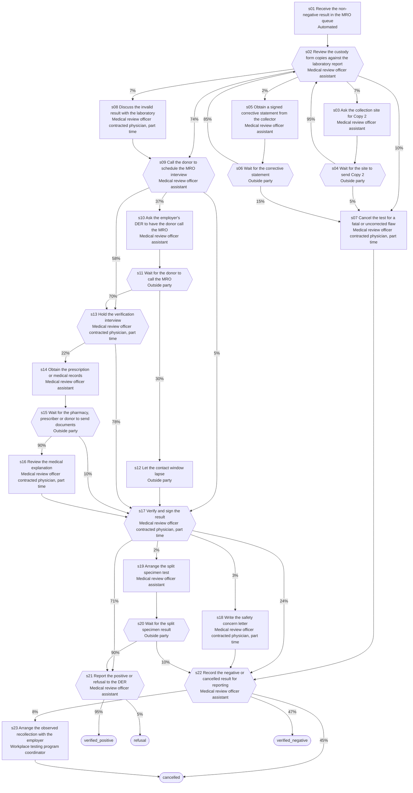

# Medical review of non-negative workplace drug test results

`dls-wp-mro-review` · health care: workplace drug and alcohol testing · workplace services: medical review · part of `diagnostic-lab-services-co`

Before an employer learns that a worker's or applicant's drug test was not negative, a medical review officer (MRO), a physician, checks whether there is a legitimate medical reason for the laboratory result. MRO assistants check the custody form copies, phone the donor to book an interview, ask the employer's designated representative to have unreachable donors call, and collect prescriptions; the MRO interviews the donor, decides the result and signs it, and the assistant reports it to the employer. Reaching donors is the slow part: many need several calls and help from the employer, and applicants who lose interest never call back, so their results wait for the regulatory windows before they can be verified.

| | |
|---|---|
| Unit of work | one non-negative result |
| Starts when | The laboratory releases a certified positive, adulterated, substituted or invalid result, or reports a specimen rejected for testing, to the MRO queue. |
| Done when | The MRO has verified the result as positive, negative or refusal, or cancelled the test, and the result is reported to the employer's designated representative for written reporting. |
| Organisation | The workplace testing line of a large Canadian laboratory company, with contracted part-time MRO physicians and an MRO assistant team reviewing results from its own SAMHSA-certified laboratories. (3,300 employees, 2019-2022) |
| Volume | 1,800 cases a month (range 1,200 to 2,400) |

## Where it sits

- Starts with **tox_result** from wp-tox-testing (98% of cases)
- Starts with **medical_explanation** from donor (2% of cases)
- Sends **mro_contact** to donor (outcome: any)
- Sends **mro_verified_result** to wp-result-reporting (outcome: verified_positive)
- Sends **mro_verified_result** to wp-result-reporting (outcome: refusal)
- Sends **mro_verified_result** to wp-result-reporting (outcome: verified_negative)
- Sends **mro_verified_result** to wp-result-reporting (outcome: cancelled)

## Flow

## Roles

| Role | Department | Layer | FTE on this process | Loaded cost per hour | Evidence |
|---|---|---|---:|---:|---|
| Medical review officer (contracted physician, part time) | Workplace services (The model laboratory Workplace) | senior specialist | 2.7 | 190 CAD | B [cfr40129], [cfr40131], [dyn_mroa] |
| Medical review officer assistant | Workplace services (The model laboratory Workplace) | individual contributor | 4.8 | 31 CAD | B [dyn_mroa], [jobbank_13112] |
| Workplace testing program coordinator | Workplace program management | individual contributor | 0.1 | 36 CAD | C |

## Steps

Hands-on time and the wait before each step show the most common value. Evidence tier A is a sourced number, B a sourced description, C the author's estimate.

| Step | Who | Kind | Hands-on | Wait before | Control | Evidence |
|---|---|---|---:|---:|---|---|
| **s01 Receive the non-negative result in the MRO queue.** The drug testing case system receives the laboratory's certified non-negative result (positive, adulterated, substituted or invalid) or its report that a specimen was rejected for testing, with the image of custody form Copy 1, and links it to the Copy 2 image the collector faxed or scanned. The case appears in the MRO assistants' queue. | Automated | system auto | 0 min | 5 min |  | B [cfr40129], [dyn_dts] |
| **s02 Review the custody form copies against the laboratory report.** An MRO assistant compares Copy 2 with Copy 1 and the laboratory report: donor and specimen IDs, donor signature and phone numbers, collector entries, the certifying scientist's signature and the result category, and looks for fatal or correctable flaws. The assistant then routes the case by what it needs next. | Medical review officer assistant | validation | 4 min | 2.0 h | 49 CFR 40.129: administrative review of Copy 2 by the MRO or supervised staff; the MRO must hold Copy 2 and a legible Copy 1 before reporting. For DOT-regulated donors this is fixed by law; for other Canadian donors it is adopted through the Canadian Model and employer contracts. | B [cfr40129], [dyn_mroa] |
| **s03 Ask the collection site for Copy 2.** The assistant faxes or emails the company centre or third-party clinic for the missing or illegible MRO copy of the custody form, or another copy bearing the donor's signature. | Medical review officer assistant | communication | 3 min | 10 min |  | B [cfr40129] |
| **s04 Wait for the site to send Copy 2.** The collection site finds its copy or the collector's file and faxes it back; third-party clinics can take several days. | Outside party | external wait | 0 min | 1.0 d |  | C |
| **s05 Obtain a signed corrective statement from the collector.** For a correctable flaw such as a missing collector signature or a wrong form, the assistant asks the collector to sign a memorandum for the record and tracks it against the deadline after which the test must be cancelled. | Medical review officer assistant | communication | 5 min | 10 min |  | B [dyn_mroa], [cfr40129] |
| **s06 Wait for the corrective statement.** The collector or clinic signs and returns the statement, usually within a few business days; without it the flaw becomes fatal and the test is cancelled. | Outside party | external wait | 0 min | 2.0 d |  | C |
| **s07 Cancel the test for a fatal or uncorrected flaw.** The MRO reviews the laboratory's rejection or the uncorrected flaw, marks the test cancelled in Step 6 of Copy 2 with the reason and notes whether the employer needs a recollection, for example for a pre-employment test that requires a negative. | Medical review officer (contracted physician, part time) | approval | 3 min | 4.0 h | 49 CFR 40.129: only the MRO may verify or cancel a test. For DOT-regulated donors this is fixed by law; for other Canadian donors it is adopted through the Canadian Model and employer contracts. | B [cfr40129] |
| **s08 Discuss the invalid result with the laboratory.** For an invalid specimen the MRO talks with the laboratory's certifying scientist about the reason (for example immunoassay interference or an unusual pH) and whether another certified laboratory should retest it before the donor is contacted. | Medical review officer (contracted physician, part time) | analysis | 5 min | 8.0 h |  | B [cfr40159] |
| **s09 Call the donor to schedule the MRO interview.** The assistant calls the day and evening numbers on the custody form, at least three times spread over 24 hours if needed, and when the donor answers only schedules a call with the MRO and explains what happens if the donor declines, without discussing the result. Every attempt is logged with date and time. | Medical review officer assistant | communication | 5 min | 30 min | 49 CFR 40.131: staff may only schedule the discussion; three attempts over 24 hours before the DER is asked to help. For DOT-regulated donors this is fixed by law; for other Canadian donors it is adopted through the Canadian Model and employer contracts. | B [cfr40131], [dyn_mroa] |
| **s10 Ask the employer's DER to have the donor call the MRO.** The assistant phones the DER, says only that the MRO needs the donor to call, records the DER's name and the time, and gives the MRO line and the 72-hour deadline the DER must pass on. | Medical review officer assistant | communication | 4 min | 1.0 d | 49 CFR 40.131(c) and (d): the MRO contacts the DER without disclosing the result; the DER tells the donor to call within 72 hours. For DOT-regulated donors this is fixed by law; for other Canadian donors it is adopted through the Canadian Model and employer contracts. | B [cfr40131], [dyn_mroa] |
| **s11 Wait for the donor to call the MRO.** The DER reaches the worker or applicant and tells them to call the MRO; most call back within a day or two, while applicants who have lost interest in the job often never call. | Outside party | external wait | 0 min | 1.0 d |  | C |
| **s12 Let the contact window lapse.** When the donor does not call within 72 hours of the DER's contact, or neither the MRO nor the DER can reach the donor within 10 days of receiving the result, the case is released for verification without an interview. | Outside party | external wait | 0 min | 3.0 d | 49 CFR 40.133: verification without interview only after the employee declines, 72 hours after DER contact, or 10 days without contact. For DOT-regulated donors this is fixed by law; for other Canadian donors it is adopted through the Canadian Model and employer contracts. | A [cfr40133] |
| **s13 Hold the verification interview.** The MRO phones the donor at the booked time, explains the process and the result, and asks about prescription and over-the-counter medicines, medical conditions and, for adulterated or substituted specimens, any explanation. Medical cannabis authorizations and prescriptions from walk-in clinics are common topics. | Medical review officer (contracted physician, part time) | judgment | 8 min | 4.0 h | 49 CFR 40.129 and 40.131: the MRO personally interviews the donor before verifying. For DOT-regulated donors this is fixed by law; for other Canadian donors it is adopted through the Canadian Model and employer contracts. | B [cfr40129], [cfr40137], [coaa_2011] |
| **s14 Obtain the prescription or medical records.** With the donor's consent the assistant phones or faxes the pharmacy or prescriber for the prescription record (drug, date, dose, prescriber), or receives the donor's faxed prescription or medical cannabis authorization, and attaches it to the case. | Medical review officer assistant | coordination | 10 min | 30 min |  | B [cfr40137], [dyn_mroa] |
| **s15 Wait for the pharmacy, prescriber or donor to send documents.** Pharmacies usually answer within a day; prescribers and donors can take longer. The MRO allows up to five days, after which the result is verified on what is available. | Outside party | external wait | 0 min | 2.0 d |  | A [cfr40137] |
| **s16 Review the medical explanation.** The MRO checks whether the prescription or medical record covers the drug found and the timing, decides whether it is a legitimate medical explanation, and considers whether the medicine raises a fitness-for-duty concern for a safety-sensitive job. | Medical review officer (contracted physician, part time) | judgment | 4 min | 4.0 h | 49 CFR 40.137: the donor bears the burden of showing a legitimate medical explanation. For DOT-regulated donors this is fixed by law; for other Canadian donors it is adopted through the Canadian Model and employer contracts. | B [cfr40137] |
| **s17 Verify and sign the result.** The MRO decides the final result: positive (with the drug), negative, refusal because of adulteration or substitution, or cancelled (an invalid result, with or without an immediate observed recollection), completes Step 6 of Copy 2 and signs it in the case system. | Medical review officer (contracted physician, part time) | approval | 2 min | 20 min | 49 CFR 40.129: only the MRO may verify or cancel a test. For DOT-regulated donors this is fixed by law; for other Canadian donors it is adopted through the Canadian Model and employer contracts. | B [cfr40129], [trucknews_dc], [sh_dti] |
| **s18 Write the safety concern letter.** When a medicine legitimately explains the result but could make the donor unsafe in a safety-sensitive job, the MRO writes a separate letter to the employer stating the nature of the concern, without the drug name on the result report. | Medical review officer (contracted physician, part time) | drafting | 15 min | 1.0 h | 49 CFR 40.327: medical information disclosed only for a significant safety risk, by separate written communication. For DOT-regulated donors this is fixed by law; for other Canadian donors it is adopted through the Canadian Model and employer contracts. | B [cfr40327], [cfr40137] |
| **s19 Arrange the split specimen test.** When the donor asks within 72 hours of being told of a verified positive or refusal, the assistant records the request time and sends the MRO's written instruction to the first laboratory to ship bottle B to another certified laboratory, then tracks the result. | Medical review officer assistant | coordination | 12 min | 1.0 h | 49 CFR 40.171: 72-hour window and immediate written notice to the laboratory. For DOT-regulated donors this is fixed by law; for other Canadian donors it is adopted through the Canadian Model and employer contracts. | B [cfr40171], [dyn_mroa] |
| **s20 Wait for the split specimen result.** Bottle B travels to the second laboratory, which tests it for the drug or adulterant found and reports whether the primary result is reconfirmed. | Outside party | external wait | 0 min | 5.0 d |  | C |
| **s21 Report the positive or refusal to the DER.** The same or next business day after verification, the assistant phones the DER on the MRO's behalf to give the verified positive or refusal, confirms the DER's identity, documents the call, and posts the signed Copy 2 image for the written report, which result reporting must deliver within two days. | Medical review officer assistant | communication | 6 min | 30 min | 49 CFR 40.167 (same or next business day, written report within two days) and 40.321 (confidentiality). For DOT-regulated donors this is fixed by law; for other Canadian donors it is adopted through the Canadian Model and employer contracts. | B [cfr40167], [cfr40163], [cfr40321], [dyn_mroa] |
| **s22 Record the negative or cancelled result for reporting.** The assistant keys the verified negative or the cancellation with its reason into the case system, attaches the signed Copy 2, and for a cancellation that needs an immediate observed recollection phones the DER the same day. | Medical review officer assistant | data entry | 3 min | 30 min |  | B [cfr40159], [cfr40167] |
| **s23 Arrange the observed recollection with the employer.** A program coordinator calls the DER to set up the immediate recollection under direct observation with as little notice to the donor as possible, and issues a new authorization for a site with a same-gender observer or an oral fluid collection. | Workplace testing program coordinator | coordination | 5 min | 30 min |  | B [cfr40159] |

## Exceptions

| Exception | Share of cases | What happens |
|---|---:|---|
| Donor not reached directly | 33% | Three calls over 24 hours fail and the DER is asked to have the donor call; about a third of these donors never call and are verified without an interview after the window lapses. |
| Prescription to check | 16% | The donor names a prescription or medical cannabis authorization and the MRO waits up to five days for the pharmacy, prescriber or donor to send proof. |
| Missing or flawed custody form | 9% | Copy 2 is missing or a correctable flaw needs a collector statement before verification. |
| Specimen rejected by the laboratory | 10% | The laboratory found a fatal flaw and the MRO cancels the test. |
| Invalid result | 7% | The MRO consults the laboratory, interviews the donor and cancels, sometimes with an immediate observed recollection. |
| Split specimen test | 2% | The donor asks within 72 hours for bottle B to be tested at another certified laboratory. |

## Benchmarks

| Metric | Value | Unit | Population | Evidence |
|---|---|---|---|---|
| cycle_time_days | p50 1.5, p90 7 | calendar days from non-negative result received by the MRO to verified result reported to the DER | MRO review of workplace drug test non-negatives | B [cfr40131], [cfr40133], [cfr40167], [dyn_dts] |
| donor_contact_attempts | 3 | attempts over 24 hours (minimum) | DOT drug tests | A [cfr40131] |
| donor_callback_window | 72 | hours after DER contact | DOT drug tests | A [cfr40131], [cfr40133] |
| verify_without_contact_after | 10 | days after the MRO receives the result | DOT drug tests | A [cfr40133] |
| positive_report_deadline | phone same or next business day, written_days 2 | after verification | DOT drug tests | A [cfr40167] |
| medical_explanation_extension | 5 | days (maximum) | DOT drug tests | A [cfr40137] |
| split_request_window | 72 | hours after notification | DOT drug tests | A [cfr40171] |
| workforce_positivity_us_2021 | 0.046 | share of tests positive | More than 11 million US workforce samples (Quest) | A [sh_dti] |
| marijuana_positivity_non_regulated_canada | 0.0768 | share of tests positive | Non-regulated Canadian trucking, October 2018 to 2023 (DriverCheck) | A [trucknews_dc] |

## Pain points

- Reaching donors takes repeated calls and the employer's help; applicants who no longer want the job never call, so their results wait days for the regulatory windows. (steps s09, s10, s11, s12; B [cfr40131], [cfr40133], [dyn_mroa])
- Missing or illegible Copy 2 forms and collector errors, mostly from third-party clinics, hold verification until a copy or corrective statement arrives. (steps s03, s04, s05, s06; B [cfr40129], [dyn_mroa])
- Prescription checks wait on pharmacies and prescribers, and medical cannabis authorizations raise questions the US rules do not settle for Canadian employers. (steps s14, s15, s16; B [cfr40137], [coaa_2011])
- Contracted part-time MROs review and sign in batches, so interviews and verifications queue for their availability. (steps s13, s17, s07; C)

## Assumptions

- One case is one non-negative or rejected specimen. Negative results get an administrative review by MRO staff in the result reporting workflow, not here.
- The MRO assistant role is added because the company posts it as a separate job and because the program coordinator headcount in the organisation file is largely used by test ordering. Its cost is an estimate.
- The 2 percent of cases triggered by the donor stand for donors who call the MRO line before being contacted or who present new information within 60 days to reopen a verification; they follow the same steps.
- Outcome shares (about 62 percent positive, 3.5 percent refusal, 16 percent negative after review, 18 percent cancelled) and contact rates are the author's estimates; no opened source gave MRO outcome rates.
- Procedures follow 49 CFR Part 40 for every donor, as the Canadian Model and employer contracts adopt them; controls are marked needs_policy_change because they are law only for DOT-regulated donors.
- Waits for the part-time MRO are modelled as approval_availability of up to a day.
- Loaded costs come from the organisation file (wage times 1.35) except the added MRO assistant role.

## Sources

- [dyn_dts] Drug testing services (link withheld) (The model laboratory, undated). More than 300,000 drug tests a year; more than 70 company centres and more than 2,000 preferred third-party collection sites; negatives usually released within 24 hours and non-negatives need another 48 to 72 hours; web-based and secure fax result reporting; DOT-compliant and non-regulated statistical reports; performance scorecards; post-accident, random and other testing reasons.
- [dyn_mroa] Medical review officer assistant (job posting) (link withheld) (The model laboratory via Jobillico, 2026). MRO assistants review and enter negative and non-negative laboratory results against custody and control forms, assist the MRO including arranging split specimen tests and contacting the DER to arrange an interview between the MRO and a donor, track turnaround and escalate delays, review documentation for fatal or correctable errors and obtain corrective documentation, report results to company contacts following client reporting preferences, and answer donor and customer calls; follows DOT rules and the Canadian Model; high school diploma; Monday to Friday plus on-call rotation.
- [cfr40129] [49 CFR 40.129 MRO functions in reviewing laboratory confirmed non-negative results](https://www.law.cornell.edu/cfr/text/49/40.129) (Legal Information Institute (Cornell), current). Staff may do the administrative review of Copy 2 but only the MRO may verify or cancel; the MRO checks Copy 1 matches Copy 2 and is signed by the certifying scientist, conducts a verification interview unless 40.133 applies, must hold Copy 2 and a legible Copy 1 before reporting, and completes Step 6 of the CCF.
- [cfr40131] [49 CFR 40.131 How does the MRO or DER notify an employee of the verification process?](https://www.law.cornell.edu/cfr/text/49/40.131) (Legal Information Institute (Cornell), current). The MRO must personally talk to the employee; staff may make the initial contact only to schedule the discussion; at least three attempts spaced over 24 hours to the day and evening numbers on the CCF; then the MRO asks the DER to have the employee call the MRO without disclosing the result; the DER tells the employee to call within 72 hours.
- [cfr40133] [49 CFR 40.133 Without interviewing the employee, under what circumstances may the MRO verify a test result?](https://www.law.cornell.edu/cfr/text/49/40.133) (Legal Information Institute (Cornell), current). The MRO may verify without an interview if the employee expressly declines, if more than 72 hours have passed since the DER reached the employee, or if neither has reached the employee within 10 days of the MRO receiving the result; the employee may present information within 60 days to reopen the verification.
- [cfr40137] [49 CFR 40.137 On what basis does the MRO verify test results involving marijuana, cocaine, amphetamines, semi-synthetic opioids, or PCP?](https://www.law.cornell.edu/cfr/text/49/40.137) (Legal Information Institute (Cornell), current). The employee has the burden of showing a legitimate medical explanation at the interview; the MRO may allow up to five days to produce evidence; with a legitimate explanation the result is verified negative, otherwise positive; safety concerns may still be raised.
- [cfr40159] [49 CFR 40.159 What does the MRO do when a drug test result is invalid?](https://www.law.cornell.edu/cfr/text/49/40.159) (Legal Information Institute (Cornell), current). The MRO discusses an invalid result with the laboratory's certifying scientist, interviews the employee; with an acceptable explanation the test is cancelled with no further action; without one the test is cancelled and the DER is told an immediate recollection under direct observation is required.
- [cfr40163] [49 CFR 40.163 How does the MRO report drug test results?](https://www.law.cornell.edu/cfr/text/49/40.163) (Legal Information Institute (Cornell), current). The MRO reports all results to the employer on a signed copy of Copy 2 or a written report with name, specimen ID, reason, dates, result and drug; only negatives may be reported as electronic data files; quantitative values are not given to employers; negative and cancelled records kept one year, positives and refusals five years.
- [cfr40167] [49 CFR 40.167 How are MRO reports of drug results transmitted to the employer?](https://www.law.cornell.edu/cfr/text/49/40.167) (Legal Information Institute (Cornell), current). Verified positives, refusals and results needing immediate observed recollection must reach the DER the same day as verification or the next business day, preferably by telephone followed by documentation; written reports must reach the DER within two days of verification by fax, courier, mail or electronic image; transmissions must be secure.
- [cfr40171] [49 CFR 40.171 How does an employee request a test of a split specimen?](https://www.law.cornell.edu/cfr/text/49/40.171) (Legal Information Institute (Cornell), current). The employee has 72 hours from notification of a verified positive or adulteration or substitution refusal to ask the MRO for a split test; the MRO records the request and immediately directs the first laboratory in writing to send the split specimen to a second certified laboratory.
- [cfr40321] [49 CFR 40.321 What is the general confidentiality rule for drug and alcohol test information?](https://www.law.cornell.edu/cfr/text/49/40.321) (Legal Information Institute (Cornell), current). Service agents and employers may not release individual test results or medical information to third parties without the employee's specific written consent naming the information, recipient and time.
- [cfr40327] [49 CFR 40.327 When must the MRO report medical information gathered in the verification process?](https://www.law.cornell.edu/cfr/text/49/40.327) (Legal Information Institute (Cornell), current). The MRO may disclose medical information without consent when it is likely to make the employee medically unqualified or indicates a significant safety risk, by a separate written communication rather than the CCF.
- [coaa_2011] [COAA Best Practices Conference XIX: Canadian Model best practice (presentation transcript)](https://sambuz.com/doc/coaa-best-practices-conference-xix-canadian-model-best-ppt-presentation-50475) (Construction Owners Association of Alberta via sambuz.com, 2011). US DOT standards are mandated for the COAA Canadian Model best practice, including collector, collection facility and MRO standards; oral fluid preference for reasonable cause, post-incident and random; medical marijuana raised as an MRO question; longer waits for drug test results.
- [trucknews_dc] [Canada sees steady trends in marijuana positive tests among truck drivers since legalization](https://www.trucknews.com/health-safety/canada-sees-steady-trends-in-marijuana-positive-tests-among-truck-drivers-since-legalization/1003187827) (Truck News, 2024). DriverCheck data: marijuana positivity about 0.78 percent in regulated trucking and 7.68 percent in non-regulated trucking after legalization (October 2018 to 2023); alcohol about 0.3 to 0.4 percent; reasonable cause tests up to about 40 percent positive and post-accident around 10 percent.
- [sh_dti] [Positive drug tests for US workers at highest level in 20 years: annual index](https://www.safetyandhealthmagazine.com/articles/22440-positive-drug-tests-for-us-workers-at-highest-level-in-20-years-annual-index) (Safety+Health magazine, 2022). Quest Drug Testing Index: 4.6 percent of more than 11 million 2021 samples positive (4.4 percent in 2020); urine marijuana 3.9 percent for all workers; 2.2 percent overall in the federally mandated safety-sensitive workforce.
- [jobbank_13112] [Wages: Medical administrative assistant in Ontario (NOC 13112)](https://www.jobbank.gc.ca/marketreport/wages-occupation/25791/ON) (Job Bank, Government of Canada, 2025). Ontario hourly wages low 17.95, median 25.00, high 32.70 CAD (2023-2024).

Written by claude-opus on 2026-11-17.
