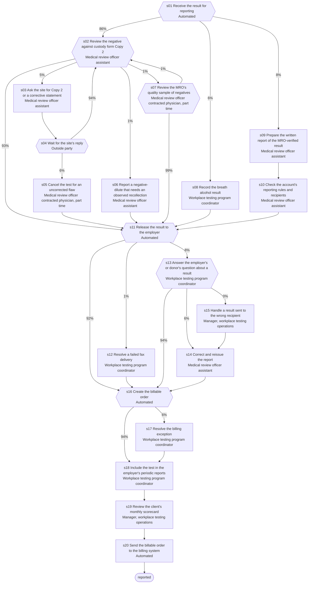

# Report verified workplace drug and alcohol test results to employers

`dls-wp-result-reporting` · health care: workplace drug and alcohol testing · workplace services: program management · part of `diagnostic-lab-services-co`

Once a workplace drug or alcohol test has a final result, the company tells the employer's designated representative and queues the test for billing. Negatives from the laboratory get a short review against the donor's custody form by an MRO assistant before they are posted to the employer's secure web report or sent by secure fax; results verified by the medical review officer get a written report within two days; breath alcohol results are recorded for the employer's reports. Coordinators answer employer questions, fix billing exceptions and prepare statistical reports. Confidentiality rules limit who may receive a result, and missing custody form copies, stale fax numbers and wrong donor details cause most delays and corrections.

| | |
|---|---|
| Unit of work | one reported test |
| Starts when | A final result is ready to report: a certified laboratory negative, an MRO-verified result or a breath alcohol result. |
| Done when | The result is in the employer's web report or delivered by secure fax, counted in the employer's statistical reports, and the test is queued for billing. |
| Organisation | The workplace testing line of a large Canadian laboratory company reporting about 25,000 test results a month to more than 500 employers through a web report and secure fax. (3,300 employees, 2019-2022) |
| Volume | 25,000 cases a month (range 22,000 to 28,000) |

## Where it sits

- Starts with **tox_result** from wp-tox-testing (86% of cases)
- Starts with **mro_verified_result** from wp-mro-review (8% of cases)
- Starts with **breath_alcohol_result** from wp-collection (6% of cases)
- Sends **verified_result_report** to employer_client (outcome: reported)
- Sends **billable_order** to fin-client-invoicing (outcome: reported)

## Flow

## Roles

| Role | Department | Layer | FTE on this process | Loaded cost per hour | Evidence |
|---|---|---|---:|---:|---|
| Medical review officer assistant | Workplace services (The model laboratory Workplace) | individual contributor | 4.2 | 31 CAD | B [dyn_mroa], [jobbank_13112], [cfr40127] |
| Workplace testing program coordinator | Workplace program management | individual contributor | 3 | 36 CAD | B [dyn_dtsol] |
| Manager, workplace testing operations | Workplace program management | manager | 0.15 | 66 CAD | C |
| Medical review officer (contracted physician, part time) | Workplace services (The model laboratory Workplace) | senior specialist | 0.1 | 190 CAD | B [cfr40127] |

## Steps

Hands-on time and the wait before each step show the most common value. Evidence tier A is a sourced number, B a sourced description, C the author's estimate.

| Step | Who | Kind | Hands-on | Wait before | Control | Evidence |
|---|---|---|---:|---:|---|---|
| **s01 Receive the result for reporting.** The drug testing case system receives a result that is ready to report: a certified negative from the laboratory, a result verified by the medical review officer, or a breath alcohol result keyed by the collector, and routes it to the right review queue. | Automated | system auto | 0 min | 0 min |  | C |
| **s02 Review the negative against custody form Copy 2.** An MRO assistant opens the negative with the Copy 2 image and checks that donor and specimen IDs match, the donor signed, the collector's entries are complete and the reason for test is recorded, then stamps the negative as reviewed for the MRO. Most negatives take well under a minute when the images match. | Medical review officer assistant | validation | 0.6 min | 2.0 h | 49 CFR 40.127: Copy 2 review by the MRO or supervised staff before a negative is released to the employer. For DOT-regulated donors this is fixed by law; for other Canadian donors it is adopted through the Canadian Model and employer contracts. | B [cfr40127], [dyn_mroa] |
| **s03 Ask the site for Copy 2 or a corrective statement.** The assistant faxes or emails the collection site for the missing Copy 2 or the collector's signed statement correcting the flaw, and holds the negative until it arrives. | Medical review officer assistant | communication | 3 min | 10 min |  | B [dyn_mroa], [cfr40127] |
| **s04 Wait for the site's reply.** The company centre or third-party clinic faxes the copy or the signed statement, usually within a day or two; some flaws are never corrected. | Outside party | external wait | 0 min | 1.0 d |  | C |
| **s05 Cancel the test for an uncorrected flaw.** The MRO reviews the uncorrected flaw, marks the test cancelled with the reason, and notes that the employer needs a new test where a negative result is required, such as pre-employment. | Medical review officer (contracted physician, part time) | approval | 3 min | 4.0 h | 49 CFR 40.127: only the MRO can cancel a test. For DOT-regulated donors this is fixed by law; for other Canadian donors it is adopted through the Canadian Model and employer contracts. | B [cfr40127] |
| **s06 Report a negative-dilute that needs an observed recollection.** For a negative-dilute with creatinine between 2 and 5 mg/dL, the assistant, on the MRO's instruction, phones the DER that an immediate recollection under direct observation is required with minimal notice to the donor, and documents the call. | Medical review officer assistant | communication | 5 min | 30 min | 49 CFR 40.197: MRO directs an immediate observed recollection for creatinine 2 to 5 mg/dL. For DOT-regulated donors this is fixed by law; for other Canadian donors it is adopted through the Canadian Model and employer contracts. | B [cfr40197] |
| **s07 Review the MRO's quality sample of negatives.** The MRO personally reviews a sample of the negatives the assistants have reviewed, plus every one that needed corrective action, to check the staff's work; the sample is capped at 500 negatives a quarter. | Medical review officer (contracted physician, part time) | review | 2 min | 30 min | 49 CFR 40.127: MRO reviews at least 5 percent of staff-reviewed results each quarter, up to 500 negatives. For DOT-regulated donors this is fixed by law; for other Canadian donors it is adopted through the Canadian Model and employer contracts. | A [cfr40127] |
| **s08 Record the breath alcohol result.** A program coordinator checks the alcohol testing form image and the collector's keyed result. Results of 0.02 or more have already been phoned to the DER by the breath alcohol technician; for DOT donors the technician also sends the form directly, so the company only records the result for the employer's reports. | Workplace testing program coordinator | validation | 1.5 min | 1.0 h | 49 CFR 40.255: the technician reports 0.02 or more to the DER immediately and directly, not through service agents. For DOT-regulated donors this is fixed by law; for other Canadian donors it is adopted through the Canadian Model and employer contracts. | B [cfr40255], [dyn_dtsol] |
| **s09 Prepare the written report of the MRO-verified result.** For a verified positive, refusal, verified negative or cancellation, the assistant checks that the MRO's phone report to the DER is documented where one was needed, attaches the signed Copy 2 image or MRO letter, and readies the written report so it reaches the DER within two days of verification. | Medical review officer assistant | drafting | 3 min | 30 min | 49 CFR 40.163 and 40.167: written report on Copy 2 or a letter, delivered within two days of verification, no quantitative values. For DOT-regulated donors this is fixed by law; for other Canadian donors it is adopted through the Canadian Model and employer contracts. | B [cfr40163], [cfr40167], [dyn_mroa] |
| **s10 Check the account's reporting rules and recipients.** Before a non-negative report goes out, the assistant checks the program profile for who may receive it (the DER, a separate contact for applicants, or a third-party administrator acting for the employer), the delivery method and the secure fax number on file. | Medical review officer assistant | lookup | 1 min | 5 min | 49 CFR 40.321 and 40.345 (results only to the employer's designated recipients or an intermediary the employer chose) and PIPEDA safeguards for health information. For DOT-regulated donors this is fixed by law; for other Canadian donors it is adopted through the Canadian Model and employer contracts. | B [cfr40321], [cfr40345], [dyn_mroa] |
| **s11 Release the result to the employer.** The case system posts the result to the employer's secure web report and emails the DER a notice to log in, or sends it by secure fax for accounts that prefer fax, and updates the daily activity report. | Automated | system auto | 0 min | 1 min |  | B [dyn_dts], [dyn_dtsol] |
| **s12 Resolve a failed fax delivery.** A coordinator checks the fax error, phones the DER to confirm the secure fax number or switch the account to web reporting, and resends the report. | Workplace testing program coordinator | communication | 5 min | 2.0 h |  | C |
| **s13 Answer the employer's or donor's question about a result.** A coordinator takes the call or email, confirms the caller is a designated contact or the donor, and explains the status or the meaning of a result (for example a dilute negative), sends a copy, or takes a donor's written request for their own result. Errors in donor details or account found here are sent for correction. | Workplace testing program coordinator | communication | 4 min | 1.0 d | 49 CFR 40.321: no release of individual results to third parties without specific written consent; identity checked before discussing a result. For DOT-regulated donors this is fixed by law; for other Canadian donors it is adopted through the Canadian Model and employer contracts. | B [cfr40321], [dyn_mroa] |
| **s14 Correct and reissue the report.** The assistant corrects the donor's name or ID, the reason for test or the employer division, gets the MRO's approval where the MRO report itself changes, and reissues a corrected report marked as amended. | Medical review officer assistant | data entry | 6 min | 1.0 h |  | B [cfr40167] |
| **s15 Handle a result sent to the wrong recipient.** The operations manager asks the wrong recipient to destroy or return the report, records the incident for the privacy office's assessment of real risk of significant harm, informs the employer, fixes the cause (often a stale fax number or contact) and has the report sent to the right contact. | Manager, workplace testing operations | judgment | 1.0 h | 4.0 h | PIPEDA breach of security safeguards provisions: assess real risk of significant harm, report and notify where it exists, and keep a record of every breach for two years | B [opc_breach] |
| **s16 Create the billable order.** The case system builds the billable order for the test from the account's price list: panel and laboratory fee, company or third-party collection fee, MRO review fee, alcohol test, after-hours callout or cancellation charge, and the employer's purchase order or cost centre. | Automated | system auto | 0 min | 0 min |  | B [dyn_dtsol] |
| **s17 Resolve the billing exception.** A coordinator works the daily exception list: gets the purchase order or cost centre from the employer, adds the third-party clinic's fee from its invoice, or moves the charge to the right division. | Workplace testing program coordinator | data entry | 4 min | 1.0 d |  | C |
| **s18 Include the test in the employer's periodic reports.** The test is counted in the employer's statistical reports (by reason, result and location) and, for DOT employers, in the annual MIS data; a coordinator builds the custom monthly reports some employers ask for in a spreadsheet. The per-test time is the coordinator's monthly report work shared across the tests. | Workplace testing program coordinator | analysis | 0.1 min | 0 min | 49 CFR 40.26: DOT employers report annual MIS data on the DOT form; the provider supplies the counts. For DOT-regulated donors this is fixed by law; for other Canadian donors it is adopted through the Canadian Model and employer contracts. | B [dyn_dts], [dyn_dtsol], [cfr4026] |
| **s19 Review the client's monthly scorecard.** The operations manager reviews each large client's monthly scorecard (turnaround, cancellations, positivity, collection site performance) before it is sent and follows up on outliers. The per-test time is the review time shared across the client's tests. | Manager, workplace testing operations | review | 0.02 min | 0 min |  | B [dyn_dts] |
| **s20 Send the billable order to the billing system.** The nightly interface sends the day's billable orders to the billing and receivables system, where they wait for the employer's monthly invoice run. | Automated | system auto | 0 min | 8.0 h |  | C |

## Exceptions

| Exception | Share of cases | What happens |
|---|---:|---|
| Missing Copy 2 or correctable flaw on a negative | 4% | The negative is held until the site sends Copy 2 or a corrective statement; a few are cancelled by the MRO. |
| Negative-dilute needing observed recollection | 1% | The DER is told an immediate observed recollection is required. |
| Employer or donor query | 8% | The DER asks for status, a copy or an explanation, or the donor asks for their own result. |
| Amended report | 0% | Wrong donor details, reason or division are corrected and the report reissued. |
| Result sent to the wrong recipient | 0% | A report reaches someone not entitled to it; the incident is logged for breach assessment and the report resent. |
| Billing exception | 6% | A missing purchase order, unknown clinic fee or wrong division holds the billable order. |

## Benchmarks

| Metric | Value | Unit | Population | Evidence |
|---|---|---|---|---|
| cycle_time_days | p50 0.6, p90 2 | calendar days from final result available to result delivered and billable order sent to billing | Workplace drug and alcohol test results at a Canadian testing provider | C |
| negative_release_from_lab_receipt | low 6, high 24 | hours | The company's workplace negatives | A [dyn_dtsol] |
| mro_written_report_deadline | 2 | days after verification | DOT drug tests | A [cfr40167] |
| mro_negative_quality_sample | share 0.05, cap_per_quarter 500 | share of staff-reviewed results and maximum negatives per quarter | DOT drug tests | A [cfr40127] |
| record_retention | negative_years 1, positive_years 5 | years | MRO records of DOT drug tests | A [cfr40163] |

## Pain points

- Negatives cannot be released until Copy 2 is on file, and third-party clinics often send it late or with errors. (steps s02, s03, s04; B [cfr40127], [dyn_mroa])
- Every negative is looked at by a person even when the images match, which takes most of the MRO assistants' reporting time. (steps s02; C)
- Secure fax delivery depends on fax numbers kept current by employers; stale numbers cause failed sends and misdirected reports that are privacy breaches. (steps s12, s15; B [opc_breach], [dyn_dts])
- Employers phone for status and copies that are already in the web report, taking coordinator time. (steps s13; C)
- Billing needs purchase orders and clinic fees that are often missing at the time of the test. (steps s16, s17; C)

## Assumptions

- One case is one reported test. A drug and alcohol test done together is one report.
- The toxicology workflow describes the laboratory sending negatives to the MRO queue and the employer report in one system step; here the employer posting happens after the MRO staff review of Copy 2, as the rules require. The two together stay within the company's 6 to 24 hours for negatives.
- The MRO assistant role is not in the organisation file and is added because the company posts it as a separate job and the coordinators are largely used by test ordering. Its cost is an estimate.
- Monthly statistical reports and scorecards are batch work; their time is shared across tests and they are marked concurrent with the billing interface, because they do not hold the result or the billable order.
- Rejected specimens and other cancellations reach this process through medical review as MRO-verified results.
- Shares of copy problems, dilutes, queries, amendments, misdirected reports and billing exceptions are the author's estimates.
- Loaded costs come from the organisation file (wage times 1.35) except the added MRO assistant role.

## Sources

- [dyn_dts] Drug testing services (link withheld) (The model laboratory, undated). More than 300,000 drug tests a year; more than 70 company centres and more than 2,000 preferred third-party collection sites; negatives usually released within 24 hours and non-negatives need another 48 to 72 hours; web-based and secure fax result reporting; DOT-compliant and non-regulated statistical reports; performance scorecards; post-accident, random and other testing reasons.
- [dyn_dtsol] Drug testing solutions (link withheld) (The model laboratory, undated). Negatives generally released within 6 to 24 hours, non-negatives another 48 to 72 hours; web-based and secure fax reporting; activity reports of specimens received in the previous 24 hours with status and result; DOT-compliant and non-regulated statistical reports; performance scorecards; single laboratory and billing platform; scientific consultants; inquiries to a drug testing mailbox.
- [dyn_mroa] Medical review officer assistant (job posting) (link withheld) (The model laboratory via Jobillico, 2026). MRO assistants review and enter negative and non-negative laboratory results against custody and control forms, assist the MRO including arranging split specimen tests and contacting the DER to arrange an interview between the MRO and a donor, track turnaround and escalate delays, review documentation for fatal or correctable errors and obtain corrective documentation, report results to company contacts following client reporting preferences, and answer donor and customer calls; follows DOT rules and the Canadian Model; high school diploma; Monday to Friday plus on-call rotation.
- [cfr40127] [49 CFR 40.127 MRO functions in reviewing negative test results](https://www.law.cornell.edu/cfr/text/49/40.127) (Legal Information Institute (Cornell), current). MRO or staff under direct supervision review CCF Copy 2 for fatal or correctable errors and match it to the negative laboratory result before release; the MRO personally reviews at least 5 percent of staff-reviewed results each quarter, including all needing corrective action, but need not review more than 500 negatives a quarter.
- [cfr40163] [49 CFR 40.163 How does the MRO report drug test results?](https://www.law.cornell.edu/cfr/text/49/40.163) (Legal Information Institute (Cornell), current). The MRO reports all results to the employer on a signed copy of Copy 2 or a written report with name, specimen ID, reason, dates, result and drug; only negatives may be reported as electronic data files; quantitative values are not given to employers; negative and cancelled records kept one year, positives and refusals five years.
- [cfr40167] [49 CFR 40.167 How are MRO reports of drug results transmitted to the employer?](https://www.law.cornell.edu/cfr/text/49/40.167) (Legal Information Institute (Cornell), current). Verified positives, refusals and results needing immediate observed recollection must reach the DER the same day as verification or the next business day, preferably by telephone followed by documentation; written reports must reach the DER within two days of verification by fax, courier, mail or electronic image; transmissions must be secure.
- [cfr40197] [49 CFR 40.197 What happens when an employer receives a report of a dilute specimen?](https://www.law.cornell.edu/cfr/text/49/40.197) (Legal Information Institute (Cornell), current). A negative-dilute result with creatinine of 2 to 5 mg/dL requires an immediate recollection under direct observation directed by the MRO; above 5 mg/dL the employer may order an unobserved retest; minimum advance notice; declining is a refusal.
- [cfr40255] [49 CFR 40.255 What are the requirements for BATs and STTs to report alcohol test results?](https://www.law.cornell.edu/cfr/text/49/40.255) (Legal Information Institute (Cornell), current). The breath alcohol technician immediately notifies the DER of any result of 0.02 or greater by telephone, secure fax or other immediate means, follows non-written reports with Copy 1 of the alcohol testing form, transmits confidentially and not through C/TPAs or other service agents.
- [cfr40321] [49 CFR 40.321 What is the general confidentiality rule for drug and alcohol test information?](https://www.law.cornell.edu/cfr/text/49/40.321) (Legal Information Institute (Cornell), current). Service agents and employers may not release individual test results or medical information to third parties without the employee's specific written consent naming the information, recipient and time.
- [cfr40345] [49 CFR 40.345 In what circumstances may a C/TPA act as an intermediary in the transmission of drug and alcohol testing information to employers?](https://www.law.cornell.edu/cfr/text/49/40.345) (Legal Information Institute (Cornell), current). A C/TPA may pass MRO results to the DER only where the employer chooses and must meet the MRO's confidentiality and timing requirements in 40.167.
- [cfr4026] [49 CFR 40.26 What form must an employer use to report Management Information System (MIS) data to a DOT agency?](https://www.law.cornell.edu/cfr/text/49/40.26) (Legal Information Institute (Cornell), current). Employers report MIS data on the DOT Drug and Alcohol Testing MIS Data Collection Form following the submission rules of their DOT agency.
- [opc_breach] [What you need to know about mandatory reporting of breaches of security safeguards](https://www.priv.gc.ca/en/privacy-topics/business-privacy/safeguards-and-breaches/privacy-breaches/respond-to-a-privacy-breach-at-your-business/gd_pb_201810/) (Office of the Privacy Commissioner of Canada, undated). Breaches posing a real risk of significant harm must be reported to the OPC and affected individuals notified as soon as feasible; health information is usually sensitive; records of every breach kept two years.
- [jobbank_13112] [Wages: Medical administrative assistant in Ontario (NOC 13112)](https://www.jobbank.gc.ca/marketreport/wages-occupation/25791/ON) (Job Bank, Government of Canada, 2025). Ontario hourly wages low 17.95, median 25.00, high 32.70 CAD (2023-2024).

Written by claude-opus on 2026-11-17.
