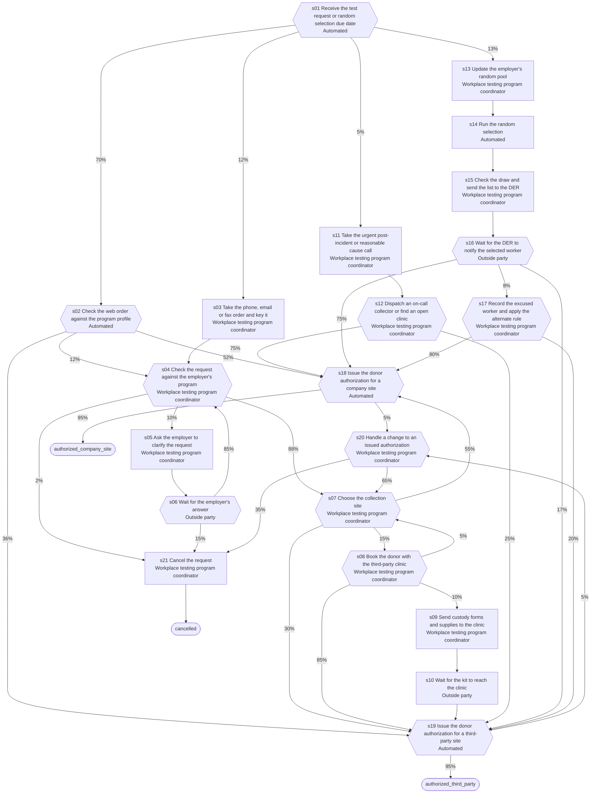

# Order workplace drug and alcohol tests and run random selections

`dls-wp-test-ordering` · health care: workplace drug and alcohol testing · workplace services: program management · part of `diagnostic-lab-services-co`

Employers that test applicants and workers for drugs and alcohol ask the company for each test, and the company turns the request into a donor authorization that tells the donor where to go and by when. Most requests are placed by the employer's designated representative in the online ordering screens and pass automatic checks against the employer's program; program coordinators key phone and email orders, resolve flagged orders, choose collection sites, book third-party clinics, dispatch on-call collectors for urgent post-incident tests and run random selections for safety-sensitive and DOT-regulated workers. Delays come from orders that do not fit the program, third-party clinics without supplies, out-of-date random pools and after-hours callouts that must beat regulatory time limits.

| | |
|---|---|
| Unit of work | one drug or alcohol test request |
| Starts when | An employer's DER places a test request (online, by email, fax or phone, or by an urgent call), or a random selection falls due under the employer's program calendar. |
| Done when | A donor authorization is issued for a company site, on-site collector or third-party clinic, or the request is cancelled. |
| Organisation | The workplace testing line of a large Canadian laboratory company serving more than 500 employers through company centres, on-site collectors and about 2,000 third-party clinics. (3,300 employees, 2019-2022) |
| Volume | 25,000 cases a month (range 22,000 to 28,000) |

## Where it sits

- Starts with **dt_request** from employer_client (87% of cases)
- Starts with **program_profile** from wp-program-setup (13% of cases)
- Sends **donor_authorization** to wp-collection (outcome: authorized_company_site)
- Sends **donor_authorization** to third_party_collection_site (outcome: authorized_third_party)
- Sends **random_selection_list** to employer_client (outcome: any)

## Flow

## Roles

| Role | Department | Layer | FTE on this process | Loaded cost per hour | Evidence |
|---|---|---|---:|---:|---|
| Workplace testing program coordinator | Workplace program management | individual contributor | 11.5 | 36 CAD | B [dyn_dtsol], [doi_sched], [cfr4014] |

## Steps

Hands-on time and the wait before each step show the most common value. Evidence tier A is a sourced number, B a sourced description, C the author's estimate.

| Step | Who | Kind | Hands-on | Wait before | Control | Evidence |
|---|---|---|---:|---:|---|---|
| **s01 Receive the test request or random selection due date.** A request reaches the drug testing case system in one of four ways: the employer's designated representative (DER) places it in the online ordering screens, sends it by email or fax or phones the workplace line, phones the 24-hour line for an urgent post-incident or reasonable cause test, or a random selection falls due under the employer's program calendar. | Automated | intake | 0 min | 0 min |  | C |
| **s02 Check the web order against the program profile.** The case system checks the DER's login against the account's authorized contacts and the order against the program profile: testing reason allowed by the employer's policy, panel and specimen type, DOT or non-regulated form, observed collection where required, and account status. Clean orders go straight to authorization; anything outside the profile is flagged to a coordinator. | Automated | validation | 0 min | 1 min |  | B [doi_sched], [cfr4014] |
| **s03 Take the phone, email or fax order and key it.** The coordinator confirms the caller or sender is an authorized DER for the account, then keys the donor's name and employee or applicant ID, contact details, testing reason, panel, specimen type, alcohol test, location and the deadline into the case system. | Workplace testing program coordinator | data entry | 4 min | 20 min |  | B [cfr4014], [dyn_dtsol] |
| **s04 Check the request against the employer's program.** The coordinator opens the program profile and confirms the testing reason is one the employer's policy allows for this worker, that the panel, cut-offs and specimen type match, whether a federal DOT or non-regulated custody form applies, whether the collection must be observed (return-to-duty, follow-up) and that the account is not on a billing hold. | Workplace testing program coordinator | validation | 1.5 min | 10 min | Employer drug and alcohol policy and program profile, limited by human rights law (testing only in justified circumstances such as safety-sensitive, post-incident or for-cause); DOT reasons and forms under 49 CFR Part 40 for regulated donors | B [hri_policy], [ohrc_policy], [cfr4014], [coaa_2011] |
| **s05 Ask the employer to clarify the request.** The coordinator emails or phones the DER to fill the gap: a missing donor ID or phone number, a reason the policy does not cover, a panel not in the program or a billing hold that the account manager must clear. | Workplace testing program coordinator | communication | 4 min | 10 min |  | C |
| **s06 Wait for the employer's answer.** The DER answers by email or phone, often after checking with the hiring manager or supervisor, or withdraws the request because the job offer or the reason has changed. | Outside party | external wait | 0 min | 8.0 h |  | C |
| **s07 Choose the collection site.** The coordinator searches the site directory by the donor's postal code and the deadline, and checks hours and capability: oral fluid, breath alcohol, a same-gender observer for observed collections, after-hours service. A company centre or on-site collector is preferred; a third-party clinic is used where no company site is near. | Workplace testing program coordinator | lookup | 1.5 min | 5 min |  | B [doi_sched], [dyn_dts] |
| **s08 Book the donor with the third-party clinic.** The coordinator phones the third-party clinic to book a time, confirms it can collect the specimen type and observed collection required and has the company's custody forms and shipping supplies in stock, and notes the booking. | Workplace testing program coordinator | coordination | 7 min | 30 min |  | C |
| **s09 Send custody forms and supplies to the clinic.** The coordinator orders a collection kit with pre-printed custody forms, bottles, seals and shipping bags for the clinic and books it on the courier system. | Workplace testing program coordinator | physical | 8 min | 1.0 h |  | B [doi_sched] |
| **s10 Wait for the kit to reach the clinic.** The courier delivers the kit to the clinic, usually the next business day and two or three days for remote northern or rural sites, before the clinic can collect. | Outside party | external wait | 0 min | 2.0 d |  | C |
| **s11 Take the urgent post-incident or reasonable cause call.** The coordinator on the 24-hour line confirms the caller is an authorized supervisor or DER, records the incident time, site address, number of workers to test, whether a breath alcohol test is needed and whether the donor is DOT-regulated, and reminds the caller of the time limits. | Workplace testing program coordinator | intake | 7 min | 3 min | 49 CFR 382.303 post-accident timing for DOT-regulated drivers (alcohol within 2 hours, stop at 8; drugs stop at 32 hours) and the employer's post-incident procedure for others. For DOT-regulated donors (cross-border drivers) the rule is fixed by law; for most Canadian donors it is adopted through the Canadian Model and the employer's policy, so it is marked needs_policy_change. | B [cfr382303], [hri_postinc] |
| **s12 Dispatch an on-call collector or find an open clinic.** The coordinator phones the on-call collector for the region and agrees an arrival time, or where none is in reach phones a 24-hour third-party clinic, then calls the DER back with the arrival time or the clinic address so the worker can be driven there. | Workplace testing program coordinator | coordination | 8 min | 5 min |  | C |
| **s13 Update the employer's random pool.** Before the scheduled draw, the coordinator loads the employer's current roster of covered safety-sensitive workers (new hires added, leavers removed) into the random pool, checking the count against the last period. The work is done once per draw and shared by all the workers selected. | Workplace testing program coordinator | data entry | 1 min | 12.0 h | 49 CFR 382.305(j): only covered employees in the pool and all of them included. For DOT-regulated donors (cross-border drivers) the rule is fixed by law; for most Canadian donors it is adopted through the Canadian Model and the employer's policy, so it is marked needs_policy_change. | B [cfr382305] |
| **s14 Run the random selection.** The case system draws the period's selections and alternates from the pool with a random number generator at the program's annual rate divided by the number of periods, giving every covered worker an equal chance, and stores the draw for audit. | Automated | system auto | 0 min | 30 min | 49 CFR 382.305: scientifically valid method, equal chance at each selection, minimum annual rates of 50 percent for drugs and 10 percent for alcohol. For DOT-regulated donors (cross-border drivers) the rule is fixed by law; for most Canadian donors it is adopted through the Canadian Model and the employer's policy, so it is marked needs_policy_change. | A [cfr382305] |
| **s15 Check the draw and send the list to the DER.** The coordinator checks the number selected against the required rate and pool size, looks for duplicates or names outside the covered group, then releases the list to the DER through the secure web report or encrypted email with the date by which each worker must be tested. | Workplace testing program coordinator | review | 0.5 min | 1.0 h | Random program audit trail: selection counts and lists kept to show the required rate was met | B [cfr382305], [dyn_dts] |
| **s16 Wait for the DER to notify the selected worker.** The DER confirms which selected workers are available and reports those on leave or no longer employed as excused; the DER later tells each worker at an unannounced time to go for testing immediately, which belongs to the collection process. | Outside party | external wait | 0 min | 12.0 h |  | B [cfr382305], [doi_sched] |
| **s17 Record the excused worker and apply the alternate rule.** The coordinator records why the worker could not be tested, and either schedules the test for the worker's return within the period or releases an alternate from the stored draw, as the program rules allow. | Workplace testing program coordinator | judgment | 4 min | 1.0 h |  | C |
| **s18 Issue the donor authorization for a company site.** The case system creates the donor authorization with the donor, reason, panel, specimen type, alcohol test and expiry time, emails or texts it to the donor or DER, and posts it to the company centre worklist or the on-site collector's booking queue. | Automated | system auto | 0 min | 1 min |  | B [doi_sched], [dyn_dts] |
| **s19 Issue the donor authorization for a third-party site.** The case system creates the authorization, sends it to the donor or DER and faxes or emails the clinic the account's instructions: custody form type, laboratory address, panel and shipping method. | Automated | system auto | 0 min | 1 min |  | B [doi_sched], [cfr4014] |
| **s20 Handle a change to an issued authorization.** The DER or donor phones because the donor cannot reach the site in time, the site was closed, the deadline needs extending or the employer wants to cancel. The coordinator voids or extends the authorization and, for a new site, goes back to site selection. | Workplace testing program coordinator | communication | 4 min | 1.0 d |  | B [cfr40191] |
| **s21 Cancel the request.** The coordinator cancels the request in the case system with the reason, voids any authorization so a site cannot collect on it, and tells the DER, so no charge or only the agreed cancellation fee is billed. | Workplace testing program coordinator | data entry | 2 min | 30 min |  | C |

## Exceptions

| Exception | Share of cases | What happens |
|---|---:|---|
| Order outside the program | 2% | A web order is flagged or a keyed order does not fit the program; the coordinator asks the DER and waits for an answer. |
| Third-party clinic without supplies | 0% | The booked clinic lacks the company's custody forms and a kit is couriered before the authorization goes out. |
| Urgent post-incident callout | 5% | An after-hours call needs a collector at the site within the post-accident time limits. |
| Random selection with excused worker | 1% | A selected worker is on leave or gone and an alternate is released or the test deferred within the period. |
| Authorization changed or cancelled after issue | 5% | The donor cannot reach the site, the deadline needs extending or the employer withdraws the test. |

## Benchmarks

| Metric | Value | Unit | Population | Evidence |
|---|---|---|---|---|
| cycle_time_days | p50 0.01, p90 2 | calendar days from request received to donor authorization issued | Workplace drug and alcohol test requests at a Canadian testing provider | C |
| pre_employment_reporting_window | 48 | hours from notification | Applicants in a US federal agency program run through a third-party administrator | A [doi_sched] |
| random_minimum_annual_rate | drugs 0.5, alcohol 0.1 | share of average covered driver positions per year | US DOT FMCSA-regulated drivers, including Canadian cross-border drivers | A [cfr382305] |
| post_accident_time_limits | alcohol_record_reason_after 2, alcohol_stop 8, drugs_stop 32 | hours after the accident | US DOT FMCSA-regulated drivers | A [cfr382303] |
| collection_sites | company_centres 70, third_party_sites 2000 | sites (more than) | The company's workplace collection network | A [dyn_dts] |
| workplace_testing_clients | 500 | employers (more than) | The company's workplace testing clients | A [dyn_wp] |

## Pain points

- Phone, email and fax orders are keyed by hand and checked against the program, which takes most of the coordinators' ordering time. (steps s03, s04; C)
- Urgent post-incident calls arrive at any hour and must reach a collector within the post-accident time limits, which is hard for remote sites. (steps s11, s12; B [cfr382303], [hri_postinc])
- Random pools depend on employers sending current rosters; stale rosters select people who have left and miss new hires. (steps s13, s16, s17; B [cfr382305])
- Third-party clinics vary in hours, capability and stock of the company's forms, so some need calls or a courier kit before a donor can be sent. (steps s08, s09, s10; B [doi_sched], [dyn_dts])
- Testing is limited by human rights law to justified circumstances, so orders outside the employer's policy have to be queried rather than processed. (steps s04, s05; B [ohrc_policy], [hri_policy])

## Assumptions

- One case is one test request for one donor. Breath alcohol and drug tests ordered together are one request.
- Channel shares (70 percent web, 12 percent email, fax or phone, 5 percent urgent, 13 percent random) are the author's estimates. The 13 percent random share is also the share of cases triggered by the program profile; all other requests come from the employer.
- Random pool updates and draws are done once per employer per period; their touch time is shared across the workers selected.
- Company sites take about 60 percent of authorizations and third-party clinics about 40 percent, matching the organisation file's collection volumes. The collection workflow handles donors who never attend.
- Rules from US DOT 49 CFR Parts 40 and 382 apply by law only to DOT-regulated donors; for the rest they are adopted through the Canadian Model and employer policies, so controls are marked needs_policy_change.
- Coordinator FTE (11.5 of 18) is close to what hands-on time times volume implies. With the collection, result reporting and medical review workflows, coordinators are left with about 3 FTE for program set-up, occupational health and account service.
- The process ends when the authorization is issued; the donor's attendance belongs to the collection process.
- Loaded costs come from the organisation file (wage times 1.35).

## Sources

- [dyn_dts] Drug testing services (link withheld) (The model laboratory, undated). More than 300,000 drug tests a year; more than 70 company centres and more than 2,000 preferred third-party collection sites; negatives usually released within 24 hours and non-negatives need another 48 to 72 hours; web-based and secure fax result reporting; DOT-compliant and non-regulated statistical reports; performance scorecards; post-accident, random and other testing reasons.
- [dyn_dtsol] Drug testing solutions (link withheld) (The model laboratory, undated). Negatives generally released within 6 to 24 hours, non-negatives another 48 to 72 hours; web-based and secure fax reporting; activity reports of specimens received in the previous 24 hours with status and result; DOT-compliant and non-regulated statistical reports; performance scorecards; single laboratory and billing platform; scientific consultants; inquiries to a drug testing mailbox.
- [dyn_wp] The model laboratory Workplace (link withheld) (The model laboratory, undated). More than 500 workplace testing clients across Canada; on-site testing or collection at company facilities nationwide; programs created and managed with employers.
- [cfr4014] [49 CFR 40.14 What collection information must employers provide to collectors?](https://www.law.cornell.edu/cfr/text/49/40.14) (Legal Information Institute (Cornell), current). Employer or C/TPA must give the collector the employee's name and ID, laboratory, employer and DER details, MRO details, DOT agency, reason for test, whether observed, C/TPA details and specimen type.
- [cfr382305] [49 CFR 382.305 Random testing](https://www.law.cornell.edu/cfr/text/49/382.305) (Legal Information Institute (Cornell), current). Minimum annual random rates of 50 percent of driver positions for drugs and 10 percent for alcohol, adjusted by FMCSA from industry positive rates; selection by a scientifically valid method such as a computer random number generator matched to employee IDs, equal chance at every selection, unannounced tests spread through the year; a notified driver goes to the test site immediately; C/TPAs may make the selections.
- [cfr382303] [49 CFR 382.303 Post-accident testing](https://www.law.cornell.edu/cfr/text/49/382.303) (Legal Information Institute (Cornell), current). Alcohol test as soon as practicable; reasons recorded if not done within 2 hours and attempts stop at 8 hours; drug test attempts stop at 32 hours; fatal accidents, and injury or tow-away accidents with a citation, require testing.
- [cfr40191] [49 CFR 40.191 What is a refusal to take a DOT drug test, and what are the consequences?](https://www.law.cornell.edu/cfr/text/49/40.191) (Legal Information Institute (Cornell), current). Failing to appear for any test except pre-employment within a reasonable time set by the employer, leaving the site, and verified adulteration or substitution are refusals; the employer alone decides whether a refusal occurred.
- [doi_sched] [Scheduling drug test](https://ibc.doi.gov/node/15) (U.S. Department of the Interior, Interior Business Center, undated). A scheduler enters the test reason, test type and donor in the third-party administrator's web system, lists notification emails or a phone number for the electronic donor pass, sets an expiration date and searches collection sites by postal code and radius; random selectees report immediately and applicants within 48 hours of notification; paper forms are used where no electronic-form site is near.
- [hri_policy] [Drug and alcohol testing policy (model policy)](https://hrinsider.ca/model-drug-alcohol-testing-policy/) (HR Insider, 2017). Canadian model policy: pre-employment, post-incident, reasonable cause, random for safety-sensitive positions and post-rehabilitation testing; confirmed results go to HR or another designated role; confidential handling; consent form; refusal is a violation.
- [hri_postinc] [Model post-incident drug or alcohol testing procedures](https://hrinsider.ca/model-post-incident-drug-or-alcohol-testing-procedures/) (HR Insider, undated). The supervisor decides on referral after investigating a significant incident, with agreement of a second level of management; only workers directly involved are referred.
- [ohrc_policy] [Policy on drug and alcohol testing](https://www.ohrc.on.ca/en/policy-drug-and-alcohol-testing) (Ontario Human Rights Commission, 2016). Testing is used only in limited circumstances such as for-cause, post-incident or post-reinstatement, for safety-sensitive positions, and must meet the bona fide requirement test set by the Supreme Court of Canada.
- [coaa_2011] [COAA Best Practices Conference XIX: Canadian Model best practice (presentation transcript)](https://sambuz.com/doc/coaa-best-practices-conference-xix-canadian-model-best-ppt-presentation-50475) (Construction Owners Association of Alberta via sambuz.com, 2011). US DOT standards are mandated for the COAA Canadian Model best practice, including collector, collection facility and MRO standards; oral fluid preference for reasonable cause, post-incident and random; medical marijuana raised as an MRO question; longer waits for drug test results.

Written by claude-opus on 2026-11-17.
