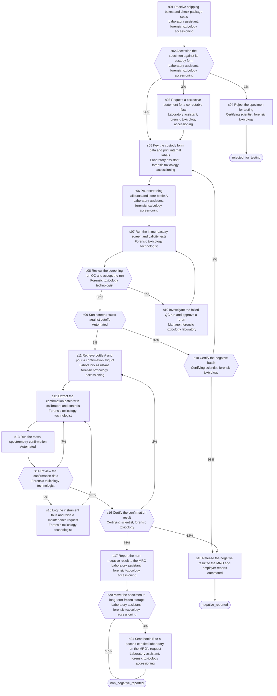

# Screen and confirm workplace drug test specimens in the forensic toxicology laboratory

`dls-wp-tox-testing` · medical laboratory services (forensic workplace drug testing) · forensic toxicology laboratory · part of `diagnostic-lab-services-co`

Sealed workplace drug test specimens arrive at the company's SAMHSA-certified toxicology laboratories from company collectors and third-party clinics. Assistants check the seals and custody form, technologists screen a small aliquot by immunoassay with validity tests, and the roughly one in twelve specimens that screen non-negative are confirmed by mass spectrometry on a fresh aliquot. A certifying scientist reviews custody, data and quality control before any result goes to the medical review officer. Negatives are released within a day; confirmations wait for drug-class batches and certifying review and take two to three days more, and custody form flaws, failed QC runs and re-extractions add delay.

| | |
|---|---|
| Unit of work | one drug test specimen |
| Starts when | A sealed specimen with copy 1 of its custody form arrives at the toxicology laboratory. |
| Done when | A certified negative or non-negative result is reported to the MRO (non-negative specimens frozen for at least a year), or the specimen is reported as rejected for testing. |
| Organisation | Two SAMHSA-certified forensic toxicology laboratories of a large Canadian laboratory company, testing about 300,000 workplace specimens a year for more than 500 employers. (3,300 employees, 2019-2022) |
| Volume | 25,000 cases a month (range 22,000 to 28,000) |

## Where it sits

- Starts with **ccf_specimen** from lg-interlab-transfer (60% of cases)
- Starts with **ccf_specimen** from third_party_collection_site (40% of cases)
- Sends **tox_result** to wp-result-reporting (outcome: negative_reported)
- Sends **tox_result** to wp-mro-review (outcome: non_negative_reported)
- Sends **tox_result** to wp-mro-review (outcome: rejected_for_testing)
- Sends **maintenance_request** to fac-instrument-maintenance (outcome: non_negative_reported)

## Flow

## Roles

| Role | Department | Layer | FTE on this process | Loaded cost per hour | Evidence |
|---|---|---|---:|---:|---|
| Laboratory assistant, forensic toxicology accessioning | Forensic toxicology laboratories | individual contributor | 13.5 | 30 CAD | B [cfr4083], [nrc26159] |
| Forensic toxicology technologist | Forensic toxicology laboratories | individual contributor | 14 | 47 CAD | B [nrc26167], [jobbank_22100] |
| Certifying scientist, forensic toxicology | Forensic toxicology laboratories | senior specialist | 4.5 | 70 CAD | B [cfr4097], [nrc26169] |
| Manager, forensic toxicology laboratory | Forensic toxicology laboratories | manager | 0.2 | 78 CAD | C |

## Steps

Hands-on time and the wait before each step show the most common value. Evidence tier A is a sourced number, B a sourced description, C the author's estimate.

| Step | Who | Kind | Hands-on | Wait before | Control | Evidence |
|---|---|---|---:|---:|---|---|
| **s01 Receive shipping boxes and check package seals.** A laboratory assistant signs for the morning deliveries from the company courier line haul and overnight carriers, checks each box and bag for intact seals, scans the manifest against the boxes and logs receipt time. Boxes arrive in a few large waves, so specimens queue for accessioning. | Laboratory assistant, forensic toxicology accessioning | intake | 0.3 min | 0 min | Package inspection on receipt: SAMHSA NLCP certification and HHS Mandatory Guidelines procedures, applied to every specimen in the certified laboratory and required by 49 CFR Part 40 for DOT specimens | B [nrc26159] |
| **s02 Accession the specimen against its custody form.** The assistant opens the bag, checks the bottle seals are intact, compares the specimen ID on bottle A and bottle B with copy 1 of the custody form, checks the collector's printed name and signature and that the temperature box was ticked, and records any flaw on the form. | Laboratory assistant, forensic toxicology accessioning | validation | 0.8 min | 1.0 h | Fatal and correctable flaw checks in 49 CFR 40.83: SAMHSA NLCP certification and HHS Mandatory Guidelines procedures, applied to every specimen in the certified laboratory and required by 49 CFR Part 40 for DOT specimens | B [cfr4083], [nrc26159], [cfr4081], [coaa_2011] |
| **s03 Request a corrective statement for a correctable flaw.** The assistant notes the flaw on the form, flags the specimen in the case system so testing continues but the result is held, and emails or faxes the collection site or collector a request for a signed corrective statement through the MRO office. The specimen is held at least five business days. | Laboratory assistant, forensic toxicology accessioning | communication | 5 min | 30 min | Correctable flaw procedure with a hold of at least 5 business days, 49 CFR 40.83(e)-(g): SAMHSA NLCP certification and HHS Mandatory Guidelines procedures, applied to every specimen in the certified laboratory and required by 49 CFR Part 40 for DOT specimens | B [cfr4083], [dyn_mroa] |
| **s04 Reject the specimen for testing.** A certifying scientist confirms the fatal flaw, records it on copy 1 and in the internal custody record, stops testing and reports the specimen as rejected for testing to the MRO, who cancels the test. | Certifying scientist, forensic toxicology | review | 5 min | 2.0 h | Fatal flaw rejection and report, 49 CFR 40.83(c)-(d) and 40.97: SAMHSA NLCP certification and HHS Mandatory Guidelines procedures, applied to every specimen in the certified laboratory and required by 49 CFR Part 40 for DOT specimens | B [cfr4083], [cfr4097] |
| **s05 Key the custody form data and print internal labels.** The assistant verifies (for company collections already keyed at the collection site) or keys (for third-party forms) the donor ID, employer account, collector, collection date, reason for test, panel and specimen type from copy 1 into the case system, which assigns a laboratory accession number and prints barcode labels for the internal chain of custody. | Laboratory assistant, forensic toxicology accessioning | data entry | 0.8 min | 20 min |  | C |
| **s06 Pour screening aliquots and store bottle A.** The assistant pours a small aliquot from bottle A into a labelled tube in a screening rack, recording the transfer on the internal custody record, then returns bottle A and sealed bottle B to secure refrigerated storage in the accession area. | Laboratory assistant, forensic toxicology accessioning | physical | 0.7 min | 1.0 h | Testing of aliquots under internal chain of custody with the original bottle in secure storage: SAMHSA NLCP certification and HHS Mandatory Guidelines procedures, applied to every specimen in the certified laboratory and required by 49 CFR Part 40 for DOT specimens | B [nrc26159], [dyn_dts] |
| **s07 Run the immunoassay screen and validity tests.** A technologist loads full racks with calibrators and controls making up at least 10 per cent of the run onto the immunoassay analysers, which test the drug panel and the validity markers (creatinine, pH, oxidants, and specific gravity when creatinine is low). Oral fluid specimens run on a separate screening assay. | Forensic toxicology technologist | physical | 1.5 min | 2.0 h | Initial test QC of at least 10 per cent of each run and validity testing of every specimen (49 CFR 40.87; HHS Mandatory Guidelines as mirrored in 10 CFR 26.167): SAMHSA NLCP certification and HHS Mandatory Guidelines procedures, applied to every specimen in the certified laboratory and required by 49 CFR Part 40 for DOT specimens | B [nrc26167], [cfr4087], [nrc26161] |
| **s08 Review the screening run QC and accept the run.** The technologist checks calibration and control results against acceptance limits in the QC software and the analyser data, and accepts the run so results pass to the case system, or rejects it. | Forensic toxicology technologist | review | 0.2 min | 15 min | Run acceptance against QC limits: SAMHSA NLCP certification and HHS Mandatory Guidelines procedures, applied to every specimen in the certified laboratory and required by 49 CFR Part 40 for DOT specimens | B [nrc26167] |
| **s09 Sort screen results against cutoffs.** The case system compares each result with the employer panel's cutoffs and validity criteria and routes specimens: negative and valid specimens to the negative review queue, and presumptive positives or specimens with validity flags to confirmation. | Automated | system auto | 0 min | 5 min |  | B [cfr4085], [trucknews_dc], [sh_dti] |
| **s10 Certify the negative batch.** A certifying scientist reviews the negative batch: run QC, the custody record of each aliquot, the keyed form data against copy 1 images, and any flags, then certifies the results in the case system. Review is done batch by batch, so a specimen waits for its batch to come up. | Certifying scientist, forensic toxicology | review | 0.4 min | 4.0 h | Certifying scientist review before release, 49 CFR 40.97(c) and 10 CFR 26.169 | B [cfr4097], [nrc26169], [dyn_dtsol] |
| **s11 Retrieve bottle A and pour a confirmation aliquot.** An assistant pulls bottle A from storage against the confirmation worklist, pours a fresh aliquot for each drug class or validity test to be confirmed, records each transfer on the internal custody form and returns the bottle. | Laboratory assistant, forensic toxicology accessioning | physical | 3 min | 2.0 h | Separate aliquot for confirmation under internal chain of custody: SAMHSA NLCP certification and HHS Mandatory Guidelines procedures, applied to every specimen in the certified laboratory and required by 49 CFR Part 40 for DOT specimens | B [nrc26159], [nrc26161] |
| **s12 Extract the confirmation batch with calibrators and controls.** A technologist prepares the batch for a drug class: adds internal standards, runs solid-phase or liquid extraction and derivatisation for GC-MS, or dilution for LC-MS/MS, with calibrators and controls making up at least 10 per cent of the batch. Batches by drug class run once or twice a day, so specimens wait for their class. | Forensic toxicology technologist | physical | 15 min | 10.0 h | Confirmatory QC of at least 10 per cent of each run, 10 CFR 26.167: SAMHSA NLCP certification and HHS Mandatory Guidelines procedures, applied to every specimen in the certified laboratory and required by 49 CFR Part 40 for DOT specimens | B [nrc26167] |
| **s13 Run the mass spectrometry confirmation.** The GC-MS or LC-MS/MS instruments run the batch unattended, often overnight, and the data system quantifies each analyte against the calibrators. | Automated | system auto | 0 min | 6.0 h |  | B [nrc26167], [dyn_dtsol] |
| **s14 Review the confirmation data.** A technologist reviews each chromatogram, ion ratios, retention times, internal standard recovery and batch QC, accepts or flags each result, and sends acceptable results to certifying review. Poor recovery or interference means re-extraction; instrument faults move the batch to another instrument. | Forensic toxicology technologist | analysis | 8 min | 4.0 h | Confirmation data review: SAMHSA NLCP certification and HHS Mandatory Guidelines procedures, applied to every specimen in the certified laboratory and required by 49 CFR Part 40 for DOT specimens | C |
| **s15 Log the instrument fault and raise a maintenance request.** The technologist records the fault in the maintenance log, takes the instrument out of service, raises a maintenance request to biomedical engineering or the vendor, and reassigns the batch to another instrument. | Forensic toxicology technologist | communication | 15 min | 15 min |  | C |
| **s16 Certify the confirmation result.** A certifying scientist reviews the confirmation data, QC, the full internal and external chain of custody and copy 1 of the custody form, decides whether the result is positive, adulterated, substituted, invalid or negative at the confirmation cutoff, signs copy 1 and certifies the result. | Certifying scientist, forensic toxicology | review | 8 min | 6.0 h | Certifying scientist review and signature of copy 1, 49 CFR 40.97(c) and 10 CFR 26.169 | B [cfr4097], [nrc26169], [cfr4085] |
| **s17 Report the non-negative result to the MRO.** The assistant scans the signed copy 1 and transmits it with the electronic result and quantitative values to the medical review officer's queue in the case system or by secure fax, the same day the certifying review is done. | Laboratory assistant, forensic toxicology accessioning | communication | 3 min | 30 min | Results only to the MRO with the signed Copy 1, 49 CFR 40.97 | B [cfr4097] |
| **s18 Release the negative result to the MRO and employer reports.** The case system sends the certified negative to the MRO queue and the employer web report, updates the activity report, and flags the aliquot and bottles for discard after the retention period. | Automated | system auto | 0 min | 5 min | Results reported only through the MRO, 49 CFR 40.97 | B [cfr4097], [dyn_dts] |
| **s19 Investigate the failed QC run and approve a rerun.** The laboratory manager or delegate reviews the failed controls, opens a nonconformance, decides on recalibration or new reagents and approves the rerun of the affected racks. | Manager, forensic toxicology laboratory | judgment | 20 min | 1.0 h | Investigation and corrective action after QC failure, 10 CFR 26.167(f); ISO/IEC 17025 | B [nrc26167], [dyn_dtsol], [nlcp_rti] |
| **s20 Move the specimen to long-term frozen storage.** The assistant moves bottle A's remainder and sealed bottle B to the -20 C freezer, records the location and custody transfer, and sets the retention date one year out. | Laboratory assistant, forensic toxicology accessioning | physical | 2 min | 4.0 h | Frozen retention of non-negative specimens for at least one year, 49 CFR 40.84 | B [cfr4084], [nrc26159] |
| **s21 Send bottle B to a second certified laboratory on the MRO's request.** When the donor asks the MRO for a split test within 72 hours, the MRO's written request arrives; the assistant retrieves sealed bottle B, completes the custody paperwork and ships it in a sealed container to another HHS-certified laboratory. | Laboratory assistant, forensic toxicology accessioning | physical | 15 min | 2.0 d | Split specimen testing at a second certified laboratory, 49 CFR 40.171 | B [cfr40171], [nrc26159] |

## Exceptions

| Exception | Share of cases | What happens |
|---|---:|---|
| Correctable custody form flaw | 3% | Missing collector signature, unrecorded temperature or wrong form; testing continues while a corrective statement is sought and the specimen is held at least five business days. |
| Fatal flaw | 1% | ID mismatch, broken seal, missing collector name or specimen; rejected for testing and the test is cancelled. |
| Failed screening QC | 2% | Run rejected, nonconformance opened and racks rerun. |
| Re-extraction or instrument fault in confirmation | 1% | Poor recovery, interference or an instrument fault sends the batch back for extraction or to another instrument. |
| Split specimen test | 0% | The donor asks the MRO within 72 hours for a test of bottle B, which is shipped to a second certified laboratory. |

## Benchmarks

| Metric | Value | Unit | Population | Evidence |
|---|---|---|---|---|
| cycle_time_days | p50 0.6, p90 1.0 | calendar days from receipt at the laboratory to result reported to the MRO | All workplace specimens at the modelled laboratories | B [dyn_dtsol], [dyn_dts] |
| negative_turnaround | low 6, high 24 | hours | The modelled laboratories | A [dyn_dtsol] |
| non_negative_additional_turnaround | low 48, high 72 | hours | The modelled laboratories | A [dyn_dtsol], [dyn_dts] |
| reporting_deadline | 5 | business days after receipt | HHS-certified laboratories testing NRC licensee specimens | A [nrc26169] |
| qc_share_of_each_run | 0.1 | minimum share of samples in each analytical run | HHS-certified laboratories | A [nrc26167] |
| non_negative_retention | 1 | year minimum, frozen | DOT and HHS-certified laboratories | A [cfr4084], [nrc26159] |
| correctable_flaw_hold | 5 | business days minimum | DOT specimens | A [cfr4083] |
| workforce_positivity_us_2021 | 0.046 | share of all workforce tests positive | Quest Drug Testing Index, more than 11 million US samples | A [sh_dti] |
| marijuana_positivity_canada_non_regulated_trucking | 0.0768 | share of tests positive after legalization | DriverCheck non-DOT trucking tests | A [trucknews_dc] |
| split_test_request_window | 72 | hours from MRO notification | DOT tests | A [cfr40171] |

## Pain points

- Paper custody forms are re-keyed at accessioning and checked again by the certifying scientist; keying errors and form flaws cause holds and corrective statements. (steps s02, s03, s05, s10; B [cfr4083], [dyn_mroa])
- Confirmations wait for drug-class batches, overnight instrument runs and two reviews, so non-negative results take two to three days longer than negatives. (steps s11, s12, s13, s14, s16; B [dyn_dtsol])
- Certifying scientist review is a single queue for every result; when it backs up, negatives miss the same-day release. (steps s10, s16; C [cfr4097])
- Failed QC runs and instrument faults force reruns of whole racks or batches. (steps s08, s19, s14, s15; C [nrc26167])

## Assumptions

- The two laboratories apply SAMHSA NLCP and HHS Mandatory Guidelines procedures to every specimen. For DOT specimens these are fixed by law; for non-regulated Canadian specimens they follow from certification, accreditation and employer contracts, so controls are marked needs_policy_change.
- HHS laboratory requirements for quality control, custody and reporting are cited from the NRC's 10 CFR Part 26, which sets the same requirements for HHS-certified laboratories, because the HHS Mandatory Guidelines pages could not be opened.
- About 8.5 per cent of specimens need confirmation and about 86 per cent of those confirm non-negative, giving about 7.3 per cent non-negative results, consistent with the organisation file's 1,800 MRO reviews a month. These shares are estimates.
- Touch times for screening, QC review and negative certification are amortised per specimen over batches of 100 or more specimens.
- Technologist FTE covers per-specimen work only; instrument maintenance, calibration, proficiency testing and validation take much of the remaining technologist time in the organisation file.
- A maintenance request to the instrument maintenance process is raised only on the about 2 per cent of confirmation reviews that find an instrument fault; it is linked to the non-negative outcome because faults arise on the confirmation path.
- Oral fluid specimens follow the same steps with a different screening assay.
- Loaded costs come from the organisation file (wage times 1.35).

## Sources

- [dyn_dts] Drug testing services (link withheld) (The model laboratory, undated). More than 300,000 drug tests a year; 70+ company centres and 2,000+ third-party collection sites; SAMHSA-certified laboratory; initial screen on a small portion separates negatives; negatives usually released within 24 hours, non-negatives need 48 to 72 hours more; activity reports of specimens received in the last 24 hours with status.
- [dyn_dtsol] Drug testing solutions (link withheld) (The model laboratory, undated). Canada's only SAMHSA-certified laboratories; London forensic toxicology laboratory accredited to ISO/IEC 17025:2017; negatives generally released within 6 to 24 hours, non-negatives an additional 48 to 72 hours; urine and oral fluid; web and secure fax reporting.
- [cfr4081] [49 CFR 40.81 What laboratories may be used for DOT drug testing?](https://www.law.cornell.edu/cfr/text/49/40.81) (Legal Information Institute, Cornell Law School, 2024). Laboratories must be HHS-certified under the NLCP for each method used; Canadian laboratories may take part when approved as meeting HHS standards; labs must follow Part 40 and HHS requirements.
- [cfr4083] [49 CFR 40.83 How do laboratories process incoming specimens?](https://www.law.cornell.edu/cfr/text/49/40.83) (Legal Information Institute, Cornell Law School, 2024). Inspect each specimen and CCF for fatal flaws (no CCF, no collector name or signature, ID mismatch, broken seal, insufficient specimen) and stop testing; for correctable flaws continue testing, hold the specimen at least 5 business days and seek a correction before reporting rejected; split bottles may be redesignated; flaws noted on Copy 1 Step 5a.
- [cfr4084] [49 CFR 40.84 How long does the laboratory retain specimens after testing?](https://www.law.cornell.edu/cfr/text/49/40.84) (Legal Information Institute, Cornell Law School, 2024). Positive, adulterated, substituted and invalid specimens kept at least one year in secure long-term frozen storage, split specimens likewise; longer on written request.
- [cfr4085] [49 CFR 40.85 What drugs do laboratories test for?](https://www.law.cornell.edu/cfr/text/49/40.85) (Legal Information Institute, Cornell Law School, 2024). Initial and confirmatory cutoffs, for example marijuana metabolite 50 and 15 ng/mL, benzoylecgonine 150 and 100, amphetamines 500 and 250; at or above the initial cutoff requires a confirmation test.
- [cfr4087] [49 CFR 40.87 What are the requirements for conducting specimen validity testing?](https://www.law.cornell.edu/cfr/text/49/40.87) (Legal Information Institute, Cornell Law School, 2024). Creatinine on each primary specimen, pH, and one or more tests for oxidizing adulterants.
- [cfr4097] [49 CFR 40.97 What do laboratories report and how do they report it?](https://www.law.cornell.edu/cfr/text/49/40.97) (Legal Information Institute, Cornell Law School, 2024). Result categories; results go only to the MRO; released only after certifying scientist review; negatives may be sent as electronic reports, non-negatives with an image of the signed Copy 1; transmit preferably the same day the certifying review is completed; quantitative values for positives.
- [cfr40171] [49 CFR 40.171 How does an employee request a test of a split specimen?](https://www.law.cornell.edu/cfr/text/49/40.171) (Legal Information Institute, Cornell Law School, 2024). Employee has 72 hours from notification of a verified positive, adulterated or substituted result to ask the MRO for a split test; the MRO directs the first laboratory in writing to send bottle B to a second HHS-certified laboratory.
- [nrc26159] [10 CFR 26.159 Assuring specimen security, chain of custody, and preservation](https://www.law.cornell.edu/cfr/text/10/26.159) (Legal Information Institute, Cornell Law School, 2024). HHS-certified laboratory practice: inspect packages and compare bottles with CCFs, report discrepancies within 24 hours, test aliquots under internal chain of custody with the original bottle in secure storage, refrigerate specimens not screened within 7 days, freeze non-negatives at -20 C for at least 1 year, discard or pool negatives.
- [nrc26161] [10 CFR 26.161 Cutoff levels for validity testing](https://www.law.cornell.edu/cfr/text/10/26.161) (Legal Information Institute, Cornell Law School, 2024). Every specimen gets creatinine, pH and an oxidant test, specific gravity when creatinine is below 20 mg/dL; adulterated, substituted, dilute or invalid results need a second aliquot confirmation; invalid criteria include immunoassay interference in two aliquots.
- [nrc26167] [10 CFR 26.167 Quality assurance and quality control](https://www.law.cornell.edu/cfr/text/10/26.167) (Legal Information Institute, Cornell Law School, 2024). Quality control samples at least 10 per cent of each initial and confirmatory analytical run, with drug-free, cutoff and above and below cutoff controls; confirmation by GC/MS or another permitted method; investigation and corrective action after errors.
- [nrc26169] [10 CFR 26.169 Reporting results](https://www.law.cornell.edu/cfr/text/10/26.169) (Legal Information Institute, Cornell Law School, 2024). The certifying scientist certifies each result before it goes to the MRO; results reported within 5 business days after the laboratory receives the specimen; annual statistical summary.
- [nlcp_rti] [National Laboratory Certification Program](https://nlcp.rti.org/) (RTI International, 2026). NLCP has supported HHS since 1986; RTI inspects applicant and certified laboratories, reviewing procedures, data and documentation, and designs, sends and scores performance testing samples.
- [sh_dti] [Positive drug tests for US workers at highest level in 20 years: annual index](https://www.safetyandhealthmagazine.com/articles/22440-positive-drug-tests-for-us-workers-at-highest-level-in-20-years-annual-index) (Safety+Health magazine (National Safety Council), 2022). Quest Drug Testing Index: overall positivity 4.6 per cent in 2021 (4.4 per cent in 2020) from more than 11 million samples; urine marijuana 3.9 per cent for all workers; federally mandated safety-sensitive workforce 2.2 per cent.
- [trucknews_dc] [Canada sees steady trends in marijuana positive tests among truck drivers since legalization](https://www.trucknews.com/health-safety/canada-sees-steady-trends-in-marijuana-positive-tests-among-truck-drivers-since-legalization/1003187827) (Trucknews.com, 2024). DriverCheck data: marijuana positivity about 0.8 per cent in regulated (DOT) trucking and 7.7 per cent in non-regulated Canadian trucking after legalization; reasonable cause around 40 per cent and post-accident around 10 per cent positive; alcohol about 0.3 to 0.4 per cent.
- [jobbank_22100] [Wages: Chemical technician in Ontario (NOC 22100)](https://www.jobbank.gc.ca/marketreport/wages-occupation/2934/ON) (Job Bank, Government of Canada, 2025). Ontario hourly wages low 21.50, median 30.00, high 47.82 CAD (2023-2024).
- [dyn_mroa] Medical review officer assistant (job posting) (link withheld) (The model laboratory via Jobillico, 2025). Reviews negative results against the custody and control form, reviews documentation for fatal or correctable errors and works with the laboratory to obtain corrective documentation from collection sites.
- [coaa_2011] [COAA Best Practices Conference XIX: Canadian Model best practice (presentation transcript)](https://sambuz.com/doc/coaa-best-practices-conference-xix-canadian-model-best-ppt-presentation-50475) (Construction Owners Association of Alberta, via Sambuz, 2011). The Canadian Model mandates US DOT 49 CFR Part 40 standards; a certified laboratory keeps forensic practices and quality systems, performs specimen validity testing, is audited and uses proficiency samples; oral fluid testing by a certified lab is allowed for some test reasons.

Written by claude-opus on 2026-11-17.
