# Assess asset condition and risk (annual health index update)

`edu-ae-asset-condition-assessment` · electric power distribution · asset management and engineering · part of `electric-distribution-utility`

Once a year asset analysts turn the inspection, test and failure records for poles, cables, transformers, switches, manholes and station equipment into a health index score for each asset, convert the scores into failure probability and risk, and rank renewal candidates for the pole, cable and station programs and the capital plan. Data comes from the station test database and the GIS mobile inspection tool, is copied by hand into Excel 'data loaders' per asset class, and the results are typed into the investment planning tool. The work is slow and error-prone because inspection records must be matched to GIS asset ids, test data is missing for many station assets, formulas live in spreadsheets, and odd results need a site visit to confirm.

| | |
|---|---|
| Unit of work | one annual asset condition assessment across 12 major asset classes |
| Starts when | The year's distribution inspection, station maintenance and cable fault results are complete and the capital planning calendar calls for updated condition results. |
| Done when | Health index, condition demographics and ranked renewal lists are approved by the engineering manager and published to the capital plan and the pole, cable and station programs. |
| Organisation | A city-owned Ontario local distribution company serving about 346,000 customers with about 570 staff and an 80-person asset management and engineering division, modelled mainly on Hydro Ottawa. (571 employees, 2019-2022) |
| Volume | 0.083 cases a month (range 0.083 to 0.083) |

## Where it sits

- Starts with **inspection_findings** from ops-distribution-inspection (50% of cases)
- Starts with **inspection_findings** from ops-station-maintenance (35% of cases)
- Starts with **inspection_findings** from ops-cable-fault-repair (15% of cases)
- Relies on **asset_register** from ae-records-gis (a standing input; it does not start a case)
- Relies on **reliability_report** from ae-reliability-analysis (a standing input; it does not start a case)
- Relies on **inspection_findings** from ops-protection-testing (a standing input; it does not start a case)
- Relies on **interruption_data** from ops-outage-restoration (a standing input; it does not start a case)
- Sends **asset_condition** to ae-capital-plan (outcome: published)
- Sends **asset_condition** to ops-pole-replacement (outcome: published)
- Sends **asset_condition** to ops-station-maintenance (outcome: published)
- Sends **asset_condition** to ops-distribution-inspection (outcome: published)
- Sends **asset_condition** to fin-rate-application (outcome: published)

## Flow

```mermaid
flowchart TD
    s01["s01 Kick off the annual assessment<br/>Engineering manager  planning, design, projects, standards"]
    s02["s02 Extract station test and maintenance data<br/>Asset management engineer / analyst"]
    s03["s03 Extract distribution inspection and failure data<br/>Asset management engineer / analyst"]
    s04{{"s04 Reconcile inspection records with the asset register<br/>Asset management engineer / analyst"}}
    s05["s05 Request missing test results and id fixes<br/>Asset management engineer / analyst"]
    s06["s06 Stations supervisor supplies missing test sheets<br/>Stations and protection supervisor"]
    s07["s07 GIS technician corrects asset ids and attributes<br/>GIS and records technician"]
    s08["s08 Load data into the class data loaders<br/>Asset management engineer / analyst"]
    s09["s09 Calculate health indices and sample sizes<br/>Asset management engineer / analyst"]
    s10{{"s10 Check formulas and results<br/>Asset management engineer / analyst"}}
    s11["s11 Drive to sample sites with anomalous scores<br/>Asset management engineer / analyst"]
    s12["s12 Inspect sample assets on site<br/>Asset management engineer / analyst"]
    s13["s13 Convert scores to failure probability and risk<br/>Asset management engineer / analyst"]
    s14["s14 Produce condition demographics<br/>Asset management engineer / analyst"]
    s15["s15 Load results into the investment planning tool<br/>Asset management engineer / analyst"]
    s16["s16 Rank renewal candidates by program<br/>Asset management engineer / analyst"]
    s17["s17 Field supervisors review the rankings<br/>Overhead lines supervisor"]
    s18{{"s18 Engineering manager approves results<br/>Engineering manager  planning, design, projects, standards"}}
    s19["s19 Outside consultant reviews the ACA framework<br/>Outside party"]
    s20["s20 Address review recommendations<br/>Asset management engineer / analyst"]
    s21["s21 Publish the assessment<br/>Asset management engineer / analyst"]
    s01 --> s02
    s02 --> s03
    s03 --> s04
    s04 -->|"60%"| s05
    s04 -->|"40%"| s08
    s05 --> s06
    s06 --> s07
    s07 --> s08
    s08 --> s09
    s09 --> s10
    s10 -->|"65%"| s13
    s10 -->|"20%"| s08
    s10 -->|"15%"| s11
    s11 --> s12
    s12 --> s13
    s13 --> s14
    s14 --> s15
    s15 --> s16
    s16 --> s17
    s17 --> s18
    s18 -->|"82%"| s21
    s18 -->|"13%"| s16
    s18 -->|"5%"| s19
    s19 --> s20
    s20 --> s21
    s21 --> end0
    end0(["published"])
```

## Roles

| Role | Department | Layer | FTE on this process | Loaded cost per hour | Evidence |
|---|---|---|---:|---:|---|
| Asset management engineer / analyst | System Planning and Asset Management | senior specialist | 1 | 68 CAD | C |
| Engineering manager (planning, design, projects, standards) | Asset Management and Engineering | manager | 0.06 | 100 CAD | C |
| Stations and protection supervisor | Stations and Protection and Control | supervisor | 0.02 | 82 CAD | C |
| Overhead lines supervisor | Overhead Lines | supervisor | 0.02 | 80 CAD | C |
| GIS and records technician | Standards and Records | individual contributor | 0.05 | 50 CAD | C |

## Steps

Hands-on time and the wait before each step show the most common value. Evidence tier A is a sourced number, B a sourced description, C the author's estimate.

| Step | Who | Kind | Hands-on | Wait before | Control | Evidence |
|---|---|---|---:|---:|---|---|
| **s01 Kick off the annual assessment.** The engineering manager confirms the data cut-off date, the asset classes and formula changes for the year (for example after the outside review's recommendations), and assigns asset classes to analysts with a due date tied to the capital planning calendar. | Engineering manager (planning, design, projects, standards) | coordination | 2.0 h | 0 min |  | C |
| **s02 Extract station test and maintenance data.** An analyst exports transformer oil and dissolved gas results, insulation and breaker timing tests, tap changer and switchgear inspection results from the station test database for every station asset. | Asset management engineer / analyst | lookup | 16.0 h | 5.0 d |  | A [ho_irr] |
| **s03 Extract distribution inspection and failure data.** Another analyst exports pole test and visual inspection results, padmount and vault inspections, infrared findings and cable test results from the GIS mobile inspection tool, and failure and outage cause records from the ERP and OMS. | Asset management engineer / analyst | lookup | 20.0 h | 0 min |  | A [ho_irr] |
| **s04 Reconcile inspection records with the asset register.** The analyst matches each inspection and test record to a GIS or ERP asset id, finds records for assets that were replaced or renumbered, and lists assets with no inspection in the cycle. Unmatched ids go to GIS for correction. | Asset management engineer / analyst | validation | 2.0 d | 3.0 d |  | A [ho_irr] |
| **s05 Request missing test results and id fixes.** The analyst emails the stations supervisor for missing test sheets and the GIS team for assets whose ids or attributes do not match, with a list and a deadline. | Asset management engineer / analyst | communication | 1.0 h | 0 min |  | C |
| **s06 Stations supervisor supplies missing test sheets.** The stations supervisor looks for paper or PDF test sheets from contractors and crews, asks electricians about tests not yet entered, and sends what exists. Tests never done are flagged for next season's maintenance plan. | Stations and protection supervisor | lookup | 3.0 h | 5.0 d |  | A [ho_irr] |
| **s07 GIS technician corrects asset ids and attributes.** A GIS technician checks each flagged asset against as-builts and work orders, corrects ids, install years and attributes, and confirms back to the analyst. | GIS and records technician | data entry | 5.0 h | 1.0 d |  | C |
| **s08 Load data into the class data loaders.** Analysts paste the matched data into the Excel data loader for each of the 12 asset classes (station transformers, tap changers, high- and medium-voltage switchgear, wood poles, overhead switches, overhead transformers, reclosers, cables, underground transformers, underground switches, manholes), refresh lookups and check row counts. | Asset management engineer / analyst | data entry | 1.3 d | 7.0 d |  | A [ho_irr] |
| **s09 Calculate health indices and sample sizes.** The workbooks score each asset from weighted degradation factors (age, test results, visual condition, loading, failures) on a 0-100% scale, assign condition bands from very good to very poor, and report the share of each class with enough data to score. Station assets need at least 70% of inputs to get a score. | Asset management engineer / analyst | analysis | 20.0 h | 1.0 d |  | A [ho_irr] |
| **s10 Check formulas and results.** A second analyst compares this year's scores with last year's by class, looks for assets that jumped bands without a new inspection, checks formulas and band thresholds, and sends errors back for correction. | Asset management engineer / analyst | review | 16.0 h | 5.0 d | Asset management procedure: independent check of health index results | A [ho_irr] |
| **s11 Drive to sample sites with anomalous scores.** For a sample of assets whose scores look wrong (a new padmount scored very poor, an old station breaker scored very good) the analyst drives to the stations and street locations in a pool vehicle. Station visits are booked with the stations supervisor for access. | Asset management engineer / analyst | travel | 4.0 h | 5.0 d |  | C |
| **s12 Inspect sample assets on site.** At each site the analyst, escorted in stations, looks at nameplates and visible condition, photographs the asset and compares it with the inspection record, then corrects the input or the score. Station entry follows the utility's work protection and site hazard rules. | Asset management engineer / analyst | physical | 4.0 h | 0 min | Station entry and hazard assessment under the Utility Work Protection Code and Occupational Health and Safety Act (Ontario Regulation 213/91 and utility rules) | C |
| **s13 Convert scores to failure probability and risk.** For station assets the analyst converts each health index into a probability of failure with an industry curve and multiplies it by the customers and load at risk to get a risk cost per station. For distribution classes, failure rates by condition band are updated from the year's failures. | Asset management engineer / analyst | analysis | 20.0 h | 1.0 d |  | A [ho_irr] |
| **s14 Produce condition demographics.** The analyst summarizes, by class, the share of assets past expected service life and in each condition band, and the change from last year, in tables and charts for the capital plan and, in filing years, the DSP. | Asset management engineer / analyst | analysis | 6.0 h | 0 min |  | A [ho_exec] |
| **s15 Load results into the investment planning tool.** The analyst formats health index and risk results to the import template and uploads them to the investment planning tool against each asset, then spot-checks a sample of records after the import. | Asset management engineer / analyst | data entry | 5.0 h | 1.0 d |  | A [ho_irr] |
| **s16 Rank renewal candidates by program.** Analysts rank poles, cable sections, underground transformers and switchgear, and station assets by risk and condition, group them into practical work packages (by feeder, street or station) and size next year's program volumes. | Asset management engineer / analyst | analysis | 1.3 d | 5.0 d |  | B [ho_blog], [ho_capex] |
| **s17 Field supervisors review the rankings.** Lines and stations supervisors go through the ranked lists in a meeting with the analysts, add assets they know are in worse shape, remove ones already replaced, and point out work packages that crews cannot reach or that clash with City works. | Overhead lines supervisor | review | 3.0 h | 7.0 d |  | C |
| **s18 Engineering manager approves results.** The engineering manager reviews the demographics, the main changes from last year and the ranked programs, asks for explanations of large swings, and approves the assessment or sends a class back. | Engineering manager (planning, design, projects, standards) | approval | 2.0 h | 5.0 d | Asset management procedure: manager approval of condition results used for capital planning | C |
| **s19 Outside consultant reviews the ACA framework.** Before a DSP filing the utility retains a consultant to review data processes, health index formulas, sample sizes and how results are used. The consultant issues an initial assessment, then a follow-up after changes; in 2019 the follow-up cost a fixed $17,000. | Outside party | external wait | 0 min | 42.0 d | OEB Chapter 5 filing requirements: description and support of the asset condition assessment in the DSP | A [ho_irr], [oeb_ch5] |
| **s20 Address review recommendations.** Analysts change formulas, data rules and documentation in response to the review, recalculate affected classes and record the changes for the DSP attachment. | Asset management engineer / analyst | data entry | 1.3 d | 5.0 d |  | A [ho_irr] |
| **s21 Publish the assessment.** The analyst files the ACA report and demographics in the document store and sends ranked renewal lists to the capital plan, the pole replacement program, stations maintenance and the inspection program (with assets lacking data for targeted inspection). | Asset management engineer / analyst | communication | 2.0 h | 1.0 d |  | C |

## Exceptions

| Exception | Share of cases | What happens |
|---|---:|---|
| Missing data and id mismatches | 60% | Station test sheets and asset ids have to be chased before the data loaders can be filled. |
| Spreadsheet calculation errors | 20% | The checker finds loading or formula errors and the class is reloaded and recalculated. |
| Field verification of anomalies | 15% | Scores that look wrong are checked on site before results are used. |
| Outside review of the framework | 5% | Before a DSP filing a consultant reviews the framework and the team implements changes. |

## Benchmarks

| Metric | Value | Unit | Population | Evidence |
|---|---|---|---|---|
| cycle_time_days | p50 75, p90 120 | calendar days from kickoff to published assessment | Annual health index updates at a large Ontario LDC, 2019-2022 | C |
| assets_past_expected_life | 0.19 | share of assets | Hydro Ottawa, 2021-2025 DSP | A [ho_exec] |
| assets_poor_or_very_poor | 0.17 | share of assets | Hydro Ottawa, 2021-2025 DSP | A [ho_exec] |
| station_classes_below_50pct_sample | 6 | of 8 station asset classes | Hydro Ottawa ACA, May 2019 | A [ho_irr] |

## Pain points

- Input data is exported by hand from the station test database and the GIS inspection tool into Excel data loaders, which loses data and introduces errors. (steps s02, s03, s08; A [ho_irr])
- Health index formulas live in spreadsheets; calculation errors and inconsistent band definitions were found, and historical scores are not stored. (steps s09, s10; A [ho_irr])
- Many station assets lack recent test data, so scores lean on age and sample sizes are low. (steps s04, s06; A [ho_irr])
- Results are typed or imported into the investment planning tool separately, so the ranking used in the capital plan can drift from the workbook. (steps s15, s16; A [ho_irr])

## Assumptions

- The case starts on the annual calendar once inspection results are in; the triggers keep the organisation file's three inspection_findings sources, with shares reflecting where most records come from.
- PowerDB and Copperleaf C55 are added as systems; the organisation file has only a generic asset analytics system.
- Stations and lines supervisors and GIS technicians take part, though the organisation file's process map lists only asset analysts and the engineering manager.
- An outside review of the framework is modelled in 5% of cycles: the model company commissioned one before the 2021-2025 filing, and the author assumes not every five-year term repeats it.
- The field check uses a pool light vehicle; weather and station access windows are the waits that matter there.
- Analyst FTE (1.0) is above the hands-on implied figure because analysts also spend time answering ACA questions in rate proceedings and maintaining the data loaders between cycles.

## Sources

- [ho_exec] [Hydro Ottawa 2021-2025 Custom IR Application, UPDATED Exhibit 1-1-8 Executive Summary (EB-2019-0261), May 5, 2020](https://hydroottawa.com/sites/default/files/2020-05/Updated%20Executive%20Summary.pdf) (Hydro Ottawa Limited, 2020). DSP is the culmination of business strategy, customer engagement, capital investment, asset management and regional planning processes; 2021-2025 capital by OEB category averaging $100.8M net a year; forecast went through iterations for priority, customer preference, rate impacts, resource capacity and financing; 19% of assets past expected service life (51% of stations, 23% of overhead assets), 17% in poor or very poor condition; custom scorecard measures for stations and feeders exceeding planning capacity; nearly 21,000 customers took part in rate engagement.
- [ho_capex] [Hydro Ottawa 2021-2025 Custom IR Application, UPDATED Exhibit 2 (rate base), including Exhibit 2-4-1 Capital Expenditure Summary (EB-2019-0261), May 5, 2020](https://www.rds.oeb.ca/CMWebDrawer/Record/676525/File/document) (Hydro Ottawa Limited (OEB Regulatory Document Search), 2020). Rationalization process: an engineering asset needs forecast first, then a review of asset needs, safety, reliability, growth, resource constraints, rate impacts, customer input and financing that cut the forecast by about $50M a year; top four drivers (customer service requests, failure risk, system capital investment support, capacity constraints); Cambrian MTS needed because South Nepean reached the limits of local transformation capacity, leave to construct applied for May 2019, approved October 2019, energization Q2 2022; System Renewal and System Service merged for tracking because funds shift between them; commitment to ISO 55000.
- [ho_irr] [Hydro Ottawa interrogatory responses CCC-46 to CCC-79 (EB-2019-0261), including Attachments CCC-56(A) and CCC-60(A) and (B): METSCO review of Hydro Ottawa's Asset Condition Assessment framework (May and October 2019)](https://www.rds.oeb.ca/CMWebDrawer/Record/679188/File/document) (Hydro Ottawa Limited (OEB Regulatory Document Search), 2020). ACA input data held in PowerDB (substation tests) and GIS Mobile Inspector (distribution inspections), manually extracted into Excel 'data loaders' that calculate health indices; calculation errors found in the Excel files; health index results loaded into Copperleaf C55 for risk evaluation while investment prioritization was still done in Excel; HI converted to probability of failure and risk cost for station assets; 12 major asset classes reviewed (4 station, 4 overhead, 4 underground); station assets need at least 70% of data, six of eight station classes below 50% sample size; METSCO first engaged January 2019, initial assessment May 2019, follow-up October 2019 for a fixed $17,000; revised maintenance cycles (annual transformer visual and infrared, vault inspections every 3-6 years, annual XLPE cable testing).
- [oeb_ch5] [Filing Requirements for Electricity Distribution Rate Applications, 2021 Edition for 2022 Rate Applications, Chapter 5 Consolidated Distribution System Plan (June 24, 2021)](https://www.oeb.ca/sites/default/files/Chapter%205_DSP%20Filing%20Requirements_20210624.pdf) (Ontario Energy Board, 2021). A DSP sets out asset management and capital expenditure plans over a minimum five-year forecast period plus five historical years; investments justified by reference to the asset management process; section 5.2.2 requires evidence of coordinated planning with the transmitter, IESO and regional planning deliverables; project or program justifications above the materiality threshold; asset condition assessment and prioritization methods described.
- [ho_blog] [An inside look at how Hydro Ottawa replaces electricity infrastructure](https://hydroottawa.com/en/blog/inside-look-how-hydro-ottawa-replaces-electricity-infrastructure) (Hydro Ottawa, 2026). Condition is scored from visual inspections, electrical testing and infrared scans plus loading and location data into a health index; poor and very poor assets are prioritized by risk to reliability, safety and the environment; pole replacements on busy corners need City coordination to limit road closures and planned outages; underground cable work needs clear communication with customers whose property is crossed.

Written by claude-opus on 2026-11-24.
