# Build the annual capital program and the five-year Distribution System Plan

`edu-ae-capital-plan` · electric power distribution · asset management and engineering · part of `electric-distribution-utility`

Each year the asset management and planning engineers turn condition results, capacity studies, connection forecasts and City road works into a ranked list of capital projects and programs, then cut and pace it until it fits the rate plan, the crews and contractors available and the financing. The list goes through engineering managers, the engineering director, the executive team and the board before it is loaded into the ERP and released for delivery. One year in five the program becomes the Distribution System Plan filed with the rate application, which adds months of drafting, regional planning letters and customer engagement. The work is slow because needs exceed the envelope by tens of millions of dollars, prioritization is done in spreadsheets outside the investment planning tool, and each cut sends the portfolio back for another iteration.

| | |
|---|---|
| Unit of work | one annual capital program (and, one year in five, the Distribution System Plan) |
| Starts when | Finance issues the annual budget call and planning calendar in spring, once the year's asset condition results and planning studies are available. |
| Done when | The board has approved the capital budget, projects and programs are set up in the ERP and released to project delivery and operations; in a filing year the DSP has been handed to regulatory affairs for the rate application. |
| Organisation | A city-owned Ontario local distribution company serving about 346,000 customers with about 570 staff and an 80-person asset management and engineering division, modelled mainly on Hydro Ottawa. (571 employees, 2019-2022) |
| Volume | 0.083 cases a month (range 0.083 to 0.083) |

## Where it sits

- Starts with **budget** from fin-budget (100% of cases)
- Relies on **planning_study** from ae-system-planning (a standing input; it does not start a case)
- Relies on **asset_condition** from ae-asset-condition-assessment (a standing input; it does not start a case)
- Relies on **reliability_report** from ae-reliability-analysis (a standing input; it does not start a case)
- Relies on **relocation_request** from ae-municipal-relocations (a standing input; it does not start a case)
- Relies on **relocation_request** from city (a standing input; it does not start a case)
- Relies on **board_decision** from exec-strategy-board (a standing input; it does not start a case)
- Relies on **planning_study** from ieso (a standing input; it does not start a case)
- Relies on **planning_study** from hydro-one (a standing input; it does not start a case)
- Sends **capital_plan** to ae-capital-project-delivery (outcome: released)
- Sends **capital_plan** to fin-budget (outcome: released)
- Sends **capital_plan** to fin-rate-application (outcome: released)
- Sends **capital_plan** to exec-strategy-board (outcome: released)
- Sends **capital_plan** to ops-work-scheduling (outcome: released)
- Sends **capital_plan** to ops-distribution-inspection (outcome: released)
- Sends **capital_plan** to ops-vegetation-management (outcome: released)

## Flow

```mermaid
flowchart TD
    s01["s01 Issue planning calendar and envelope guidance<br/>Engineering manager  planning, design, projects, standards"]
    s02["s02 Gather condition results, studies and reliability data<br/>Asset management engineer / analyst"]
    s03["s03 Request City road works and relocation plans<br/>System planning engineer"]
    s04["s04 City confirms its road works program<br/>Outside party"]
    s05["s05 Build renewal needs forecast by program<br/>Asset management engineer / analyst"]
    s06["s06 Prepare capacity and system service project list<br/>System planning engineer"]
    s07["s07 Forecast System Access spending<br/>Customer and generation connections engineer"]
    s08["s08 Compile general plant requests<br/>Budget and forecasting analyst"]
    s09["s09 Load candidate investments into the planning tool<br/>Asset management engineer / analyst"]
    s10["s10 Prioritize into a draft portfolio<br/>Asset management engineer / analyst"]
    s11{{"s11 Engineering challenge workshop<br/>Engineering manager  planning, design, projects, standards"}}
    s12["s12 Check delivery capacity with operations<br/>Director, distribution operations"]
    s13["s13 Price the portfolio and its rate impact<br/>Budget and forecasting analyst"]
    s14{{"s14 Director rationalizes to the envelope<br/>Director, asset management and engineering"}}
    s15{{"s15 Executive team review<br/>Vice-President  operations, engineering, customer service, finance, corporate services"}}
    s16["s16 Draft the DSP and material investment narratives<br/>System planning engineer"]
    s17["s17 Obtain regional planning status from IESO and transmitter<br/>Outside party"]
    s18["s18 Customer engagement on plan options<br/>Outside party"]
    s19["s19 Pace the plan to engagement results<br/>Director, asset management and engineering"]
    s20{{"s20 Regulatory review and integration into the rate application<br/>Regulatory analyst"}}
    s21["s21 Prepare the board capital budget package<br/>Budget and forecasting analyst"]
    s22{{"s22 Board approves the capital budget<br/>President and Chief Executive Officer"}}
    s23["s23 Load the approved budget into the ERP<br/>Budget and forecasting analyst"]
    s24["s24 Release the program to delivery and operations<br/>Engineering manager  planning, design, projects, standards"]
    s01 --> s02
    s02 --> s03
    s03 --> s04
    s04 --> s05
    s05 --> s06
    s06 --> s07
    s07 --> s08
    s08 --> s09
    s09 --> s10
    s10 --> s11
    s11 -->|"85%"| s12
    s11 -->|"15%"| s10
    s12 --> s13
    s13 --> s14
    s14 -->|"60%"| s15
    s14 -->|"40%"| s10
    s15 -->|"60%"| s21
    s15 -->|"15%"| s16
    s15 -->|"25%"| s14
    s16 --> s17
    s17 --> s18
    s18 --> s19
    s19 --> s20
    s20 -->|"85%"| s21
    s20 -->|"15%"| s16
    s21 --> s22
    s22 -->|"93%"| s23
    s22 -->|"7%"| s14
    s23 --> s24
    s24 --> end0
    end0(["released"])
```

## Roles

| Role | Department | Layer | FTE on this process | Loaded cost per hour | Evidence |
|---|---|---|---:|---:|---|
| Asset management engineer / analyst | System Planning and Asset Management | senior specialist | 0.6 | 68 CAD | C |
| System planning engineer | System Planning and Asset Management | senior specialist | 0.8 | 72 CAD | C |
| Customer and generation connections engineer | Distribution Design and Customer Connections | senior specialist | 0.1 | 72 CAD | C |
| Engineering manager (planning, design, projects, standards) | Asset Management and Engineering | manager | 0.15 | 100 CAD | C |
| Director, asset management and engineering | Asset Management and Engineering | director | 0.06 | 120 CAD | C |
| Director, distribution operations | Distribution Operations | director | 0.02 | 120 CAD | C |
| Budget and forecasting analyst | Accounting, Payables and Payroll | individual contributor | 0.2 | 60 CAD | C |
| Vice-President (operations, engineering, customer service, finance, corporate services) | Office of the President and CEO | executive | 0.02 | 160 CAD | C |
| President and Chief Executive Officer | Office of the President and CEO | executive | 0.005 | 230 CAD | C |
| Regulatory analyst | Regulatory Affairs | senior specialist | 0.12 | 66 CAD | C |

## Steps

Hands-on time and the wait before each step show the most common value. Evidence tier A is a sourced number, B a sourced description, C the author's estimate.

| Step | Who | Kind | Hands-on | Wait before | Control | Evidence |
|---|---|---|---:|---:|---|---|
| **s01 Issue planning calendar and envelope guidance.** The engineering manager responsible for planning takes the budget call from finance and the prior year's plan, sets dates for program submissions, workshops and executive review, and sends each program owner the preliminary capital envelope by investment category. The memo restates the DSP run rate the OEB approved so owners know the target before they build needs. | Engineering manager (planning, design, projects, standards) | coordination | 6.0 h | 0 min |  | B [ho_exec] |
| **s02 Gather condition results, studies and reliability data.** An asset analyst collects the year's asset condition assessment and renewal candidate lists, the planning studies recommending capacity work, the worst-feeder and reliability report, and the open project carry-over list from the ERP. Late inputs are chased by email; the ACA usually arrives last. | Asset management engineer / analyst | lookup | 16.0 h | 10.0 d |  | B [ho_exec], [ho_capex] |
| **s03 Request City road works and relocation plans.** A planning engineer asks the City for its multi-year road reconstruction, rapid transit and sewer program and lists which Hydro plant will have to be relocated or can be renewed in the same trench. The City's program and dates often change, so the engineer flags each item as firm or tentative. | System planning engineer | communication | 4.0 h | 1.0 d |  | B [ho_capex] |
| **s04 City confirms its road works program.** The City's infrastructure office returns its draft multi-year program with tentative construction years. Hydro waits for this before fixing relocation and joint-trench renewal projects. | Outside party | external wait | 0 min | 10.0 d |  | C |
| **s05 Build renewal needs forecast by program.** Asset analysts each take a group of programs (poles, cables, underground transformers, switchgear, station transformers and switchgear, protection) and size the engineering need from health index ranks, failure trends and unit costs. Each writes a short program sheet with volumes, cost and risk if deferred. The forecast reflects what engineering judges necessary, before any envelope is applied. | Asset management engineer / analyst | analysis | 3.3 d | 21.0 d |  | A [ho_capex] |
| **s06 Prepare capacity and system service project list.** Planning engineers turn the studies' recommendations into projects: new feeders, station transformer upgrades, voltage conversion, load transfers, SCADA and automation. For each they write scope, in-service year, a class 4 or 5 estimate and the consequence of delay, such as stations above planning capacity. | System planning engineer | analysis | 2.5 d | 1.0 d |  | B [ho_capex], [ho_exec] |
| **s07 Forecast System Access spending.** Two connections engineers forecast subdivision, commercial and infill connection spending and capital contributions from the development pipeline, signed offers and City relocations. They net contributions from gross cost because developer payments offset a large part of the category. | Customer and generation connections engineer | analysis | 1.3 d | 0 min |  | A [ho_exec] |
| **s08 Compile general plant requests.** The budget analyst collects fleet, facilities, tools and IT requests from their owners on a standard template and checks each has a business case and a cash flow by year. | Budget and forecasting analyst | data entry | 16.0 h | 1.0 d |  | B [ho_exec], [ho_cir2022] |
| **s09 Load candidate investments into the planning tool.** An asset analyst enters each candidate project and program into the C55 investment planning tool with cost by year, investment category, driver and the risk and value scores from the health index and reliability data. Station risk costs come from a separate spreadsheet and are typed in. | Asset management engineer / analyst | data entry | 1.3 d | 7.0 d |  | A [ho_irr] |
| **s10 Prioritize into a draft portfolio.** The analyst exports the candidates and ranks them in a spreadsheet by risk reduced per dollar, mandatory status (connections, relocations, regulatory) and program pacing, then draws a cut line at the envelope. Items below the line are listed with the risk of deferral. | Asset management engineer / analyst | analysis | 1.3 d | 1.0 d |  | A [ho_irr] |
| **s11 Engineering challenge workshop.** The four engineering managers meet with the analysts and planners, walk through each program and project above and below the line, challenge volumes and estimates, and agree trades between renewal, capacity and access. Items found wrong go back for rework. | Engineering manager (planning, design, projects, standards) | review | 12.0 h | 10.0 d | Asset management policy: engineering review of the capital portfolio before executive submission | C |
| **s12 Check delivery capacity with operations.** The engineering director's staff send the draft plan to the operations director, who checks crew hours, contractor capacity, outage windows and material lead times by quarter. Operations marks work that cannot be built in the year, for example where connections and storm work will take the same crews. | Director, distribution operations | coordination | 8.0 h | 7.0 d |  | B [ho_exec], [oeb_scorecard] |
| **s13 Price the portfolio and its rate impact.** The budget analyst adds overheads, capitalized labour and contributions, spreads cash flows into in-service additions by year, and runs the revenue requirement and bill impact model against the rate plan. She flags years where additions exceed the approved amounts and would fall into the capital variance account. | Budget and forecasting analyst | analysis | 1.3 d | 3.0 d |  | B [ho_capex] |
| **s14 Director rationalizes to the envelope.** The engineering director compares priced needs with the envelope, safety and reliability risk, customer preferences and financing, and decides which programs to pace down or defer. When the gap is large she sends the analysts back to re-rank; the 2021-2025 review removed about $50M a year from the engineering need. | Director, asset management and engineering | judgment | 16.0 h | 3.0 d |  | A [ho_capex], [ho_exec] |
| **s15 Executive team review.** The vice-presidents and the CEO review the capital envelope with the operating budget and financing plan, question large projects and deferrals, and either accept it or ask for a lower total. In a rebasing year they also decide the DSP run rate to file. | Vice-President (operations, engineering, customer service, finance, corporate services) | review | 3.0 h | 14.0 d | Corporate delegation of authority: executive approval of the capital envelope | B [ho_exec] |
| **s16 Draft the DSP and material investment narratives.** In a filing year, planning engineers write the Distribution System Plan to the OEB's Chapter 5 format: asset management process, condition and capability assessments, five historical and five forecast years by category, and a justification for every project or program over the materiality threshold. Each engineer writes several chapters and cross-checks every figure against the C55 and ERP extracts. | System planning engineer | drafting | 10.0 d | 14.0 d | OEB Filing Requirements for Electricity Distribution Rate Applications, Chapter 5 (Distribution System Plan) | A [oeb_ch5] |
| **s17 Obtain regional planning status from IESO and transmitter.** The utility asks the IESO and the transmitter for letters or report extracts that confirm the status of the Needs Assessment, IRRP and Regional Infrastructure Plan and the station work they expect, so the DSP can show coordinated planning. Replies come on their schedule. | Outside party | external wait | 0 min | 10.0 d |  | A [oeb_ch5], [ieso_irrp] |
| **s18 Customer engagement on plan options.** A research firm hired by the utility runs workbook surveys and focus groups that show customers the reliability and bill trade-off of different capital levels. Results come back after several weeks of fieldwork; the engagement for Hydro Ottawa's 2021-2025 plan drew nearly 21,000 customer responses. | Outside party | external wait | 0 min | 28.0 d |  | A [ho_exec] |
| **s19 Pace the plan to engagement results.** The director reviews what customers chose, moves programs between years to smooth bill impact, and confirms the five-year run rate with the executive sponsor. The DSP tables are re-cut to match. | Director, asset management and engineering | judgment | 16.0 h | 3.0 d |  | B [ho_exec] |
| **s20 Regulatory review and integration into the rate application.** Regulatory analysts check the DSP against the filing requirements and the other exhibits, reconcile capital tables with the revenue requirement model and OEB appendices, and send inconsistencies back to the planners. The cleaned DSP becomes Exhibit 2-4-3 of the application. | Regulatory analyst | review | 3.3 d | 7.0 d | OEB Filing Requirements, Chapters 2 and 5: consistency of capital appendices and DSP | B [oeb_ch5], [ho_exec] |
| **s21 Prepare the board capital budget package.** The budget analyst writes the capital section of the budget book: totals by category and program, major projects, deferrals and their risks, and the financing need, with slides for the director to present. | Budget and forecasting analyst | drafting | 16.0 h | 3.0 d |  | C |
| **s22 Board approves the capital budget.** The CEO presents the capital budget to the board of directors at its scheduled meeting, usually in late fall. The board approves it, or occasionally asks management to bring back a lower figure. | President and Chief Executive Officer | approval | 2.0 h | 21.0 d | Board of directors approval of the annual capital budget under the shareholder declaration | C |
| **s23 Load the approved budget into the ERP.** The budget analyst creates or reopens budget programs and project shells in the ERP with the approved amounts by year, cost centre and investment category, so project managers can raise work orders and requisitions in January. | Budget and forecasting analyst | data entry | 16.0 h | 3.0 d |  | B [ho_cir2022] |
| **s24 Release the program to delivery and operations.** The engineering manager sends the approved project and program list with priorities and target in-service quarters to project delivery, work planning and the field programs, and posts it in the document store. Deferred items are recorded for next year's cycle. | Engineering manager (planning, design, projects, standards) | communication | 8.0 h | 1.0 d |  | B [oeb_scorecard] |

## Exceptions

| Exception | Share of cases | What happens |
|---|---:|---|
| Envelope gap needs further ranking iterations | 55% | Priced needs exceed the envelope or the executive team asks for a lower total, so the analysts re-rank and the director cuts again. |
| Distribution System Plan filing year | 20% | One year in five the plan is written up as the DSP, regional planning letters are gathered, customers are engaged and regulatory affairs integrates it into the rate application. |
| Board sends the budget back | 7% | The board asks for a lower capital figure, usually in a year of rate or financing pressure. |

## Benchmarks

| Metric | Value | Unit | Population | Evidence |
|---|---|---|---|---|
| cycle_time_days | p50 230, p90 330 | calendar days from budget call to release of the approved program | Annual capital planning cycles at a large Ontario LDC, 2019-2022, including one DSP filing year in five | C |
| rationalization_reduction | 50 | CAD million per year removed from the engineering asset needs forecast | Hydro Ottawa 2021-2025 capital plan | A [ho_capex] |
| average_net_capital | 100.8 | CAD million per year, 2021-2025 plan | Hydro Ottawa 2021-2025 DSP | A [ho_exec] |
| dsp_implementation_progress | 0.92 | share of planned System Renewal and System Service spending completed in 2021 | Hydro Ottawa 2021 | A [oeb_scorecard] |

## Pain points

- Prioritization runs in spreadsheets exported from the investment planning tool, so every iteration means re-exporting, re-ranking and re-checking formulas by hand. (steps s09, s10, s14; A [ho_irr])
- Engineering need exceeds the affordable envelope by a wide margin, so the portfolio cycles between analysts, director and executives several times. (steps s10, s13, s14, s15; A [ho_capex])
- The plan assumes crew, contractor and material capacity that does not always appear, so released work is deferred and DSP implementation falls short. (steps s12; A [oeb_scorecard])
- In filing years the same engineers write the DSP while running the annual plan, and figures drift between narrative, appendices and models. (steps s16, s20; C)

## Assumptions

- The cycle is started by finance's annual budget call (fin-budget). Planning studies, asset condition results, reliability reports and the City's road program are standing inputs, not triggers; the organisation file lists planning_study and asset_condition as triggers.
- The capital plan is sent to fin-rate-application only in DSP filing years (about one in five); the interface is listed under the single 'released' outcome.
- Copperleaf C55 is added as a system because the organisation file's asset-analytics entry describes only health index analytics; the model company used C55 for investment planning and Excel for prioritization in 2019 (ho_irr).
- Connections engineers and the operations director take part although the organisation file's process map does not list them; regulatory analysts and the CEO take part in DSP years and at board approval.
- Touch time on drafting and analysis steps is counted as continuous minutes by the simulator; the long waits before those steps stand for the weeks over which part-time effort is spread.
- The simulated median cycle is compared with a tier C benchmark of 230 days; ordinary years run about 7 months and DSP years 11 to 13 months from budget call to release.
- FTE figures cover only time spent building the plan; the staffing check uses 130 productive hours a month and the single annual case.

## Sources

- [ho_exec] [Hydro Ottawa 2021-2025 Custom IR Application, UPDATED Exhibit 1-1-8 Executive Summary (EB-2019-0261), May 5, 2020](https://hydroottawa.com/sites/default/files/2020-05/Updated%20Executive%20Summary.pdf) (Hydro Ottawa Limited, 2020). DSP is the culmination of business strategy, customer engagement, capital investment, asset management and regional planning processes; 2021-2025 capital by OEB category averaging $100.8M net a year; forecast went through iterations for priority, customer preference, rate impacts, resource capacity and financing; 19% of assets past expected service life (51% of stations, 23% of overhead assets), 17% in poor or very poor condition; custom scorecard measures for stations and feeders exceeding planning capacity; nearly 21,000 customers took part in rate engagement.
- [ho_capex] [Hydro Ottawa 2021-2025 Custom IR Application, UPDATED Exhibit 2 (rate base), including Exhibit 2-4-1 Capital Expenditure Summary (EB-2019-0261), May 5, 2020](https://www.rds.oeb.ca/CMWebDrawer/Record/676525/File/document) (Hydro Ottawa Limited (OEB Regulatory Document Search), 2020). Rationalization process: an engineering asset needs forecast first, then a review of asset needs, safety, reliability, growth, resource constraints, rate impacts, customer input and financing that cut the forecast by about $50M a year; top four drivers (customer service requests, failure risk, system capital investment support, capacity constraints); Cambrian MTS needed because South Nepean reached the limits of local transformation capacity, leave to construct applied for May 2019, approved October 2019, energization Q2 2022; System Renewal and System Service merged for tracking because funds shift between them; commitment to ISO 55000.
- [ho_irr] [Hydro Ottawa interrogatory responses CCC-46 to CCC-79 (EB-2019-0261), including Attachments CCC-56(A) and CCC-60(A) and (B): METSCO review of Hydro Ottawa's Asset Condition Assessment framework (May and October 2019)](https://www.rds.oeb.ca/CMWebDrawer/Record/679188/File/document) (Hydro Ottawa Limited (OEB Regulatory Document Search), 2020). ACA input data held in PowerDB (substation tests) and GIS Mobile Inspector (distribution inspections), manually extracted into Excel 'data loaders' that calculate health indices; calculation errors found in the Excel files; health index results loaded into Copperleaf C55 for risk evaluation while investment prioritization was still done in Excel; HI converted to probability of failure and risk cost for station assets; 12 major asset classes reviewed (4 station, 4 overhead, 4 underground); station assets need at least 70% of data, six of eight station classes below 50% sample size; METSCO first engaged January 2019, initial assessment May 2019, follow-up October 2019 for a fixed $17,000; revised maintenance cycles (annual transformer visual and infrared, vault inspections every 3-6 years, annual XLPE cable testing).
- [oeb_ch5] [Filing Requirements for Electricity Distribution Rate Applications, 2021 Edition for 2022 Rate Applications, Chapter 5 Consolidated Distribution System Plan (June 24, 2021)](https://www.oeb.ca/sites/default/files/Chapter%205_DSP%20Filing%20Requirements_20210624.pdf) (Ontario Energy Board, 2021). A DSP sets out asset management and capital expenditure plans over a minimum five-year forecast period plus five historical years; investments justified by reference to the asset management process; section 5.2.2 requires evidence of coordinated planning with the transmitter, IESO and regional planning deliverables; project or program justifications above the materiality threshold; asset condition assessment and prioritization methods described.
- [ieso_irrp] [Ottawa Sub-Region: Integrated Regional Resource Plan (March 4, 2020)](https://ieso.ca/-/media/Files/IESO/Document-Library/engage/ottawa/Ottawa-Sub-Region-IRRP-20200304.pdf) (Independent Electricity System Operator, 2020). Regional planning runs on a five-year cycle: Needs Assessment led by the transmitter, Scoping Assessment and IRRP led by the IESO, then a Regional Infrastructure Plan; for Ottawa the Needs Assessment was released in June 2018, scoping completed September 2018 and the IRRP published March 2020; LDCs produce 20-year station-level gross demand forecasts from known connection applications and typical customer demand, starting from IESO weather-normalized 'unbundled' gross demand; a net extreme-weather planning forecast is used to test station capacity.
- [oeb_scorecard] [Scorecard - Hydro Ottawa Limited (2017-2021) and 2021 Scorecard Management Discussion and Analysis](https://www.oeb.ca/documents/scorecard/2021/Scorecard%20-%20Hydro%20Ottawa%20Limited.pdf) (Ontario Energy Board, 2022). DSP implementation progress measured as actual over planned System Renewal and System Service spending; 92% in 2021, missed because planned work was deferred for labour availability, material availability and pandemic outage restrictions; emergency spend $8.57M against a $6.73M budget, driven by poles and underground transformers.
- [ho_cir2022] [Hydro Ottawa 2022 OEB Custom Incentive Rate Progress Report](https://www.rds.oeb.ca/CMWebDrawer/Record/827771/File/document) (Hydro Ottawa Limited (OEB Regulatory Document Search), 2023). Capital spending tracked against approved amounts by budget program (about 35 programs across System Access, System Renewal and Service, General Plant); 2021-2022 cumulative gross capital $276.4M actual vs $282.3M approved; System Service 26% under approved (capacity upgrades, SCADA, communications deferred) while System Renewal ran over; May 2022 derecho damaged more than 500 poles, cost $24M including $15.3M capital, the equivalent of four years of emergency replacements in two weeks; fleet replacement delayed by supply chain; wood pole replacement unit cost $8,415 (2021) and $9,951 (2022) against an $8,510 target.

Written by claude-opus on 2026-11-24.
