# Deliver capital projects from release to in-service and closeout

`edu-ae-capital-project-delivery` · electric power distribution · asset management and engineering · part of `electric-distribution-utility`

Capital project managers take a project released in the annual capital plan (a cable or pole line renewal, a feeder extension, a switchgear or station upgrade, a road-work relocation) and carry it through scope, design, City consent, materials, contracted civil work, in-house electrical construction, inspection, energization and financial closeout. They depend on the design group, the City's right-of-way office, a civil contractor, work planning for crew time, the control room for outages and the construction inspectors for the inspections the Electrical Distribution Safety regulation requires before energizing. Projects are slow because each handoff has a queue, City consent and contractor mobilization take weeks, and capital work competes with customer connections and trouble work for the same crews; in 2021 labour, material and pandemic outage limits deferred part of the plan.

| | |
|---|---|
| Unit of work | one capital project |
| Starts when | A project in the board-approved capital program is released to project delivery, or a developer agreement or City relocation request creates a capital job. |
| Done when | The new plant is energized, as-builts are in GIS, the contractor is paid and holdback released, and the work order is closed and put in service for capitalization; or the project is deferred to the next year or cancelled. |
| Organisation | A city-owned Ontario local distribution company serving about 346,000 customers with about 570 staff and an 80-person asset management and engineering division, modelled mainly on Hydro Ottawa. (571 employees, 2019-2022) |
| Volume | 18 cases a month (range 12 to 25) |

## Where it sits

- Starts with **capital_plan** from ae-capital-plan (70% of cases)
- Starts with **connection_agreement** from ae-developer-connections (12% of cases)
- Starts with **relocation_request** from ae-municipal-relocations (18% of cases)
- Relies on **design_package** from ae-distribution-design (a standing input; it does not start a case)
- Relies on **inspection_findings** from ae-construction-inspection (a standing input; it does not start a case)
- Relies on **as_built** from ops-overhead-construction (a standing input; it does not start a case)
- Relies on **as_built** from ops-underground-construction (a standing input; it does not start a case)
- Relies on **as_built** from ops-pole-replacement (a standing input; it does not start a case)
- Relies on **purchase_order** from fin-procurement (a standing input; it does not start a case)
- Relies on **materials** from fin-inventory-stores (a standing input; it does not start a case)
- Relies on **standards** from ae-standards-maintenance (a standing input; it does not start a case)
- Sends **capital_work_order** to ae-distribution-design (outcome: in_service)
- Sends **capital_work_order** to ops-work-scheduling (outcome: in_service)
- Sends **purchase_requisition** to fin-procurement (outcome: in_service)
- Sends **capital_work_order** to ae-construction-inspection (outcome: in_service)
- Sends **as_built** to ae-records-gis (outcome: in_service)
- Sends **capital_work_order** to fin-capital-accounting (outcome: in_service)
- Sends **design_package** to city (outcome: in_service)
- Sends **capital_work_order** to ae-protection-settings (outcome: in_service)
- Sends **switching_order** to ops-control-room-switching (outcome: in_service)
- Sends **planned_outage_notice** to ops-planned-outage-notice (outcome: in_service)
- Sends **supplier_payment** to contractor (outcome: in_service)
- Sends **capital_work_order** to ae-capital-plan (outcome: deferred)
- Sends **capital_work_order** to fin-capital-accounting (outcome: cancelled)

## Flow

```mermaid
flowchart TD
    s01["s01 Open the project from the released program<br/>Capital project manager"]
    s02["s02 Define scope, estimate and schedule<br/>Capital project manager"]
    s03{{"s03 Engineering manager releases funding<br/>Engineering manager  planning, design, projects, standards"}}
    s04["s04 Drive to the site for survey<br/>Distribution design technologist"]
    s05["s05 Survey the site<br/>Distribution design technologist"]
    s06["s06 Prepare the design package<br/>Distribution design technologist"]
    s07{{"s07 Engineer reviews and approves the design<br/>Engineering manager  planning, design, projects, standards"}}
    s08["s08 Apply for Municipal Consent<br/>Capital project manager"]
    s09["s09 Raise material requisitions<br/>Capital project manager"]
    s10{{"s10 City circulates and issues consent<br/>Outside party"}}
    s11["s11 Release civil work to the contractor<br/>Capital project manager"]
    s12["s12 Contractor mobilizes, obtains locates and road cut permit<br/>Outside party"]
    s13["s13 Contractor builds civil infrastructure<br/>Outside party"]
    s14["s14 Drive to the civil site for inspection<br/>Construction inspector"]
    s15{{"s15 Inspect civil works<br/>Construction inspector"}}
    s16["s16 Contractor corrects deficiencies<br/>Outside party"]
    s17["s17 Issue the capital work order to work planning<br/>Capital project manager"]
    s18{{"s18 Work planner schedules crews<br/>Work planner and scheduler"}}
    s19["s19 Book the planned outage and switching<br/>Switching and outage planner"]
    s20{{"s20 Track electrical construction and resolve field issues<br/>Capital project manager"}}
    s21["s21 Drive to the site for pre-energization inspection<br/>Construction inspector"]
    s22{{"s22 Verify construction before energization<br/>Construction inspector"}}
    s23["s23 Energize under the switching order<br/>Distribution system operator  control room"]
    s24["s24 Collect as-builts and send to GIS<br/>Capital project manager"]
    s25["s25 Approve final contractor invoice and release holdback<br/>Capital project manager"]
    s26["s26 Close the work order and put it in service<br/>Capital project manager"]
    s01 --> s02
    s02 --> s03
    s03 -->|"90%"| s04
    s03 -->|"6%"| s02
    s03 -->|"4%"| end0
    s04 --> s05
    s05 --> s06
    s06 --> s07
    s07 -->|"85%"| s08
    s07 -->|"15%"| s06
    s08 --> s09
    s09 --> s10
    s10 -->|"87%"| s11
    s10 -->|"13%"| s06
    s11 --> s12
    s12 --> s13
    s13 --> s14
    s14 --> s15
    s15 -->|"82%"| s17
    s15 -->|"18%"| s16
    s16 --> s14
    s17 --> s18
    s18 -->|"92%"| s19
    s18 -->|"8%"| end1
    s19 --> s20
    s20 -->|"90%"| s21
    s20 -->|"6%"| s06
    s20 -->|"4%"| s18
    s21 --> s22
    s22 -->|"90%"| s23
    s22 -->|"10%"| s20
    s23 --> s24
    s24 --> s25
    s25 --> s26
    s26 --> end2
    end0(["cancelled"])
    end1(["deferred"])
    end2(["in_service"])
```

## Roles

| Role | Department | Layer | FTE on this process | Loaded cost per hour | Evidence |
|---|---|---|---:|---:|---|
| Capital project manager | Capital Project Delivery | senior specialist | 6 | 74 CAD | C |
| Engineering manager (planning, design, projects, standards) | Asset Management and Engineering | manager | 0.3 | 100 CAD | C |
| Distribution design technologist | Distribution Design and Customer Connections | individual contributor | 3 | 57 CAD | C |
| Construction inspector | Capital Project Delivery | individual contributor | 2 | 56 CAD | C |
| Work planner and scheduler | Work Planning and Dispatch | individual contributor | 0.3 | 55 CAD | C |
| Switching and outage planner | System Control Centre | senior specialist | 0.3 | 70 CAD | C |
| Distribution system operator (control room) | System Control Centre | individual contributor | 0.1 | 72 CAD | C |

## Steps

Hands-on time and the wait before each step show the most common value. Evidence tier A is a sourced number, B a sourced description, C the author's estimate.

| Step | Who | Kind | Hands-on | Wait before | Control | Evidence |
|---|---|---|---:|---:|---|---|
| **s01 Open the project from the released program.** The project manager picks up the next project assigned from the released capital program, opens the ERP project and work order under the right budget program and investment category, and pulls the planning or condition study that justified it. | Capital project manager | intake | 2.0 h | 7.0 d |  | B [ho_cir2022] |
| **s02 Define scope, estimate and schedule.** The project manager writes a one-page charter: scope by street or station, constraints (City works, outage windows, frost), a class 3 estimate from unit costs, and a schedule that fits the construction season and crew plan. | Capital project manager | drafting | 8.0 h | 2.0 d |  | C |
| **s03 Engineering manager releases funding.** The projects manager reviews the charter against the approved budget line and releases the work order for design and spending, sends it back for a sharper estimate, or defers it if the program is over-committed. | Engineering manager (planning, design, projects, standards) | approval | 30 min | 3.0 d | Corporate delegation of authority: release of capital work order spending | C |
| **s04 Drive to the site for survey.** A design technologist assigned from the design queue takes a pool vehicle to the project streets or station to see the plant, clearances, trees, driveways and other utilities. | Distribution design technologist | travel | 1.3 h | 7.0 d |  | C |
| **s05 Survey the site.** On site the technologist walks the route, measures spans and setbacks, photographs poles, vaults and padmounts, notes conflicts with other utilities and trees, and checks the GIS record against what is there. | Distribution design technologist | physical | 3.0 h | 0 min |  | C |
| **s06 Prepare the design package.** Back at the desk the technologist draws the design to the utility's construction standards in CAD and GIS, builds the material list and construction units, and prepares the drawing set needed for City consent. | Distribution design technologist | drafting | 1.0 d | 5.0 d |  | C |
| **s07 Engineer reviews and approves the design.** A professional engineer checks the design against standards, loading and clearances and approves it under the utility's Ontario Regulation 22/04 compliance program, or returns it with markups. | Engineering manager (planning, design, projects, standards) | review | 1.0 h | 3.0 d | Ontario Regulation 22/04 s. 7: installation work based on plans prepared and approved by a professional engineer or to approved standard designs | A [oreg22] |
| **s08 Apply for Municipal Consent.** The project manager submits the drawing set and cover letter to the City's right-of-way office for Municipal Consent, which circulates it to other utilities and City departments for comments and conditions. | Capital project manager | communication | 2.0 h | 1.0 d | City of Ottawa Road Activity By-law: Municipal Consent before excavating in the right-of-way | B [ottawa_mc] |
| **s09 Raise material requisitions.** While consent is in circulation, the project manager raises requisitions in the ERP for cable, transformers, switchgear and poles not stocked, with required-on-site dates, and reserves stocked items. | Capital project manager | data entry | 1.0 h | 0 min |  | C |
| **s10 City circulates and issues consent.** The City and other right-of-way occupants review the drawings and return comments; conflicts with water, sewer, gas or telecom plant or with planned City works can require a redesign. When objections are cleared the City issues consent with conditions. | Outside party | external wait | 0 min | 21.0 d |  | B [ottawa_mc], [ho_blog] |
| **s11 Release civil work to the contractor.** The project manager issues a work release to the civil contractor on the standing unit-price contract with the drawings, consent conditions and dates, and confirms the road cut permit and traffic plan the contractor must obtain. | Capital project manager | coordination | 2.0 h | 3.0 d |  | C |
| **s12 Contractor mobilizes, obtains locates and road cut permit.** The contractor fits the job into its crew schedule, requests locates through Ontario One Call, obtains the road cut permit and traffic control plan, and mobilizes once locates are valid. | Outside party | external wait | 0 min | 14.0 d | Ontario Underground Infrastructure Notification System Act, 2012: locates before excavation | C |
| **s13 Contractor builds civil infrastructure.** The contractor's crew trenches or bores, lays ducts, sets vaults, padmount bases and handholes, backfills and restores the road and boulevard. Work stops for heavy rain, frost or a conflict found in the ground. | Outside party | external wait | 0 min | 12.0 d | Ontario Regulation 213/91 (Construction Projects): trenching, traffic protection and excavation safety | C |
| **s14 Drive to the civil site for inspection.** A construction inspector drives a pool vehicle to the site while the civil work is open, usually combining visits to several capital and connection jobs in one day. | Construction inspector | travel | 1.0 h | 0 min |  | C |
| **s15 Inspect civil works.** The inspector checks duct depth and spacing, vault and base placement, bedding and backfill against the drawings and standards, and records deficiencies with photos on the tablet. | Construction inspector | physical | 5.0 h | 0 min | Pre-job hazard assessment and Ontario Regulation 213/91 trench entry rules | C |
| **s16 Contractor corrects deficiencies.** The contractor schedules a crew to return and fix shallow ducts, misaligned bases or poor road and boulevard restoration, then asks the inspector to re-inspect the corrected work. | Outside party | external wait | 0 min | 5.0 d |  | C |
| **s17 Issue the capital work order to work planning.** The project manager confirms materials are on hand and sends the electrical construction work order to work planning with the design, crew-hour estimate and required outage windows. | Capital project manager | coordination | 2.0 h | 1.0 d |  | C |
| **s18 Work planner schedules crews.** The work planner fits the job into the line or cable crew schedule against connections, maintenance and trouble work, and gives it a construction week. Jobs wait when crews, bucket trucks or materials are short or emergency work takes priority. | Work planner and scheduler | coordination | 1.0 h | 21.0 d |  | A [oeb_scorecard] |
| **s19 Book the planned outage and switching.** The switching planner books the outage window with the control room, writes the switching order for the tie-ins and triggers the planned outage notice to affected customers. | Switching and outage planner | coordination | 2.0 h | 3.0 d | Utility Work Protection Code and switching procedures: written switching order for planned outages | C |
| **s20 Track electrical construction and resolve field issues.** In-house line or cable crews build the electrical work over one or more construction weeks while the project manager visits, answers crew questions, approves field changes and records progress and cost against the estimate. | Capital project manager | coordination | 5.0 h | 14.0 d |  | B [oeb_scorecard], [ho_exec] |
| **s21 Drive to the site for pre-energization inspection.** A construction inspector drives a pool vehicle to the completed job for the inspection the safety regulation requires before the new plant can be energized and connected to customers. | Construction inspector | travel | 1.0 h | 1.0 d |  | C |
| **s22 Verify construction before energization.** The inspector checks the installation against the approved design and standards (clearances, grounding, connections, labelling), records the result in the construction verification record, and either approves energization or lists deficiencies for the crew. | Construction inspector | validation | 3.0 h | 0 min | Ontario Regulation 22/04 s. 8: construction inspected and approved before the system is put into service | A [oreg22] |
| **s23 Energize under the switching order.** The system operator executes the switching order with the crew in the field, energizes the new plant, returns the feeder to its normal configuration and records the change in SCADA and OMS. | Distribution system operator (control room) | communication | 1.0 h | 1.0 d | Utility Work Protection Code: control room authority over switching and work protection | C |
| **s24 Collect as-builts and send to GIS.** The project manager chases the crew's redlined drawings and the contractor's civil as-builts, checks them against the design and sends the package to the GIS team to update the network model. | Capital project manager | data entry | 2.0 h | 7.0 d |  | C |
| **s25 Approve final contractor invoice and release holdback.** The project manager checks the contractor's final quantities against inspection records, approves the invoice in the ERP, and releases the 10% holdback once the lien period has passed without claims. | Capital project manager | approval | 1.0 h | 21.0 d | Ontario Construction Act: 10% holdback retained until the lien period expires | C |
| **s26 Close the work order and put it in service.** The project manager reviews final cost against the estimate, writes the variance explanation, confirms all charges are in, and requests in-service and closure so accounting can capitalize the assets by asset class. | Capital project manager | analysis | 4.0 h | 5.0 d |  | B [ho_capex] |

## Exceptions

| Exception | Share of cases | What happens |
|---|---:|---|
| Deferred for crews, materials or outage limits | 8% | Crews, materials or outage windows are not available in the year and the job is carried into next year's plan. |
| City consent conflict | 13% | Circulation finds a conflict with other plant or planned City works, and the design is revised and resubmitted. |
| Civil deficiencies | 18% | The inspector finds shallow ducts, misplaced bases or poor restoration; the contractor returns. |
| Field change during construction | 6% | Crews find conditions that differ from the design and the design is revised mid-construction. |

## Benchmarks

| Metric | Value | Unit | Population | Evidence |
|---|---|---|---|---|
| cycle_time_days | p50 270, p90 480 | calendar days from project release to work order closeout | Distribution capital projects at a large Ontario LDC, 2019-2022 | C |
| dsp_implementation_progress | 0.92 | share of planned System Renewal and System Service spending completed | Hydro Ottawa 2021 | A [oeb_scorecard] |
| wood_pole_replacement_unit_cost | 2021 8415, 2022 9951 | CAD per pole | Hydro Ottawa (target $8,510) | A [ho_cir2022] |
| large_project_duration | 1100 | calendar days from leave-to-construct application (May 2019) to planned energization (Q2 2022) | Cambrian MTS new station | A [ho_capex] |

## Pain points

- Capital jobs wait for crew time because connections, maintenance and storm work draw on the same line and cable crews; some are deferred to the next year. (steps s18, s20; A [oeb_scorecard])
- City consent circulation and contractor mobilization add weeks, and a conflict found in circulation sends the design back. (steps s10, s12; B [ottawa_mc])
- Design queues are long because the same technologists design customer connections with service-standard deadlines. (steps s04, s06; C)
- As-builts arrive late or differ from what was built, delaying closeout and leaving GIS out of date. (steps s24, s26; C)
- Material and supply chain delays in 2021-2022 held up fleet and equipment and pushed jobs out. (steps s09, s18; A [ho_cir2022], [oeb_scorecard])

## Assumptions

- Electrical construction labour by line and cable crews is counted in the ops construction processes (ops-overhead-construction, ops-underground-construction, ops-pole-replacement); here the construction period appears as wait time on the project manager's tracking step, so crew vehicles are not attached as resources to avoid double counting.
- Construction inspection steps overlap with the separate ae-construction-inspection process; only the two inspections per project are modelled here.
- Triggers keep the organisation file's capital plan, developer and relocation sources; as-builts, design packages and inspection findings are treated as inputs returned to the project, not as triggers.
- Construction inspectors, work planners, switching planners and system operators take part though the organisation file's process map lists only project managers, the engineering manager and design technologists.
- Contractor civil construction is entered as external waits (elapsed weeks on site, including weather stops) with no touch time, because contractor labour is outside the organisation; the contractor's cost is in the project's material and contract spend, not in labour cost per case.
- The 8% deferral share is set so that about 92% of planned work completes in the year, matching 2021 DSP implementation; most projects are not deferred.
- The simulated p90 (about 340 days) is below the 480-day benchmark p90 because a deferred project ends this case at the scheduling step and returns as a new case in next year's plan; the benchmark counts the carried-over project end to end.
- Ontario One Call and Construction Act rules are named from general knowledge; their source pages were not opened.

## Sources

- [ho_exec] [Hydro Ottawa 2021-2025 Custom IR Application, UPDATED Exhibit 1-1-8 Executive Summary (EB-2019-0261), May 5, 2020](https://hydroottawa.com/sites/default/files/2020-05/Updated%20Executive%20Summary.pdf) (Hydro Ottawa Limited, 2020). DSP is the culmination of business strategy, customer engagement, capital investment, asset management and regional planning processes; 2021-2025 capital by OEB category averaging $100.8M net a year; forecast went through iterations for priority, customer preference, rate impacts, resource capacity and financing; 19% of assets past expected service life (51% of stations, 23% of overhead assets), 17% in poor or very poor condition; custom scorecard measures for stations and feeders exceeding planning capacity; nearly 21,000 customers took part in rate engagement.
- [ho_capex] [Hydro Ottawa 2021-2025 Custom IR Application, UPDATED Exhibit 2 (rate base), including Exhibit 2-4-1 Capital Expenditure Summary (EB-2019-0261), May 5, 2020](https://www.rds.oeb.ca/CMWebDrawer/Record/676525/File/document) (Hydro Ottawa Limited (OEB Regulatory Document Search), 2020). Rationalization process: an engineering asset needs forecast first, then a review of asset needs, safety, reliability, growth, resource constraints, rate impacts, customer input and financing that cut the forecast by about $50M a year; top four drivers (customer service requests, failure risk, system capital investment support, capacity constraints); Cambrian MTS needed because South Nepean reached the limits of local transformation capacity, leave to construct applied for May 2019, approved October 2019, energization Q2 2022; System Renewal and System Service merged for tracking because funds shift between them; commitment to ISO 55000.
- [oeb_scorecard] [Scorecard - Hydro Ottawa Limited (2017-2021) and 2021 Scorecard Management Discussion and Analysis](https://www.oeb.ca/documents/scorecard/2021/Scorecard%20-%20Hydro%20Ottawa%20Limited.pdf) (Ontario Energy Board, 2022). DSP implementation progress measured as actual over planned System Renewal and System Service spending; 92% in 2021, missed because planned work was deferred for labour availability, material availability and pandemic outage restrictions; emergency spend $8.57M against a $6.73M budget, driven by poles and underground transformers.
- [ho_cir2022] [Hydro Ottawa 2022 OEB Custom Incentive Rate Progress Report](https://www.rds.oeb.ca/CMWebDrawer/Record/827771/File/document) (Hydro Ottawa Limited (OEB Regulatory Document Search), 2023). Capital spending tracked against approved amounts by budget program (about 35 programs across System Access, System Renewal and Service, General Plant); 2021-2022 cumulative gross capital $276.4M actual vs $282.3M approved; System Service 26% under approved (capacity upgrades, SCADA, communications deferred) while System Renewal ran over; May 2022 derecho damaged more than 500 poles, cost $24M including $15.3M capital, the equivalent of four years of emergency replacements in two weeks; fleet replacement delayed by supply chain; wood pole replacement unit cost $8,415 (2021) and $9,951 (2022) against an $8,510 target.
- [oreg22] [Ontario Regulation 22/04, Electrical Distribution Safety (Electricity Act, 1998)](https://www.ontario.ca/laws/docs/040022_e.doc) (Government of Ontario (e-Laws), 2018). Section 7: before installation work starts, a distributor ensures it is based on plans prepared by a professional engineer and reviewed and approved; section 8: before a new or modified distribution system is put into service its construction is inspected and approved by a professional engineer, by qualified persons in an ESA-approved construction verification program, or by the Authority; the engineer prepares a record and certificate.
- [ottawa_mc] [Utilities approvals (Municipal Consent and Utility Circulation)](https://ottawa.ca/en/planning-development-and-construction/construction-right-way/utilities-approvals) (City of Ottawa, 2025). Utilities need Municipal Consent to occupy and excavate a location in the public right-of-way; drawing packages are circulated to other right-of-way occupants and stakeholders for comments and conditions; work must comply with the Road Activity By-law; road cut permits are a separate process.
- [ho_blog] [An inside look at how Hydro Ottawa replaces electricity infrastructure](https://hydroottawa.com/en/blog/inside-look-how-hydro-ottawa-replaces-electricity-infrastructure) (Hydro Ottawa, 2026). Condition is scored from visual inspections, electrical testing and infrared scans plus loading and location data into a health index; poor and very poor assets are prioritized by risk to reliability, safety and the environment; pole replacements on busy corners need City coordination to limit road closures and planned outages; underground cable work needs clear communication with customers whose property is crossed.

Written by claude-opus on 2026-11-24.
