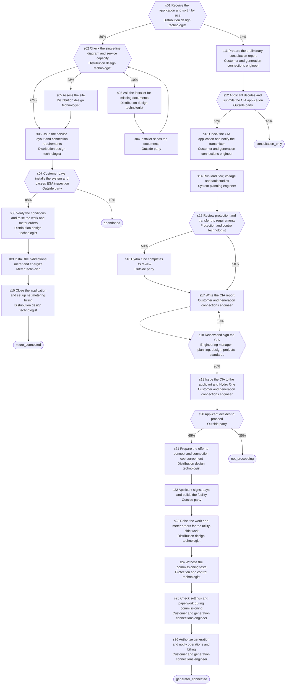

# Connect generation and storage

`edu-ae-der-connection` · electricity distribution · asset management and engineering (customer and generation connections) · part of `electric-distribution-utility`

Homeowners, businesses and developers apply to connect rooftop solar, battery storage and larger generators to the distribution system. Micro-embedded projects of 10 kW or less get a service layout from a design technologist, and once the ESA has inspected the installation and the agreement is signed a meter technician installs a bidirectional meter within five business days. Larger projects go through a preliminary consultation and a connection impact assessment by the connections engineer, planning and protection staff, sometimes with Hydro One, then an offer to connect and a witnessed commissioning. Most elapsed time is the applicant's installation and decisions; the utility's work is bounded by Distribution System Code deadlines.

| | |
|---|---|
| Unit of work | one generation application |
| Starts when | A customer, installer or developer submits a micro-embedded generation application or a preliminary consultation request for a larger generator or storage facility. |
| Done when | The generator is connected and authorized to operate, or the applicant has stopped after the layout, the preliminary consultation or the CIA. |
| Organisation | A municipally owned Ontario distributor serving about 350,000 customers that does all connection impact assessments in house, with a small connections engineering team inside distribution design. (571 employees, 2019-2022) |
| Volume | 5 cases a month (range 3 to 9) |

## Where it sits

- Starts with **der_application** from generator-applicant (100% of cases)
- Relies on **planning_study** from ae-system-planning (a standing input; it does not start a case)
- Relies on **protection_settings** from ae-protection-settings (a standing input; it does not start a case)
- Sends **connection_offer** to generator-applicant (outcome: any)
- Sends **cia_report** to generator-applicant (outcome: any)
- Sends **cia_report** to hydro-one (outcome: any)
- Sends **capital_work_order** to ops-work-scheduling (outcome: generator_connected)
- Sends **meter_order** to cs-meter-exchange (outcome: micro_connected)
- Sends **meter_order** to cs-meter-exchange (outcome: generator_connected)

## Flow

## Roles

| Role | Department | Layer | FTE on this process | Loaded cost per hour | Evidence |
|---|---|---|---:|---:|---|
| Distribution design technologist | Distribution Design and Customer Connections | individual contributor | 0.18 | 57 CAD | C |
| Customer and generation connections engineer | Distribution Design and Customer Connections | senior specialist | 0.08 | 72 CAD | C |
| System planning engineer | System Planning and Asset Management | senior specialist | 0.07 | 72 CAD | C |
| Protection and control technologist | Stations and Protection and Control | senior specialist | 0.04 | 65 CAD | C |
| Engineering manager (planning, design, projects, standards) | Asset Management and Engineering | manager | 0.01 | 100 CAD | C |
| Meter technician | Metering Services | individual contributor | 0.05 | 60 CAD | C |

## Steps

Hands-on time and the wait before each step show the most common value. Evidence tier A is a sourced number, B a sourced description, C the author's estimate.

| Step | Who | Kind | Hands-on | Wait before | Control | Evidence |
|---|---|---|---:|---:|---|---|
| **s01 Receive the application and sort it by size.** A design technologist opens the generation application that arrived by email or the service request form, checks the forms, single-line diagram, meter photos and contractor quote are attached, and sorts it: micro-embedded projects of 10 kW or less go to the service layout path, larger projects to the connections engineer for a preliminary consultation and impact assessment. | Distribution design technologist | intake | 15 min | 1.0 d |  | A [oeb-scorecard-2021] |
| **s02 Check the single-line diagram and service capacity.** The technologist checks the inverter rating and certification on the single-line diagram, the main breaker and service size from the photos, and the supplying transformer's loading and existing generation in the GIS, and decides whether a site visit is needed. | Distribution design technologist | analysis | 40 min | 4.0 d |  | B [hol-der-res], [oeb-dsc] |
| **s03 Ask the installer for missing documents.** The technologist emails the solar installer for a legible single-line diagram, inverter specification sheet or meter base photos and holds the application. | Distribution design technologist | communication | 10 min | 4.0 h |  | C |
| **s04 Installer sends the documents.** The installer sends the missing documents by email, usually after checking with the equipment supplier, and the application returns to review. | Outside party | external wait | 0 min | 7.0 d |  | C |
| **s05 Assess the site.** The technologist drives to the premise and checks the meter base, the service entrance, the location for the disconnect switch and the route of the generator wiring, and photographs the existing service. | Distribution design technologist | physical | 1.2 h | 7.0 d |  | B [hol-der-res] |
| **s06 Issue the service layout and connection requirements.** The technologist drafts the service layout for the generator: metering arrangement (bidirectional meter), disconnect location, whether the service must be isolated, connection fee, and the connection agreement to sign, and emails it to the customer and installer. | Distribution design technologist | drafting | 45 min | 2.0 d | Distribution System Code s.6.2.6: offer to connect a micro-embedded generator within 15, 30 or 60 days | B [hol-der-res], [oeb-dsc] |
| **s07 Customer pays, installs the system and passes ESA inspection.** The customer pays the connection fee, the installer mounts the panels or battery and wires the inverter, the ESA inspects and issues its authorization, and the customer signs the connection agreement. Many projects wait for equipment deliveries or incentive approvals. | Outside party | external wait | 0 min | 45.0 d |  | B [hol-der-res], [oeb-dsc] |
| **s08 Verify the conditions and raise the work and meter orders.** The technologist checks the ESA authorization and the signed agreement against the layout, confirms payment, and raises a meter order for the bidirectional meter and, when the service must be isolated, a work order for a line crew. The five-business-day connection clock starts here. | Distribution design technologist | validation | 25 min | 1.0 d | Distribution System Code s.6.2.7 and Ontario Regulation 22/04: ESA authorization, connection agreement and payment before connecting a micro-embedded generator | B [oeb-dsc], [oeb-scorecard-2021] |
| **s09 Install the bidirectional meter and energize.** A meter technician drives to the premise, removes the existing meter, installs and programs a bidirectional smart meter, closes the generator disconnect with the installer present, confirms export is registered and records the meter change. About a quarter of jobs also need a line crew to isolate the service, arranged through crew scheduling. | Meter technician | physical | 1.0 h | 3.0 d |  | B [hol-der-res], [oeb-dsc] |
| **s10 Close the application and set up net metering billing.** The technologist closes the application, confirms the meter change reached the customer system and asks billing to set up the net metering or load displacement billing arrangement. | Distribution design technologist | data entry | 15 min | 2.0 d |  | B [hol-cos-v8] |
| **s11 Prepare the preliminary consultation report.** The connections engineer reviews the preliminary consultation request for a larger project, looks up the feeder, station capacity, short-circuit levels and existing generation, and sends the applicant a report on feasibility and likely requirements. | Customer and generation connections engineer | analysis | 4.0 h | 7.0 d | Distribution System Code s.6.2.9.1: respond to a preliminary consultation within 15 days | B [hol-der-bus], [oeb-dsc] |
| **s12 Applicant decides and submits the CIA application.** The applicant decides whether to pursue the project and, if so, submits the connection impact assessment application with engineer-stamped drawings and the CIA fee. | Outside party | external wait | 0 min | 45.0 d |  | B [hol-der-bus], [hol-cos-v8] |
| **s13 Check the CIA application and notify the transmitter.** The engineer checks the application and drawings are complete, deems it complete or asks for corrections, and where the project affects the transmission connection files a request with Hydro One within 15 days. | Customer and generation connections engineer | validation | 1.5 h | 3.0 d | Distribution System Code s.6.2.14A: file with the transmitter or host distributor within 15 days | B [oeb-dsc], [hol-cos-v8] |
| **s14 Run load flow, voltage and fault studies.** A system planning engineer models the generator on the feeder and checks voltage rise, thermal loading, fault current contribution and the station's reverse power limits, and lists any line or equipment upgrades. | System planning engineer | analysis | 16.0 h | 14.0 d |  | B [oeb-dsc], [oeb-scorecard-2021] |
| **s15 Review protection and transfer trip requirements.** A protection and control technologist reviews the generator's interconnection protection, anti-islanding and the need for transfer trip or a recloser, against the utility's generation technical guideline. The work runs alongside the planning study. | Protection and control technologist | analysis | 4.0 h | 0 min |  | B [hol-cos-v8], [oeb-dsc] |
| **s16 Hydro One completes its review.** Hydro One reviews the effect of the generator on its transformer station and transmission protection and returns its comments or requirements, which the distributor cannot speed up. | Outside party | external wait | 0 min | 21.0 d |  | B [oeb-dsc] |
| **s17 Write the CIA report.** The connections engineer combines the study, protection requirements and any transmitter comments into the CIA report: feasibility, voltage and fault impacts, required upgrades, metering and protection, and an estimate range. | Customer and generation connections engineer | drafting | 8.0 h | 5.0 d |  | B [oeb-dsc] |
| **s18 Review and sign the CIA.** The engineering manager reviews the report and its assumptions and signs it as the professional engineer of record, or returns it for changes. | Engineering manager (planning, design, projects, standards) | review | 1.0 h | 3.0 d | Professional Engineers Act (Ontario): engineering reports sealed by a licensed professional engineer | C |
| **s19 Issue the CIA to the applicant and Hydro One.** The engineer sends the signed CIA to the applicant and, where involved, to Hydro One, and records the date for the on-time measure. | Customer and generation connections engineer | communication | 30 min | 1.0 d | Distribution System Code s.6.2.12-6.2.13: CIA within 60 to 105 days | A [oeb-scorecard-2021], [oeb-dsc] |
| **s20 Applicant decides to proceed.** The applicant decides within the CIA's six-month validity whether to proceed, agrees the project scope and pays for the detailed cost estimate. | Outside party | external wait | 0 min | 60.0 d |  | B [hol-der-bus], [oeb-dsc] |
| **s21 Prepare the offer to connect and connection cost agreement.** The technologist designs the utility-side work (metering, recloser or transfer trip, line upgrades) and the engineer prices it into the detailed cost estimate, offer to connect and connection cost agreement. | Distribution design technologist | drafting | 15.0 h | 21.0 d | Distribution System Code s.6.2.16 and 6.2.18: detailed cost estimate and offer within 90 days; connection cost agreement | B [oeb-dsc], [hol-cos-v8] |
| **s22 Applicant signs, pays and builds the facility.** The applicant signs the offer and agreement, pays, builds the generation or storage facility and has it inspected by the ESA; Hydro Ottawa holds a pre-construction meeting. | Outside party | external wait | 0 min | 150.0 d |  | B [hol-der-bus] |
| **s23 Raise the work and meter orders for the utility-side work.** The technologist raises the capital work order for the recloser, transfer trip or line work and the meter order for the generation metering, and releases them to crew scheduling and metering. | Distribution design technologist | data entry | 1.0 h | 3.0 d |  | C |
| **s24 Witness the commissioning tests.** A protection and control technologist drives to the site and witnesses the applicant's commissioning tests against the commissioning plan: protection trips, anti-islanding, transfer trip and metering, and signs the test record. | Protection and control technologist | physical | 5.0 h | 14.0 d | Hydro Ottawa DER commissioning guide (ECG0024): utility witness of protection and anti-islanding tests before parallel operation | B [hol-der-bus] |
| **s25 Check settings and paperwork during commissioning.** The connections engineer attends the same commissioning, checks the as-built single-line diagram and settings against the CIA and agreement, and confirms the ESA authorization and agreements are signed. | Customer and generation connections engineer | review | 4.0 h | 0 min |  | B [hol-der-bus] |
| **s26 Authorize generation and notify operations and billing.** The engineer issues the authorization to operate in parallel, tells the control room to add the generator to the operating diagram and asks billing and settlement to set up the generator account. | Customer and generation connections engineer | approval | 45 min | 1.0 d | Authorization to operate in parallel issued only after commissioning and signed agreements | C |

## Exceptions

| Exception | Share of cases | What happens |
|---|---:|---|
| Missing or unclear documents | 9% | The single-line diagram or meter photos are missing or illegible; the application waits for the installer. |
| Micro project abandoned | 10% | The customer does not install within the layout's validity or cancels. |
| Transmitter review | 4% | The generator affects the Hydro One station; the CIA waits for the transmitter's comments. |
| Larger project stops after consultation or CIA | 9% | Applicants test feasibility and stop when upgrade costs or capacity limits appear. |

## Benchmarks

| Metric | Value | Unit | Population | Evidence |
|---|---|---|---|---|
| micro_connected_within_five_business_days | 1.0 | share of micro connections, 2021 | Hydro Ottawa micro-embedded generators (52 in 2021) | A [oeb-scorecard-2021] |
| cia_on_time | 1.0 | share of CIAs within 60 to 90 days, 2021 | Hydro Ottawa CIAs (6 in 2021, 11,635.8 kW) | A [oeb-scorecard-2021] |
| cycle_time_days | p50 75, p90 200 | calendar days from application to connection or stop | Modelled utility, 2019-2022 | C [hol-der-res], [oeb-dsc] |

## Pain points

- Incomplete micro applications from installers and illegible single-line diagrams cause back-and-forth. (steps s02, s03; C)
- A few engineers do all CIA studies in house, so a cluster of larger applications competes with developer work for the same people. (steps s14, s15, s17; A [oeb-scorecard-2021])
- Transmitter reviews add weeks that the distributor does not control. (steps s16; B [oeb-dsc])
- Bidirectional meter installs must fit within five business days alongside other meter work. (steps s08, s09; B [oeb-dsc])

## Assumptions

- Micro projects are 86% of applications: 52 connections and 6 CIAs in 2021, plus preliminary consultations that never become CIAs.
- The 2019-2022 micro threshold was 10 kW (scorecard); Hydro Ottawa's current pages use 12 kW and the 2022 DER Connection Procedures, so the forms differ slightly from those in the reference period.
- Meter technicians, protection and control technologists and the engineering manager take part although the organisation file's process map lists only connections engineers, design technologists and planning engineers.
- A micro layout is recorded as a connection offer to the applicant, an object the organisation file's process map does not list as an output of this process.
- Loaded costs are the organisation file's rates (wage x 1.40). FTEs add 20% to hands-on time.
- The Distribution System Code cited is the August 2026 revision; sections 6.2.7, 6.2.12 and 6.2.13 match the 60 to 90 day and five-business-day standards reported for 2021 in the OEB scorecard.

## Sources

- [hol-cos-v8] [Hydro Ottawa Conditions of Service, ECS0012 Rev. 8 (proposed, effective December 2021)](https://hydroottawa.com/sites/default/files/2021-09/HOL-COS-V8-EN-PROPOSED-SEPT-2021.pdf) (Hydro Ottawa Limited, 2021). s.2.1: design and material prepayments, deposits before field work; s.2.1.3: offer to connect contents, economic evaluation, expansion deposit (letter of credit, cash, surety), alternative bid with qualified contractors and 2-year warranty; s.2.1.5: ESA Connection Authorization Certificate required before energizing and must match address, voltage and ampacity; duct banks inspected before concrete and before backfill with a mandrel test, pads and vaults inspected before equipment; s.2.1.7: Installation and Service Agreement for developers; s.3.1.2: subdivision site information (plan, grading, phasing, load summary); s.3.1.3: utility designates supply point and meter base location, installs up to 30 m of service conductor, inspects service entry to the meter base; s.3.4: DER Form B, CIA fee, Installation and Service Agreement with Connection Cost Agreement, Hydro One consulted on the customer's behalf; Appendix G: quotes expire after 90 days, one free customer layout per property per year, two-person line crew isolations.
- [hol-der-bus] [Business DER connection process](https://hydroottawa.com/en/business/savings-incentives/distributed-energy-resources-ders/business-der-connection-process) (Hydro Ottawa Limited, 2026). Larger DER: preliminary consultation report within 15 days; CIA application with P.Eng-stamped drawings and fee; CIA at least 60 days (simplified CIA 30 days), expires after six months; project manager assigned after intent to proceed; offer to connect signed and paid; pre-construction meeting; commissioning plan and Hydro Ottawa witness of commissioning; ESA connection authorization; CIA fees $1,000 (small) to $5,700 (large).
- [hol-der-res] [DER connection process (residential)](https://hydroottawa.com/en/residential/savings-incentives/produce-your-own-energy/der-connection-process) (Hydro Ottawa Limited, 2026). Micro-DER: application with single-line diagram, meter photos and Micro-DER form; service layout within 15 days without and 60 days with a site assessment, valid 90 days; contractor installs, ESA inspects and certifies; customer signs the micro-generation connection agreement; Hydro Ottawa does meter work (bidirectional meter) and energizes; connection fee about $500, about $1,200 when isolation is needed.
- [oeb-dsc] [Distribution System Code (last revised August 1, 2026)](https://www.oeb.ca/sites/default/files/Distribution_System_Code.pdf) (Ontario Energy Board, 2026). s.6.1.1: respond to a written connection request within 15 calendar days and make an offer to connect within 60 calendar days; s.3.2 and Appendix B: economic evaluation, capital contribution, expansion deposit, alternative bid and final economic evaluation after energization; s.6.2.6: micro-embedded offer within 15, 30 or 60 days and at least 30 days to accept; s.6.2.7: connect a micro-embedded generator within 5 business days of ESA authorization, agreement and payment (90% of the time); s.6.2.9.1: preliminary consultation response within 15 days; s.6.2.12 and 6.2.13: CIA within 60, 75, 90 or 105 days; s.6.2.14A: file with the transmitter within 15 days; s.6.2.16: detailed cost estimate and offer to connect within 90 days of payment.
- [oeb-scorecard-2021] [Scorecard - Hydro Ottawa Limited (2017-2021) and 2021 Scorecard Management Discussion and Analysis](https://www.oeb.ca/documents/scorecard/2021/Scorecard%20-%20Hydro%20Ottawa%20Limited.pdf) (Ontario Energy Board, 2022). 5,024 new residential and small business services connected in 2021, 100% within five business days of conditions being met or as scheduled with the customer (DSC s.7.2, 90% minimum); 9,001 appointments for service upgrades, meter checks and service layouts in 2021 (98.86% on time, four-hour window under DSC s.7.4); missed appointments mainly caused by emergencies and weather; 6 CIAs totalling 11,635.8 kW in 2021 all on time, timelines 60 to 90 days, all CIA work done internally; 52 micro-embedded generators (10 kW or less) connected in 2021, 100% within five business days.

Written by claude-opus on 2026-11-24.
