# Connect subdivisions and large developments

`edu-ae-developer-connections` · electricity distribution · asset management and engineering (distribution design and customer connections) · part of `electric-distribution-utility`

Developers of subdivisions, condominiums and commercial buildings over 50 kW apply to the utility for supply. The design supervisor logs the application, a connections engineer checks feeder and station capacity, a design technologist designs the layout, and the engineer runs the economic evaluation required by the Distribution System Code to set the capital contribution and issues an offer to connect and agreement. After the developer signs and pays, its contractor builds ducts, pads and vaults under utility inspection, utility crews install and energize the cable and transformers, and a final evaluation trues up the contribution. Projects take a year or more because of design queues, comment rounds with the developer and other utilities, negotiation, winter shutdowns of civil work and material lead times.

| | |
|---|---|
| Unit of work | one development project |
| Starts when | A developer, builder or key account customer applies for supply to a subdivision phase, condominium or commercial development. |
| Done when | The development is energized and the final economic evaluation has been sent, or the developer has withdrawn or let the offer lapse. |
| Organisation | A municipally owned Ontario distributor in a growing city of about one million people, with a distribution design and customer connections group of about 35 people and a capital project delivery group that schedules the crews. (571 employees, 2019-2022) |
| Volume | 25 cases a month (range 15 to 40) |

## Where it sits

- Starts with **service_request** from developer (75% of cases)
- Starts with **service_request** from key-account-customer (10% of cases)
- Starts with **key_account_request** from cs-key-accounts (15% of cases)
- Relies on **planning_study** from ae-system-planning (a standing input; it does not start a case)
- Relies on **standards** from ae-standards-maintenance (a standing input; it does not start a case)
- Relies on **tariff** from fin-annual-rate-update (a standing input; it does not start a case)
- Relies on **connection_agreement** from developer (a standing input; it does not start a case)
- Sends **connection_offer** to developer (outcome: any)
- Sends **connection_agreement** to ae-capital-project-delivery (outcome: closed)
- Sends **connection_agreement** to fin-capital-accounting (outcome: closed)

## Flow

```mermaid
flowchart TD
    s01{{"s01 Log the application and check the package<br/>Distribution design supervisor"}}
    s02["s02 Ask the developer for the missing drawings<br/>Distribution design supervisor"]
    s03["s03 Developer's consultant sends the drawings<br/>Outside party"]
    s04["s04 Brief engineering on the key account's load and dates<br/>Key account representative"]
    s05["s05 Assign the team and request the design prepayment<br/>Distribution design supervisor"]
    s06{{"s06 Developer pays the design prepayment<br/>Outside party"}}
    s07{{"s07 Check feeder and station capacity<br/>Customer and generation connections engineer"}}
    s08["s08 Study the expansion or feeder reinforcement<br/>System planning engineer"]
    s09["s09 Design the distribution layout<br/>Distribution design technologist"]
    s10["s10 Circulate the layout for comments<br/>Distribution design technologist"]
    s11{{"s11 Developer and other utilities return comments<br/>Outside party"}}
    s12["s12 Revise the layout<br/>Distribution design technologist"]
    s13["s13 Prepare the cost estimate and economic evaluation<br/>Customer and generation connections engineer"]
    s14{{"s14 Approve the offer and capital contribution<br/>Engineering manager  planning, design, projects, standards"}}
    s15["s15 Issue the offer to connect and agreement<br/>Customer and generation connections engineer"]
    s16{{"s16 Developer reviews, signs and pays<br/>Outside party"}}
    s17["s17 Answer the developer's questions and revise the offer<br/>Customer and generation connections engineer"]
    s18["s18 Record the agreement and payment and open the capital job<br/>Distribution design technologist"]
    s19["s19 Issue construction drawings and order materials<br/>Distribution design technologist"]
    s20["s20 Developer's contractor builds the civil works<br/>Outside party"]
    s21{{"s21 Inspect ducts, pads and vaults<br/>Construction inspector"}}
    s22["s22 Contractor corrects the deficiencies<br/>Outside party"]
    s23["s23 Release the job to construction and scheduling<br/>Distribution design technologist"]
    s24["s24 Follow the job through installation and energization<br/>Distribution design technologist"]
    s25["s25 Run the final economic evaluation with actual costs<br/>Customer and generation connections engineer"]
    s26["s26 Approve the final statement<br/>Engineering manager  planning, design, projects, standards"]
    s27["s27 Send the final statement and settle the deposit<br/>Customer and generation connections engineer"]
    s01 -->|"60%"| s05
    s01 -->|"15%"| s04
    s01 -->|"25%"| s02
    s02 --> s03
    s03 --> s01
    s04 --> s05
    s05 --> s06
    s06 -->|"95%"| s07
    s06 -->|"5%"| end0
    s07 -->|"80%"| s09
    s07 -->|"20%"| s08
    s08 --> s09
    s09 --> s10
    s10 --> s11
    s11 -->|"65%"| s13
    s11 -->|"35%"| s12
    s12 --> s10
    s13 --> s14
    s14 -->|"92%"| s15
    s14 -->|"8%"| s13
    s15 --> s16
    s16 -->|"72%"| s18
    s16 -->|"18%"| s17
    s16 -->|"10%"| end1
    s17 --> s16
    s18 --> s19
    s19 --> s20
    s20 --> s21
    s21 -->|"75%"| s23
    s21 -->|"25%"| s22
    s22 --> s21
    s23 --> s24
    s24 --> s25
    s25 --> s26
    s26 --> s27
    s27 --> end2
    end0(["withdrawn"])
    end1(["not_proceeding"])
    end2(["closed"])
```

## Roles

| Role | Department | Layer | FTE on this process | Loaded cost per hour | Evidence |
|---|---|---|---:|---:|---|
| Distribution design supervisor | Distribution Design and Customer Connections | supervisor | 0.4 | 78 CAD | C |
| Key account representative | Key Accounts | senior specialist | 0.1 | 65 CAD | C |
| Customer and generation connections engineer | Distribution Design and Customer Connections | senior specialist | 3.8 | 72 CAD | C |
| System planning engineer | System Planning and Asset Management | senior specialist | 0.6 | 72 CAD | C |
| Distribution design technologist | Distribution Design and Customer Connections | individual contributor | 8.9 | 57 CAD | C |
| Engineering manager (planning, design, projects, standards) | Asset Management and Engineering | manager | 0.3 | 100 CAD | C |
| Construction inspector | Capital Project Delivery | individual contributor | 1.2 | 56 CAD | B [hol-cos-v8] |

## Steps

Hands-on time and the wait before each step show the most common value. Evidence tier A is a sourced number, B a sourced description, C the author's estimate.

| Step | Who | Kind | Hands-on | Wait before | Control | Evidence |
|---|---|---|---:|---:|---|---|
| **s01 Log the application and check the package.** The distribution design supervisor logs the developer's application in the ERP and checks the package against the Conditions of Service list: plan of subdivision or site plan, grading and servicing plans, unit count and phasing, load summary, construction schedule and developer contact. Incomplete packages are returned with a list of what is missing. | Distribution design supervisor | intake | 30 min | 1.0 d | Distribution System Code s.6.1.1: respond to a written connection request within 15 calendar days and make an offer within 60 days once information is complete | B [hol-cos-v8], [oeb-dsc], [hydroone-subdivisions] |
| **s02 Ask the developer for the missing drawings.** The supervisor emails the developer's consultant a list of missing drawings or data (digital base plan in the required format, load summary, phasing) and puts the application on hold. | Distribution design supervisor | communication | 15 min | 4.0 h |  | B [hol-cos-v8] |
| **s03 Developer's consultant sends the drawings.** The developer's electrical or civil consultant prepares and sends the missing drawings and load data, often after the municipal draft plan changes. | Outside party | external wait | 0 min | 14.0 d |  | C |
| **s04 Brief engineering on the key account's load and dates.** For a large customer already managed by key accounts, the key account representative meets the connections engineer to pass on the customer's load ramp, in-service date and constraints such as critical processes or standby generation. | Key account representative | communication | 1.0 h | 1.0 d |  | C |
| **s05 Assign the team and request the design prepayment.** The supervisor assigns a connections engineer and a design technologist and sends the developer the design prepayment request, which is credited against the final contribution or refunded less costs if the developer withdraws. | Distribution design supervisor | coordination | 20 min | 1.0 d |  | B [hol-cos-v8], [th-large-dev], [alectra-2025] |
| **s06 Developer pays the design prepayment.** The developer pays the design prepayment by cheque or electronic transfer; design does not start until it is received, and some developers withdraw at this point when the project is not yet financed. | Outside party | external wait | 0 min | 10.0 d |  | C |
| **s07 Check feeder and station capacity.** The connections engineer adds the development's load to the supplying feeder and station using the load summary, planning load forecasts and SCADA peaks, and decides whether existing capacity is enough or an expansion or enhancement is needed. | Customer and generation connections engineer | analysis | 1.5 h | 5.0 d |  | C |
| **s08 Study the expansion or feeder reinforcement.** A system planning engineer runs load flow and contingency studies for the feeder or station work needed to supply the development, and sizes the expansion so its cost can enter the economic evaluation. | System planning engineer | analysis | 10.0 h | 14.0 d |  | B [hol-dsp-2026] |
| **s09 Design the distribution layout.** The design technologist designs the layout on the developer's base plan: primary cable routes, pad-mounted transformer and switchgear locations, secondary pedestals, streetlight supply and duct structures, following the subdivision and commercial standards. Large subdivisions take several weeks of drafting. | Distribution design technologist | drafting | 20.0 h | 21.0 d |  | B [hol-cos-v8], [alectra-2025] |
| **s10 Circulate the layout for comments.** The technologist sends the draft layout to the developer's consultant and the other utilities for the composite utility plan, with the trench and joint-use arrangement, and books a review meeting if needed. | Distribution design technologist | communication | 1.0 h | 1.0 d |  | B [hol-cos-v8] |
| **s11 Developer and other utilities return comments.** The developer, the municipality's engineering review and the gas and telecom utilities return comments on transformer locations, conflicts with driveways and trees, and phasing. | Outside party | external wait | 0 min | 21.0 d |  | B [hydroone-subdivisions] |
| **s12 Revise the layout.** The technologist moves transformers, re-routes cable or changes phasing to answer the comments, updates the material list and re-issues the layout for another round. | Distribution design technologist | drafting | 5.0 h | 7.0 d |  | C |
| **s13 Prepare the cost estimate and economic evaluation.** The connections engineer prices labour, materials and contracted work for the expansion, separates the work eligible for alternative bid, and runs the discounted cash flow model that sets the capital contribution and the expansion deposit. | Customer and generation connections engineer | analysis | 6.0 h | 7.0 d | Distribution System Code s.3.2 and Appendix B: economic evaluation to set the capital contribution | B [oeb-dsc], [hol-cos-v8] |
| **s14 Approve the offer and capital contribution.** The engineering manager reviews the estimate, the evaluation inputs and any non-standard terms and approves the offer under the delegation of authority, or sends it back. | Engineering manager (planning, design, projects, standards) | approval | 30 min | 4.0 d | Delegation of authority for customer offers and capital contributions | C |
| **s15 Issue the offer to connect and agreement.** The connections engineer prepares the offer to connect and the installation and service agreement from templates, states whether the offer is firm, the capital contribution, the expansion deposit, the alternative bid option and the customer's civil responsibilities, and sends it to the developer. | Customer and generation connections engineer | drafting | 1.5 h | 2.0 d | Distribution System Code s.3.2.8-3.2.9: required contents of an offer to connect | B [hol-cos-v8], [oeb-dsc] |
| **s16 Developer reviews, signs and pays.** The developer reviews the offer with its lawyer and financier, chooses whether to use its own qualified contractor for the contestable work, and returns the signed agreement with the capital contribution and a letter of credit or cash for the expansion deposit. | Outside party | external wait | 0 min | 30.0 d |  | B [hol-cos-v8] |
| **s17 Answer the developer's questions and revise the offer.** The connections engineer explains the evaluation, adjusts phasing or the alternative bid scope, and re-issues the offer when terms change. | Customer and generation connections engineer | communication | 1.5 h | 5.0 d |  | C |
| **s18 Record the agreement and payment and open the capital job.** The technologist records the signed agreement, the contribution received and the security in the ERP, opens the capital work order with the contribution recorded against it, and files the agreement in the document system for finance and capital project delivery. | Distribution design technologist | data entry | 1.0 h | 3.0 d | Capital contributions recorded against the work order for capitalization and rate base | C |
| **s19 Issue construction drawings and order materials.** The technologist finalizes the drawings issued for construction, the civil drawings for the developer's contractor and the material list, and raises requisitions for transformers and switchgear with long lead times. | Distribution design technologist | drafting | 4.0 h | 5.0 d |  | B [th-large-dev], [alectra-2025] |
| **s20 Developer's contractor builds the civil works.** The developer's contractor builds duct banks, transformer pads, vaults and secondary trenches to the utility's drawings, coordinated with roads and other utilities. Frozen ground stops most civil work from December to March. | Outside party | external wait | 0 min | 75.0 d |  | B [hol-cos-v8], [hydroone-subdivisions] |
| **s21 Inspect ducts, pads and vaults.** A construction inspector checks duct banks before the concrete pour and before backfill, witnesses the mandrel pulled through each duct, and inspects transformer pads and vault bases before equipment is set. Deficiencies are written up for the contractor. | Construction inspector | physical | 4.0 h | 2.0 d | Conditions of Service s.2.1.5: utility inspection of duct banks, pads and vaults before concrete, backfill and equipment | B [hol-cos-v8], [th-large-dev] |
| **s22 Contractor corrects the deficiencies.** The developer's contractor clears blocked ducts, re-sets a misplaced pad or fixes the vault grounding, then calls the inspector to book a re-inspection. | Outside party | external wait | 0 min | 7.0 d |  | C |
| **s23 Release the job to construction and scheduling.** The technologist assembles the construction package (drawings, inspection records, material status, outage needs) and releases the job to capital project delivery and crew scheduling for cable pulling, splicing and transformer setting. | Distribution design technologist | coordination | 1.0 h | 2.0 d |  | C |
| **s24 Follow the job through installation and energization.** While utility cable crews pull and splice cable, set transformers and energize the phase, the technologist answers crew questions, chases late materials and tells the developer the energization date. | Distribution design technologist | coordination | 2.0 h | 60.0 d |  | C |
| **s25 Run the final economic evaluation with actual costs.** Once all costs have posted to the work order, the connections engineer reruns the evaluation with actual costs and connected customers, and calculates the amount to refund or invoice and the deposit to release over the connection horizon. | Customer and generation connections engineer | analysis | 3.0 h | 90.0 d | Distribution System Code s.3.2.2 and 3.2.23: final economic evaluation and expansion deposit return | B [oeb-dsc], [hol-cos-v8] |
| **s26 Approve the final statement.** The engineering manager reviews the true-up calculation against the original offer and approves the refund, the invoice or the release of the expansion deposit. | Engineering manager (planning, design, projects, standards) | approval | 20 min | 7.0 d | Delegation of authority for customer refunds and invoices | C |
| **s27 Send the final statement and settle the deposit.** The connections engineer sends the developer the final statement, arranges the refund or invoice through finance, and reduces or releases the letter of credit or cash deposit as customers connect. | Customer and generation connections engineer | communication | 1.0 h | 3.0 d |  | B [hol-cos-v8], [oeb-dsc] |

## Exceptions

| Exception | Share of cases | What happens |
|---|---:|---|
| Incomplete application | 25% | Drawings, load summary or phasing missing; the application waits for the consultant. |
| Feeder or station expansion needed | 19% | The load exceeds feeder or station capacity; a planning study sizes an expansion whose cost enters the evaluation. |
| Layout revisions after comments | 35% | The developer or other utilities ask for transformer moves or phasing changes. |
| Offer negotiated | 18% | The developer questions the contribution or changes the alternative bid scope; the offer is re-issued. |
| Civil deficiencies | 22% | Blocked ducts, misplaced pads or grounding faults found at inspection. |

## Benchmarks

| Metric | Value | Unit | Population | Evidence |
|---|---|---|---|---|
| response_to_request_days | 15 | calendar days (maximum) | Ontario distributors | A [oeb-dsc] |
| offer_to_connect_days | 60 | calendar days after complete information (maximum) | Ontario distributors | A [oeb-dsc] |
| design_and_offer_weeks | 25 | weeks from prepayment and complete information to offer | Alectra Utilities, a large Ontario peer, 2025 | A [alectra-2025] |
| cycle_time_days | p50 420, p90 640 | calendar days from application to final statement (projects that proceed) | Modelled utility, 2019-2022 | C [th-large-dev] |

## Pain points

- Design queues and comment rounds with the developer, the city and other utilities stretch the time to an offer. (steps s09, s10, s11, s12; B [alectra-2025])
- Economic evaluations are built in spreadsheets and re-checked by the manager; errors in revenue horizons or unit costs send offers back. (steps s13, s14; C)
- Civil work by the developer's contractor fails inspection or stops for winter, holding up cable crews. (steps s20, s21, s22; B [hol-cos-v8])
- Final evaluations wait months for costs to post, so contributions and deposits stay open long after energization. (steps s25; C)

## Assumptions

- Utility cable crews' installation and energization are in ops-underground-construction and ae-capital-project-delivery; this file keeps the technologist's follow-up during that period so the case runs to the final evaluation.
- The organisation file lists the developer's signed agreement as a trigger; here it arrives in the middle of the case and is shown as an input, with the developer's application as the trigger.
- Planning engineers and construction inspectors take part although the organisation file's process map does not list them for this process.
- The Alectra 25-week figure is from 2025, when transformer lead times were 26 to 52 weeks; 2019-2022 design queues are assumed shorter (about 3 to 6 months to the offer).
- Loaded costs are the organisation file's rates (wage x 1.40). FTEs add 20% to hands-on time, and 50% for supervisors, managers and key account representatives.

## Sources

- [alectra-2025] [Alectra Utilities conditional approval letter, OZ OPA 25-7 W3 (October 2025)](https://www.mississauga.ca/wp-content/uploads/2025/11/10134025/Alectra-Conditional-Approval-Letter-OZ-OPA-25-7-W3-October-2025.pdf) (City of Mississauga (Alectra Utilities letter), 2025). Design prepayment of $11,300 before design; P.Eng-stamped drawings required; 25 weeks or longer to prepare the design and offer to connect after prepayment and complete information; pad-mounted transformer lead time 26 to 52 weeks; offer to connect signed and paid before construction.
- [hol-cos-v8] [Hydro Ottawa Conditions of Service, ECS0012 Rev. 8 (proposed, effective December 2021)](https://hydroottawa.com/sites/default/files/2021-09/HOL-COS-V8-EN-PROPOSED-SEPT-2021.pdf) (Hydro Ottawa Limited, 2021). s.2.1: design and material prepayments, deposits before field work; s.2.1.3: offer to connect contents, economic evaluation, expansion deposit (letter of credit, cash, surety), alternative bid with qualified contractors and 2-year warranty; s.2.1.5: ESA Connection Authorization Certificate required before energizing and must match address, voltage and ampacity; duct banks inspected before concrete and before backfill with a mandrel test, pads and vaults inspected before equipment; s.2.1.7: Installation and Service Agreement for developers; s.3.1.2: subdivision site information (plan, grading, phasing, load summary); s.3.1.3: utility designates supply point and meter base location, installs up to 30 m of service conductor, inspects service entry to the meter base; s.3.4: DER Form B, CIA fee, Installation and Service Agreement with Connection Cost Agreement, Hydro One consulted on the customer's behalf; Appendix G: quotes expire after 90 days, one free customer layout per property per year, two-person line crew isolations.
- [hol-dsp-2026] [Distribution System Plan Overview, 2026-2030 Custom IR (EB-2024-0115), Exhibit 2-5-1](https://static.hydroottawa.com/documents/corporate/regulatory-affairs/2025/Distribution%20System%20Plan%20Overview.pdf) (Hydro Ottawa Limited, 2025). Residential customer connection volumes averaged 6,067 a year in 2021-2023 against a budgeted 3,190; 2021-2025 System Access spending of $293M including $157M customer connections, $89M system expansion and $1M generation connections, with $158M of capital contributions; customer connections cover subdivisions, commercial developments and infill.
- [hydroone-subdivisions] [Subdivisions (builders and contractors)](https://www.hydroone.com/business-services/builders-and-contractors/subdivisions) (Hydro One Networks Inc., 2026). Subdivision process: complete project information, response within 15 days, design costs paid before preliminary design, developer approves design drawing, final cost estimate and legal agreement, contestable work option, materials ordered and work scheduled; developer does civil work and trenching; timelines vary with queue and scope.
- [oeb-dsc] [Distribution System Code (last revised August 1, 2026)](https://www.oeb.ca/sites/default/files/Distribution_System_Code.pdf) (Ontario Energy Board, 2026). s.6.1.1: respond to a written connection request within 15 calendar days and make an offer to connect within 60 calendar days; s.3.2 and Appendix B: economic evaluation, capital contribution, expansion deposit, alternative bid and final economic evaluation after energization; s.6.2.6: micro-embedded offer within 15, 30 or 60 days and at least 30 days to accept; s.6.2.7: connect a micro-embedded generator within 5 business days of ESA authorization, agreement and payment (90% of the time); s.6.2.9.1: preliminary consultation response within 15 days; s.6.2.12 and 6.2.13: CIA within 60, 75, 90 or 105 days; s.6.2.14A: file with the transmitter within 15 days; s.6.2.16: detailed cost estimate and offer to connect within 90 days of payment.
- [th-large-dev] [How to Power Up Your Medium or Large Development (as of January 1, 2025)](https://torontohydro.com/documents/d/guest/how-to-power-up-your-medium-or-large-development-as-of-january-1-2025) (Toronto Hydro-Electric System Limited, 2025). Ten sequential steps: service request, review within five to ten business days, design prepayment, job quote or offer to connect, signed agreement with payment, detailed design, permits and materials, customer civil work, civil inspection with two business days notice before concrete is poured, ESA inspection, final inspection, connection within five (750 V or less) or ten business days; connections take a few weeks to several months.

Written by claude-opus on 2026-11-24.
