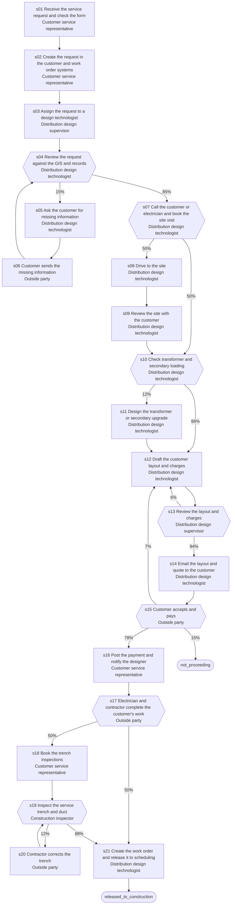

# Lay out residential and small business services

`edu-ae-service-layouts` · electricity distribution · asset management and engineering (distribution design) · part of `electric-distribution-utility`

A homeowner, small business or their electrician asks the utility for a new, upgraded or relocated service of 50 kW or less. The service desk logs the request, a design technologist checks the supply transformer and secondary in the GIS, visits the site when needed, and issues a customer layout showing the supply point, meter location and charges. Once the customer pays and the electrician and trench contractor have finished, the trench is inspected and the technologist releases a work order to crew scheduling. Most of the elapsed time is waiting for the customer to decide and for the electrician's work; the utility's own delays are design queues in the spring and summer, missing information and failed trench inspections.

| | |
|---|---|
| Unit of work | one service request |
| Starts when | A customer, electrician or the contact centre submits an electrical service request for a new, upgraded or relocated low-voltage service. |
| Done when | A paid layout has a construction work order released to work planning, or the customer has dropped the project or let the quote expire. |
| Organisation | A municipally owned Ontario distributor serving about 350,000 customers, with a central service desk, about 26 design technologists, GIS, an ERP for work orders and a customer information system. (571 employees, 2019-2022) |
| Volume | 450 cases a month (range 330 to 600) |

## Where it sits

- Starts with **service_request** from residential-customer (35% of cases)
- Starts with **service_request** from customer-electrician (40% of cases)
- Starts with **service_request** from business-customer (10% of cases)
- Starts with **service_request** from cs-contact-centre (15% of cases)
- Relies on **standards** from ae-standards-maintenance (a standing input; it does not start a case)
- Relies on **asset_register** from ae-records-gis (a standing input; it does not start a case)
- Relies on **tariff** from fin-annual-rate-update (a standing input; it does not start a case)
- Sends **connection_offer** to residential-customer (outcome: any)
- Sends **connection_offer** to business-customer (outcome: any)
- Sends **capital_work_order** to ops-work-scheduling (outcome: released_to_construction)

## Flow

## Roles

| Role | Department | Layer | FTE on this process | Loaded cost per hour | Evidence |
|---|---|---|---:|---:|---|
| Customer service representative | Customer Contact Centre | individual contributor | 2.6 | 42 CAD | C |
| Distribution design technologist | Distribution Design and Customer Connections | individual contributor | 13.1 | 57 CAD | C |
| Distribution design supervisor | Distribution Design and Customer Connections | supervisor | 1.6 | 78 CAD | C |
| Construction inspector | Capital Project Delivery | individual contributor | 2.9 | 56 CAD | B [hol-trench] |

## Steps

Hands-on time and the wait before each step show the most common value. Evidence tier A is a sourced number, B a sourced description, C the author's estimate.

| Step | Who | Kind | Hands-on | Wait before | Control | Evidence |
|---|---|---|---:|---:|---|---|
| **s01 Receive the service request and check the form.** A customer service representative on the service desk opens the electrical service request that arrived through the web form or by email, and checks that it has the civic address, the service size, the electrician's details, the requested date and, for a new or relocated service, a site plan. Requests for more than 50 kW or five or more units are sent to the distribution design team instead. | Customer service representative | intake | 10 min | 8.0 h |  | B [hol-service-requests], [hol-dsd] |
| **s02 Create the request in the customer and work order systems.** The representative finds the premise and account in the customer system, opens a design work request in the ERP with the premise number, and files the form and site plan in the document system so the designer sees one record. The same address and contact details are typed into both systems. | Customer service representative | data entry | 12 min | 1.0 h |  | C |
| **s03 Assign the request to a design technologist.** The distribution design supervisor goes through new requests once a day, groups them by area and assigns each to the design technologist who covers that part of the city or rural area. | Distribution design supervisor | coordination | 4 min | 1.0 d |  | C |
| **s04 Review the request against the GIS and records.** The technologist opens the GIS to find the supply transformer or pole, the secondary bus and the existing service, checks the service history in the customer system and the request details, and decides whether a site visit is needed. Missing site plans or service sizes go back to the customer. | Distribution design technologist | analysis | 20 min | 5.0 d |  | B [hol-service-requests], [oeb-dsc] |
| **s05 Ask the customer for missing information.** The technologist emails or phones the customer or electrician for the missing site plan, service size or load summary and puts the request on hold. | Distribution design technologist | communication | 10 min | 2.0 h |  | C |
| **s06 Customer sends the missing information.** The customer or electrician sends the site plan, load summary or corrected service size by email, and the request goes back into the technologist's review queue. | Outside party | external wait | 0 min | 5.0 d |  | C |
| **s07 Call the customer or electrician and book the site visit.** The technologist phones the customer or electrician to confirm what they want, explain the process and, when a visit is needed, book it within a four-hour window. | Distribution design technologist | communication | 15 min | 1.0 d | Distribution System Code s.6.1.1 (respond to a connection request within 15 calendar days) and s.7.3-7.4 (four-hour appointment window) | B [hol-service-requests], [oeb-scorecard-2021] |
| **s08 Drive to the site.** The technologist drives a utility light vehicle to the address, often combining two or three visits in one area on the same day. | Distribution design technologist | travel | 25 min | 4.0 d |  | C |
| **s09 Review the site with the customer.** On site the technologist confirms the supply point and route, marks the meter base location, checks clearances to buildings, pools and trees, measures the service length and photographs the existing service and transformer. | Distribution design technologist | physical | 30 min | 0 min |  | B [hol-cos-v8], [hol-service-requests] |
| **s10 Check transformer and secondary loading.** The technologist adds the new or upgraded load to the transformer's connected customers using smart meter peaks and the load summary, and checks voltage drop on the secondary. An overloaded transformer or long secondary means an upgrade must be designed first. | Distribution design technologist | analysis | 15 min | 4.0 h |  | B [hol-service-requests] |
| **s11 Design the transformer or secondary upgrade.** The technologist designs the larger transformer or new secondary run, prepares a material list and checks whether the work needs an outage or a pole. Materials with long lead times are flagged so the customer is warned. | Distribution design technologist | drafting | 2.0 h | 3.0 d |  | B [hol-cos-v8], [hol-service-requests] |
| **s12 Draft the customer layout and charges.** The technologist draws the layout sketch (supply point, meter base location, conductor size and route, trench specification for underground) and lists the customer's responsibilities and the charges from the standard fee tables, such as the shared transformer cost and service wire beyond 30 m. | Distribution design technologist | drafting | 35 min | 1.0 d |  | B [hol-cos-v8] |
| **s13 Review the layout and charges.** The design supervisor checks the layout and the charges, focusing on non-standard services, upgrades and quotes above the standard fees, and signs it off or sends it back. | Distribution design supervisor | review | 10 min | 1.0 d | Design checking: supervisor review of customer layouts and quoted charges | C |
| **s14 Email the layout and quote to the customer.** The technologist emails the layout and quote to the customer and electrician with the validity date and the next steps: pay the fees, have the electrician take out the ESA permit, build the trench if underground, then call the service desk. | Distribution design technologist | communication | 10 min | 4.0 h |  | B [hol-service-requests], [hol-trench] |
| **s15 Customer accepts and pays.** The customer decides whether to go ahead and pays the layout charges by phone, online or cheque. Quotes expire after 90 days. Some customers ask for a change, such as a different meter location, and some drop the project. | Outside party | external wait | 0 min | 10.0 d |  | B [hol-cos-v8] |
| **s16 Post the payment and notify the designer.** The representative records the payment against the request in the customer system and the ERP and emails the technologist that the job can proceed. | Customer service representative | data entry | 8 min | 1.0 d |  | C |
| **s17 Electrician and contractor complete the customer's work.** The electrician takes out the ESA permit and installs the meter base, panel and mast, and for an underground service the customer's contractor gets locates and digs the trench with duct and rope to the utility's specification. This waiting time is the longest part of the process. | Outside party | external wait | 0 min | 21.0 d |  | B [hol-trench], [esa-service-inspection] |
| **s18 Book the trench inspections.** The contractor calls the service desk, and the representative books the first trench inspection (duct in place, before sand backfill) and later the second, in the construction inspectors' calendar. | Customer service representative | coordination | 8 min | 4.0 h |  | B [hol-trench] |
| **s19 Inspect the service trench and duct.** A construction inspector visits twice: first to check depth, width, duct size, rope and meter base conduit before the sand backfill, then after backfill. A failed inspection is written up and the contractor fixes it. | Construction inspector | physical | 1.3 h | 2.0 d | Conditions of Service s.2.1.5 and trench specification UDS0003: utility inspection of service ducts before and after backfill | B [hol-trench], [hol-cos-v8] |
| **s20 Contractor corrects the trench.** The contractor deepens the trench, replaces crushed duct or adds the missing rope, then calls the service desk again to book a re-inspection. | Outside party | external wait | 0 min | 3.0 d |  | C |
| **s21 Create the work order and release it to scheduling.** The technologist builds the construction work order in the ERP with the material list (service wire, connectors, meter), attaches the layout sketch and inspection results, and releases it to work planning so the connection can be booked once the ESA authorization arrives. | Distribution design technologist | data entry | 20 min | 1.0 d |  | C |

## Exceptions

| Exception | Share of cases | What happens |
|---|---:|---|
| Missing information | 15% | No site plan, service size or load summary; the request waits for the customer. |
| Transformer or secondary upgrade needed | 12% | The added load overloads the transformer or the secondary; an upgrade is designed and the customer is warned of material lead times. |
| Customer does not proceed | 15% | The customer drops the project or lets the 90-day quote expire. |
| Revised layout | 7% | The customer asks for a different meter location or service size after seeing the quote. |
| Failed trench inspection | 6% | Trench too shallow, duct crushed or rope missing; the contractor fixes it and calls for a re-inspection. |

## Benchmarks

| Metric | Value | Unit | Population | Evidence |
|---|---|---|---|---|
| first_contact_business_days | 10 | business days from request to first call | Hydro Ottawa residential service requests (current published target) | B [hol-service-requests] |
| lead_time_to_layout_days | p50 18, p90 35 | calendar days from request to layout emailed | Modelled utility, 2019-2022 | B [hol-service-requests], [oeb-dsc] |
| cycle_time_days | p50 60, p90 140 | calendar days from request to work order released (cases that proceed) | Modelled utility, 2019-2022 | C |

## Pain points

- The same request is typed into the customer system and the ERP, and the designer re-reads the form and site plan from the document system. (steps s02, s04; C)
- Design queues build in spring and summer, so the first call and layout slip toward the 10-business-day and 15-day limits. (steps s04, s07, s12; B [hol-service-requests], [oeb-dsc])
- Site visits take a technologist out for one to two hours per request, often only to confirm a meter location. (steps s08, s09; C)
- Trench inspections need two visits and fail when contractors do not follow the specification. (steps s19, s20; B [hol-trench])

## Assumptions

- The process ends when the work order is released to work planning; booking the crew, the ESA authorization and the connection are in ops-service-connection-work.
- Construction inspectors do the service trench inspections; the organisation file's process map lists only design technologists, supervisors and representatives for this process.
- About half of the layouts are underground services that need trench inspections; overhead services and upgrades without a trench go straight to the work order.
- The 10-business-day first-contact target and the 15-day and 60-day layout times come from Hydro Ottawa's current web pages and the 2026 Distribution System Code; the same sections (6.1.1, 7.3, 7.4) applied in 2019-2022.
- Loaded costs are the organisation file's rates (wage x 1.40). FTEs add 15% to hands-on time for calls and revisions not tied to a step.

## Sources

- [esa-service-inspection] [What is a service connection inspection?](https://esasafe.com/notifications-and-inspections/what-is-a-service-connection-inspection/) (Electrical Safety Authority, 2026). Service inspection after customer-owned service equipment is installed and before it is covered; ESA then authorizes the utility to energize; authorization valid up to six months; each project needs a service layout from the utility.
- [hol-cos-v8] [Hydro Ottawa Conditions of Service, ECS0012 Rev. 8 (proposed, effective December 2021)](https://hydroottawa.com/sites/default/files/2021-09/HOL-COS-V8-EN-PROPOSED-SEPT-2021.pdf) (Hydro Ottawa Limited, 2021). s.2.1: design and material prepayments, deposits before field work; s.2.1.3: offer to connect contents, economic evaluation, expansion deposit (letter of credit, cash, surety), alternative bid with qualified contractors and 2-year warranty; s.2.1.5: ESA Connection Authorization Certificate required before energizing and must match address, voltage and ampacity; duct banks inspected before concrete and before backfill with a mandrel test, pads and vaults inspected before equipment; s.2.1.7: Installation and Service Agreement for developers; s.3.1.2: subdivision site information (plan, grading, phasing, load summary); s.3.1.3: utility designates supply point and meter base location, installs up to 30 m of service conductor, inspects service entry to the meter base; s.3.4: DER Form B, CIA fee, Installation and Service Agreement with Connection Cost Agreement, Hydro One consulted on the customer's behalf; Appendix G: quotes expire after 90 days, one free customer layout per property per year, two-person line crew isolations.
- [hol-dsd] [Distribution system design](https://hydroottawa.com/accounts-services/accounts/contractors-developers/distribution-system-design) (Hydro Ottawa Limited, 2026). Distribution design handles commercial services over 50 kW, residential projects of five or more units and underground subdivisions; customer layouts cover infill of 50 kW or less; design and project management offered; designs must meet the Conditions of Service and OEB rules.
- [hol-service-requests] [Electrical service requests](https://hydroottawa.com/en/residential/services/electrical-service-requests) (Hydro Ottawa Limited, 2026). Submit the service request form three to four weeks before the project; Hydro Ottawa calls within 10 business days; customer layout by email with initial site review and service loading assessment; customer pays the layout fees and then calls the Service Desk to schedule; extra charges if the site is not ready when the crew arrives; some projects take longer when equipment must be ordered.
- [hol-trench] [Contractors - Underground service trenches](https://hydroottawa.com/accounts-services/accounts/contractors-developers/underground-service-trench) (Hydro Ottawa Limited, 2026). Sequence for an underground service: customer layout, locate, trench, duct and rope, meter base, first inspection booked through the Service Desk, backfill with sand, second inspection, final backfill, ESA connection permit, then call the Service Desk to schedule the connection.
- [oeb-dsc] [Distribution System Code (last revised August 1, 2026)](https://www.oeb.ca/sites/default/files/Distribution_System_Code.pdf) (Ontario Energy Board, 2026). s.6.1.1: respond to a written connection request within 15 calendar days and make an offer to connect within 60 calendar days; s.3.2 and Appendix B: economic evaluation, capital contribution, expansion deposit, alternative bid and final economic evaluation after energization; s.6.2.6: micro-embedded offer within 15, 30 or 60 days and at least 30 days to accept; s.6.2.7: connect a micro-embedded generator within 5 business days of ESA authorization, agreement and payment (90% of the time); s.6.2.9.1: preliminary consultation response within 15 days; s.6.2.12 and 6.2.13: CIA within 60, 75, 90 or 105 days; s.6.2.14A: file with the transmitter within 15 days; s.6.2.16: detailed cost estimate and offer to connect within 90 days of payment.
- [oeb-scorecard-2021] [Scorecard - Hydro Ottawa Limited (2017-2021) and 2021 Scorecard Management Discussion and Analysis](https://www.oeb.ca/documents/scorecard/2021/Scorecard%20-%20Hydro%20Ottawa%20Limited.pdf) (Ontario Energy Board, 2022). 5,024 new residential and small business services connected in 2021, 100% within five business days of conditions being met or as scheduled with the customer (DSC s.7.2, 90% minimum); 9,001 appointments for service upgrades, meter checks and service layouts in 2021 (98.86% on time, four-hour window under DSC s.7.4); missed appointments mainly caused by emergencies and weather; 6 CIAs totalling 11,635.8 kW in 2021 all on time, timelines 60 to 90 days, all CIA work done internally; 52 micro-embedded generators (10 kW or less) connected in 2021, 100% within five business days.

Written by claude-opus on 2026-11-24.
