# Forecast load and plan station and feeder capacity

`edu-ae-system-planning` · electric power distribution · asset management and engineering · part of `electric-distribution-utility`

Planning engineers check whether stations and feeders will have enough capacity for the load coming from new subdivisions, intensification, large customers and electrification, and recommend feeder extensions, load transfers, station upgrades or new stations when they will not. A study starts from measured peaks in SCADA, adds the development pipeline and produces a 10- to 20-year station and feeder forecast, then tests it against planning ratings in a power-flow model built from GIS. Studies that touch transformer station capacity go into regional planning with the transmitter and the IESO, which can take more than a year. The work is slow because development timing is uncertain, the network model needs GIS corrections before it runs, and transmission-level answers depend on outside parties.

| | |
|---|---|
| Unit of work | one planning study (area, station, feeder or regional planning input) |
| Starts when | A development or connection application exceeds known capacity, the annual forecast refresh is due, reliability or the transmitter's Needs Assessment flags a need, or the IESO asks for station forecasts. |
| Done when | The study is approved and its recommendations are entered in the capital planning list and shared with connections, design and regional planning partners, or the study finds no need and capacity information is updated. |
| Organisation | A city-owned Ontario local distribution company serving about 346,000 customers with about 570 staff and an 80-person asset management and engineering division, modelled mainly on Hydro Ottawa. (571 employees, 2019-2022) |
| Volume | 5 cases a month (range 3 to 8) |

## Where it sits

- Starts with **service_request** from ae-developer-connections (30% of cases)
- Starts with **capital_plan** from ae-capital-plan (25% of cases)
- Starts with **reliability_report** from ae-reliability-analysis (10% of cases)
- Starts with **der_application** from ae-der-connection (10% of cases)
- Starts with **planning_study** from hydro-one (15% of cases)
- Starts with **planning_study** from ieso (10% of cases)
- Relies on **asset_register** from ae-records-gis (a standing input; it does not start a case)
- Relies on **interruption_data** from ops-system-monitoring (a standing input; it does not start a case)
- Relies on **relocation_request** from city (a standing input; it does not start a case)
- Sends **planning_study** to ae-capital-plan (outcome: recommendations_issued)
- Sends **planning_study** to ae-developer-connections (outcome: recommendations_issued)
- Sends **planning_study** to ae-der-connection (outcome: recommendations_issued)
- Sends **planning_study** to ieso (outcome: recommendations_issued)
- Sends **planning_study** to hydro-one (outcome: recommendations_issued)
- Sends **planning_study** to ae-developer-connections (outcome: no_need_found)
- Sends **planning_study** to ae-capital-plan (outcome: no_need_found)

## Flow

```mermaid
flowchart TD
    s01["s01 Log and assign the study request<br/>Engineering manager  planning, design, projects, standards"]
    s02["s02 Scope the study<br/>System planning engineer"]
    s03["s03 Extract historical peak loads<br/>System planning engineer"]
    s04["s04 Weather-correct and unbundle peaks<br/>System planning engineer"]
    s05["s05 Collect the development pipeline<br/>System planning engineer"]
    s06["s06 City and developers return load information<br/>Outside party"]
    s07["s07 Build the station and feeder load forecast<br/>System planning engineer"]
    s08{{"s08 Export and check the network model<br/>System planning engineer"}}
    s09["s09 GIS technician corrects network data<br/>GIS and records technician"]
    s10["s10 Run load flow and contingency analysis<br/>System planning engineer"]
    s11{{"s11 Decide whether a need exists<br/>System planning engineer"}}
    s12["s12 Confirm available capacity to the requester<br/>System planning engineer"]
    s13["s13 Develop and screen options<br/>System planning engineer"]
    s14["s14 Check operability with the control room<br/>Switching and outage planner"]
    s15["s15 Estimate option costs<br/>Distribution design technologist"]
    s16{{"s16 Recommend the preferred option<br/>System planning engineer"}}
    s17["s17 Raise the need in regional planning<br/>Engineering manager  planning, design, projects, standards"]
    s18["s18 Transmitter and IESO assess the need<br/>Outside party"]
    s19{{"s19 Peer review of the study<br/>System planning engineer"}}
    s20{{"s20 Manager approves the study<br/>Engineering manager  planning, design, projects, standards"}}
    s21["s21 Enter recommended projects in the capital planning list<br/>System planning engineer"]
    s22["s22 Publish the study and update capacity information<br/>System planning engineer"]
    s01 --> s02
    s02 --> s03
    s03 --> s04
    s04 --> s05
    s05 --> s06
    s06 --> s07
    s07 --> s08
    s08 -->|"70%"| s10
    s08 -->|"30%"| s09
    s09 --> s10
    s10 --> s11
    s11 -->|"60%"| s13
    s11 -->|"40%"| s12
    s12 --> end0
    s13 --> s14
    s14 --> s15
    s15 --> s16
    s16 -->|"80%"| s19
    s16 -->|"20%"| s17
    s17 --> s18
    s18 --> s19
    s19 -->|"85%"| s20
    s19 -->|"15%"| s07
    s20 -->|"90%"| s21
    s20 -->|"10%"| s13
    s21 --> s22
    s22 --> end1
    end0(["no_need_found"])
    end1(["recommendations_issued"])
```

## Roles

| Role | Department | Layer | FTE on this process | Loaded cost per hour | Evidence |
|---|---|---|---:|---:|---|
| System planning engineer | System Planning and Asset Management | senior specialist | 3 | 72 CAD | C |
| Engineering manager (planning, design, projects, standards) | Asset Management and Engineering | manager | 0.15 | 100 CAD | C |
| GIS and records technician | Standards and Records | individual contributor | 0.15 | 50 CAD | C |
| Switching and outage planner | System Control Centre | senior specialist | 0.05 | 70 CAD | C |
| Distribution design technologist | Distribution Design and Customer Connections | individual contributor | 0.15 | 57 CAD | C |

## Steps

Hands-on time and the wait before each step show the most common value. Evidence tier A is a sourced number, B a sourced description, C the author's estimate.

| Step | Who | Kind | Hands-on | Wait before | Control | Evidence |
|---|---|---|---:|---:|---|---|
| **s01 Log and assign the study request.** The planning manager reads the request (a developer's load letter passed on by connections, the annual forecast refresh, a Needs Assessment data request or a reliability concern), opens a study entry in the tracking sheet, sets a due date and assigns a planning engineer. | Engineering manager (planning, design, projects, standards) | intake | 30 min | 1.0 d |  | C |
| **s02 Scope the study.** The planning engineer defines the area, stations and feeders in scope, the horizon (10 years for distribution, 20 years for regional planning), the criteria to apply (planning ratings, N-1 for stations) and the questions the requester needs answered, and confirms scope with the requester by email. | System planning engineer | drafting | 3.0 h | 5.0 d |  | B [ieso_irrp] |
| **s03 Extract historical peak loads.** The engineer pulls hourly or 15-minute station transformer and feeder head loads from SCADA history for the last five summers and winters, removes days with abnormal switching or outages, and records the seasonal peaks per station and feeder. | System planning engineer | lookup | 5.0 h | 1.0 d |  | B [ieso_irrp] |
| **s04 Weather-correct and unbundle peaks.** Using the IESO's method, the engineer adjusts each station peak to median weather and adds back output from embedded generation and past conservation savings so the forecast starts from gross customer demand rather than metered net load. | System planning engineer | analysis | 4.0 h | 0 min |  | A [ieso_irrp] |
| **s05 Collect the development pipeline.** The engineer asks connections, key accounts and the City's planning department for subdivision phases, site plans, large customer requests and electrification projects in the area, with expected load and year. Answers come back over a few weeks and often disagree on timing. | System planning engineer | communication | 3.0 h | 1.0 d |  | A [ieso_irrp] |
| **s06 City and developers return load information.** City planners, developers and key account customers send phasing plans, load letters and site plans. Some never reply and the engineer applies typical loads per unit instead. | Outside party | external wait | 0 min | 7.0 d |  | C |
| **s07 Build the station and feeder load forecast.** In the forecast workbook the engineer adds development loads by year to each feeder and station, applies diversity, electrification and conservation assumptions, and produces a median-weather and an extreme-weather forecast for each station over the horizon. | System planning engineer | analysis | 10.0 h | 1.0 d |  | A [ieso_irrp] |
| **s08 Export and check the network model.** The engineer exports the feeder network from GIS into the power-flow tool, updates normal open points, conductor sizes and recent projects, and runs a base case to find connectivity and data errors before analysis. | System planning engineer | data entry | 5.0 h | 1.0 d |  | C |
| **s09 GIS technician corrects network data.** A GIS technician checks the flagged segments against as-built drawings, fixes phasing, conductor and switch status errors in GIS and tells the engineer when the corrected model can be re-exported. | GIS and records technician | data entry | 3.0 h | 3.0 d |  | C |
| **s10 Run load flow and contingency analysis.** The engineer loads the forecast into the model year by year and checks feeder loading against planning ratings, voltage, and station transformer loading with one unit out. He lists each year a station or feeder exceeds planning capacity. | System planning engineer | analysis | 8.0 h | 1.0 d |  | B [ho_exec], [ho_cir2022] |
| **s11 Decide whether a need exists.** The engineer judges whether the violations are real and timely enough to act on, allowing for forecast uncertainty and existing ties. If not, he writes a short note confirming available capacity for the requester. | System planning engineer | judgment | 2.0 h | 0 min |  | C |
| **s12 Confirm available capacity to the requester.** When no need is found the engineer files the short study note, updates the capacity table and tells connections or the requester the load can be supplied from existing feeders, with any switching or timing conditions. | System planning engineer | communication | 45 min | 12.0 h |  | C |
| **s13 Develop and screen options.** The engineer lays out options: permanent load transfers between feeders, new feeder egress, voltage conversion, adding a transformer or a new municipal station, and non-wires options such as storage or demand response. Each option is screened for capacity gained, timing and constraints such as duct space and station land. | System planning engineer | analysis | 10.0 h | 2.0 d |  | B [ieso_irrp], [ho_capex] |
| **s14 Check operability with the control room.** A switching and outage planner reviews proposed transfers and new ties, confirms the switching is workable and flags feeders that cannot be paralleled or that are already used for contingency transfers. | Switching and outage planner | review | 1.0 h | 3.0 d |  | C |
| **s15 Estimate option costs.** A design technologist prices the feeder, civil and station options from unit costs and recent jobs, including duct banks and road restoration, and returns class 4 estimates. | Distribution design technologist | analysis | 5.0 h | 5.0 d |  | C |
| **s16 Recommend the preferred option.** The engineer compares options on cost, capacity gained, timing and reliability, recommends one with an in-service year and decides whether the need reaches the transformer station or transmission supply, which requires the transmitter and IESO. | System planning engineer | analysis | 5.0 h | 1.0 d |  | C |
| **s17 Raise the need in regional planning.** The planning manager takes the station forecast and need to the regional planning working group with the transmitter and IESO, submits the 20-year station forecasts they request and joins meetings on Needs Assessment, Scoping and IRRP options. | Engineering manager (planning, design, projects, standards) | communication | 4.0 h | 5.0 d | OEB Transmission System Code and Distribution System Code regional planning obligations; OEB Chapter 5 section 5.2.2 | A [ieso_irrp], [oeb_ch5] |
| **s18 Transmitter and IESO assess the need.** The transmitter and IESO assess the station need within the regional plan and confirm whether the transmitter will expand its station, a new municipal station is needed, or a non-wires solution is preferred. The Ottawa cycle took about 21 months from Needs Assessment to IRRP. | Outside party | external wait | 0 min | 90.0 d |  | A [ieso_irrp] |
| **s19 Peer review of the study.** A senior planning engineer reviews the forecast workbook, model results and recommendation, checks assumptions against other studies in the area, and returns comments or sign-off. | System planning engineer | review | 3.0 h | 3.0 d | Engineering quality procedure: independent check of planning studies by a professional engineer | C |
| **s20 Manager approves the study.** The planning manager reads the summary and recommendation, checks fit with the capital plan and regional plan, and approves the study or asks for other options. | Engineering manager (planning, design, projects, standards) | approval | 1.0 h | 3.0 d | Asset management procedure: manager approval of planning recommendations | C |
| **s21 Enter recommended projects in the capital planning list.** The engineer creates candidate projects in the investment planning tool with scope, estimate, need year and the capacity risk if deferred, ready for the annual capital plan. | System planning engineer | data entry | 1.0 h | 1.0 d |  | A [ho_irr] |
| **s22 Publish the study and update capacity information.** The engineer files the study in the document store, updates the station and feeder capacity table used by connections and DER staff, and replies to the requester with the result and any conditions on new load. | System planning engineer | communication | 1.0 h | 1.0 d |  | C |

## Exceptions

| Exception | Share of cases | What happens |
|---|---:|---|
| Network model errors | 30% | The GIS export does not solve because of connectivity or attribute errors; a GIS technician corrects them first. |
| Transformer station or transmission need | 12% | The need reaches transmitter supply capacity and waits on regional planning with the transmitter and IESO. |
| Forecast rework after peer review | 10% | The reviewer finds forecast or model errors and the forecast is rebuilt. |

## Benchmarks

| Metric | Value | Unit | Population | Evidence |
|---|---|---|---|---|
| cycle_time_days | p50 55, p90 150 | calendar days from request to published study | Distribution capacity and area studies at a large Ontario LDC, 2019-2022 | C |
| regional_planning_cycle | 640 | calendar days from Needs Assessment (June 2018) to IRRP publication (March 4, 2020) | Ottawa Sub-Region, second regional planning cycle | A [ieso_irrp] |

## Pain points

- Development timing and load are uncertain and arrive late from the City and developers, so forecasts are rebuilt as phases slip. (steps s05, s06, s07; C)
- The power-flow model is exported from GIS and often fails on data errors that have to be fixed before any analysis. (steps s08, s09; C)
- Station-level needs depend on the transmitter and IESO regional planning cycle, which runs on a five-year schedule and can hold a decision for more than a year. (steps s17, s18; A [ieso_irrp])

## Assumptions

- Triggers differ from the organisation file, which lists only the transmitter: in practice most studies start from development applications, the annual forecast refresh for the capital plan, reliability concerns, DER applications and IESO data requests. Shares are estimates.
- Volume of 3 to 8 studies a month is the organisation file's estimate and is kept; it includes small feeder capacity checks as well as area and station studies.
- A power-flow tool and Copperleaf C55 are added as systems; the organisation file lists neither.
- Switching planners, GIS technicians and design technologists take part though the organisation file's process map lists only planning engineers and the engineering manager.
- The regional planning wait is long-tailed (one month to a year); only about 12% of studies go that way, so it moves the p90 more than the median.
- FTE stated for planning engineers (3.0) is above the hands-on implied figure because engineers also spend time on study follow-up, meetings and regional planning working group work not modelled as steps.

## Sources

- [ho_exec] [Hydro Ottawa 2021-2025 Custom IR Application, UPDATED Exhibit 1-1-8 Executive Summary (EB-2019-0261), May 5, 2020](https://hydroottawa.com/sites/default/files/2020-05/Updated%20Executive%20Summary.pdf) (Hydro Ottawa Limited, 2020). DSP is the culmination of business strategy, customer engagement, capital investment, asset management and regional planning processes; 2021-2025 capital by OEB category averaging $100.8M net a year; forecast went through iterations for priority, customer preference, rate impacts, resource capacity and financing; 19% of assets past expected service life (51% of stations, 23% of overhead assets), 17% in poor or very poor condition; custom scorecard measures for stations and feeders exceeding planning capacity; nearly 21,000 customers took part in rate engagement.
- [ho_capex] [Hydro Ottawa 2021-2025 Custom IR Application, UPDATED Exhibit 2 (rate base), including Exhibit 2-4-1 Capital Expenditure Summary (EB-2019-0261), May 5, 2020](https://www.rds.oeb.ca/CMWebDrawer/Record/676525/File/document) (Hydro Ottawa Limited (OEB Regulatory Document Search), 2020). Rationalization process: an engineering asset needs forecast first, then a review of asset needs, safety, reliability, growth, resource constraints, rate impacts, customer input and financing that cut the forecast by about $50M a year; top four drivers (customer service requests, failure risk, system capital investment support, capacity constraints); Cambrian MTS needed because South Nepean reached the limits of local transformation capacity, leave to construct applied for May 2019, approved October 2019, energization Q2 2022; System Renewal and System Service merged for tracking because funds shift between them; commitment to ISO 55000.
- [ho_irr] [Hydro Ottawa interrogatory responses CCC-46 to CCC-79 (EB-2019-0261), including Attachments CCC-56(A) and CCC-60(A) and (B): METSCO review of Hydro Ottawa's Asset Condition Assessment framework (May and October 2019)](https://www.rds.oeb.ca/CMWebDrawer/Record/679188/File/document) (Hydro Ottawa Limited (OEB Regulatory Document Search), 2020). ACA input data held in PowerDB (substation tests) and GIS Mobile Inspector (distribution inspections), manually extracted into Excel 'data loaders' that calculate health indices; calculation errors found in the Excel files; health index results loaded into Copperleaf C55 for risk evaluation while investment prioritization was still done in Excel; HI converted to probability of failure and risk cost for station assets; 12 major asset classes reviewed (4 station, 4 overhead, 4 underground); station assets need at least 70% of data, six of eight station classes below 50% sample size; METSCO first engaged January 2019, initial assessment May 2019, follow-up October 2019 for a fixed $17,000; revised maintenance cycles (annual transformer visual and infrared, vault inspections every 3-6 years, annual XLPE cable testing).
- [oeb_ch5] [Filing Requirements for Electricity Distribution Rate Applications, 2021 Edition for 2022 Rate Applications, Chapter 5 Consolidated Distribution System Plan (June 24, 2021)](https://www.oeb.ca/sites/default/files/Chapter%205_DSP%20Filing%20Requirements_20210624.pdf) (Ontario Energy Board, 2021). A DSP sets out asset management and capital expenditure plans over a minimum five-year forecast period plus five historical years; investments justified by reference to the asset management process; section 5.2.2 requires evidence of coordinated planning with the transmitter, IESO and regional planning deliverables; project or program justifications above the materiality threshold; asset condition assessment and prioritization methods described.
- [ieso_irrp] [Ottawa Sub-Region: Integrated Regional Resource Plan (March 4, 2020)](https://ieso.ca/-/media/Files/IESO/Document-Library/engage/ottawa/Ottawa-Sub-Region-IRRP-20200304.pdf) (Independent Electricity System Operator, 2020). Regional planning runs on a five-year cycle: Needs Assessment led by the transmitter, Scoping Assessment and IRRP led by the IESO, then a Regional Infrastructure Plan; for Ottawa the Needs Assessment was released in June 2018, scoping completed September 2018 and the IRRP published March 2020; LDCs produce 20-year station-level gross demand forecasts from known connection applications and typical customer demand, starting from IESO weather-normalized 'unbundled' gross demand; a net extreme-weather planning forecast is used to test station capacity.
- [ho_cir2022] [Hydro Ottawa 2022 OEB Custom Incentive Rate Progress Report](https://www.rds.oeb.ca/CMWebDrawer/Record/827771/File/document) (Hydro Ottawa Limited (OEB Regulatory Document Search), 2023). Capital spending tracked against approved amounts by budget program (about 35 programs across System Access, System Renewal and Service, General Plant); 2021-2022 cumulative gross capital $276.4M actual vs $282.3M approved; System Service 26% under approved (capacity upgrades, SCADA, communications deferred) while System Renewal ran over; May 2022 derecho damaged more than 500 poles, cost $24M including $15.3M capital, the equivalent of four years of emergency replacements in two weeks; fleet replacement delayed by supply chain; wood pole replacement unit cost $8,415 (2021) and $9,951 (2022) against an $8,510 target.

Written by claude-opus on 2026-11-24.
