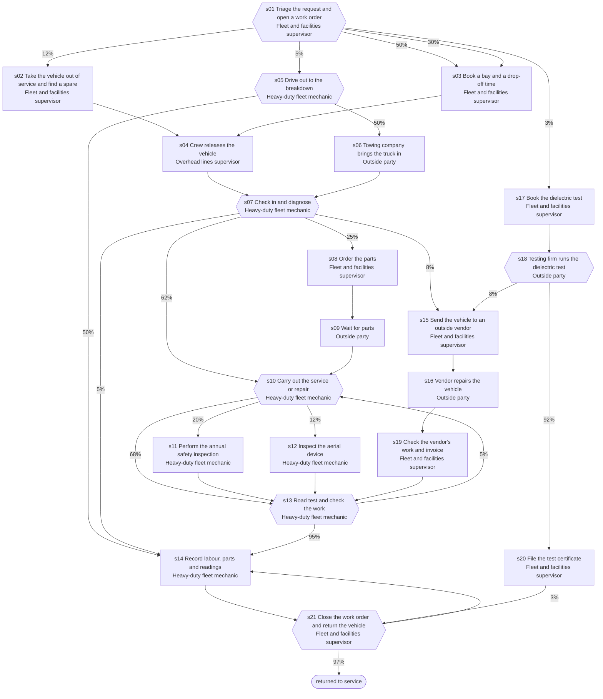

# Maintain the vehicle fleet

`edu-corp-fleet-maintenance` · electric power distribution · fleet and facilities · part of `electric-distribution-utility`

A small in-house garage keeps the utility's roughly 214 vehicles on the road: bucket trucks, digger derricks, cable trucks, trouble trucks and pickups. Work comes from preventive maintenance schedules in the fleet system, defects that drivers find on their daily trip inspection, breakdowns, the annual provincial safety inspection for trucks over 4,500 kg and the annual dielectric test of every insulated boom. The fleet supervisor triages each request by how many people it idles, seven mechanics do the work in eight bays, and outside dealers, body shops and a certified testing firm do what the shop cannot. Delays come from getting a truck released by a busy crew, parts on back order, and outside vendors, and a bucket truck out of service can leave a whole line crew without a vehicle.

| | |
|---|---|
| Unit of work | one fleet work order |
| Starts when | A preventive maintenance, annual inspection or dielectric test falls due in the fleet system, or a driver reports a defect or breakdown. |
| Done when | The vehicle is repaired or certified, the work order is closed with labour and parts recorded, and the crew has its vehicle back. |
| Organisation | A city-owned Ontario electricity distributor with about 350,000 customers, about 570 staff and about 214 vehicles, maintained by a supervisor and seven heavy-duty mechanics. (571 employees, 2019-2022) |
| Volume | 220 cases a month (range 160 to 300) |

## Where it sits

- Starts with **maintenance_work_order** from corp-fleet-maintenance (53% of cases)
- Starts with **vehicle_defect** from ops-overhead-construction (22% of cases)
- Starts with **vehicle_defect** from ops-underground-construction (8% of cases)
- Starts with **vehicle_defect** from ops-trouble-response (7% of cases)
- Starts with **vehicle_defect** from ops-outage-restoration (5% of cases)
- Starts with **vehicle_defect** from ops-field-service-orders (5% of cases)
- Relies on **material_issue** from fin-inventory-stores (a standing input; it does not start a case)
- Sends **fleet_availability** to ops-overhead-construction (outcome: returned to service)
- Sends **fleet_availability** to ops-outage-restoration (outcome: returned to service)
- Sends **fleet_availability** to ops-underground-construction (outcome: returned to service)
- Sends **purchase_requisition** to fin-procurement (outcome: any)
- Sends **supplier_invoice** to fin-accounts-payable (outcome: any)
- Sends **purchase_order** to supplier (outcome: any)

## Flow

## Roles

| Role | Department | Layer | FTE on this process | Loaded cost per hour | Evidence |
|---|---|---|---:|---:|---|
| Heavy-duty fleet mechanic | Fleet and Facilities | individual contributor | 6.8 | 53 CAD | C |
| Fleet and facilities supervisor | Fleet and Facilities | supervisor | 0.8 | 67 CAD | C |
| Overhead lines supervisor | Overhead Lines | supervisor | 0.2 | 80 CAD | C |

## Steps

Hands-on time and the wait before each step show the most common value. Evidence tier A is a sourced number, B a sourced description, C the author's estimate.

| Step | Who | Kind | Hands-on | Wait before | Control | Evidence |
|---|---|---|---:|---:|---|---|
| **s01 Triage the request and open a work order.** The fleet supervisor reads the fleet system's due list or the driver's defect report or phone call, opens a work order, and sets its priority by safety and by how many people the vehicle idles; a bucket truck for a four-person crew comes before a pickup. | Fleet and facilities supervisor | intake | 4 min | 1.0 h |  | B [mto2021] |
| **s02 Take the vehicle out of service and find a spare.** For a major defect the supervisor tags the vehicle out of service in the fleet system, tells the crew supervisor, and assigns a spare or rental so the crew can keep working. | Fleet and facilities supervisor | coordination | 20 min | 30 min | Highway Traffic Act daily inspection rules (Ontario Regulation 199/07): no operation with a major defect | A [mto2021] |
| **s03 Book a bay and a drop-off time.** The supervisor checks bay and mechanic availability for the shift and agrees a drop-off time with the crew's supervisor, usually after the crew's work day or on a day the crew is in the yard. | Fleet and facilities supervisor | coordination | 6 min | 3.0 d |  | C |
| **s04 Crew releases the vehicle.** The overhead lines supervisor moves the crew to a spare or rearranges work so the truck can go to the garage, and has a crew member drive it in with the keys and the defect report. | Overhead lines supervisor | coordination | 6 min | 1.0 d |  | C |
| **s05 Drive out to the breakdown.** A mechanic drives the service truck to the vehicle, diagnoses it at the roadside or work site, and fixes it there when the fault is simple (battery, hose, tire, hydraulic fitting). | Heavy-duty fleet mechanic | travel | 1.0 h | 1.5 h |  | C |
| **s06 Towing company brings the truck in.** A heavy towing company with a unit rated for a loaded bucket truck or digger derrick tows the vehicle to the garage. | Outside party | external wait | 0 min | 3.0 h |  | C |
| **s07 Check in and diagnose.** The mechanic pulls the vehicle into a bay, reads fault codes and the telematics history, inspects the reported defect or the preventive checklist items, and lists the parts and labour needed. | Heavy-duty fleet mechanic | analysis | 30 min | 4.0 h |  | C |
| **s08 Order the parts.** The supervisor looks up the part with the dealer or parts supplier, raises a purchase requisition or uses a blanket order in the ERP, and records the expected delivery on the work order; the vehicle is parked outside the bay. | Fleet and facilities supervisor | data entry | 15 min | 4.0 h |  | C |
| **s09 Wait for parts.** The supplier ships the parts; common filters and brake parts arrive next day, while boom components, hydraulic cylinders and truck body parts can take weeks. | Outside party | external wait | 0 min | 3.0 d |  | C |
| **s10 Carry out the service or repair.** The mechanic performs the preventive service (oil, filters, brakes, lubrication, hydraulic and PTO checks) or the repair, using parts drawn from the shop stock or delivered, and logs readings. | Heavy-duty fleet mechanic | physical | 1.3 h | 1.0 h |  | C |
| **s11 Perform the annual safety inspection.** A licensed inspection mechanic inspects brakes, steering, suspension, lights, frame, tires and coupling against the national safety code standard, fixes any failed item, and issues the annual inspection sticker and report. | Heavy-duty fleet mechanic | validation | 3.0 h | 0 min | Highway Traffic Act annual inspection of commercial vehicles (Regulation 611) by a licensed inspection mechanic | A [mto2021] |
| **s12 Inspect the aerial device.** The mechanic inspects the boom, pins, welds, hydraulic hoses and cylinders, controls, fall-arrest anchors and outrigger interlocks of the bucket or digger derrick against the manufacturer's checklist and the aerial device standard, and operates it through its full range. | Heavy-duty fleet mechanic | validation | 2.5 h | 0 min | Periodic inspection of vehicle-mounted aerial devices under CSA C225 and the manufacturer's manual | B [applus] |
| **s13 Road test and check the work.** The mechanic road tests the vehicle or runs the equipment, checks for leaks and warning lights, and confirms the defect is fixed before releasing it. | Heavy-duty fleet mechanic | validation | 20 min | 0 min |  | C |
| **s14 Record labour, parts and readings.** The mechanic enters labour hours, parts used, odometer and engine hours, and what was found and done in the fleet system work order, which resets the next preventive maintenance date. | Heavy-duty fleet mechanic | data entry | 10 min | 1.0 h |  | C |
| **s15 Send the vehicle to an outside vendor.** For warranty, body, transmission, upfitter or boom structural work the supervisor gets a quote, raises a purchase order and arranges transport to the dealer or specialist shop. | Fleet and facilities supervisor | coordination | 30 min | 1.0 d |  | C |
| **s16 Vendor repairs the vehicle.** The dealer or specialist shop schedules, repairs and returns the vehicle with an invoice; warranty claims and back-ordered parts can stretch this to weeks. | Outside party | external wait | 0 min | 7.0 d |  | C |
| **s17 Book the dielectric test.** The supervisor books the boom's annual dielectric test with a certified testing firm on a date when a spare can cover the crew, and arranges to take the truck to the tester's facility or have the mobile unit come. | Fleet and facilities supervisor | coordination | 20 min | 5.0 d |  | B [applus] |
| **s18 Testing firm runs the dielectric test.** The testing firm applies high voltage across the insulating boom sections, liners and extensions, measures leakage current against the acceptance limits and issues a certificate or a failure report. | Outside party | external wait | 0 min | 2.0 d | Annual dielectric test of insulating aerial devices (CSA C225 as required by provincial occupational health and safety rules) | A [applus] |
| **s19 Check the vendor's work and invoice.** The supervisor inspects the returned vehicle, compares the vendor invoice with the quote and purchase order, and approves it for payment. | Fleet and facilities supervisor | approval | 20 min | 1.0 d | Receipt and invoice approval within delegated authority | C |
| **s20 File the test certificate.** The supervisor scans the dielectric certificate into the vehicle file, updates the test date in the fleet system and places a copy in the truck as crews and auditors expect. | Fleet and facilities supervisor | data entry | 10 min | 4.0 h |  | C |
| **s21 Close the work order and return the vehicle.** The supervisor reviews the completed work order for labour, parts and readings, closes it so costs post to the vehicle, and tells the crew supervisor the vehicle is ready. | Fleet and facilities supervisor | review | 4 min | 8.0 h | Fleet records kept for each vehicle as the operator's maintenance record | C |

## Exceptions

| Exception | Share of cases | What happens |
|---|---:|---|
| Parts on back order | 22% | The vehicle waits outside the bay for parts ordered through the ERP. |
| Breakdown in the field | 5% | A mechanic drives out; half are fixed on site and half are towed in. |
| Failed dielectric test | 0% | The boom fails its test and goes to a specialist shop before it can be used near energized lines. |

## Benchmarks

| Metric | Value | Unit | Population | Evidence |
|---|---|---|---|---|
| annual_inspection_validity_months | 12 | months | Ontario trucks over 4,500 kg | A [mto2021] |
| dielectric_test_interval_months | 12 | months | Aerial devices and digger derricks in Canada | A [applus] |
| cycle_time_days | p50 7, p90 20 | calendar days from work order opened to vehicle returned | Author's estimate | C |

## Pain points

- Trucks are hard to get released from crews, so preventive services slip and turn into breakdowns. (steps s03, s04; C)
- Back-ordered parts and outside vendors keep vehicles out of service for weeks, idling crews or forcing rentals. (steps s08, s09, s15, s16; C)
- Labour and odometer readings are typed in after the job and are sometimes missing, which mistimes the next service. (steps s14, s21; C)

## Assumptions

- Fleet size of about 214 vehicles is the sum of the organisation file's resource counts (42 bucket trucks, 14 digger derricks, 16 cable trucks, 12 trouble trucks and 130 light vehicles); no opened source gives the utility's fleet size.
- The garage is assumed to be an MTO-licensed inspection station with at least one licensed inspection mechanic, so annual inspections are done in-house; dielectric tests are contracted to a certified testing firm.
- Preventive maintenance orders are generated by the fleet system itself; this is shown as a trigger from this process because the organisation file has no separate fleet planning process.
- Defect reports come from every field process that drives trucks, not only overhead construction and outage restoration as the process map lists.
- Triage shares, repair times, parts lead times and vendor turnaround are the author's estimates.

## Sources

- [mto2021] [Commercial vehicle safety requirements (archived 2021-08-28)](https://bac-lac.wayback.archive-it.org/web/20210828184642/http://www.mto.gov.on.ca/english/trucks/commercial-vehicle-safety-requirements.shtml) (Ontario Ministry of Transportation, via Library and Archives Canada web archive, 2021). Trucks over 4,500 kg need an annual inspection valid for 12 months, done by a licensed motor vehicle inspection mechanic at an MTO-licensed inspection station; drivers do a daily inspection within 24 hours before driving and report defects to the operator; a vehicle with a major defect cannot be operated; the operator repairs defects immediately or before the next dispatch and keeps repair records.
- [applus] [Dielectric testing of aerial devices and digger derricks](https://www.applus.com/ca/en/what-we-do/service-sheet/dielectric-testing-of-aerial-devices--digger-derricks) (Applus+ Canada, 2025). Dielectric testing is required annually for all aerial devices and digger derricks operating in Canada under provincially mandated standards including CSA C225; the insulating booms, extensions, bucket and liners are tested indoors at the tester's facility, with mobile testing available.
- [tdw2026] [The Trees Are Winning: Hydro Ottawa Is Using Remote Sensing to Fight Back (A. Kemp)](https://www.tdworld.com/vegetation-management/article/55373019/the-trees-are-winning-hydro-ottawa-is-using-remote-sensing-to-fight-back) (T&D World, 2026). Before the 2022 pilot Hydro Ottawa trimmed on fixed cycles under OEB direction, rural circuits every three years and urban circuits every two; planning relied on ground patrols and outage history; contractor work was verified with small field samples; the May 2022 derecho put more than 180,000 customers out and compressed about four years of emergency repairs into 14 days.

Written by claude-opus on 2026-11-24.
