# Investigate incidents and audit field safety

`edu-corp-health-safety` · electricity distribution · health and safety · part of `electric-distribution-utility`

This process deals with every worker injury, near miss, vehicle incident, property damage and electrical contact at a city-owned electricity distributor, and with the planned field audits that safety advisors make of line and cable crews. A crew supervisor reports the incident, the on-call safety advisor opens a case and decides which legal notices are due (Ministry of Labour, joint health and safety committee and union, WSIB), then the supervisor and advisor investigate at the site, write the causes and corrective actions, and the safety manager signs off. Field audits check a crew's permits, PPE, cover-up and approach distances on the job. Work is slow mainly because field supervisors write reports between crew jobs, cases wait for the monthly committee meeting, and corrective actions wait for training seats and crew time.

| | |
|---|---|
| Unit of work | one incident or one field safety audit |
| Starts when | A supervisor reports an injury, near miss, vehicle incident, property damage or electrical contact, or a planned field audit comes due on the monthly audit plan. |
| Done when | The investigation report is approved, corrective actions are verified and the case is closed, or the audit is recorded with any findings closed. |
| Organisation | A municipally owned Ontario electricity distributor of about 570 staff and 346,000 customers, with unionised line, cable and station crews and a seven-person health, safety and environment team. (571 employees, 2019-2022) |
| Volume | 35 cases a month (range 20 to 60) |

## Where it sits

- Starts with **safety_incident** from ops-overhead-construction (18% of cases)
- Starts with **safety_incident** from ops-outage-restoration (12% of cases)
- Starts with **safety_incident** from ops-service-connection-work (8% of cases)
- Starts with **safety_incident** from ops-locates (6% of cases)
- Starts with **safety_incident** from ops-underground-construction (6% of cases)
- Starts with **safety_incident** from ops-station-maintenance (5% of cases)
- Starts with **crew_schedule** from ops-work-scheduling (45% of cases)
- Relies on **standards** from ae-standards-maintenance (a standing input; it does not start a case)
- Sends **safety_incident** to corp-training-qualification (outcome: incident closed)
- Sends **safety_incident** to corp-public-safety-compliance (outcome: incident closed)
- Sends **safety_incident** to exec-enterprise-risk (outcome: incident closed)
- Sends **safety_incident** to ae-standards-maintenance (outcome: incident closed)
- Sends **safety_incident** to corp-training-qualification (outcome: audit closed)

## Flow

```mermaid
flowchart TD
    s01{{"s01 Receive report or audit assignment and open case<br/>Health and safety / environment advisor"}}
    s02{{"s02 Classify severity and decide the notices required<br/>Health and safety / environment advisor"}}
    s03["s03 Notify the Ministry, JHSC and union and send the written report<br/>Manager, health, safety and environment"]
    s04["s04 File the WSIB employer's report of injury<br/>HR advisor / recruiter"]
    s05["s05 Send the written injury notice to the JHSC and union<br/>Health and safety / environment advisor"]
    s06["s06 Travel to the incident site or service centre<br/>Health and safety / environment advisor"]
    s07["s07 Inspect the scene and collect evidence<br/>Health and safety / environment advisor"]
    s08["s08 Interview the crew and witnesses<br/>Overhead lines supervisor"]
    s09["s09 Pull system records for the incident<br/>Health and safety / environment advisor"]
    s10["s10 Analyse root causes and draft the investigation report<br/>Overhead lines supervisor"]
    s11{{"s11 Review the report and corrective actions<br/>Health and safety / environment advisor"}}
    s12{{"s12 Approve the report and decide escalation<br/>Manager, health, safety and environment"}}
    s13["s13 Review the equipment or work method involved<br/>Standards engineer"]
    s14["s14 Table the case at the joint health and safety committee<br/>Health and safety / environment advisor"]
    s15["s15 Complete the corrective actions<br/>Overhead lines supervisor"]
    s16{{"s16 Verify the actions and close the case<br/>Health and safety / environment advisor"}}
    s17["s17 Pick a crew and job to audit<br/>Health and safety / environment advisor"]
    s18["s18 Drive to the crew's job site<br/>Health and safety / environment advisor"]
    s19["s19 Observe the crew's work against the audit checklist<br/>Health and safety / environment advisor"]
    s20["s20 Debrief the crew on what was seen<br/>Power line technician  journeyperson"]
    s21{{"s21 Enter the audit results in the incident system<br/>Health and safety / environment advisor"}}
    s22["s22 Assign and complete the corrective action<br/>Overhead lines supervisor"]
    s23["s23 Confirm the audit action is closed<br/>Health and safety / environment advisor"]
    s01 -->|"55%"| s02
    s01 -->|"45%"| s17
    s02 -->|"0%"| s03
    s02 -->|"4%"| s04
    s02 -->|"96%"| s06
    s03 --> s04
    s04 --> s05
    s05 --> s06
    s06 --> s07
    s07 --> s08
    s08 --> s09
    s09 --> s10
    s10 --> s11
    s11 -->|"20%"| s10
    s11 -->|"80%"| s12
    s12 -->|"10%"| s13
    s12 -->|"90%"| s14
    s13 --> s14
    s14 --> s15
    s15 --> s16
    s16 -->|"10%"| s15
    s16 -->|"90%"| end0
    s17 --> s18
    s18 --> s19
    s19 --> s20
    s20 --> s21
    s21 -->|"35%"| s22
    s21 -->|"65%"| end1
    s22 --> s23
    s23 --> end1
    end0(["incident closed"])
    end1(["audit closed"])
```

## Roles

| Role | Department | Layer | FTE on this process | Loaded cost per hour | Evidence |
|---|---|---|---:|---:|---|
| Health and safety / environment advisor | Health, Safety and Environment | individual contributor | 1.6 | 65 CAD | C |
| Manager, health, safety and environment | Health, Safety and Environment | manager | 0.15 | 95 CAD | C |
| Overhead lines supervisor | Overhead Lines | supervisor | 0.5 | 80 CAD | C |
| Underground and cable supervisor | Underground and Cable | supervisor | 0.1 | 80 CAD | C |
| Power line technician (journeyperson) | Overhead Lines | individual contributor | 0.1 | 65 CAD | C |
| HR advisor / recruiter | Human Resources and Training | individual contributor | 0.02 | 60 CAD | C |
| Standards engineer | Standards and Records | senior specialist | 0.03 | 72 CAD | C |

## Steps

Hands-on time and the wait before each step show the most common value. Evidence tier A is a sourced number, B a sourced description, C the author's estimate.

| Step | Who | Kind | Hands-on | Wait before | Control | Evidence |
|---|---|---|---:|---:|---|---|
| **s01 Receive report or audit assignment and open case.** The on-call safety advisor takes the supervisor's phone call or the initial incident e-form, or picks up the next planned field audit from the monthly audit schedule. They open a case in the health and safety incident system with date, crew, location, type (injury, near miss, vehicle, property damage, electrical contact, or audit) and a short description. | Health and safety / environment advisor | intake | 15 min | 1.0 h |  | C |
| **s02 Classify severity and decide the notices required.** The advisor checks the injury against the critical injury definition and the WSIB health care and lost time tests, and checks whether a member of the public or utility plant was involved. They decide which notices are due (Ministry of Labour, JHSC and union, WSIB) and whether the case also goes to the distribution safety compliance team. | Health and safety / environment advisor | judgment | 20 min | 0 min | Occupational Health and Safety Act ss. 51-52 and Workplace Safety and Insurance Act reporting duties | B [on_ohsa7], [wsib_report], [ho_cir2021] |
| **s03 Notify the Ministry, JHSC and union and send the written report.** For a death or critical injury the safety manager phones the Ministry's Health and Safety Contact Centre, the JHSC worker co-chair and the union immediately, makes sure the scene is held, and within 48 hours sends the written report with the prescribed particulars to a Ministry Director. | Manager, health, safety and environment | communication | 2.0 h | 15 min | Occupational Health and Safety Act s. 51(1): immediate notice of death or critical injury and written report within 48 hours | A [on_ohsa7] |
| **s04 File the WSIB employer's report of injury.** The HR advisor collects the injury details from the case and the supervisor, enters the Form 7 on the WSIB online service with wage and return-to-work information, and starts the claim file. Late filing brings a WSIB penalty. | HR advisor / recruiter | data entry | 45 min | 1.0 d | Workplace Safety and Insurance Act: employer's report within three business days | A [wsib_report] |
| **s05 Send the written injury notice to the JHSC and union.** The advisor writes the notice with the prescribed particulars of the injury and sends it to the JHSC co-chairs and the union steward. The notice is copied into the case file. | Health and safety / environment advisor | drafting | 30 min | 1.0 d | Occupational Health and Safety Act s. 52(1): written notice to JHSC and union within four days | A [on_ohsa7] |
| **s06 Travel to the incident site or service centre.** The advisor drives a utility light vehicle to the incident site while the conditions can still be seen, or to the service centre where the crew and vehicle are, often the next working day. | Health and safety / environment advisor | travel | 35 min | 12.0 h |  | C |
| **s07 Inspect the scene and collect evidence.** The advisor photographs the site, equipment, vehicle damage or tool involved, measures distances and checks the cover-up, grounding and traffic set-up against the work protection permit and the pre-job briefing form. They take copies of the permit, the briefing form and any statements. | Health and safety / environment advisor | physical | 1.5 h | 0 min |  | C |
| **s08 Interview the crew and witnesses.** While the advisor examines the scene, the crew's supervisor interviews the injured or involved worker, the crew lead and other witnesses one at a time, and writes down the sequence of events and what was different from the plan. | Overhead lines supervisor | communication | 1.0 h | 0 min |  | C |
| **s09 Pull system records for the incident.** Back at the office the advisor pulls the switching and outage records, vehicle telematics for vehicle incidents, the worker's training and qualification records and the crew's job record, and attaches them to the case. | Health and safety / environment advisor | lookup | 1.0 h | 1.0 d |  | C |
| **s10 Analyse root causes and draft the investigation report.** The supervisor writes the investigation report in the incident system: sequence of events, immediate and root causes, and corrective actions with owners and dates. Field supervisors fit this between crew work, so reports often wait several days. | Overhead lines supervisor | drafting | 2.0 h | 3.0 d |  | C |
| **s11 Review the report and corrective actions.** The advisor checks that the causes are supported by the evidence, that each cause has an action, and that the actions go beyond retraining where a hazard can be removed. Weak reports go back to the supervisor with comments. | Health and safety / environment advisor | review | 40 min | 1.0 d |  | C |
| **s12 Approve the report and decide escalation.** The safety manager reads the report, signs it off and decides whether the case goes further: to the standards engineer when equipment or a work method is involved, to the enterprise risk register when serious, and to training when retraining is needed. | Manager, health, safety and environment | approval | 20 min | 2.0 d | Company health and safety management system (ISO 45001-certified) incident investigation procedure: management review and sign-off | C |
| **s13 Review the equipment or work method involved.** The standards engineer checks the construction standard, approved material or work method named in the report, compares it with the manufacturer data and industry practice, and decides whether to issue a standard change or a safety bulletin. | Standards engineer | analysis | 3.0 h | 7.0 d |  | C |
| **s14 Table the case at the joint health and safety committee.** The advisor adds the case to the next joint health and safety committee meeting package with the causes and actions, presents it, and records the committee's questions or recommendations in the case. | Health and safety / environment advisor | coordination | 15 min | 7.0 d | Occupational Health and Safety Act s. 9: joint health and safety committee to be informed and to make recommendations | B [on_jhsc] |
| **s15 Complete the corrective actions.** The supervisor arranges the actions: a crew tailboard on the lessons, a tool or equipment repair, a change to the job plan template or a training refresher booked with the training coordinator. They mark each action done in the incident system. | Overhead lines supervisor | coordination | 1.5 h | 3.0 d |  | C |
| **s16 Verify the actions and close the case.** The advisor checks evidence that each action is done (sign-in sheet, repair record, revised form) and closes the case, or reopens an action that was not done. | Health and safety / environment advisor | validation | 30 min | 3.0 d |  | C |
| **s17 Pick a crew and job to audit.** The advisor looks at the next days' crew schedule in the mobile workforce system and picks a crew and job type that is due for an audit under the audit plan, such as live-line work, pole setting, cable splicing or traffic control. | Health and safety / environment advisor | lookup | 20 min | 3.0 d |  | C |
| **s18 Drive to the crew's job site.** The advisor drives a utility light vehicle to the work site. Audits are put off when a storm pulls crews onto restoration or the job is rescheduled for weather. | Health and safety / environment advisor | travel | 35 min | 4.0 h |  | C |
| **s19 Observe the crew's work against the audit checklist.** The advisor watches the job without stopping it and checks the pre-job briefing form, work protection permit, PPE and rubber gloves, cover-up, grounding, minimum approach distances, traffic control and housekeeping, ticking each item on the field audit checklist. They stop the work only for an imminent hazard. | Health and safety / environment advisor | physical | 1.2 h | 0 min | Company field safety audit program under the occupational health and safety management system | C |
| **s20 Debrief the crew on what was seen.** At a natural break the advisor and the crew talk through the good practices and the gaps seen, agree on fixes that can be made on the spot, and the crew lead signs the checklist. The whole crew stops work for the talk. | Power line technician (journeyperson) | communication | 15 min | 10 min |  | C |
| **s21 Enter the audit results in the incident system.** Back at the office the advisor types the checklist results and photos into the health and safety system, scores the audit and flags findings that need a corrective action from the supervisor. | Health and safety / environment advisor | data entry | 25 min | 1.0 d |  | C |
| **s22 Assign and complete the corrective action.** The supervisor gets the audit finding by email from the system, agrees the fix (a tool replaced, a crew refresher, a missing permit field corrected) and records when it is done. | Overhead lines supervisor | coordination | 30 min | 3.0 d |  | C |
| **s23 Confirm the audit action is closed.** The advisor checks the supervisor's evidence that the fix is in place and closes the audit record, so it counts in the monthly safety report to management. | Health and safety / environment advisor | validation | 15 min | 5.0 d |  | C |

## Exceptions

| Exception | Share of cases | What happens |
|---|---:|---|
| Critical injury | 0% | A worker is critically injured. The scene is held for the Ministry inspector, the safety manager makes the immediate and 48-hour notices, a JHSC worker member joins the investigation, and the WSIB report and JHSC notice follow. |
| Injury with health care or lost time | 2% | The WSIB Form 7 and the written JHSC and union notice are due within three business days and four days before the investigation is finished. |
| Weak investigation report returned | 11% | The advisor sends the report back because the causes stop at worker error or the actions do not match the causes. |
| Standards or work method review | 5% | An incident points to a construction standard, approved material or work method, so the standards engineer reviews it before closure. |
| Corrective action not done at verification | 6% | The advisor finds no evidence that an action is done and sends it back to the supervisor. |

## Benchmarks

| Metric | Value | Unit | Population | Evidence |
|---|---|---|---|---|
| cycle_time_days | p50 15, p90 50 | calendar days from report or audit assignment to case closed | All incident and audit cases at a mid-size Ontario distributor, 2019-2022 | C |
| all_injury_illness_frequency_rate | 1.17 | injuries and illnesses per 200,000 hours worked (unit assumed) | Hydro Ottawa Limited employees, 2021 | A [ho_cir2021] |
| lost_workday_severity_rate | 3.11 | lost workdays per 200,000 hours worked (unit assumed) | Hydro Ottawa Limited employees, 2021 | A [ho_cir2021] |
| critical_injury_written_notice_deadline | 48 | hours | Ontario employers under the OHSA | A [on_ohsa7] |
| wsib_form7_deadline | 3 | business days | Ontario employers | A [wsib_report] |
| safe_work_training_hours_trades | 44 | hours per trades employee per year | Hydro Ottawa, 2021 | A [ho_ar2021] |

## Pain points

- Field supervisors draft investigation reports between crew jobs and storm call-outs, so reports wait about a week and then often come back for weak root causes. (steps s10, s11; C)
- Cases wait for the next joint health and safety committee meeting and corrective actions wait for training seats and crew time, which stretches closure to weeks. (steps s14, s15, s16; B [on_jhsc])
- Evidence sits in several systems (outage records, telematics, training records, permits on paper or tablets), so the advisor spends an hour or more assembling it for each case. (steps s07, s09; C)
- Storms stop planned field audits and add fatigue and vehicle incidents, so the audit plan falls behind in summer. (steps s18; C)

## Assumptions

- The process mixes two kinds of case: incidents (about 55 percent) and planned field audits (about 45 percent). Both start at the same intake step so that one file covers the process map entry.
- Supervisor steps are written with the overhead lines supervisor role; underground and stations supervisors do the same work for their crews, and their time is stated as FTE on the roles list rather than as separate steps.
- The joint health and safety committee wait (up to a month) is on the critical path because cases are closed only after the committee has seen them; corrective work starts in parallel, so the corrective action step's wait is short.
- WSIB Form 7 filing is placed with HR's disability management function; some utilities give it to the safety team instead.
- Loaded costs are the organisation file's (wage x 1.40). Labour cost per case leaves out the time of the injured worker and of the external parties (Ministry inspector, WSIB).
- Ministry of Labour inspector visits and orders after a critical injury are outside this workflow; they add weeks to the few cases they touch.
- Simulated median cycle time (about 24 days over all cases) is 1.6 times the author's benchmark of 15 days. Split by case type the simulation gives incidents a median of about 33 days (p90 about 44) and audits about 7 days (p90 about 18), both inside the ranges the benchmark rests on; the gap comes from the benchmark's rough guess at how the two types mix, so the step times were left as they are. No published cycle time for utility incident investigations was found.

## Sources

- [ho_cir2021] [Hydro Ottawa Limited 2021 Custom Incentive Rate Progress Report (EB-2019-0261)](https://www.rds.oeb.ca/CMWebDrawer/Record/765311/File/document) (Hydro Ottawa Limited, filed with the Ontario Energy Board, 2022). Custom scorecard safety measures for 2021: All Injury/Illness Frequency Rate 1.17 and Lost Workday Severity Rate 3.11, both with a target of 'reduce'.
- [ho_ar2021] [Hydro Ottawa Holding Inc. 2021 Annual Report](https://hydroottawa.com/sites/default/files/2022-06/Hydro_Ottawa_2021AnnualReport-EN_0.pdf) (Hydro Ottawa Holding Inc., 2022). Integrated health, safety and environment management system moved from OHSAS 18001 to ISO 45001 and ISO 14001 certification in 2021; safe work practices training averaged 15 hours per employee and 44 hours for trades employees; safety performance described as on par with industry peers.
- [on_ohsa7] [Guide to the Occupational Health and Safety Act: Part VII Notices](https://www.ontario.ca/document/guide-occupational-health-and-safety-act/part-vii-notices) (Government of Ontario, Ministry of Labour, Immigration, Training and Skills Development, 2026). For a death or critical injury the employer notifies the Ministry (Health and Safety Contact Centre), the joint health and safety committee and the union immediately and sends a written report to a Ministry Director within 48 hours (s. 51(1)); for an injury needing medical attention or causing disability from usual work, written notice to the committee and the union within four days (s. 52(1)), and to the Ministry if an inspector requires it.
- [on_jhsc] [Guide for health and safety committees and representatives](https://www.ontario.ca/page/guide-health-and-safety-committees-and-representatives) (Government of Ontario, Ministry of Labour, Immigration, Training and Skills Development, 2026). A designated worker member of the joint health and safety committee inspects the workplace at least once a month; the committee meets at least once every three months (s. 9(33)); worker members designate one or more members to investigate a death or critical injury (s. 9(31)).
- [wsib_report] [Report a workplace injury or illness (employers)](https://www.wsib.ca/en/businesses/claims/report-injury-or-illness) (Workplace Safety and Insurance Board (Ontario), 2026). The employer's accident report (Form 7) must reach the WSIB within three business days after the reporting obligation begins; reporting is needed when the worker needs health care beyond first aid, loses time or pay, or does modified work beyond seven days.

Written by claude-opus on 2026-11-24.
