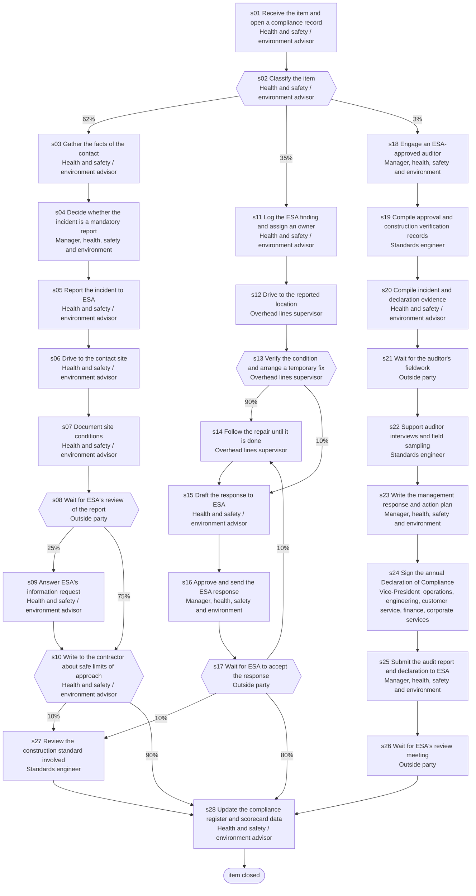

# Comply with Ontario's distribution safety regulation (Regulation 22/04)

`edu-corp-public-safety-compliance` · electricity distribution · health and safety (regulatory compliance) · part of `electric-distribution-utility`

Ontario Regulation 22/04 makes every licensed distributor report serious electrical incidents to the Electrical Safety Authority (ESA) within 48 hours, answer ESA's due diligence inspections and public safety concerns, and pass an annual audit and declaration of compliance. At a city-owned distributor a safety advisor runs these items: reporting contacts by contractors and homeowners with utility lines, getting field supervisors to verify and repair hazards that ESA finds, and assembling evidence with the standards engineer for the annual audit. The work is slow because ESA reviews and field repairs take weeks, and the audit evidence sits in many record systems.

| | |
|---|---|
| Unit of work | one ESA reportable item (incident report, ESA finding or concern, or the annual audit and declaration) |
| Starts when | A contact with utility plant is reported, ESA sends a due diligence inspection finding or public safety concern, an inspector finds a public hazard, or ESA's bulletin opens the annual audit. |
| Done when | The item is reported and accepted or answered, ESA has closed it, and the compliance register and scorecard data are updated. |
| Organisation | A municipally owned Ontario electricity distributor of about 570 staff and 346,000 customers that reported 20 public contacts and no serious incidents to ESA in 2021 and was rated compliant. (571 employees, 2019-2022) |
| Volume | 3 cases a month (range 1 to 6) |

## Where it sits

- Starts with **safety_incident** from corp-health-safety (62% of cases)
- Starts with **esa_report** from esa (31% of cases)
- Starts with **esa_report** from ops-distribution-inspection (7% of cases)
- Relies on **standards** from ae-standards-maintenance (a standing input; it does not start a case)
- Sends **esa_report** to esa (outcome: item closed)
- Sends **esa_report** to ae-standards-maintenance (outcome: item closed)
- Sends **esa_report** to fin-rrr-reporting (outcome: item closed)
- Sends **maintenance_work_order** to ops-work-scheduling (outcome: item closed)

## Flow

## Roles

| Role | Department | Layer | FTE on this process | Loaded cost per hour | Evidence |
|---|---|---|---:|---:|---|
| Health and safety / environment advisor | Health, Safety and Environment | individual contributor | 0.2 | 65 CAD | C |
| Manager, health, safety and environment | Health, Safety and Environment | manager | 0.06 | 95 CAD | C |
| Standards engineer | Standards and Records | senior specialist | 0.07 | 72 CAD | C |
| Overhead lines supervisor | Overhead Lines | supervisor | 0.03 | 80 CAD | C |
| Vice-President (operations, engineering, customer service, finance, corporate services) | Office of the President and CEO | executive | 0.003 | 160 CAD | C |

## Steps

Hands-on time and the wait before each step show the most common value. Evidence tier A is a sourced number, B a sourced description, C the author's estimate.

| Step | Who | Kind | Hands-on | Wait before | Control | Evidence |
|---|---|---|---:|---:|---|---|
| **s01 Receive the item and open a compliance record.** The distribution safety compliance advisor receives the item: an incident report from the control room or a crew about a member of the public or a contractor contacting utility plant, a letter or email from an ESA inspector about a due diligence inspection or a public safety concern, an inspection finding of a public hazard, or ESA's annual audit notice. They open a record in the compliance tracker with the date and time the utility became aware. | Health and safety / environment advisor | intake | 20 min | 1.0 h |  | B [esa_seir], [oeb_psguide] |
| **s02 Classify the item.** The advisor decides what kind of item it is: a contact or fire involving the public or a contractor, an ESA finding or public safety concern that needs a field fix and a reply, or the annual audit and declaration cycle. | Health and safety / environment advisor | judgment | 20 min | 0 min |  | B [ho_sc2021] |
| **s03 Gather the facts of the contact.** The advisor pulls the outage or trouble record, the crew's make-safe notes and photos, and for dig-ins the locate ticket from the One Call portal, and calls the crew lead or the control room operator to confirm what was hit, the voltage and whether anyone was hurt. | Health and safety / environment advisor | lookup | 1.0 h | 4.0 h |  | B [esa_seir] |
| **s04 Decide whether the incident is a mandatory report.** The safety manager compares the facts with the serious electrical incident definition: death or critical injury, or contact, fire or explosion at 750 volts or above with the potential for death or critical injury, and not caused by force majeure. When unsure, the guideline says to report first and settle the class with ESA afterwards. | Manager, health, safety and environment | judgment | 20 min | 2.0 h | Ontario Regulation 22/04 s. 12: serious electrical incident definition | A [esa_seir] |
| **s05 Report the incident to ESA.** The advisor fills in the ESA serious electrical incident reporting form (caller, location, date and time of incident and of awareness, other authorities involved, nature of incident, site information and a description with photos) and sends it by email, or phones the ESA line, within 48 hours. Contacts that are not mandatory are sent as voluntary reports. | Health and safety / environment advisor | communication | 30 min | 1.0 h | Ontario Regulation 22/04 s. 12: report serious electrical incidents to ESA within 48 hours of becoming aware | A [esa_seir], [ho_sc2021] |
| **s06 Drive to the contact site.** The advisor drives a light vehicle to the site, usually after the crew has made it safe, to see the clearances, the barrier or enclosure damage, the excavation or the equipment that touched the line. | Health and safety / environment advisor | travel | 35 min | 1.0 d |  | C |
| **s07 Document site conditions.** The advisor photographs and measures the site: overhead clearance to the building, sign or equipment, depth and location of the cable against the locate marks, and whether the plant met the utility's construction standard. They note any public hazard that still needs a fix. | Health and safety / environment advisor | physical | 1.0 h | 0 min |  | C |
| **s08 Wait for ESA's review of the report.** ESA's powerlines staff review the report, decide whether it counts as a mandatory serious incident for the scorecard or a voluntary report, and may contact the utility for more information or assistance. | Outside party | external wait | 0 min | 5.0 d |  | B [esa_seir] |
| **s09 Answer ESA's information request.** The advisor writes a reply with the site notes, photos, locate records and crew statements that ESA asked for, and the safety manager reviews it before it is sent. | Health and safety / environment advisor | drafting | 1.0 h | 1.0 d | Ontario Regulation 22/04 s. 12(3.1): assist ESA investigations on request | B [esa_seir] |
| **s10 Write to the contractor about safe limits of approach.** For a contractor or homeowner contact the advisor sends a letter or arranges a visit to the firm about limits of approach to overhead lines or calling for locates, and passes damage details to the claims specialist for cost recovery. | Health and safety / environment advisor | communication | 40 min | 2.0 d |  | B [ho_sc2021] |
| **s11 Log the ESA finding and assign an owner.** The advisor logs the ESA due diligence inspection finding, public safety concern or inspection-found hazard (for example a damaged pad-mount transformer enclosure, a low conductor, or a missing guard), looks up the asset in GIS and assigns it to the area supervisor with ESA's reply date. | Health and safety / environment advisor | data entry | 30 min | 8.0 h |  | B [oeb_psguide], [ho_sc2021] |
| **s12 Drive to the reported location.** The area supervisor drives a light vehicle to the asset named in the finding, usually fitting the visit in on the way between crew sites, so it can wait a few days. | Overhead lines supervisor | travel | 30 min | 2.0 d |  | C |
| **s13 Verify the condition and arrange a temporary fix.** The supervisor checks the condition against the construction standard, photographs it, has it made safe on the spot if there is exposure to the public (a lock, barricade or call-out of the trouble truck), and raises a maintenance work order for the permanent repair. | Overhead lines supervisor | physical | 1.0 h | 0 min | Company public safety procedure: make public hazards safe on discovery | C |
| **s14 Follow the repair until it is done.** The supervisor tracks the work order through scheduling, chases the planner when a crew or material is not available, and collects the completion photos when the crew finishes. | Overhead lines supervisor | coordination | 30 min | 10.0 d |  | C |
| **s15 Draft the response to ESA.** The advisor writes the response to the inspector: what was found, the temporary and permanent fixes with dates and photos, and any change to the inspection or construction practice to stop it recurring. | Health and safety / environment advisor | drafting | 1.0 h | 1.0 d |  | C |
| **s16 Approve and send the ESA response.** The safety manager reads the response, checks that the photos show the fix and that the dates meet ESA's deadline, then signs it and emails it to the inspector. | Manager, health, safety and environment | approval | 15 min | 1.0 d | Ontario Regulation 22/04 compliance follow-up: written response to ESA findings | C |
| **s17 Wait for ESA to accept the response.** ESA's inspector reviews the response and photos and either closes the finding in ESA's records or writes back asking for more repair work or more evidence. | Outside party | external wait | 0 min | 7.0 d |  | C |
| **s18 Engage an ESA-approved auditor.** After ESA's bulletin sets the audit period and due date for the utility's group, the safety manager confirms the auditor is on ESA's approved list (or gets ESA's approval first), issues the purchase order and agrees the audit plan and dates. | Manager, health, safety and environment | coordination | 4.0 h | 7.0 d | Ontario Regulation 22/04 s. 13: annual audit by an ESA-approved auditor | A [esa_audit] |
| **s19 Compile approval and construction verification records.** The standards engineer assembles the evidence for sections 4 to 8: equipment approvals and test records, P.Eng-certified standard designs, the construction verification program and a sample of inspection certificates for new, like-for-like and emergency work, and the maintenance program records. | Standards engineer | analysis | 1.7 d | 7.0 d |  | B [esa_audit] |
| **s20 Compile incident and declaration evidence.** In parallel the advisor gathers the section 12 incident reports and ESA replies, the public safety concern and due diligence files, and the evidence for the sections the declaration covers. | Health and safety / environment advisor | analysis | 16.0 h | 0 min |  | B [esa_decl] |
| **s21 Wait for the auditor's fieldwork.** The auditor interviews senior managers on the control environment, works through ESA's checklist and samples plans, test records and installed construction in the field. | Outside party | external wait | 0 min | 7.0 d |  | B [esa_audit] |
| **s22 Support auditor interviews and field sampling.** The standards engineer answers the auditor's questions, pulls the extra records the auditor samples and takes the auditor to installed sites to compare the construction with the approved design. | Standards engineer | communication | 8.0 h | 0 min |  | C |
| **s23 Write the management response and action plan.** When the auditor reviews the draft findings with the utility, the safety manager writes the management response and an action plan with owners and dates for each Needs Improvement item. | Manager, health, safety and environment | drafting | 8.0 h | 3.0 d |  | A [esa_audit] |
| **s24 Sign the annual Declaration of Compliance.** The vice-president reads the declaration that the utility is in full compliance with sections 3, 9, 10, 11 and 12, or lists any non-compliance with the action plan, checks the stated methodology and signs it. | Vice-President (operations, engineering, customer service, finance, corporate services) | approval | 1.0 h | 3.0 d | Ontario Regulation 22/04 s. 14: declaration signed by a professional engineer, director or officer | A [esa_decl] |
| **s25 Submit the audit report and declaration to ESA.** The safety manager sends the audit report, management response, action plan and the signed declaration to ESA by the group's due date and files copies for the scorecard. | Manager, health, safety and environment | communication | 1.5 h | 1.0 d | Ontario Regulation 22/04 ss. 13-14: annual audit report and declaration due to ESA | A [esa_audit], [esa_decl] |
| **s26 Wait for ESA's review meeting.** ESA reviews the report, response and action plan, then meets the utility to agree any actions needed for compliance and the compliance rating that feeds the scorecard. | Outside party | external wait | 0 min | 30.0 d |  | B [esa_audit], [oeb_psguide] |
| **s27 Review the construction standard involved.** The standards engineer checks whether the standard, approved material or clearance rule involved should change, for example a deeper burial depth, a different enclosure lock or a clearance table update, and opens a standards change if so. | Standards engineer | analysis | 3.0 h | 7.0 d |  | C |
| **s28 Update the compliance register and scorecard data.** The advisor closes the item in the compliance tracker with its ESA class and outcome, so the year's incident counts and compliance status can be checked against ESA's scorecard data before the April 30 RRR filing. | Health and safety / environment advisor | data entry | 30 min | 3.0 d |  | B [oeb_psguide] |

## Exceptions

| Exception | Share of cases | What happens |
|---|---:|---|
| ESA asks for more information on an incident | 16% | ESA's review of a contact report raises questions, and the advisor must assemble and send more records before ESA classifies it. |
| ESA not satisfied with a finding response | 4% | ESA asks for more repair work or evidence, so the supervisor goes back to the work order and the response is redone. |
| No defect found at the reported location | 4% | The supervisor finds the asset already meets the standard, and the response to ESA explains this with photos. |
| Standards change after an incident or finding | 10% | The incident or finding shows a standard, material or clearance rule should change, so the standards engineer reviews it before closure. |

## Benchmarks

| Metric | Value | Unit | Population | Evidence |
|---|---|---|---|---|
| cycle_time_days | p50 20, p90 60 | calendar days from receipt to item closed | All Regulation 22/04 items at a mid-size Ontario distributor, 2019-2022 | C |
| incident_report_deadline | 48 | hours after becoming aware | Ontario licensed distributors and their contractors | A [esa_seir] |
| public_contacts_reported | 20 | incidents reported to ESA per year (none serious) | Hydro Ottawa Limited, 2021 | A [ho_sc2021] |
| serious_electrical_incident_index_target | 0.049 | serious incidents involving the public per 1,000 km of line | Hydro Ottawa Limited 2021 industry target; achieved 0 | A [ho_sc2021] |
| audit_report_due | 3 | months after the twelve-month audit period ends | Ontario licensed distributors | A [esa_audit] |
| audit_effort | low 21, high 36 | auditor hours for a routine audit | Ontario distributors, ESA estimate (larger distributors take longer) | A [esa_audit] |

## Pain points

- Classifying a contact as mandatory or voluntary under the 48-hour clock needs facts from the crew, control room and locate records that arrive piecemeal, so many contacts are reported 'just in case' and classified later with ESA. (steps s03, s04, s05; B [esa_seir], [ho_sc2021])
- Repairs for ESA findings compete with planned and storm work for crew time, so responses wait weeks for a work order to be done. (steps s14; C)
- Audit evidence (approvals, P.Eng-certified designs, inspection certificates, maintenance records) sits in document, ERP and GIS systems, and the standards engineer spends days assembling it each year. (steps s19, s20, s22; B [esa_audit])
- The year's incident counts and compliance status are reconciled by hand against ESA's scorecard data in the weeks before the April 30 filing. (steps s28; B [oeb_psguide])

## Assumptions

- One file covers three kinds of item that share intake and closing: contact incident reports (about 62 percent), ESA findings, public safety concerns and inspection-found hazards (about 35 percent) and the annual audit and declaration cycle (about 3 percent, about one a year).
- Public contacts reach this process through the health and safety process, as in the organisation file; in practice the first call usually comes from the control room or a trouble crew.
- Field supervisors and the vice-president take part although the organisation file's process map lists only the safety manager, safety advisor and standards engineer.
- The repair of a hazard ESA finds is done by crews in the maintenance and construction processes; this workflow counts only the supervisor's verification and follow-up.
- Public awareness work (Component A of the scorecard: campaigns, contractor outreach, the awareness survey) is outside this workflow except the letter or visit after a contact.
- Loaded costs are the organisation file's (wage x 1.40). External auditor fees and ESA time are not in labour cost.
- The stated FTE (about 0.4) is about twice what step hands-on time times volume implies (about 0.2), because the roles also keep the compliance register, liaise with ESA by phone, reconcile scorecard data and maintain the construction verification program between items; none of that is written as a step.
- Simulated median cycle time (about 20 days) matches the author's benchmark. By item type the simulation gives incident reports a median of about 17 days, ESA findings about 35 days and the audit cycle about 79 days from engaging the auditor to ESA's review meeting.

## Sources

- [esa_seir] [Guideline for Section 12 of Ontario Regulation 22/04: Reporting of Serious Electrical Incidents, Version 4.1.2](https://esasafe.com/assets/files/esasafe/pdf/Utilities/Guideline-for-Serious-Electrical-Incident-Reporting-v4.1.2.pdf) (Electrical Safety Authority (Ontario), 2021). Distributors and their contractors must report any serious electrical incident to ESA within 48 hours of becoming aware of it, by telephone, fax or email using the Appendix A form; definition of serious electrical incident (death or critical injury from electrical contact, or inadvertent contact, fire or explosion at 750 V or above or in a meter with the potential for death or critical injury, force majeure excepted); worker-only incidents reported to the Ministry of Labour are exempt; voluntary reporting encouraged and unsure cases should be reported first and classified with ESA afterwards; ESA may ask the distributor for information or assistance (s. 12(3.1)); vegetation, animal contacts, safe equipment failures and customer-owned equipment are not reportable.
- [esa_audit] [Guideline for Audit, Version 2.1, Ontario Regulation 22/04 Electrical Distribution Safety](https://esasafe.com/assets/files/esasafe/pdf/Utilities/Guideline-for-Audit-v2.1.pdf) (Electrical Safety Authority (Ontario), 2014). Annual audit of compliance with sections 4 to 8 (equipment approval, P.Eng-certified designs, inspection of all construction before energization, operating and maintenance programs); ESA must approve the auditor before engagement; ten-step audit process (ESA notice, auditor approval, engagement, audit program, fieldwork, report reviewed with distributor, distributor submits report with management response and action plan, ESA review, ESA meeting, progress reports); distributors in three groups, twelve-month audit period, report due three months after the period ends; routine audit effort 21 to 36 auditor hours depending on control environment, longer for larger distributors; records kept at least one year after the audit.
- [esa_decl] [Guideline for Declaration of Compliance, Revision 2.1, Ontario Regulation 22/04](https://esasafe.com/assets/files/esasafe/pdf/Utilities/Guideline_Annual_Compliance_Declaration.pdf) (Electrical Safety Authority (Ontario), 2021). Section 14 requires an annual Declaration of Compliance with sections 3, 9, 10, 11 and 12, signed by a professional engineer or a director or officer, due with the annual audit report; it states full compliance or lists non-compliances with an action plan, and names the methodology used (senior management review, independent managers, auditors, compliance officer or other).
- [oeb_psguide] [Electrical Distribution Safety: Public Safety Scorecard Metrics Guide, Components B and C, R2](https://www.oeb.ca/sites/default/files/public-safety-scorecard-metrics-guide.pdf) (Electrical Safety Authority, hosted by the Ontario Energy Board, 2019). Component B (compliance with Regulation 22/04) is built from five elements: audit, declaration of compliance, due diligence inspections, public safety concerns and compliance investigations, rated Compliant, Needs Improvement or Non-Compliant; Component C counts serious electrical incidents involving the public per 1,000 km of line; ESA sends scorecard data two months before the April 30 RRR 2.1.19 due date and accepts distributor feedback up to one month before it.
- [ho_sc2021] [Scorecard - Hydro Ottawa Limited (2017-2021) and 2021 Scorecard Management Discussion and Analysis](https://www.oeb.ca/documents/scorecard/2021/Scorecard%20-%20Hydro%20Ottawa%20Limited.pdf) (Ontario Energy Board, 2022). In 2021 the distributor reported 20 electrical incidents in the public domain to ESA, from contractors and homeowners contacting overhead or underground lines; none was a serious electrical incident (index 0 against a target of 0.049 per 1,000 km); it showed compliance through due diligence inspections, public safety concerns, compliance investigations and annual ESA audits, and the 2021 audit found it compliant in the five sections examined; its safety partners made 32 site visits to third-party contractors on limits of approach; public safety awareness index 72 percent.

Written by claude-opus on 2026-11-24.
