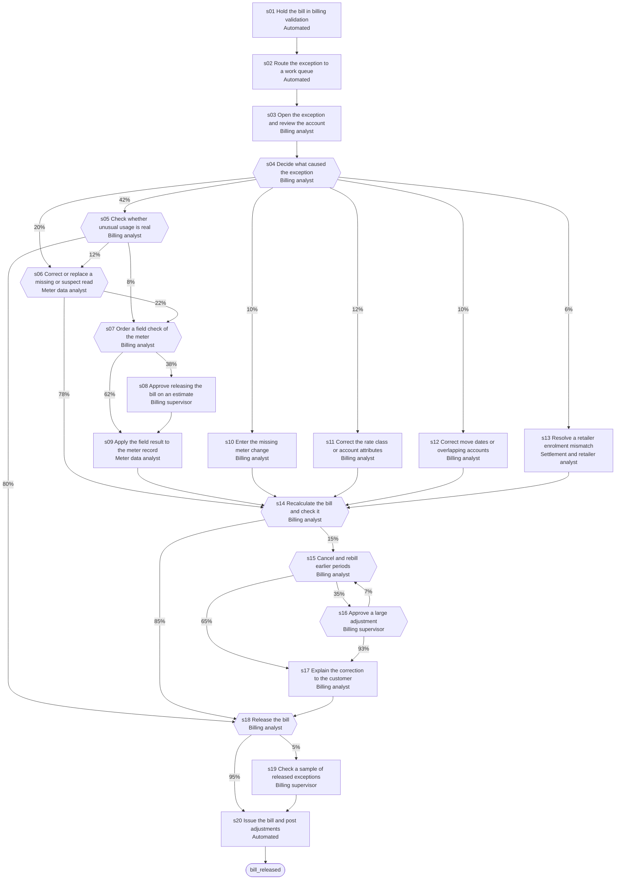

# Resolve billing exceptions

`edu-cs-billing-exceptions` · electricity distribution · customer service (billing) · part of `electric-distribution-utility`

A distributor billing about 350,000 customers every month lets its billing system calculate almost all bills automatically, but a few percent fail validation and are held: unusual usage, missing or estimated reads, unrecorded meter changes, wrong rate classes, move date errors or retailer mismatches. Billing analysts work these held bills from a queue, using smart meter data, field orders and corrections in the CIS, then release them; some errors reach back to bills already sent, which must be cancelled and reissued. The regulator expects at least 98% of bills to be accurate and monthly billing, so held bills that wait for a field visit and month-end queues are the main sources of delay.

| | |
|---|---|
| Unit of work | one held bill or billing investigation |
| Starts when | A bill fails validation in the billing run, or a contact centre agent, meter data analyst or field result raises a billing problem. |
| Done when | The corrected or confirmed bill is released and issued, with any rebills and adjustments posted. |
| Organisation | A municipally owned Ontario electricity distributor with about 350,000 smart-metered customers on monthly billing, a CIS with bill validation rules and a local meter data management tool linked to the provincial repository. (571 employees, 2019-2022) |
| Volume | 6,000 cases a month (range 4,000 to 9,000) |

## Where it sits

- Starts with **bill_exception** from cs-billing (72% of cases)
- Starts with **read_exception** from cs-meter-data-management (15% of cases)
- Starts with **bill_exception** from cs-contact-centre (10% of cases)
- Starts with **field_result** from ops-field-service-orders (3% of cases)
- Sends **customer_bill** to residential-customer (outcome: bill_released)
- Sends **customer_bill** to business-customer (outcome: bill_released)
- Sends **meter_order** to ops-field-service-orders (outcome: any)
- Sends **journal_entries** to fin-month-end-close (outcome: bill_released)

## Flow

## Roles

| Role | Department | Layer | FTE on this process | Loaded cost per hour | Evidence |
|---|---|---|---:|---:|---|
| Billing analyst | Billing and Settlement | individual contributor | 10 | 47 CAD | C |
| Meter data analyst | Metering Services | individual contributor | 2 | 52 CAD | C |
| Billing supervisor | Billing and Settlement | supervisor | 0.6 | 60 CAD | C |
| Settlement and retailer analyst | Billing and Settlement | senior specialist | 0.3 | 56 CAD | C |

## Steps

Hands-on time and the wait before each step show the most common value. Evidence tier A is a sourced number, B a sourced description, C the author's estimate.

| Step | Who | Kind | Hands-on | Wait before | Control | Evidence |
|---|---|---|---:|---:|---|---|
| **s01 Hold the bill in billing validation.** During the nightly billing run for a bill cycle, the CIS checks every calculated bill against validation rules (usage far above or below history, zero usage on an active account, estimated or missing reads, a meter change without readings, rate or retailer mismatches, overlapping accounts) and holds the bills that fail instead of printing them. | Automated | system auto | 0 min | 0 min | OEB Distribution System Code s.7.11: 98% of bills accurate; cancelled or adjusted bills count as inaccurate | A [src-dsc], [src-scorecard] |
| **s02 Route the exception to a work queue.** The CIS places each held bill in an exception work queue by type and bill cycle, together with exceptions raised by contact centre agents, read exceptions from meter data management and field results that change a reading. | Automated | system auto | 0 min | 1.0 h |  | C |
| **s03 Open the exception and review the account.** A billing analyst takes the oldest exception in the queue, opens the held bill, the account's last thirteen months of usage, the meter and read history and any notes, and sees what the validation rule flagged. | Billing analyst | lookup | 3 min | 1.0 d |  | C |
| **s04 Decide what caused the exception.** The analyst decides whether the bill is right despite the flag or what kind of fix it needs: a read problem, a missing meter change, a wrong rate or account attribute, a move date error or a retailer enrolment mismatch. | Billing analyst | judgment | 2 min | 0 min |  | C |
| **s05 Check whether unusual usage is real.** The analyst looks at the hourly smart meter data, the weather, past seasons and any change of occupant to decide whether the high or low usage is genuine. Genuine usage is released; a stuck, stopped or reversed meter needs a field check. | Billing analyst | analysis | 3 min | 0 min |  | C |
| **s06 Correct or replace a missing or suspect read.** A meter data analyst checks the validation flags in the local meter data tool and the provincial repository, asks the AMI head-end for an on-demand read, and if none comes estimates the read under the validation, estimation and editing rules and notes the estimate. | Meter data analyst | lookup | 6 min | 1.0 d |  | C |
| **s07 Order a field check of the meter.** The billing analyst creates a meter order for field services to read, test or replace the meter, with the reason and access notes, and puts the exception on hold until the field result comes back. | Billing analyst | data entry | 4 min | 0 min |  | C |
| **s08 Approve releasing the bill on an estimate.** So that the customer still gets a monthly bill, the billing supervisor reviews the held bill and approves issuing it on an estimated read, knowing it will be trued up after the field visit; smart-metered customers may get only a few estimated bills a year. | Billing supervisor | approval | 3 min | 1.0 d | OEB Distribution System Code s.2.6.1A: monthly bills for residential and GS<50 kW customers | B [src-dsc] |
| **s09 Apply the field result to the meter record.** When the field result comes back (read, test result or meter exchange), the meter data analyst updates the meter and read records so the bill can be recalculated. Field crews work these orders around other priorities. | Meter data analyst | data entry | 6 min | 7.0 d |  | C |
| **s10 Enter the missing meter change.** The analyst finds the meter exchange in the field records, enters the old meter's final read, the new meter's number, initial read and multiplier in the CIS, and links the new meter to the account. | Billing analyst | data entry | 6 min | 0 min |  | C |
| **s11 Correct the rate class or account attributes.** The analyst checks the service against its rate class rules, time-of-use or tiered price choice, OESP credit and other bill attributes, and corrects the account set-up in the CIS. | Billing analyst | data entry | 5 min | 0 min |  | C |
| **s12 Correct move dates or overlapping accounts.** The analyst compares the move orders with the reads and the customers' notes, corrects the move-in or move-out date and removes the overlap so each party is billed only for their own period. | Billing analyst | data entry | 6 min | 0 min |  | C |
| **s13 Resolve a retailer enrolment mismatch.** The settlement analyst compares the retailer enrolment in the CIS with the EBT transaction history, corrects the enrolment or billing option, and sends or requests the missing transaction through the EBT hub. | Settlement and retailer analyst | coordination | 12 min | 1.0 d | OEB Retail Settlement Code and EBT standards for retailer service transactions | C |
| **s14 Recalculate the bill and check it.** The analyst recalculates the held bill in the CIS, compares the result with the account's normal bill, and decides whether bills already issued for earlier periods were also wrong. | Billing analyst | validation | 1.5 min | 1.0 h |  | C |
| **s15 Cancel and rebill earlier periods.** The analyst cancels the affected earlier bills, rebills them with the corrected data within the permitted look-back period, works out the net amount owed or refunded, and prepares an instalment plan for a large under-billing. | Billing analyst | data entry | 15 min | 0 min | OEB Retail Settlement Code s.7.7 billing error correction periods and repayment terms | C |
| **s16 Approve a large adjustment.** The billing supervisor checks the cause, the periods and the amount of a large credit or back-bill, and approves it or sends it back with questions. | Billing supervisor | approval | 6 min | 1.0 d | Billing adjustment authority limits: adjustments above the analyst limit approved by the supervisor | C |
| **s17 Explain the correction to the customer.** The analyst writes or phones the customer to explain what was wrong, the corrected amount, and for an under-billing the instalment option, using the standard letter templates for corrected bills. | Billing analyst | drafting | 8 min | 0 min | OEB Distribution System Code s.7.8: written response within 10 business days for customer enquiries | B [src-dsc] |
| **s18 Release the bill.** The analyst clears the hold, adds a bill message where needed, and releases the bill into the next print and e-bill file, closing the exception with a cause code that feeds the billing accuracy report. | Billing analyst | data entry | 1 min | 0 min |  | C |
| **s19 Check a sample of released exceptions.** The billing supervisor reviews a sample of each analyst's released exceptions and adjustments each week, checks them against the account data, and returns any error for correction. | Billing supervisor | review | 6 min | 1.0 d | Internal control over billing adjustments: periodic supervisory review | C |
| **s20 Issue the bill and post adjustments.** The CIS includes the released bill in the next nightly print and e-bill run and posts adjustments and rebills to the general ledger in the daily interface. | Automated | system auto | 0 min | 12.0 h |  | C |

## Exceptions

| Exception | Share of cases | What happens |
|---|---:|---|
| Field check of the meter | 8% | The meter may be faulty or is not communicating, so a field order is raised and the bill waits for the result or goes out on an estimate. |
| Cancel and rebill earlier periods | 6% | The error also affected bills already sent, which are cancelled, reissued and explained to the customer. |
| Retailer mismatch | 6% | The CIS and the retailer disagree on enrolment, and the settlement analyst fixes it through the EBT hub. |

## Benchmarks

| Metric | Value | Unit | Population | Evidence |
|---|---|---|---|---|
| cycle_time_days | p50 2, p90 7 | calendar days from hold to bill issued | Held bills | C |
| billing_accuracy | 0.9988 | share of bills accurate, 2021 | Hydro Ottawa Limited, more than 4.2 million bills | A [src-scorecard] |

## Pain points

- Meters that need a field visit hold the bill for one to three weeks, so the bill goes out on an estimate and is corrected later, counting twice against accuracy. (steps s07, s08, s09; C)
- Month-end and post-release spikes build queues; holds that age past the billing window break monthly billing and generate calls. (steps s03; C)
- Cancel-and-rebill work is manual, needs supervisor approval for large amounts and a letter to the customer. (steps s15, s16, s17; C)

## Assumptions

- One case is one held bill or one billing investigation raised by another team. About 80% of usage flags turn out to be genuine usage and are released after a check.
- Volume keeps the organisation file's 6,000 a month (1.5-2.5% of bills); the published accuracy of 99.88% bounds only the bills issued wrongly, about 420 a month.
- The settlement-analyst role is added for retailer mismatches although the organisation file lists only billing analysts, the billing supervisor and meter data analysts for this process.
- Retail Settlement Code s.7.7 billing-error look-back and repayment rules are described from general knowledge; the source was not opened.
- Staffing: hands-on time times volume implies about 15 FTE against 12.9 stated. With 10 billing-analyst FTE here and 2 on moves, only about 4 of the organisation file's 16 billing analysts are left for running the billing cycle, so either the exception volume (6,000 a month) is high or the billing team is larger than the organisation file shows.
- Simulated median of about 2.7 days against an estimated 2 days: the nightly issue batch and a one-day queue at the start set the floor; the benchmark itself is an estimate.
- Roles use the organisation file's ids and loaded costs (wage x 1.40).

## Sources

- [src-scorecard] [Scorecard - Hydro Ottawa Limited (2017-2021) and 2021 Scorecard Management Discussion and Analysis](https://www.oeb.ca/documents/scorecard/2021/Scorecard%20-%20Hydro%20Ottawa%20Limited.pdf) (Ontario Energy Board, 2022). Telephone calls answered on time 85.07% (2017), 88.74% (2018), 86.15% (2019), 74.60% (2020), 83.14% (2021) against a 65% standard; 186,632 calls to agents in 2021; first contact resolution 84.27-89.88 (2017-2021), 89.04% in 2021 from 3,176 surveyed callers of whom 2,828 said the issue was resolved; billing accuracy 99.88-99.90% against 98%; more than 4.2 million bills in 2021; 9,001 appointments; 95% overall satisfaction.
- [src-dsc] [Distribution System Code (consolidated, revised March 27, 2024)](https://www.oeb.ca/sites/default/files/Distribution-System-Code_March_20240327.pdf) (Ontario Energy Board, 2024). s.2.4.11-2.4.20A security deposit waivers, maximum (billing cycle factor x estimated bill) and instalments over at least 6 months for residential customers; s.2.6.1A monthly billing of residential and GS<50 kW customers (in force December 31, 2016); s.2.6.6.2B payment allocation; s.2.7 arrears payment agreements (down payment up to 15%, 10% for eligible low-income; terms of at least 5 or 10 months, 8, 12 or 16 months for eligible low-income); s.4.2.2.1 disconnection notice not in the bill envelope; s.4.2.2.6 21-day suspension while a LEAP intake agency assesses the customer; s.4.2.3.1 mailed notice deemed received on the fifth day; s.7.6 65% of calls answered in 30 s; s.7.7 abandon rate 10% or less; s.7.8 written response in 10 business days 80% of the time; s.7.10 reconnection within 2 business days 85% of the time; s.7.11 billing accuracy 98% and what counts as an inaccurate bill. Amendment history shows these sections were in force through 2019-2022 apart from the March 2020 changes.

Written by claude-opus on 2026-11-24.
