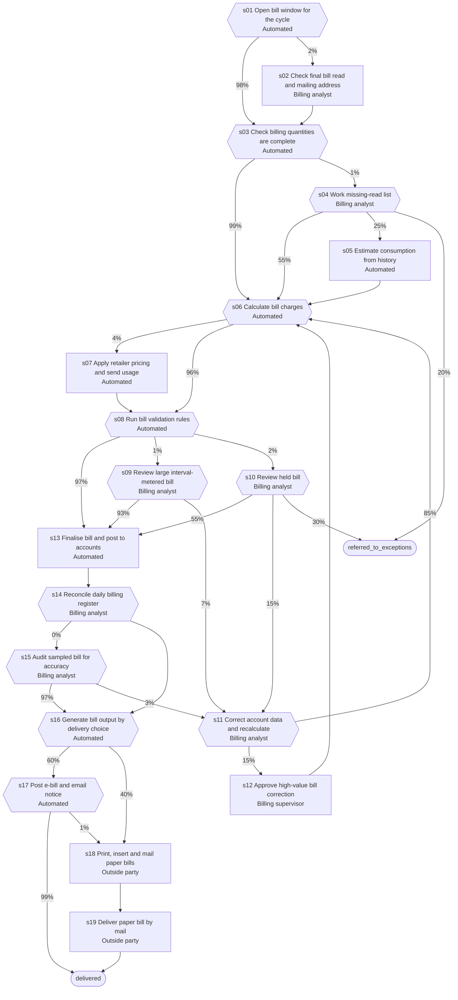

# Bill customers monthly

`edu-cs-billing` · electricity distribution · customer service (billing) · part of `electric-distribution-utility`

The utility bills about 350,000 customers every month in daily cycles: the customer information system (CIS) takes the billing quantities from the provincial meter data repository, prices them at the commodity, distribution, transmission and regulatory rates, adds rebates and HST, and sends an e-bill or a paper bill. Almost all bills pass without anyone touching them; billing analysts review the few percent that fail validation rules, check large commercial bills, work accounts without reads and reconcile each day's run. Delays and errors come from missing reads, meter changes and moves in the billing period, rate changes, and the limit of two estimated bills a year that the OEB sets.

| | |
|---|---|
| Unit of work | one customer bill |
| Starts when | Validated billing quantities for an account whose billing period has ended reach the CIS, or a move-out or account change needs a final bill. |
| Done when | The bill is delivered by e-bill or mail and posted to the customer's account, or it is held and handed to billing exceptions. |
| Organisation | A municipally owned Ontario distributor of about 350,000 customers billing monthly in daily cycles from a CIS fed by the provincial MDM/R. (571 employees, 2019-2022) |
| Volume | 350,000 cases a month (range 340,000 to 360,000) |

## Where it sits

- Starts with **validated_reads** from cs-meter-data-management (98% of cases)
- Starts with **account_change** from cs-move-in-move-out (2% of cases)
- Relies on **tariff** from fin-annual-rate-update (a standing input; it does not start a case)
- Relies on **assistance_credit** from cs-low-income-programs (a standing input; it does not start a case)
- Relies on **retailer_transaction** from cs-retailer-ebt (a standing input; it does not start a case)
- Relies on **field_result** from ops-customer-isolations (a standing input; it does not start a case)
- Relies on **system_change** from corp-it-change (a standing input; it does not start a case)
- Sends **customer_bill** to residential-customer (outcome: delivered)
- Sends **customer_bill** to business-customer (outcome: delivered)
- Sends **customer_bill** to key-account-customer (outcome: delivered)
- Sends **journal_entries** to fin-month-end-close (outcome: delivered)
- Sends **customer_bill** to cs-ieso-settlement (outcome: delivered)
- Sends **bill_exception** to cs-billing-exceptions (outcome: referred_to_exceptions)

## Flow

## Roles

| Role | Department | Layer | FTE on this process | Loaded cost per hour | Evidence |
|---|---|---|---:|---:|---|
| Billing analyst | Billing and Settlement | individual contributor | 8.5 | 47 CAD | C |
| Billing supervisor | Billing and Settlement | supervisor | 0.5 | 60 CAD | C |

## Steps

Hands-on time and the wait before each step show the most common value. Evidence tier A is a sourced number, B a sourced description, C the author's estimate.

| Step | Who | Kind | Hands-on | Wait before | Control | Evidence |
|---|---|---|---:|---:|---|---|
| **s01 Open bill window for the cycle.** The CIS bill run selects the accounts in the day's bill cycle whose billing period has ended, about 17,000 a working day, and queues them for calculation once their billing quantities are loaded. | Automated | system auto | 0 min | 4.0 h |  | A [scorecard] |
| **s02 Check final bill read and mailing address.** For move-out and account-change bills a billing analyst checks that the move date read was taken from the interval data, the forwarding address is on file and any security deposit is applied, then releases the account to the bill run. | Billing analyst | validation | 2 min | 4.0 h |  | C |
| **s03 Check billing quantities are complete.** The CIS confirms that a billing quantity response covers the whole period for every meter on the account, including generation channels for net-metered customers. | Automated | system auto | 0 min | 10 min |  | B [sme] |
| **s04 Work missing-read list.** A billing analyst looks up each account without billing quantities, checks whether metering has a fix in progress and the account's estimate history, and either waits for the re-request, lets the CIS estimate, or holds the bill for billing exceptions. | Billing analyst | lookup | 2 min | 5.0 h | Distribution System Code: at most two estimated bills to a customer in a 12-month period | B [bg2015] |
| **s05 Estimate consumption from history.** The CIS estimates the period's use by time-of-use period from the account's own history for the same season and flags the bill as estimated so the next actual read trues it up. | Automated | system auto | 0 min | 0 min |  | B [bg2015] |
| **s06 Calculate bill charges.** The CIS prices the billing quantities: commodity at Regulated Price Plan time-of-use or tiered prices, or the retailer's contract price, distribution fixed and volumetric charges from the OEB-approved tariff, transmission, wholesale market and regulatory charges, global adjustment for non-RPP customers, the Ontario Electricity Rebate and HST. | Automated | system auto | 0 min | 5 min |  | C |
| **s07 Apply retailer pricing and send usage.** For customers enrolled with a licensed retailer the CIS applies the retailer's price from the EBT enrolment, and sends the usage and charges to the retailer through the EBT hub for its settlement. | Automated | system auto | 0 min | 0 min |  | C |
| **s08 Run bill validation rules.** The CIS checks each bill against rules: consumption far above or below history, negative or very large amounts, long or short periods, a meter change in the period, zero use on an active account and demand values out of range. Failing bills are held on the exception worklist. | Automated | system auto | 0 min | 0 min | Distribution System Code section 7.11 billing accuracy standard (98% of bills accurate) | B [scorecard], [bg2015] |
| **s09 Review large interval-metered bill.** A billing analyst checks the bill of a general service customer of 50 kW or more: peak demand in kW or kVA against history, instrument transformer multiplier, loss factor, and for Class A customers the global adjustment share from their peak demand factor. | Billing analyst | review | 5 min | 5.0 h |  | B [qa2019] |
| **s10 Review held bill.** A billing analyst opens the held bill in the exception worklist, compares the consumption with the interval profile and history and checks for a meter change, move or rate change in the period, and decides to release it, correct it, or send it to billing exceptions for investigation. | Billing analyst | validation | 3.5 min | 10.0 h |  | C |
| **s11 Correct account data and recalculate.** The analyst fixes the cause in the CIS (rate class, multiplier, meter change dates, retailer flag or a missing credit) and triggers a recalculation, which sends the bill back through validation. | Billing analyst | data entry | 6 min | 30 min |  | C |
| **s12 Approve high-value bill correction.** The billing supervisor checks the reason and the amount of a correction above the analyst's limit, for example a large credit or a multi-month adjustment on a commercial account, and approves it in the CIS. | Billing supervisor | approval | 5 min | 4.0 h | Internal control over financial reporting: billing adjustments above a dollar limit need supervisor approval | C |
| **s13 Finalise bill and post to accounts.** The CIS finalises the bill, posts the charges to the customer's receivable balance, sets the due date and adds the amounts to the daily billing register and the general ledger interface. | Automated | system auto | 0 min | 10 min |  | C |
| **s14 Reconcile daily billing register.** Each morning a billing analyst reconciles the run: accounts selected against bills produced, held and estimated, and the register totals against the ledger interface, before releasing the print and e-bill files. The one-hour task is spread over about 17,000 bills. | Billing analyst | validation | 0.004 min | 5.0 h | Internal control over financial reporting: daily reconciliation of billed revenue to the general ledger | C |
| **s15 Audit sampled bill for accuracy.** For a daily sample of about 35 bills an analyst recalculates the bill by hand from the reads and the tariff, checks customer details, and records the result for the billing accuracy measure reported to the OEB. | Billing analyst | review | 12 min | 1.0 h | Distribution System Code section 7.11 billing accuracy measurement and OEB scorecard reporting | B [scorecard] |
| **s16 Generate bill output by delivery choice.** The CIS renders each bill and routes it by the customer's choice: an e-bill to the web portal or a paper bill to the print file sent to the print and mail vendor. | Automated | system auto | 0 min | 30 min |  | C |
| **s17 Post e-bill and email notice.** The web portal publishes the bill in MyAccount and the notification service emails the customer that the bill is ready, with the amount and due date. | Automated | system auto | 0 min | 4.0 h |  | C |
| **s18 Print, insert and mail paper bills.** The print and mail vendor receives the nightly print file, prints and inserts the bills with any regulatory inserts, presorts them and hands them to Canada Post. | Outside party | external wait | 0 min | 1.0 d |  | C |
| **s19 Deliver paper bill by mail.** Canada Post delivers the bill to the customer's mailing address, usually within two to four business days within the city. | Outside party | external wait | 0 min | 2.0 d |  | C |

## Exceptions

| Exception | Share of cases | What happens |
|---|---:|---|
| Held by validation rules | 2% | Bills with unusual consumption, a meter change or a rate change in the period are held for an analyst, who releases most, corrects some and sends about a third to billing exceptions. |
| No billing quantities | 1% | The repository has not returned billable data; the bill waits, is estimated if the customer is under the two-estimate limit, or is held. |
| Large account review | 1% | Interval-metered customers of 50 kW or more get a manual check of demand, multipliers and global adjustment before release. |
| Final bill on move-out | 2% | A move-out bill needs the move date read, forwarding address and deposit applied before the run. |

## Benchmarks

| Metric | Value | Unit | Population | Evidence |
|---|---|---|---|---|
| cycle_time_days | p50 1.0, p90 5.0 | calendar days from validated reads available to bill delivered | Ontario distributor monthly bills, 2019-2022 (60% e-bill, 40% paper) | C |
| billing_accuracy | 99.88 | percent of bills accurate, 2021 | The distributor this organisation is modelled on | A [scorecard] |
| bills_issued_per_year | 4200000 | bills, 2021 | The distributor this organisation is modelled on | A [scorecard] |
| billing_accuracy_standard | 98 | percent of bills accurate (minimum) | All Ontario electricity distributors | A [bg2015], [scorecard] |

## Pain points

- Price and rate changes on May 1, November 1 and January 1, and the COVID-19 relief prices of 2020, split billing periods and produce bursts of held bills that analysts must clear before the cycle's due dates. (steps s06, s10; C)
- Accounts without billing quantities sit between metering and billing; each team checks the other's queue, and the estimate limit forces hand tracking of estimate history. (steps s04, s05; B [bg2015], [sme])
- Large interval-metered bills are checked by hand because multipliers, demand and Class A global adjustment errors are expensive to rebill. (steps s09; B [qa2019])
- Paper bills take up to a week longer to arrive than e-bills, which shortens the customer's time to pay before the due date. (steps s18, s19; C)

## Assumptions

- Per-bill touch time is small because about 96% of bills pass without a person; the daily reconciliation hour is spread over about 17,000 bills a working day.
- Validation hold rate of 2.2%, missing-read rate of 1.4% and the 30% of holds referred to billing exceptions are the author's estimates, chosen so that referrals (about 3,300 a month) plus customer-raised rebills match the organisation file's 6,000 billing exceptions a month.
- E-bill share is 60%, taken from the organisation file's statement that more than 60% of customers were paperless by 2021.
- The print and mail vendor and Canada Post are modelled as external steps; no external party for the print vendor exists in the organisation file.
- The simulated median of about one day reflects the e-bill majority; paper bills take four to seven days.
- Hands-on time implies more billing analyst FTE than stated because the hold review, large-account review and accuracy sampling all draw on the same 16-person team that also runs billing exceptions; the stated 9 FTE is 0.6 times the 14.6 FTE implied by hands-on time, so the 16-person team is tight once billing exceptions (about 6,000 cases a month) are added.

## Sources

- [scorecard] [Scorecard - Hydro Ottawa Limited (2017-2021) and 2021 Scorecard Management Discussion and Analysis](https://www.oeb.ca/documents/scorecard/2021/Scorecard%20-%20Hydro%20Ottawa%20Limited.pdf) (Ontario Energy Board, 2022). More than 4.2 million bills in 2021; billing accuracy 99.88% (2020, 2021); definition of an accurate bill under Distribution System Code section 7.1; 98% industry target.
- [bg2015] [Backgrounder: Monthly and Estimated Billing Changes to the Distribution System Code](https://oeb.ca/sites/default/files/bg_Billing_Practices_Code_Amendments_20150415.pdf) (Ontario Energy Board, 2015). Monthly billing from 31 December 2016, bills based on actual reads, at most two estimated bills a year, 98% billing accuracy standard.
- [sme] [Quarterly SME MDM/R Report, Issue 32.0 (2nd quarter 2021)](https://www.oeb.ca/sites/default/files/Quarterly%20SME%20MDMR%20Report%20-%20Issue%2032.0.pdf) (IESO Smart Metering Entity (report to the Ontario Energy Board), 2021). 'No Data' billing quantity responses that impede distributor billing.
- [qa2019] [Accounts 1588 and 1589 Q&As (accounting guidance questions and answers)](https://www.oeb.ca/sites/default/files/Accounting-Guidance-on-Accounts-1588-1589-QA-20190711.pdf) (Ontario Energy Board, 2019). Class A customers are charged global adjustment based on their peak demand factor.

Written by claude-opus on 2026-11-24.
