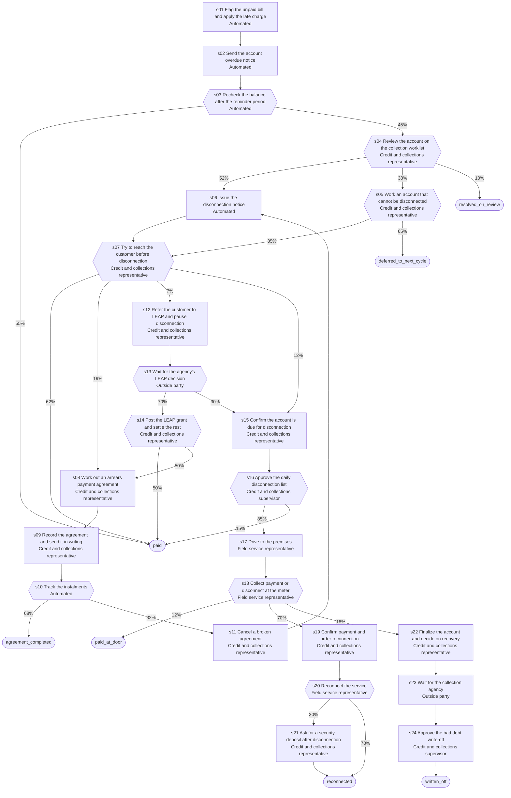

# Collect overdue accounts

`edu-cs-collections` · electricity distribution · customer service (credit and collections) · part of `electric-distribution-utility`

When a customer does not pay a bill by the due date, the distributor follows a sequence set largely by Ontario Energy Board rules: a late charge and reminder, a disconnection notice with a fixed notice period, attempts to reach the customer, an offer of an arrears payment agreement or a referral to low-income assistance, and only then a field disconnection, followed by reconnection within two business days once the customer pays. Most accounts pay after the reminder; a few end in agency collection and write-off. Residential disconnections are banned from November 15 to April 30, and in 2020 the ban ran to July 31, so arrears grow through winter and the field work bunches into summer and autumn.

| | |
|---|---|
| Unit of work | one account in arrears (one overdue bill episode) |
| Starts when | A bill is still unpaid after the minimum payment period, or a customer calls to arrange payment of an overdue balance. |
| Done when | The arrears are paid, an agreement is completed, the service is reconnected after payment, the account is deferred to the next cycle, or the balance is written off. |
| Organisation | A municipally owned Ontario electricity distributor with about 350,000 customers and a ten-person credit and collections team using CIS collection treatment and field service representatives for disconnections. (571 employees, 2019-2022) |
| Volume | 12,000 cases a month (range 8,000 to 18,000) |

## Where it sits

- Starts with **payment** from cs-payment-processing (93% of cases)
- Starts with **payment_arrangement** from cs-contact-centre (5% of cases)
- Starts with **field_result** from ops-field-service-orders (2% of cases)
- Relies on **assistance_credit** from cs-low-income-programs (a standing input; it does not start a case)
- Sends **arrears_notice** to residential-customer (outcome: any)
- Sends **arrears_notice** to business-customer (outcome: any)
- Sends **disconnect_order** to ops-field-service-orders (outcome: reconnected)
- Sends **disconnect_order** to ops-field-service-orders (outcome: paid_at_door)
- Sends **disconnect_order** to ops-field-service-orders (outcome: written_off)
- Sends **journal_entries** to fin-month-end-close (outcome: written_off)
- Sends **customer_inquiry** to cs-low-income-programs (outcome: any)

## Flow

## Roles

| Role | Department | Layer | FTE on this process | Loaded cost per hour | Evidence |
|---|---|---|---:|---:|---|
| Credit and collections representative | Credit and Collections | individual contributor | 8 | 44 CAD | C |
| Credit and collections supervisor | Credit and Collections | supervisor | 0.6 | 58 CAD | C |
| Field service representative | Field Services | individual contributor | 3.5 | 50 CAD | C |

## Steps

Hands-on time and the wait before each step show the most common value. Evidence tier A is a sourced number, B a sourced description, C the author's estimate.

| Step | Who | Kind | Hands-on | Wait before | Control | Evidence |
|---|---|---|---:|---:|---|---|
| **s01 Flag the unpaid bill and apply the late charge.** The nightly CIS aging run finds bills still unpaid after the minimum payment period (16 days, 20 days from March 2020), applies the 1.5% a month late payment charge and places the account on the collection treatment path for its customer class. | Automated | system auto | 0 min | 0 min | OEB Distribution System Code s.2.6.2-2.6.3 minimum payment period before late charges (raised to 20 days on March 1, 2020) | A [src-csr2020], [src-dsc] |
| **s02 Send the account overdue notice.** The CIS sends an account overdue reminder by the customer's preferred method, email or mail, stating the amount and the date after which a disconnection notice may follow. Before March 2020 a reminder was common practice but not required. | Automated | system auto | 0 min | 1.0 d | OEB customer service rules from March 1, 2020: account overdue notice at least 7 days before a disconnection notice | B [src-csr2020] |
| **s03 Recheck the balance after the reminder period.** After the reminder period the CIS rechecks the account. Most customers pay after the reminder; the rest are put on the representatives' daily collection worklist. | Automated | system auto | 0 min | 7.0 d |  | C |
| **s04 Review the account on the collection worklist.** A collections representative opens the account and checks the exclusions: the winter ban or the 2020 pandemic ban for residential and small business customers, a pending LEAP assessment, an open billing dispute, an active arrangement, or a medical or vulnerability flag. The representative then decides the next action. | Credit and collections representative | review | 2 min | 1.0 d | OEB winter disconnection ban (November 15 to April 30) and the March 19 to July 31, 2020 extended ban | B [src-ban2020], [src-csr2020] |
| **s05 Work an account that cannot be disconnected.** During a ban the representative sends reminder letters, calls customers with larger balances to offer an arrangement or assistance (from 2020 the COVID-19 Energy Assistance Program), and leaves the account to recycle on the worklist next month. | Credit and collections representative | communication | 4 min | 0 min |  | B [src-ban2020] |
| **s06 Issue the disconnection notice.** The CIS prints a disconnection notice in its own envelope (not with the bill) stating the overdue amount, payment methods, reconnection charges and assistance programs. From March 2020 the notice period is 14 days, with mailed notices deemed received on the fifth day; before then it was 10 days. | Automated | system auto | 0 min | 1.0 d | OEB Distribution System Code s.4.2.2-4.2.3: content and delivery of disconnection notices and minimum notice period | A [src-dsc], [src-csr2020] |
| **s07 Try to reach the customer before disconnection.** Before the notice period ends the representative calls the customer, leaves messages or emails, and if no contact is made a notice is left at the premises. On contact the representative takes a payment, offers an arrears payment agreement, or refers the customer to assistance. | Credit and collections representative | communication | 5 min | 5.0 d | OEB Distribution System Code s.4.2.2.4: reasonable efforts to contact the customer before disconnection | C |
| **s08 Work out an arrears payment agreement.** The representative applies any security deposit to the arrears, calculates the average monthly bill, sets the down payment (at most 15%, or 10% for an eligible low-income customer) and the number of months the rules require, and agrees the schedule with the customer. | Credit and collections representative | judgment | 10 min | 0 min | OEB Distribution System Code s.2.7: arrears payment agreement minimum terms | A [src-dsc] |
| **s09 Record the agreement and send it in writing.** The representative enters the instalment schedule in the CIS, stops late charges on the covered amount, suspends the disconnection, and sends the customer the written agreement with the due dates and what happens if a payment is missed. | Credit and collections representative | data entry | 6 min | 0 min |  | B [src-csr2020] |
| **s10 Track the instalments.** The CIS checks each instalment against the schedule alongside the current bills over the five to sixteen months of the agreement and puts the account back on the worklist when a payment is missed. | Automated | system auto | 0 min | 150.0 d |  | C |
| **s11 Cancel a broken agreement.** When instalments are missed the representative calls the customer, and if the arrears are not brought up to date cancels the agreement, which allows the distributor to refuse a new one for a year, and restarts the notice process. | Credit and collections representative | review | 7 min | 3.0 d | OEB Distribution System Code s.2.7: conditions for cancelling an arrears payment agreement | C |
| **s12 Refer the customer to LEAP and pause disconnection.** The representative gives the customer the LEAP intake agency's contact, records the referral, and when the agency confirms it is assessing the customer suspends disconnection for 21 days. | Credit and collections representative | communication | 5 min | 0 min | OEB Distribution System Code s.4.2.2.6: 21-day suspension while a LEAP intake agency assesses eligibility | A [src-dsc] |
| **s13 Wait for the agency's LEAP decision.** A social service agency interviews the customer, checks household income, and tells the distributor whether a one-time LEAP grant is approved and how much, usually within the 21-day hold. | Outside party | external wait | 0 min | 14.0 d |  | B [src-dsc] |
| **s14 Post the LEAP grant and settle the rest.** The representative posts the LEAP grant as a credit on the account, waives charges the rules require for an eligible low-income customer, and either confirms the balance is cleared or sets up an agreement for what is left. | Credit and collections representative | data entry | 5 min | 1.0 d |  | C |
| **s15 Confirm the account is due for disconnection.** After the notice period the representative rechecks payments, holds, the ban calendar and the next business day, since disconnection may not happen on a day the office is closed or the day before, and adds the account to the disconnection list. | Credit and collections representative | validation | 3 min | 1.0 d | OEB customer service rules from March 2020: disconnect within 14 days after the notice period and not on a day the utility is closed or the day before | B [src-csr2020] |
| **s16 Approve the daily disconnection list.** The credit and collections supervisor reviews the day's list, removes accounts with medical, vulnerability or dispute flags, checks the count against field capacity and releases the disconnect orders to field services. | Credit and collections supervisor | approval | 1 min | 12.0 h | Credit policy: supervisor release of residential disconnections | C |
| **s17 Drive to the premises.** A field service representative picks up the day's disconnect orders on the tablet, plans the route and drives to the premises in a light vehicle; order is set by area and by meter access. | Field service representative | travel | 15 min | 3.0 d |  | C |
| **s18 Collect payment or disconnect at the meter.** At the premises the representative knocks, accepts payment by credit card if offered, otherwise disconnects at the meter or installs a load limiter, leaves a notice saying how to get reconnected, and records the result on the tablet. | Field service representative | physical | 15 min | 0 min | Employer electrical safe work practice for meter work: arc-flash PPE and meter base inspection | B [src-dsc] |
| **s19 Confirm payment and order reconnection.** When the customer pays the overdue amount or signs an arrears agreement, the representative confirms the payment, charges or waives the reconnection fee (waived for eligible low-income customers) and issues an urgent reconnect order. | Credit and collections representative | data entry | 5 min | 1.0 d |  | B [src-dsc] |
| **s20 Reconnect the service.** A field service representative drives back to the premises, inspects the meter base, restores supply or removes the load limiter, confirms the meter is reading, and closes the order on the tablet. | Field service representative | physical | 35 min | 1.0 d | OEB Distribution System Code s.7.10: reconnect within 2 business days of payment or agreement, 85% of the time | A [src-dsc] |
| **s21 Ask for a security deposit after disconnection.** Because the account now lacks a good payment history, the representative calculates a security deposit from the billing cycle factor and estimated bill and bills it in instalments over at least six months for a residential customer. | Credit and collections representative | drafting | 5 min | 3.0 d | OEB Distribution System Code s.2.4.12 and 2.4.20A: maximum deposit and instalments | A [src-dsc] |
| **s22 Finalize the account and decide on recovery.** For an account that stays off or was vacated, the representative issues the final bill, applies the deposit, waits the final-bill due period and sends the remaining balance to the collection agency. | Credit and collections representative | analysis | 10 min | 30.0 d |  | C |
| **s23 Wait for the collection agency.** An outside collection agency traces the former customer and tries to recover the balance on contingency, reporting recoveries monthly and returning the accounts it cannot collect. | Outside party | external wait | 0 min | 90.0 d |  | C |
| **s24 Approve the bad debt write-off.** The credit and collections supervisor reviews the agency's returned accounts and the representative's notes, approves the write-off list within delegated limits, and the CIS posts the write-off journal for finance. | Credit and collections supervisor | approval | 2 min | 14.0 d | Delegation of authority: write-offs approved by someone other than the collector | C |

## Exceptions

| Exception | Share of cases | What happens |
|---|---:|---|
| Winter or pandemic ban | 17% | A residential (and in 2020 small business) account cannot be disconnected, so it gets reminders and offers and recycles monthly. |
| Broken arrears payment agreement | 2% | The customer misses instalments; the agreement is cancelled and the disconnection notice process restarts. |
| LEAP assessment hold | 2% | An agency assesses the customer for emergency assistance and disconnection is suspended for 21 days. |
| Disconnection and reconnection | 3% | The account is disconnected in the field, the customer pays or agrees, and service is restored within two business days. |

## Benchmarks

| Metric | Value | Unit | Population | Evidence |
|---|---|---|---|---|
| cycle_time_days | p50 10, p90 30 | calendar days from overdue to resolution | Accounts entering collection treatment | C |
| disconnection_notice_period | 14 | calendar days (10 before March 2020) | Ontario electricity distributors | A [src-csr2020] |
| reconnection_within_2_business_days | 0.85 | minimum share of reconnections | Ontario electricity distributors | A [src-dsc] |

## Pain points

- The winter ban and the 2020 extended ban stop disconnections for months, so arrears grow and the work arrives in a wave in spring and summer. (steps s04, s05; B [src-ban2020], [src-csr2020])
- Many customers cannot be reached by phone before disconnection, so field visits are made that end in payment at the door. (steps s07, s18; C)
- About a third of arrears agreements break, restarting the notice process. (steps s10, s11; C)

## Assumptions

- One case is one overdue bill episode on one account, from the day the bill is overdue until it is paid, settled under an agreement, deferred to the next month's treatment or written off. Accounts in a ban period that recycle each month count as a new case each month.
- The organisation file's volume of 12,000 a month (about 3.5% of customers) is kept; with the shares used here it gives about 3,000 disconnection notices, about 450 field disconnection visits and about 300 reconnections a month, averaged over the year, which is plausible for a 350,000-customer utility but not checked against published RRR data.
- Disconnection is done by field visit. Remote disconnection through smart meters is not assumed because the organisation file gives no evidence of remote-disconnect meters.
- Field service representatives are added to this process although the organisation file lists only collections representatives and the supervisor; their visits could instead sit in ops-field-service-orders.
- The 1.5% a month late payment charge is the usual Ontario rate, described from general knowledge.
- The long p90 cycle time comes from arrears agreements that last five to sixteen months and from agency referrals; hands-on time is small.
- Staffing: hands-on time times volume implies about 12 FTE, matching 12.1 stated (8 collections representatives, 0.6 supervisor, 3.5 field service representatives). The field share is about 450 disconnection and 300 reconnection visits a month; with 8 field service representatives in the organisation file also covering about 1,300 other field service orders a month, field capacity is tight in the May to November disconnection season.
- Simulated p90 of about 21 days sits inside the estimated 30-day benchmark; agreements and agency referrals are under 10% of cases and lie beyond the 90th percentile.
- Roles use the organisation file's ids and loaded costs (wage x 1.40).

## Sources

- [src-csr2020] [New Ontario Energy Board customer service rules strengthen consumer protection (news release)](https://www.oeb.ca/sites/default/files/news-release-csr-20200305.pdf) (Ontario Energy Board, 2020). Rules in force March 1, 2020: minimum payment period raised from 16 to 20 calendar days; an account overdue notice 7 days before a disconnection notice; disconnection notice period raised from 10 to 14 days, mailed notice deemed received on the fifth calendar day, disconnection within 14 days after the notice period; no disconnection on a day the utility is closed or the day before; winter ban November 15 to April 30 with reconnection by December 1; residential deposits returned after one year of good payment, small business after three; deposits waived for new residential customers enrolling in equal or pre-authorized payment; APA offered to small business; no late charges on APA amounts.
- [src-dsc] [Distribution System Code (consolidated, revised March 27, 2024)](https://www.oeb.ca/sites/default/files/Distribution-System-Code_March_20240327.pdf) (Ontario Energy Board, 2024). s.2.4.11-2.4.20A security deposit waivers, maximum (billing cycle factor x estimated bill) and instalments over at least 6 months for residential customers; s.2.6.1A monthly billing of residential and GS<50 kW customers (in force December 31, 2016); s.2.6.6.2B payment allocation; s.2.7 arrears payment agreements (down payment up to 15%, 10% for eligible low-income; terms of at least 5 or 10 months, 8, 12 or 16 months for eligible low-income); s.4.2.2.1 disconnection notice not in the bill envelope; s.4.2.2.6 21-day suspension while a LEAP intake agency assesses the customer; s.4.2.3.1 mailed notice deemed received on the fifth day; s.7.6 65% of calls answered in 30 s; s.7.7 abandon rate 10% or less; s.7.8 written response in 10 business days 80% of the time; s.7.10 reconnection within 2 business days 85% of the time; s.7.11 billing accuracy 98% and what counts as an inaccurate bill. Amendment history shows these sections were in force through 2019-2022 apart from the March 2020 changes.
- [src-ban2020] [The OEB's extended Disconnection Ban will end on July 31, 2020](https://oeb.ca/node/2675) (Ontario Energy Board, 2020). On March 19, 2020 the OEB extended the winter disconnection ban to July 31, 2020 and widened it to small business customers; after it ended, the account overdue notice, 14-day disconnection notice and LEAP rules applied; COVID-19 Energy Assistance Program (CEAP) one-time on-bill credit applied for through the utility; LEAP emergency assistance and OESP credits.

Written by claude-opus on 2026-11-24.
