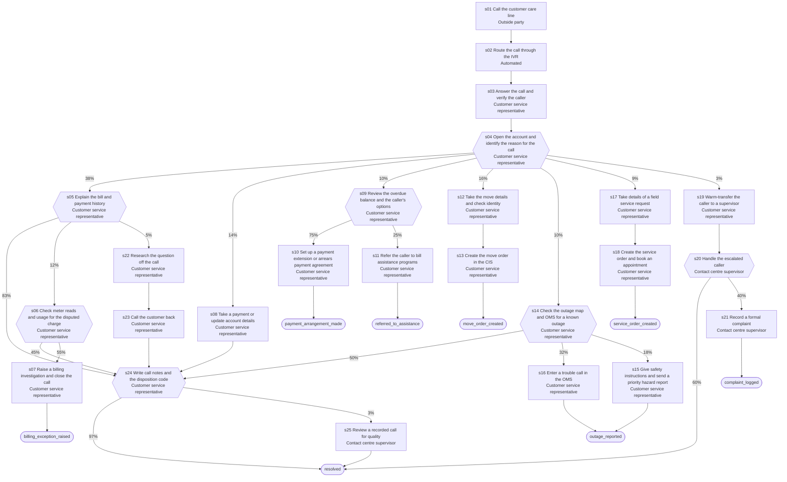

# Answer customer calls and contacts

`edu-cs-contact-centre` · electricity distribution · customer service · part of `electric-distribution-utility`

Customers of a city-owned electricity distributor phone the contact centre about bills, payments, moves, outages and service requests. An IVR routes each call to about 40 representatives who verify the caller, open the account in the customer information system and either answer on the spot or start work for another team: a move order, a billing investigation, a payment arrangement, a trouble call or a field order. The regulator requires 65% of calls answered within 30 seconds; in 2021 the centre took 186,632 calls, answered 83% on time and resolved 89% at first contact. Storms, rate changes and the summer move season bring call peaks that staffing cannot follow, and calls that need research turn into callbacks.

| | |
|---|---|
| Unit of work | one customer call answered by an agent |
| Starts when | A customer or member of the public calls the customer care line and asks for an agent. |
| Done when | The caller's question is answered or the follow-up work is created in the CIS or OMS, and the call is coded. |
| Organisation | A municipally owned Ontario electricity distributor with about 350,000 customers, an in-house contact centre open weekdays and Saturdays, a CIS, an OMS and smart meters. (571 employees, 2019-2022) |
| Volume | 15,550 cases a month (range 13,000 to 19,000) |

## Where it sits

- Starts with **customer_inquiry** from residential-customer (80% of cases)
- Starts with **customer_inquiry** from business-customer (10% of cases)
- Starts with **outage_report** from residential-customer (8% of cases)
- Starts with **outage_report** from public (2% of cases)
- Relies on **customer_outage_notice** from corp-outage-communications (a standing input; it does not start a case)
- Relies on **tariff** from fin-annual-rate-update (a standing input; it does not start a case)
- Relies on **system_change** from corp-it-change (a standing input; it does not start a case)
- Sends **outage_report** to ops-system-monitoring (outcome: outage_reported)
- Sends **account_change** to cs-move-in-move-out (outcome: move_order_created)
- Sends **bill_exception** to cs-billing-exceptions (outcome: billing_exception_raised)
- Sends **payment_arrangement** to cs-collections (outcome: payment_arrangement_made)
- Sends **complaint** to cs-complaints (outcome: complaint_logged)
- Sends **service_request** to ae-service-layouts (outcome: service_order_created)
- Sends **customer_inquiry** to ops-field-service-orders (outcome: service_order_created)
- Sends **customer_inquiry** to ops-vegetation-management (outcome: service_order_created)
- Sends **isolation_request** to ops-customer-isolations (outcome: service_order_created)
- Sends **customer_inquiry** to cs-low-income-programs (outcome: referred_to_assistance)
- Sends **survey_results** to exec-strategy-board (outcome: any)

## Flow

## Roles

| Role | Department | Layer | FTE on this process | Loaded cost per hour | Evidence |
|---|---|---|---:|---:|---|
| Customer service representative | Customer Contact Centre | individual contributor | 27 | 42 CAD | B [src-scorecard] |
| Contact centre supervisor | Customer Contact Centre | supervisor | 3.2 | 58 CAD | C |
| Customer service manager (contact centre, billing and credit, metering) | Customer Service | manager | 0.4 | 88 CAD | C |

## Steps

Hands-on time and the wait before each step show the most common value. Evidence tier A is a sourced number, B a sourced description, C the author's estimate.

| Step | Who | Kind | Hands-on | Wait before | Control | Evidence |
|---|---|---|---:|---:|---|---|
| **s01 Call the customer care line.** A residential or business customer, or a member of the public reporting a hazard, dials the customer care number during contact centre hours (weekdays plus Saturday) or the 24-hour emergency option. The caller's own time is not counted as labour. | Outside party | intake | 0 min | 0 min |  | C |
| **s02 Route the call through the IVR.** The IVR plays any outage message for the caller's area, asks for the account or phone number, offers self-service balance and payment options and routes the caller to a skill queue (billing, moving, outage, collections). The volume counts only calls that reach an agent, so every case continues. | Automated | system auto | 0 min | 1 min |  | C |
| **s03 Answer the call and verify the caller.** The next free representative answers, reads the screen pop, and verifies the caller by name, service address and account number or postal code before discussing the account. If the caller is not the account holder the agent limits what can be disclosed. | Customer service representative | intake | 1.5 min | 0.05 min | OEB Distribution System Code s.7.6: 65% of qualified calls answered within 30 seconds and s.7.7 abandon rate of 10% or less, measured yearly | A [src-scorecard], [src-dsc] |
| **s04 Open the account and identify the reason for the call.** The representative opens the account in the CIS, scans the last bills, payments, notices and open orders, checks the outage map or OMS banner when the caller mentions power, and picks the reason code that decides how the call is handled. | Customer service representative | lookup | 1 min | 0 min |  | C |
| **s05 Explain the bill and payment history.** The representative walks the caller through the charges, the time-of-use or tiered prices, usage compared with the same month last year from the smart meter data, and any late payment charge. Most callers accept the explanation; some dispute a charge and some need research the agent cannot finish on the call. | Customer service representative | communication | 3.5 min | 0 min |  | B [src-scorecard] |
| **s06 Check meter reads and usage for the disputed charge.** The representative opens the hourly smart meter data and read history, compares the disputed period with earlier months, and looks for estimated reads, a recent meter change or a move date that could explain the amount. | Customer service representative | lookup | 4 min | 0 min |  | C |
| **s07 Raise a billing investigation and close the call.** The representative creates a billing investigation task in the CIS with the period, the caller's concern and the evidence found, may hold collection activity on the disputed amount, tells the caller a billing analyst will reply, and records the call notes and disposition. | Customer service representative | data entry | 3 min | 0 min | OEB Distribution System Code s.7.8: written response to a qualified enquiry within 10 business days, 80% of the time | B [src-dsc] |
| **s08 Take a payment or update account details.** The representative transfers the caller to the secure card payment line or updates the mailing address, phone, e-billing, pre-authorized payment or equal payment plan in the CIS, and confirms the change back to the caller. | Customer service representative | data entry | 3 min | 0 min |  | C |
| **s09 Review the overdue balance and the caller's options.** The representative reviews the overdue amount, notices already sent, any security deposit, earlier payment agreements and whether the caller says they are on a low income, then decides with the caller between a payment arrangement and a referral to assistance programs. | Customer service representative | judgment | 3 min | 0 min |  | C |
| **s10 Set up a payment extension or arrears payment agreement.** For a short delay the representative records a promise-to-pay date; for larger arrears the agent builds an arrears payment agreement in the CIS within the OEB minimum terms, quotes the down payment and instalments, suspends collection steps and records the call. | Customer service representative | data entry | 5 min | 0 min | OEB Distribution System Code s.2.7: down payment up to 15% (10% for eligible low-income) and minimum terms of 5 or 10 months (8, 12 or 16 for eligible low-income) | B [src-dsc] |
| **s11 Refer the caller to bill assistance programs.** The representative explains the Ontario Electricity Support Program, LEAP emergency assistance and, in 2020-2021, the COVID-19 Energy Assistance Program, gives the intake agency's contact, flags the account so collections waits, and records the call. | Customer service representative | communication | 4 min | 0 min |  | B [src-ban2020] |
| **s12 Take the move details and check identity.** For a move the representative records the old and new addresses, move dates, landlord contact for renters, and for a new customer the date of birth and photo identification, and reminds the caller that ten business days' notice is asked for. | Customer service representative | intake | 4 min | 0 min |  | B [src-moving] |
| **s13 Create the move order in the CIS.** The representative creates the move-out and move-in orders against the premise in the CIS, notes any security deposit question for the account team, and confirms the dates and set-up charge to the caller before closing the call. | Customer service representative | data entry | 3 min | 0 min |  | B [src-moving] |
| **s14 Check the outage map and OMS for a known outage.** The representative checks the OMS and outage map for the caller's address. For a known outage the agent gives the cause and estimated restoration time; otherwise the agent asks whether neighbours are out, whether the main breaker was checked and whether anything is down or sparking. | Customer service representative | lookup | 1.5 min | 0 min |  | C |
| **s15 Give safety instructions and send a priority hazard report.** The representative tells the caller to stay at least ten metres away and keep others away, creates a priority hazard trouble call in the OMS, and phones the control room when life or property is at risk or police and fire are on site. | Customer service representative | communication | 3 min | 0 min | Utility public safety procedure for downed or damaged lines: keep-away instruction and immediate dispatch (Ontario Regulation 22/04 public safety obligations) | C |
| **s16 Enter a trouble call in the OMS.** The representative enters a no-power or partial-power trouble call in the OMS against the customer's premise so that the OMS can group it with other calls and the control room can dispatch, then records the call. | Customer service representative | data entry | 2.5 min | 0 min |  | C |
| **s17 Take details of a field service request.** The representative records what the customer wants: a new or upgraded service, a meter check, a tree near a line, an isolation so a contractor can work safely, or a disconnect for renovation, with the site contact, access and preferred dates. | Customer service representative | intake | 3 min | 0 min |  | C |
| **s18 Create the service order and book an appointment.** The representative creates the order in the CIS, which passes it to mobile workforce management, offers a four-hour appointment window where the customer must be present, and sends new services to the layout team. | Customer service representative | data entry | 3 min | 0 min | OEB Distribution System Code s.7.3-7.4: appointment window of no more than four hours, met 90% of the time | B [src-scorecard] |
| **s19 Warm-transfer the caller to a supervisor.** When a caller asks for a supervisor or the agent cannot resolve the problem within their authority, the agent places the caller on hold, summarises the case to the supervisor on duty and stays on the line for the introduction. | Customer service representative | coordination | 1 min | 0 min |  | C |
| **s20 Handle the escalated caller.** The supervisor listens, reviews the account and earlier contacts, explains the rules that apply, and offers what is within their authority such as a late charge reversal, a longer payment plan or a goodwill credit. Some callers want a formal complaint recorded. | Contact centre supervisor | judgment | 10 min | 1 min | Contact centre delegation of authority for credits and charge reversals | C |
| **s21 Record a formal complaint.** The supervisor records the complaint in the CIS complaint log with the facts, the remedy asked for and what was offered, sends the acknowledgement, and assigns it to the complaints team, who must tell the customer about the OEB's complaint process if it is not settled. | Contact centre supervisor | drafting | 10 min | 30 min | OEB licence and Distribution System Code requirements for a complaint process and written response (s.7.8) | C |
| **s22 Research the question off the call.** When the answer needs another department or more digging, the representative promises a callback, then works the case from the queue: reads the bill calculation, asks billing or metering staff by email or Teams, and notes the answer. | Customer service representative | analysis | 10 min | 12.0 h |  | C |
| **s23 Call the customer back.** The representative phones the customer with the answer, leaves a message if there is no reply and tries again the next day, and records the outcome on the account. | Customer service representative | communication | 5 min | 1.0 d |  | C |
| **s24 Write call notes and the disposition code.** After the conversation the representative types notes in the CIS contact log and selects the call reason and outcome codes that feed the first-contact-resolution and call-driver reports, then becomes available for the next call. | Customer service representative | data entry | 1 min | 0 min |  | C |
| **s25 Review a recorded call for quality.** A supervisor listens to a sample of recorded calls each week, scores each one against the quality form (verification, accuracy, tone, notes, required disclosures) and coaches the agent on what was missed. | Contact centre supervisor | review | 18 min | 3.0 d | Contact centre quality monitoring program | C |

## Exceptions

| Exception | Share of cases | What happens |
|---|---:|---|
| Billing dispute needing investigation | 2% | The agent finds a possible error and hands the case to billing analysts, who must reply within 10 business days. |
| Callback after research | 2% | The agent cannot answer on the call, researches the question from the queue and calls back a day or two later. |
| Escalation and formal complaint | 1% | The caller asks for a supervisor and then for a formal complaint, which goes to the complaints team. |
| Public safety hazard | 2% | A wire down or sparking equipment is reported; the agent gives keep-away instructions and sends a priority report. |

## Benchmarks

| Metric | Value | Unit | Population | Evidence |
|---|---|---|---|---|
| calls_answered_within_30_seconds | 0.8314 | share of calls to agents, 2021 | Hydro Ottawa Limited, 186,632 calls | A [src-scorecard] |
| first_contact_resolution | 0.8904 | share of surveyed telephone customers, 2021 | 3,176 survey respondents | A [src-scorecard] |
| cycle_time_days | p50 0.01, p90 0.02 | calendar days from call to call closed | Calls to agents | C |

## Pain points

- Storm days bring several times the normal calls; on-time answer fell to 74.6% in 2020 while staff moved to remote work. (steps s03, s14; A [src-scorecard])
- About one call in nine is not resolved at first contact, which brings repeat calls and callbacks. (steps s22, s23; A [src-scorecard])
- Agents re-key move and service details from calls into separate CIS orders, and wrong premises or dates cause later bills to the wrong person. (steps s12, s13, s18; C)

## Assumptions

- The unit of work is one call answered by an agent, matching the 186,632 calls a year in the OEB scorecard. Emails, web forms and chat are not counted; they are perhaps 1,500-2,500 more contacts a month (author's estimate) and are part of why stated CSR FTE exceeds the hands-on time.
- Hands-on time per call comes to about 9-10 minutes including verification and wrap-up, against the organisation file's note of about 6 minutes; no published handle time was found.
- Staffing: hands-on minutes times volume imply fewer FTE than the 27 CSR FTE stated. The gap is time not spent on a call: waiting for calls to arrive (occupancy of about 75-85% is needed to answer 83% in 30 seconds), training, team meetings, Saturday cover and written contacts.
- Call reason shares are estimates; the scorecard gives no breakdown.
- Queue wait is triangular with low 0, mode 0.05 and high 0.8 minutes so that about 85% of calls are answered within 30 seconds, close to the 2019 and 2021 results.
- Roles use the organisation file's ids and loaded costs (wage x 1.40).
- Sources were opened on 2026-11-24. The Distribution System Code was read in its March 2024 consolidation; its amendment history shows sections 7.3-7.11 and 2.7 in force throughout 2019-2022.

## Sources

- [src-scorecard] [Scorecard - Hydro Ottawa Limited (2017-2021) and 2021 Scorecard Management Discussion and Analysis](https://www.oeb.ca/documents/scorecard/2021/Scorecard%20-%20Hydro%20Ottawa%20Limited.pdf) (Ontario Energy Board, 2022). Telephone calls answered on time 85.07% (2017), 88.74% (2018), 86.15% (2019), 74.60% (2020), 83.14% (2021) against a 65% standard; 186,632 calls to agents in 2021; first contact resolution 84.27-89.88 (2017-2021), 89.04% in 2021 from 3,176 surveyed callers of whom 2,828 said the issue was resolved; billing accuracy 99.88-99.90% against 98%; more than 4.2 million bills in 2021; 9,001 appointments; 95% overall satisfaction.
- [src-dsc] [Distribution System Code (consolidated, revised March 27, 2024)](https://www.oeb.ca/sites/default/files/Distribution-System-Code_March_20240327.pdf) (Ontario Energy Board, 2024). s.2.4.11-2.4.20A security deposit waivers, maximum (billing cycle factor x estimated bill) and instalments over at least 6 months for residential customers; s.2.6.1A monthly billing of residential and GS<50 kW customers (in force December 31, 2016); s.2.6.6.2B payment allocation; s.2.7 arrears payment agreements (down payment up to 15%, 10% for eligible low-income; terms of at least 5 or 10 months, 8, 12 or 16 months for eligible low-income); s.4.2.2.1 disconnection notice not in the bill envelope; s.4.2.2.6 21-day suspension while a LEAP intake agency assesses the customer; s.4.2.3.1 mailed notice deemed received on the fifth day; s.7.6 65% of calls answered in 30 s; s.7.7 abandon rate 10% or less; s.7.8 written response in 10 business days 80% of the time; s.7.10 reconnection within 2 business days 85% of the time; s.7.11 billing accuracy 98% and what counts as an inaccurate bill. Amendment history shows these sections were in force through 2019-2022 apart from the March 2020 changes.
- [src-ban2020] [The OEB's extended Disconnection Ban will end on July 31, 2020](https://oeb.ca/node/2675) (Ontario Energy Board, 2020). On March 19, 2020 the OEB extended the winter disconnection ban to July 31, 2020 and widened it to small business customers; after it ended, the account overdue notice, 14-day disconnection notice and LEAP rules applied; COVID-19 Energy Assistance Program (CEAP) one-time on-bill credit applied for through the utility; LEAP emergency assistance and OESP credits.
- [src-moving] [Moving (residential services)](https://hydroottawa.com/en/residential/services/moving) (Hydro Ottawa, 2026). Move requests at least 10 business days before moving day; new customers use an online moving request form and give date of birth, government photo ID and landlord contact; existing customers move or stop service in MyAccount; account set-up charge on the first bill; final bill about three weeks after the move-out date; landlords may not submit for tenants; OESP recipients must re-apply after a move. Page read in 2026; practice in 2019-2022 assumed similar.

Written by claude-opus on 2026-11-24.
