# Settle with the IESO

`edu-cs-ieso-settlement` · electricity distribution · customer service (billing and settlement) · part of `electric-distribution-utility`

Each month the utility settles with the IESO, which runs the Ontario wholesale market: it files a claim by the fourth business day for the difference between what Regulated Price Plan customers paid and what the market charged, with true-ups for earlier months, pays the IESO invoice for energy, global adjustment and other charges within two business days of its issue, and reconciles everything to the regulatory variance accounts. Settlement analysts do the work in spreadsheets fed by the billing system, with a supervisor's review and finance releasing the payment. It is error-prone because the first claim must rest on estimated volumes and prices, and errors only surface in later true-ups or when the OEB tests the variance account balances.

| | |
|---|---|
| Unit of work | one monthly settlement |
| Starts when | Calendar month-end: the trade month closes and settlement data for it must be prepared. |
| Done when | The settlement claim is filed, the IESO invoice is paid, journal entries are posted, variance accounts are reconciled and treasury has the next cash forecast. |
| Organisation | A municipally owned Ontario distributor of about 350,000 customers buying about $1B a year of power through the IESO. (571 employees, 2019-2022) |
| Volume | 1 cases a month (range 1 to 1) |

## Where it sits

- Starts with **ieso_invoice** from ieso (100% of cases)
- Relies on **customer_bill** from cs-billing (a standing input; it does not start a case)
- Relies on **retailer_transaction** from cs-retailer-ebt (a standing input; it does not start a case)
- Sends **settlement_submission** to ieso (outcome: settled)
- Sends **variance_balances** to fin-regulatory-accounts (outcome: settled)
- Sends **journal_entries** to fin-month-end-close (outcome: settled)
- Sends **cash_forecast** to fin-treasury (outcome: settled)

## Flow

```mermaid
flowchart TD
    s01["s01 Run month-end billing and consumption extracts<br/>Automated"]
    s02["s02 Download IESO statements and wholesale data<br/>Settlement and retailer analyst"]
    s03["s03 Estimate RPP and non-RPP volumes for the month<br/>Settlement and retailer analyst"]
    s04["s04 Calculate initial RPP settlement claim<br/>Settlement and retailer analyst"]
    s05["s05 Calculate first true-up for prior month<br/>Settlement and retailer analyst"]
    s06["s06 Calculate second true-up with actual volumes<br/>Settlement and retailer analyst"]
    s07["s07 Prepare embedded generation settlement<br/>Settlement and retailer analyst"]
    s08["s08 Compile Class A and Class B global adjustment data<br/>Settlement and retailer analyst"]
    s09{{"s09 Review and approve settlement submission<br/>Billing supervisor"}}
    s10["s10 Submit settlement data to the IESO<br/>Settlement and retailer analyst"]
    s11["s11 Wait for the IESO monthly invoice<br/>Outside party"]
    s12{{"s12 Review IESO invoice by charge type<br/>Settlement and retailer analyst"}}
    s13["s13 Query or dispute invoice difference<br/>Settlement and retailer analyst"]
    s14["s14 Prepare IESO payment<br/>Accountant / financial analyst"]
    s15["s15 Approve and release the wire<br/>Director, finance  controller"]
    s16["s16 Record cost of power journal entries<br/>Accountant / financial analyst"]
    s17["s17 Settle amounts with retailers<br/>Settlement and retailer analyst"]
    s18["s18 Reconcile variance accounts 1588 and 1589<br/>Settlement and retailer analyst"]
    s19{{"s19 Review variance reconciliation<br/>Billing supervisor"}}
    s20["s20 Update cash forecast for next payment<br/>Settlement and retailer analyst"]
    s01 --> s02
    s02 --> s03
    s03 --> s04
    s04 --> s05
    s05 --> s06
    s06 --> s07
    s07 --> s08
    s08 --> s09
    s09 -->|"90%"| s10
    s09 -->|"10%"| s03
    s10 --> s11
    s11 --> s12
    s12 -->|"88%"| s14
    s12 -->|"12%"| s13
    s13 --> s14
    s14 --> s15
    s15 --> s16
    s16 --> s17
    s17 --> s18
    s18 --> s19
    s19 -->|"90%"| s20
    s19 -->|"10%"| s18
    s20 --> end0
    end0(["settled"])
```

## Roles

| Role | Department | Layer | FTE on this process | Loaded cost per hour | Evidence |
|---|---|---|---:|---:|---|
| Settlement and retailer analyst | Billing and Settlement | senior specialist | 0.8 | 56 CAD | C |
| Billing supervisor | Billing and Settlement | supervisor | 0.05 | 60 CAD | C |
| Accountant / financial analyst | Accounting, Payables and Payroll | individual contributor | 0.1 | 60 CAD | C |
| Director, finance (controller) | Finance and Regulatory Affairs | director | 0.01 | 115 CAD | C |

## Steps

Hands-on time and the wait before each step show the most common value. Evidence tier A is a sourced number, B a sourced description, C the author's estimate.

| Step | Who | Kind | Hands-on | Wait before | Control | Evidence |
|---|---|---|---:|---:|---|---|
| **s01 Run month-end billing and consumption extracts.** After month-end the CIS and reporting tools produce extracts of billed kWh by RPP time-of-use period and tier, non-RPP and retailer kWh, Class A customer volumes, and unbilled days by account for the trade month. | Automated | system auto | 0 min | 6.0 h |  | C |
| **s02 Download IESO statements and wholesale data.** A settlement analyst downloads the IESO preliminary settlement statements and wholesale meter data for the month's trade days, the posted average energy price and the global adjustment second estimate, and loads them into the settlement workbook. | Settlement and retailer analyst | lookup | 1.5 h | 20.0 h |  | B [iesosettle], [ag2019] |
| **s03 Estimate RPP and non-RPP volumes for the month.** Two analysts estimate the calendar month's loss-adjusted kWh by RPP time-of-use period and tier and for non-RPP customers, using billed data plus interval data for unbilled days, and check that the total matches wholesale purchases apart from losses. | Settlement and retailer analyst | analysis | 6.0 h | 2.0 h |  | B [ag2019] |
| **s04 Calculate initial RPP settlement claim.** The analyst calculates the difference between what RPP customers were charged at RPP prices and what the market charged at the average energy price plus the GA second estimate, producing the initial claim for charge type 1142. | Settlement and retailer analyst | analysis | 2.5 h | 0 min |  | B [ag2019] |
| **s05 Calculate first true-up for prior month.** The analyst reverses last month's initial claim and recalculates it with the actual global adjustment price from last month's IESO invoice and the actual energy price, and records the difference as an adjustment. | Settlement and retailer analyst | analysis | 2.0 h | 10.0 h |  | B [ag2019] |
| **s06 Calculate second true-up with actual volumes.** For the month two or three months back the analyst replaces estimated volumes with actual billed kWh by price point now that the cycles are billed, and calculates the second true-up. | Settlement and retailer analyst | analysis | 3.5 h | 0 min |  | B [ag2019] |
| **s07 Prepare embedded generation settlement.** The analyst totals the month's kWh and contract payments for FIT and microFIT generators connected to the utility's system from the CIS, checks new and terminated contracts, and prepares the amounts to claim from the IESO. | Settlement and retailer analyst | analysis | 2.5 h | 10.0 h |  | C |
| **s08 Compile Class A and Class B global adjustment data.** The analyst compiles Class A customers' consumption and peak demand factors and the Class B volume so the global adjustment is split correctly, and checks customers who moved between classes on July 1. | Settlement and retailer analyst | analysis | 1.5 h | 0 min |  | B [qa2019] |
| **s09 Review and approve settlement submission.** The billing supervisor checks the workbook: volumes against last month and last year, price points, the true-ups and the embedded generation totals, and either approves the submission or sends questions back. | Billing supervisor | approval | 1.0 h | 6.0 h | Internal control over financial reporting: settlement claims prepared by one person and reviewed by another | C |
| **s10 Submit settlement data to the IESO.** The analyst keys the RPP settlement claim, true-ups and embedded generation amounts into the IESO's online settlement forms by the fourth business day after month-end and saves the confirmation. | Settlement and retailer analyst | data entry | 30 min | 2.0 h | OEB Accounting Procedures Handbook guidance on Accounts 1588 and 1589 and IESO market rules: initial RPP settlement claim filed by business day 4 | A [ag2019] |
| **s11 Wait for the IESO monthly invoice.** The IESO issues its monthly invoice ten business days after month-end, bundling preliminary, final and recalculated statements since the last invoice, including energy, global adjustment, market charges, transmission and the RPP settlement. | Outside party | external wait | 0 min | 8.0 d |  | B [iesosettle] |
| **s12 Review IESO invoice by charge type.** The analyst compares each charge type on the invoice (energy, global adjustment, RPP settlement, transmission network and connection, wholesale market service, embedded generation) with the submission and expectations, and checks recalculated statements for earlier months. | Settlement and retailer analyst | validation | 4.5 h | 2.0 h |  | B [iesosettle] |
| **s13 Query or dispute invoice difference.** For an unexplained difference the analyst traces it to a trade day and charge type, contacts IESO settlements or files a notice of disagreement within the window, and notes the amount for the reconciliation. Payment still goes ahead on time. | Settlement and retailer analyst | communication | 3.0 h | 0 min |  | B [iesosettle] |
| **s14 Prepare IESO payment.** An accountant prepares the wire for the net invoice amount, tens of millions of dollars, in the banking platform and the ERP, attaching the invoice and the analyst's review, so it settles within two business days of the invoice. | Accountant / financial analyst | data entry | 45 min | 2.0 h | IESO market rules: participants owing money pay within two business days of the invoice | B [iesosettle] |
| **s15 Approve and release the wire.** The director of finance checks the amount against the invoice and cash forecast and releases the wire in the banking platform as the second signer. | Director, finance (controller) | approval | 15 min | 3.0 h | Treasury policy: dual authorization of large wires | C |
| **s16 Record cost of power journal entries.** The accountant records the invoice by charge type in the cost of power accounts (power purchased, global adjustment, transmission, market charges), reverses the estimate accrued at month-end and records the RPP settlement amounts. | Accountant / financial analyst | data entry | 2.5 h | 1.0 d |  | B [ag2019] |
| **s17 Settle amounts with retailers.** The analyst reconciles amounts billed to retailer customers with the retailer settlement transactions from the EBT hub and prepares the monthly retailer payments and settlement statements. | Settlement and retailer analyst | analysis | 2.0 h | 4.0 h |  | C |
| **s18 Reconcile variance accounts 1588 and 1589.** The analyst reconciles the month's power and global adjustment revenue and cost, RPP and non-RPP, including the true-ups, to the retail settlement variance accounts 1588 and 1589, explains the movement and updates the GA analysis workform used in rate applications. | Settlement and retailer analyst | analysis | 5.5 h | 2.0 d |  | B [ag2019] |
| **s19 Review variance reconciliation.** The billing supervisor reviews the reconciliation and unexplained differences and signs it off for month-end close and the regulatory accounts team. | Billing supervisor | review | 1.0 h | 1.0 d | Internal control over financial reporting and OEB review of commodity variance balances at disposition | C |
| **s20 Update cash forecast for next payment.** The analyst estimates next month's IESO payment from consumption trends and posted prices and sends it to treasury for the cash and credit facility forecast. | Settlement and retailer analyst | communication | 30 min | 2.0 h |  | C |

## Exceptions

| Exception | Share of cases | What happens |
|---|---:|---|
| Submission sent back | 10% | The supervisor questions the volumes or true-ups and the analysts rework them before the day-4 deadline. |
| Invoice difference | 12% | An invoice charge does not match expectations; the analyst queries the IESO or files a notice of disagreement, but pays on time. |
| Reconciling items | 10% | The variance reconciliation has unexplained items that must be cleared before sign-off. |

## Benchmarks

| Metric | Value | Unit | Population | Evidence |
|---|---|---|---|---|
| cycle_time_days | p50 21, p90 26 | calendar days from month-end to reconciliation signed off | Ontario distributors settling with the IESO, 2019-2022 | B [ag2019], [iesosettle] |
| initial_rpp_claim_deadline | 4 | business days after month-end | Ontario distributors | A [ag2019] |
| ieso_payment_deadline | 2 | business days after invoice | IESO market participants owing money | B [iesosettle] |

## Pain points

- The day-4 claim rests on estimated volumes and the GA second estimate, so every month needs two true-ups and errors persist for months. (steps s03, s04, s05, s06; B [ag2019])
- The settlement runs in linked spreadsheets kept by one or two analysts, so knowledge and checks depend on a few people. (steps s03, s18; C)
- Variance balances in Accounts 1588 and 1589 are tested by the OEB at disposition; settlement errors found then mean restating balances and explaining adjustments in the rate application. (steps s18, s19; B [ag2019])
- The IESO payment of tens of millions of dollars falls due two business days after the invoice, which makes cash timing tight. (steps s14, s15; B [iesosettle])

## Assumptions

- The organisation file lists the IESO invoice, customer bills and retailer transactions as triggers; the monthly case actually starts at month-end and the invoice arrives mid-case, so the IESO invoice is kept as the trigger for consistency with the organisation file and bills and retailer transactions are standing inputs.
- Multi-hour analysis steps are elapsed working time; overnight gaps are written as waits so the day-4 deadline falls about five to six calendar days after month-end.
- Embedded generation (FIT and microFIT) settlement and retailer settlement are included because the same analysts do them in the same monthly cycle.
- The finance director is added as the wire's second signer, a role the organisation file's process map does not list for this process.
- Touch times are the author's estimates. Modelled hands-on time is about 50 hours a month (0.4 FTE); the stated 1.0 FTE also covers work not modelled step by step: IESO queries between cycles, year-end true-ups for rate application disposition, the GA analysis workform and responses to OEB interrogatories on Accounts 1588 and 1589.

## Sources

- [ag2019] [Accounting Procedures Handbook Update: Accounting Guidance related to Commodity Pass-Through Accounts 1588 & 1589](https://www.oeb.ca/sites/default/files/Accounting-Guidance-Commodity-Accounts-20190221.pdf) (Ontario Energy Board, 2019). RPP settlement claims for each calendar month through CT 1142 filed by the 4th business day; estimated volumes by RPP rate point; GA second estimate; first and second true-ups; monthly accounting entries; Accounts 1588 and 1589; effective 1 January 2019.
- [qa2019] [Accounts 1588 and 1589 Q&As (accounting guidance questions and answers)](https://www.oeb.ca/sites/default/files/Accounting-Guidance-on-Accounts-1588-1589-QA-20190711.pdf) (Ontario Energy Board, 2019). Class A global adjustment based on peak demand factor; Class A volumes reported to the IESO; invoiced GA price used for settlements.
- [iesosettle] [Settlement Process (preliminary and final statements, monthly invoices, payment deadlines)](https://ieso.ca/sector-participants/settlements) (Independent Electricity System Operator, 2026). Preliminary statements ten business days after each trade day; monthly invoices ten business days after month-end; payment within two business days; notices of disagreement within six to ten business days. Current IESO page; the timetable is taken to apply to 2019-2022.

Written by claude-opus on 2026-11-24.
