# Collect and validate smart meter data

`edu-cs-meter-data-management` · electricity distribution · customer service (metering) · part of `electric-distribution-utility`

Every day the utility's smart meter network collects hourly reads from about 352,000 meters and sends them to the province's Meter Data Management/Repository (MDM/R), run by the IESO as Smart Metering Entity, which validates and estimates the data and later returns billing quantities. A team of meter data analysts works the exceptions the next working day: meters that stopped communicating, reads that failed validation, mismatches between the billing system and the repository, meter exchanges and failed billing quantity requests. Work is slow because each exception needs a look at interval history, outage records and account changes, weekend cycles wait for Monday, and every unresolved meter risks an estimated bill, which the OEB limits to two a year per customer.

| | |
|---|---|
| Unit of work | one daily read cycle |
| Starts when | Midnight: the AMI head-end starts collecting the previous day's interval reads. |
| Done when | The day's billing quantities are released to billing, and every exception is either fixed, sent to the field or handed to billing exceptions. |
| Organisation | A municipally owned Ontario distributor of about 350,000 customers with a mesh AMI network, a local meter data tool, a CIS, and the provincial MDM/R. (571 employees, 2019-2022) |
| Volume | 30.4 cases a month (range 30 to 31) |

## Where it sits

- Starts with **validated_reads** from ieso (100% of cases)
- Relies on **meter_change_record** from cs-meter-exchange (a standing input; it does not start a case)
- Relies on **field_result** from ops-field-service-orders (a standing input; it does not start a case)
- Relies on **account_change** from cs-move-in-move-out (a standing input; it does not start a case)
- Sends **validated_reads** to cs-billing (outcome: released)
- Sends **meter_change_record** to ieso (outcome: released)
- Sends **read_exception** to ops-field-service-orders (outcome: any)
- Sends **meter_order** to cs-meter-exchange (outcome: any)
- Sends **read_exception** to cs-billing-exceptions (outcome: any)
- Sends **ot_ticket** to corp-ot-systems (outcome: any)

## Flow

```mermaid
flowchart TD
    s01["s01 Collect overnight interval reads<br/>Automated"]
    s02["s02 Re-poll missing meters<br/>Automated"]
    s03["s03 Transmit reads to the provincial repository<br/>Automated"]
    s04["s04 Repository validates, estimates and edits reads<br/>Outside party"]
    s05{{"s05 Load results and build exception worklists<br/>Automated"}}
    s06["s06 Hold weekend cycle until Monday<br/>Automated"]
    s07["s07 Review daily read performance<br/>Meter data analyst"]
    s08["s08 Work failed validations<br/>Meter data analyst"]
    s09{{"s09 Work non-communicating meters<br/>Meter data analyst"}}
    s10["s10 Raise OT ticket for network fault<br/>Meter data analyst"]
    s11["s11 Fix synchronization mismatches<br/>Meter data analyst"]
    s12["s12 Process meter change records<br/>Meter data analyst"]
    s13["s13 Close exceptions from field results<br/>Meter data analyst"]
    s14{{"s14 Create field and meter orders<br/>Meter data analyst"}}
    s15["s15 Review aged exceptions and backlog<br/>Metering supervisor"]
    s16["s16 Request billing quantities for the day's cycle<br/>Automated"]
    s17["s17 Repository returns billing quantities<br/>Outside party"]
    s18["s18 Load responses and flag failures<br/>Automated"]
    s19{{"s19 Work billing quantity failures<br/>Meter data analyst"}}
    s20{{"s20 Edit or estimate reads in the repository<br/>Meter data analyst"}}
    s21["s21 Refer unresolved accounts to billing<br/>Meter data analyst"]
    s01 --> s02
    s02 --> s03
    s03 --> s04
    s04 --> s05
    s05 -->|"71%"| s07
    s05 -->|"29%"| s06
    s06 --> s07
    s07 --> s08
    s08 --> s09
    s09 -->|"30%"| s10
    s09 -->|"70%"| s11
    s10 --> s11
    s11 --> s12
    s12 --> s13
    s13 --> s14
    s14 -->|"20%"| s15
    s14 -->|"80%"| s16
    s15 --> s16
    s16 --> s17
    s17 --> s18
    s18 --> s19
    s19 -->|"55%"| end0
    s19 -->|"35%"| s20
    s19 -->|"10%"| s21
    s20 -->|"85%"| end0
    s20 -->|"15%"| s21
    s21 --> end0
    end0(["released"])
```

## Roles

| Role | Department | Layer | FTE on this process | Loaded cost per hour | Evidence |
|---|---|---|---:|---:|---|
| Meter data analyst | Metering Services | individual contributor | 5.5 | 52 CAD | C |
| Metering supervisor | Metering Services | supervisor | 0.3 | 70 CAD | C |

## Steps

Hands-on time and the wait before each step show the most common value. Evidence tier A is a sourced number, B a sourced description, C the author's estimate.

| Step | Who | Kind | Hands-on | Wait before | Control | Evidence |
|---|---|---|---:|---:|---|---|
| **s01 Collect overnight interval reads.** The AMI head-end polls about 352,000 smart meters through the mesh network and collectors after midnight and stores the 24 hourly register and interval reads for the previous day. Meters that do not answer are marked missing for the retry pass. | Automated | system auto | 0 min | 0 min |  | C |
| **s02 Re-poll missing meters.** The head-end runs its scheduled retry passes on meters and collectors that did not report, and fills gaps from meter memory where the meter answers late. Reads still missing after the last pass stay as gaps for the provincial repository to estimate. | Automated | system auto | 0 min | 5.0 h |  | C |
| **s03 Transmit reads to the provincial repository.** The head-end formats the day's reads into the repository's interface file and transmits it to the IESO Smart Metering Entity's Meter Data Management/Repository (MDM/R). Transmission failures raise an alert to the OT on-call specialist. | Automated | system auto | 0 min | 1.0 h |  | B [sme] |
| **s04 Repository validates, estimates and edits reads.** The MDM/R runs validation, estimation and editing (VEE) on each meter's day: sum checks between interval and register reads, gap and spike checks, and estimation of missing intervals. It returns read status and a list of failed and estimated meters to the distributor. | Outside party | external wait | 0 min | 2.5 h | Ontario Regulation 393/07: the Smart Metering Entity specifies and performs VEE to produce billing quantity data | B [sme] |
| **s05 Load results and build exception worklists.** The local meter data tool imports the repository's VEE results, the head-end's communication status and the CIS account list, and builds worklists: non-communicating meters, failed validations, synchronization mismatches and meters estimated several days running. | Automated | system auto | 0 min | 30 min |  | C |
| **s06 Hold weekend cycle until Monday.** Analysts work office hours, so exception worklists built on Saturday and Sunday wait for Monday. The OT on-call specialist reacts only to head-end or transmission alarms; ordinary meter exceptions are left in the queue. | Automated | system auto | 0 min | 1.5 d |  | C |
| **s07 Review daily read performance.** A meter data analyst opens the daily dashboard in the local tool and the MDM/R portal, checks the read success rate, the count of 'No Data' and estimated meters, any collector outages and the age of open exceptions, and splits the day's worklists among the team. | Meter data analyst | analysis | 45 min | 30 min |  | B [sme] |
| **s08 Work failed validations.** Two analysts go through meters that failed VEE: sum-check failures between interval and register reads, zero consumption on an active account, consumption on a vacant premise and reverse flow on a meter without generation. They compare the interval profile with history and the CIS account, edit or accept the estimate, or mark the meter for a field check. | Meter data analyst | validation | 3.5 h | 15 min |  | C |
| **s09 Work non-communicating meters.** Two other analysts work meters with no reads for one or more days. They ping each meter from the head-end, check the outage management system for an outage or disconnection, look for a pattern by collector or street, and decide whether the cause is the network, the meter or the premise. | Meter data analyst | analysis | 3.5 h | 5 min |  | C |
| **s10 Raise OT ticket for network fault.** When a cluster of meters behind one collector or relay stops reporting, the analyst opens a ticket for the OT specialists with the collector id, the affected meter count and the first missing hour, and follows up on the ticket the next day. | Meter data analyst | communication | 20 min | 0 min |  | C |
| **s11 Fix synchronization mismatches.** One analyst resolves records where the CIS and the MDM/R disagree: meter number, multiplier, rate class, or account status after a move-in, move-out or retailer switch. The analyst corrects the CIS or resubmits the master data so the repository can return billing quantities. | Meter data analyst | data entry | 2.0 h | 5 min |  | B [sme] |
| **s12 Process meter change records.** The same analyst checks the meter exchanges completed by technicians the day before: old meter final read, new meter initial read, dates and seal information. Clean records are sent to the MDM/R so the new meter's reads are accepted; incomplete ones go back to the metering supervisor. | Meter data analyst | validation | 2.0 h | 0 min |  | C |
| **s13 Close exceptions from field results.** An analyst reads the results of completed field orders (meter replaced, premise vacant, tampering found, meter base repaired) and closes or updates the matching exceptions in the local tool and the CIS. | Meter data analyst | data entry | 50 min | 0 min |  | C |
| **s14 Create field and meter orders.** For meters that need a visit the analyst creates the order in the CIS: a meter exchange for a failed or non-communicating meter, or a field investigation for suspected tampering, vacant premises or access problems, with the evidence attached. | Meter data analyst | data entry | 1.0 h | 0 min |  | C |
| **s15 Review aged exceptions and backlog.** The metering supervisor reviews exceptions open more than five days, meters estimated close to the two-estimates-a-year limit and the field order backlog, and reassigns or escalates them with field services and IT. | Metering supervisor | review | 1.0 h | 4.0 h | Distribution System Code estimated-billing limit: no more than two estimated bills to a customer in 12 months | B [bg2015] |
| **s16 Request billing quantities for the day's cycle.** In the evening batch the CIS sends billing quantity requests to the MDM/R for every account whose bill period ended, with the meter, period and rate structure. | Automated | system auto | 0 min | 7.0 h |  | B [sme] |
| **s17 Repository returns billing quantities.** The MDM/R aggregates each account's validated intervals into time-of-use or tiered billing quantities and returns them, or returns 'No Data' when the period is not billable yet. | Outside party | external wait | 0 min | 3.0 h |  | B [sme] |
| **s18 Load responses and flag failures.** The CIS loads the responses and puts accounts with 'No Data', partial periods or failed sum checks on the billing quantity failure list for the analysts. | Automated | system auto | 0 min | 30 min |  | C |
| **s19 Work billing quantity failures.** Next morning two analysts go through the failure list: they fix the master data, trigger a re-request after an edit, or decide that the period needs a manual estimate. Each account is checked against its estimate history so the customer does not receive a third estimated bill in a year. | Meter data analyst | validation | 2.0 h | 7.0 h |  | B [sme], [bg2015] |
| **s20 Edit or estimate reads in the repository.** For gaps the VEE could not fill, the analyst enters a manual estimate or edit in the MDM/R portal using the customer's own history or a like-day profile, records the reason code, and re-requests billing quantities. | Meter data analyst | judgment | 1.0 h | 30 min | MDM/R VEE editing rules and Distribution System Code estimated-billing limits | C |
| **s21 Refer unresolved accounts to billing.** The analyst lists accounts that metering cannot make billable today (meter needs a visit, long gap, disputed history) with the reason and expected fix date, and sends them to the billing exceptions queue so billing can hold or estimate the bill. | Meter data analyst | communication | 30 min | 0 min |  | C |

## Exceptions

| Exception | Share of cases | What happens |
|---|---:|---|
| Weekend read days | 29% | Saturday and Sunday cycles are collected and validated automatically, but their exceptions wait for Monday, when analysts work three days of worklists. |
| Collector or network outage | 30% | A collector, relay or backhaul link fails and hundreds of meters stop reporting; the analyst raises an OT ticket and the meters are estimated until the network is repaired. |
| Accounts not billable today | 15% | Some accounts in the day's cycle cannot get billing quantities even after edits and are handed to billing exceptions to hold or estimate the bill. |

## Benchmarks

| Metric | Value | Unit | Population | Evidence |
|---|---|---|---|---|
| cycle_time_days | p50 1.5, p90 3.0 | calendar days from start of read collection to billing quantities released and exceptions dispositioned | Ontario distributor daily read cycles, 2019-2022 | C |
| billing_quantity_requests_fulfilled_on_time | 100 | percent of requests, Q2 2021 | All Ontario distributors using the MDM/R | A [sme] |
| smart_meters_processed_daily_by_mdmr | 5107693 | meters, Q2 2021 | Ontario, all distributors | A [sme] |

## Pain points

- 'No Data' billing quantity responses and synchronization mismatches between the CIS and the repository hold up bills until an analyst fixes master data and re-requests. (steps s11, s19; B [sme])
- Weekend exceptions wait until Monday, so a meter that fails on Friday night may be estimated for three days before anyone looks at it. (steps s06; C)
- Diagnosing a non-communicating meter needs the head-end, the outage system and the CIS open side by side; the knowledge of which collectors are flaky is held by a few experienced analysts. (steps s09; C)
- Customers near the two-estimates-a-year limit have to be tracked by hand across the metering and billing teams. (steps s15, s19; B [bg2015])

## Assumptions

- The case is a daily cycle, so the simulation's touch time is the whole team's exception work for one day and the FTE check compares it with the analyst team.
- The organisation file lists the IESO's 'validated_reads' as the trigger; in practice the cycle starts with the utility's own AMI head-end collection and the IESO repository returns validated data during the cycle. Meter change records, field results and account changes are standing inputs, not triggers, so they are listed under inputs.
- Two analysts each work validation failures, non-communicating meters and billing quantity failures in parallel; these steps use people = 2 and concurrent_with so elapsed time is not added twice.
- A storm surge is not modelled as extra cases because the number of daily cycles does not change; storms raise the exception count inside each cycle (for example after the May 2022 derecho).
- The billing quantity request is placed in the evening batch and failures are worked the next morning, which puts about one working day between read collection and billable quantities.
- Exception shares and step times are the author's estimates; no Ontario distributor publishes its daily exception counts.

## Sources

- [sme] [Quarterly SME MDM/R Report, Issue 32.0 (2nd quarter 2021)](https://www.oeb.ca/sites/default/files/Quarterly%20SME%20MDMR%20Report%20-%20Issue%2032.0.pdf) (IESO Smart Metering Entity (report to the Ontario Energy Board), 2021). MDM/R scale (5,107,693 meters, all distributors, daily processing), billing quantity and meter read service levels, 'No Data' responses, synchronization exceptions, VEE threshold changes.
- [bg2015] [Backgrounder: Monthly and Estimated Billing Changes to the Distribution System Code](https://oeb.ca/sites/default/files/bg_Billing_Practices_Code_Amendments_20150415.pdf) (Ontario Energy Board, 2015). Monthly billing from December 2016, bills based on actual reads, at most two estimated bills per customer in 12 months.

Written by claude-opus on 2026-11-24.
