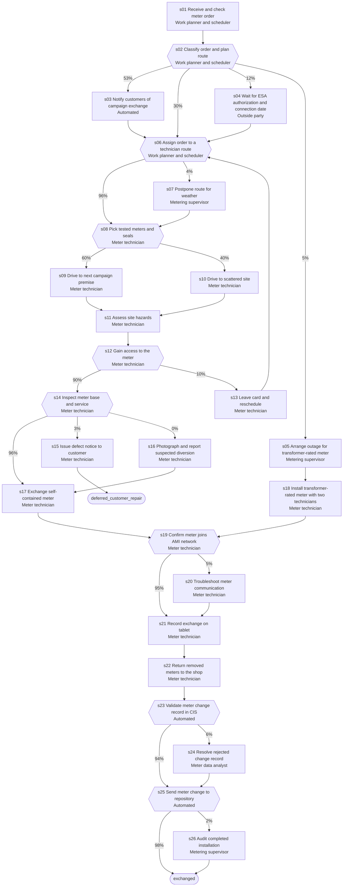

# Install and exchange meters

`edu-cs-meter-exchange` · electricity distribution · customer service (metering) · part of `electric-distribution-utility`

Meter technicians replace smart meters whose Measurement Canada seal period is ending or whose lot failed sampling, replace failed and non-communicating meters, and install meters for new services and generators. Each job is planned onto a daily route, the technician drives to the site, checks hazards and the customer-owned meter base, swaps the meter, confirms it joins the AMI network and records the old and new meter readings, which must reach the billing system and the provincial repository before the next bill. Delays come from waiting for technician capacity, notice periods for campaigns, blocked access, damaged meter bases, winter weather and transformer-rated meters that need two technicians and an outage.

| | |
|---|---|
| Unit of work | one meter installation or exchange |
| Starts when | A meter order is created by meter data analysts, a seal-expiry or sampling-failure campaign, a new service or a generation connection. |
| Done when | The new meter is installed, communicating and recorded in the CIS and MDM/R, or the order is deferred until the customer repairs the meter base. |
| Organisation | A municipally owned Ontario distributor of about 350,000 meters with an in-house metering team, a meter shop and mobile work orders on tablets. (571 employees, 2019-2022) |
| Volume | 2,000 cases a month (range 1,200 to 3,500) |

## Where it sits

- Starts with **meter_test_result** from cs-meter-shop (53% of cases)
- Starts with **meter_order** from cs-meter-data-management (30% of cases)
- Starts with **meter_order** from ops-service-connection-work (15% of cases)
- Starts with **meter_order** from ae-der-connection (2% of cases)
- Relies on **material_issue** from fin-inventory-stores (a standing input; it does not start a case)
- Sends **meter_change_record** to cs-meter-data-management (outcome: exchanged)
- Sends **field_result** to residential-customer (outcome: deferred_customer_repair)
- Sends **meter_test_result** to cs-meter-shop (outcome: any)

## Flow

## Roles

| Role | Department | Layer | FTE on this process | Loaded cost per hour | Evidence |
|---|---|---|---:|---:|---|
| Meter technician | Metering Services | individual contributor | 10 | 60 CAD | C |
| Work planner and scheduler | Work Planning and Dispatch | individual contributor | 1 | 55 CAD | C |
| Metering supervisor | Metering Services | supervisor | 0.6 | 70 CAD | C |
| Meter data analyst | Metering Services | individual contributor | 0.2 | 52 CAD | C |

## Steps

Hands-on time and the wait before each step show the most common value. Evidence tier A is a sourced number, B a sourced description, C the author's estimate.

| Step | Who | Kind | Hands-on | Wait before | Control | Evidence |
|---|---|---|---:|---:|---|---|
| **s01 Receive and check meter order.** A work planner opens the new meter order in the CIS (from metering analysts, a seal-expiry campaign list, a new service or a generation connection), checks the meter form, voltage and class against the premise record and whether instrument transformers are involved, and fixes missing details. | Work planner and scheduler | intake | 1.5 min | 1.0 d |  | C |
| **s02 Classify order and plan route.** The planner groups the order by type and area: seal-expiry campaign exchanges are batched by street, trouble exchanges by district, new services wait for their connection date, and transformer-rated commercial meters go to the metering supervisor to arrange an outage. | Work planner and scheduler | coordination | 1.5 min | 1.0 h |  | B [e26] |
| **s03 Notify customers of campaign exchange.** The CIS produces notification letters, emails or automated calls for every premise in the campaign route, telling the customer that the meter will be replaced, that a brief interruption is possible and that an adult may need to give access. | Automated | system auto | 0 min | 10.0 d |  | B [h1meter] |
| **s04 Wait for ESA authorization and connection date.** New service and generation meters wait until the customer's electrician passes the Electrical Safety Authority inspection and the line or cable crew sets the connection date, so the meter is installed when the service is energized. | Outside party | external wait | 0 min | 3.0 d | Ontario Regulation 22/04 and the Ontario Electrical Safety Code: ESA authorization before a new service is connected | C |
| **s05 Arrange outage for transformer-rated meter.** The metering supervisor contacts the business customer and the customer's electrician to agree a time when the main can be opened or a bypass used, books two technicians and, where the utility must isolate, a line crew window. | Metering supervisor | coordination | 30 min | 7.0 d |  | C |
| **s06 Assign order to a technician route.** The planner places the order on a meter technician's daily route in the mobile workforce system, balancing campaign volume against urgent trouble exchanges and the technicians available that day. | Work planner and scheduler | coordination | 1 min | 3.0 d |  | C |
| **s07 Postpone route for weather.** The metering supervisor postpones outdoor exchange routes in extreme cold, freezing rain or deep snow that blocks meter access, and the orders return to the next available day. | Metering supervisor | judgment | 10 min | 2.0 d | Utility cold-weather and slip hazard work rules | C |
| **s08 Pick tested meters and seals.** At the start of the day the technician collects programmed, tested meters, seals and blanks from the meter shop, scans each serial number to the route and loads the light vehicle. | Meter technician | physical | 1.5 min | 0 min |  | C |
| **s09 Drive to next campaign premise.** On a campaign route the next premise is usually on the same street or a few blocks away, so the technician moves the vehicle a short distance. | Meter technician | travel | 5 min | 0 min |  | C |
| **s10 Drive to scattered site.** For trouble exchanges and new services the technician drives across the 1,116 square kilometre territory between jobs, which can take most of an hour to rural addresses. | Meter technician | travel | 22 min | 0 min |  | C |
| **s11 Assess site hazards.** Before touching the meter the technician walks the site and records a short hazard assessment on the tablet: dogs, ice, overhead wires, a hot or damaged socket, and whether arc-rated clothing and gloves are needed for the meter class. | Meter technician | validation | 2.5 min | 0 min | Occupational Health and Safety Act and utility electrical safety rules: site hazard assessment and PPE for work on energized meter sockets | C |
| **s12 Gain access to the meter.** The technician knocks, explains the exchange, and reaches the meter. Indoor meters, locked gates, dogs, fences and stored items often block access, especially in older houses. | Meter technician | physical | 2.5 min | 0 min |  | B [h1meter] |
| **s13 Leave card and reschedule.** The technician leaves a door card asking the customer to book a time, notes the reason on the tablet, and the order goes back to the planner for another day. | Meter technician | communication | 4 min | 0 min |  | C |
| **s14 Inspect meter base and service.** The technician checks the customer-owned meter base for burn marks, loose jaws, corrosion and damage, looks for signs of tampering or bypass, and confirms the meter form matches the order. | Meter technician | validation | 2 min | 0 min |  | B [h1meter] |
| **s15 Issue defect notice to customer.** The technician photographs the damaged base, leaves a defect notice telling the customer to have an electrician repair it under an ESA permit, makes the site safe and closes the order as deferred. | Meter technician | communication | 15 min | 0 min | Utility conditions of service: the customer repairs a damaged meter base before the meter is reinstalled | B [h1meter] |
| **s16 Photograph and report suspected diversion.** The technician photographs the seal, wiring and meter, keeps the removed meter as evidence, and sends a field investigation request so field services and billing can assess unbilled consumption. | Meter technician | communication | 20 min | 0 min |  | C |
| **s17 Exchange self-contained meter.** The technician reads and photographs the old meter, cuts the seal, pulls the meter from the socket, installs the new one, checks the display and rotation, and fits a new seal. Customers may lose power for a minute or two. | Meter technician | physical | 10 min | 0 min |  | B [h1meter] |
| **s18 Install transformer-rated meter with two technicians.** Two technicians drive to the commercial site, isolate the service with the customer's electrician, check the current and voltage transformer ratios and wiring, install and program the meter and test socket, re-energize and confirm the readings and phase angles. | Meter technician | physical | 2.5 h | 0 min | Occupational Health and Safety Act and utility electrical safety rules: isolation and verification before work on instrument transformer circuits | C |
| **s19 Confirm meter joins AMI network.** The technician waits for the new meter to register on the mesh network, checking the tablet or calling a meter data analyst, so that the first reads will reach the repository. | Meter technician | validation | 2 min | 0 min |  | C |
| **s20 Troubleshoot meter communication.** The technician checks the meter's radio, tries a replacement meter, or logs the premise as a weak-signal location for the OT team to add a range extender. | Meter technician | analysis | 20 min | 0 min |  | C |
| **s21 Record exchange on tablet.** The technician enters the old meter number and final read, the new meter number and initial read, seal details, time and photos in the mobile workforce form and completes the order. | Meter technician | data entry | 3 min | 0 min |  | C |
| **s22 Return removed meters to the shop.** At the end of the day the technician unloads removed meters at the meter shop and scans them in for testing, sampling evidence or disposal, as Measurement Canada lot records require. | Meter technician | physical | 1 min | 2.0 h | Electricity and Gas Inspection Act: meter lot and reverification records | B [e26] |
| **s23 Validate meter change record in CIS.** When the tablet syncs, the CIS checks the change record: meter number exists in inventory, reads are plausible against the last repository read, dates and multiplier match. | Automated | system auto | 0 min | 1.0 h |  | C |
| **s24 Resolve rejected change record.** A meter data analyst compares the rejected record with the tablet photos and the repository reads, corrects the meter number or read, or calls the technician, then resubmits. | Meter data analyst | data entry | 12 min | 1.0 d |  | C |
| **s25 Send meter change to repository.** The CIS sends the meter change to the provincial MDM/R so reads from the new meter are accepted and the old meter's final read closes its register. | Automated | system auto | 0 min | 4.0 h |  | C |
| **s26 Audit completed installation.** The metering supervisor visits a sample of completed exchanges to check the seal, installation quality, photos and that the hazard assessment was done, and coaches the technician on any finding. | Metering supervisor | review | 30 min | 3.0 d | Metering quality and safety audit program | C |

## Exceptions

| Exception | Share of cases | What happens |
|---|---:|---|
| No access | 10% | The meter cannot be reached (indoor meter, locked gate, dog); a door card is left and the order is rebooked. |
| Damaged meter base | 3% | The customer-owned base is burnt or damaged; the exchange is deferred until the customer's electrician repairs it under an ESA permit. |
| Transformer-rated commercial meter | 5% | Needs an outage window agreed with the business, two technicians and ratio and wiring checks. |
| Rejected change record | 6% | The CIS rejects the record (meter number or read keyed wrong) and an analyst corrects it from the photos. |
| Weather postponement | 4% | Extreme cold, freezing rain or deep snow postpones outdoor routes. |

## Benchmarks

| Metric | Value | Unit | Population | Evidence |
|---|---|---|---|---|
| cycle_time_days | p50 14, p90 35 | calendar days from meter order to meter change accepted in the repository | Ontario distributor meter exchanges and installs, 2019-2022 | C |
| initial_reverification_period_electronic_meter | qualifying 10, other 6 | years | Electronic electricity meters in Canada | A [e26] |

## Pain points

- Technician capacity is shared between campaign exchanges, trouble exchanges, new services and meter shop testing, so non-communicating meters can wait one to two weeks and stay estimated meanwhile. (steps s06; C)
- About one visit in ten finds no access, and each rebooking adds a drive and a door card. (steps s12, s13; C)
- Meter numbers and reads keyed on the tablet are sometimes wrong, which rejects the change record or puts a spike on the customer's next bill. (steps s21, s23, s24; C)
- A sampling failure turns a meter lot into a replacement campaign with a fixed deadline, which pulls technicians off other work. (steps s02, s03; B [e26])

## Assumptions

- Order type is drawn once at the classification step and again at the travel step (nearby campaign stop or scattered stop), so the simulation does not keep the two perfectly aligned; the mix is about right overall.
- Hands-on time implies about 21 FTE at 2,000 jobs a month (two-technician commercial jobs add about a fifth), against 11.8 FTE stated; the organisation file has 12 meter technicians, who also staff the meter shop. Either campaign exchanges were partly contracted out (as Hydro One does with a contractor) or the technician count is low; the stated FTE assumes some contractor help.
- The light vehicle is held for the drive plus the time on site; occupied minutes are attached to the travel steps.
- The cs-meter-shop trigger stands for campaign lists created after sampling results or seal expiry; the 2% from generation connections is part of the 15% new-service share in the classification step.
- Times and shares are the author's estimates for residential self-contained and commercial transformer-rated meters in an Ontario urban and rural territory.

## Sources

- [e26] [Bulletin E-26 (rev. 5): Reverification periods for electricity meters and metering installations](https://ised-isde.canada.ca/site/measurement-canada/sites/default/files/attachments/2022/E-26-eng.pdf) (Measurement Canada, 2010). Initial and subsequent reverification periods for electronic meters (10/8 years qualifying, 6/4 years other); extension of a lot's period after sampling; reverification or removal from service at the end of the period.
- [h1meter] [Electricity meter replacement](https://www.hydroone.com/rates-and-billing/meters/meter-replacement) (Hydro One, 2026). Customer notification by email, text, call or letter weeks ahead; an adult must give access when needed; brief interruption during a standard exchange; customer-owned meter base repairs and repair notices. Page describes Hydro One's current program and is used for practice, not volumes.

Written by claude-opus on 2026-11-24.
