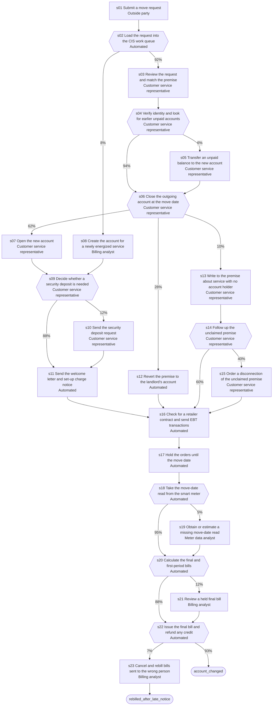

# Open and close customer accounts

`edu-cs-move-in-move-out` · electricity distribution · customer service · part of `electric-distribution-utility`

When people move, the distributor must stop billing the person leaving and start billing whoever takes over the premise: a new occupant, the landlord or, if nobody claims it, an occupant account. Customers submit an online form or call; a representative matches the premise, checks identity and earlier debts, decides on a security deposit under OEB rules, and sets up the orders, which wait for the move date. The smart meter supplies the move-date read and the final bill goes out about three weeks later. Late or wrong move notices, multi-unit addresses and premises nobody claims cause bills to the wrong person, rebilling and some disconnections.

| | |
|---|---|
| Unit of work | one move request (move-out, move-in or both at one premise) or new-service account |
| Starts when | A customer submits the moving form or calls, or a newly energized service needs an account. |
| Done when | The outgoing account has a final bill and the premise is billed to the new occupant, the landlord or an occupant account, or is ordered disconnected. |
| Organisation | A municipally owned Ontario electricity distributor with about 350,000 customers, monthly billing from smart meter reads, an online moving form and a landlord reversion program. (571 employees, 2019-2022) |
| Volume | 5,500 cases a month (range 4,000 to 7,500) |

## Where it sits

- Starts with **account_change** from residential-customer (62% of cases)
- Starts with **account_change** from cs-contact-centre (30% of cases)
- Starts with **energization_notice** from ops-service-connection-work (8% of cases)
- Sends **account_change** to cs-billing (outcome: any)
- Sends **disconnect_order** to ops-field-service-orders (outcome: any)
- Sends **account_change** to cs-retailer-ebt (outcome: any)

## Flow

## Roles

| Role | Department | Layer | FTE on this process | Loaded cost per hour | Evidence |
|---|---|---|---:|---:|---|
| Customer service representative | Customer Contact Centre | individual contributor | 11 | 42 CAD | C |
| Billing analyst | Billing and Settlement | individual contributor | 2 | 47 CAD | C |
| Meter data analyst | Metering Services | individual contributor | 0.3 | 52 CAD | C |

## Steps

Hands-on time and the wait before each step show the most common value. Evidence tier A is a sourced number, B a sourced description, C the author's estimate.

| Step | Who | Kind | Hands-on | Wait before | Control | Evidence |
|---|---|---|---:|---:|---|---|
| **s01 Submit a move request.** The customer fills in the online moving form or MyAccount move screen with old and new addresses, move dates and, for renters, the landlord's contact, or gives the same details to a representative by phone. The customer's own time is not counted. | Outside party | intake | 0 min | 0 min |  | B [src-moving] |
| **s02 Load the request into the CIS work queue.** Web form submissions are loaded into a CIS work queue in batches during the day, and phone requests arrive as move orders already started by the contact centre; both are sorted by move date so the nearest moves are worked first. | Automated | system auto | 0 min | 1.0 h |  | C |
| **s03 Review the request and match the premise.** A representative opens the request, finds the premise in the CIS by address and meter number, checks who is billed there now and whether the landlord has a reversion agreement, and fixes or queries an unclear unit number or date. | Customer service representative | lookup | 2.5 min | 1.0 d |  | C |
| **s04 Verify identity and look for earlier unpaid accounts.** For a new account holder the representative checks the date of birth and photo identification supplied, then searches the CIS for earlier accounts in the same name with unpaid final bills that should follow the customer to the new address. | Customer service representative | validation | 2 min | 0 min | Utility identity verification and privacy policy for opening accounts (date of birth and government photo ID) | B [src-moving] |
| **s05 Transfer an unpaid balance to the new account.** The representative moves the unpaid final balance from the closed account to the new one, notes the transfer, and tells the customer by email or phone, which often leads to a payment arrangement request. | Customer service representative | data entry | 5 min | 0 min |  | C |
| **s06 Close the outgoing account at the move date.** The representative enters the move-out on the account billed at the premise with the move date, sets the final bill flag and mailing address for the final bill, and decides what happens to the premise next: a new occupant, the landlord, or nobody. | Customer service representative | data entry | 2.5 min | 0 min |  | C |
| **s07 Open the new account.** The representative creates the new account at the premise from the move date with the billing address, contact details, paperless and payment preferences, rate class and any OESP note, and links it to the premise and meter. | Customer service representative | data entry | 4 min | 0 min |  | C |
| **s08 Create the account for a newly energized service.** When a crew energizes a new service, a billing analyst takes the energization notice and the meter installation record from the field system and creates the premise, meter and account in the CIS so billing starts from the energization date. | Billing analyst | data entry | 12 min | 2.0 d |  | C |
| **s09 Decide whether a security deposit is needed.** The representative applies the deposit rules: no deposit for a residential customer with a good payment letter, a satisfactory credit check, low-income status or (from March 2020) enrolment in equal or pre-authorized payment; otherwise a deposit up to the billing cycle factor times the estimated bill, mostly for business accounts. | Customer service representative | judgment | 1.5 min | 0 min | OEB Distribution System Code s.2.4.11-2.4.20A security deposit waivers, maximum and instalments; OEB customer service rule changes effective March 1, 2020 | B [src-dsc], [src-csr2020] |
| **s10 Send the security deposit request.** The representative calculates the deposit from the estimated monthly bill, offers instalments over at least six months for residential customers (four for others), and sends the deposit letter that tells the customer how to avoid it. | Customer service representative | drafting | 5 min | 0 min |  | B [src-dsc] |
| **s11 Send the welcome letter and set-up charge notice.** The CIS sends the new account holder a welcome email or letter with the account number, the start date, the one-time account set-up charge that appears on the first bill, and how to register for MyAccount. | Automated | system auto | 0 min | 0 min |  | B [src-moving] |
| **s12 Revert the premise to the landlord's account.** Because the landlord has signed a reversion agreement, the CIS moves the premise to the landlord's account from the day after the move-out without a fee, and emails the landlord that the transfer is done. | Automated | system auto | 0 min | 0 min |  | B [src-landlord] |
| **s13 Write to the premise about service with no account holder.** With no successor and no landlord agreement, the representative leaves the premise on an occupant account and sends a letter to the address and to the owner of record asking the occupant or owner to open an account within a set time. | Customer service representative | communication | 7 min | 0 min | Conditions of Service: responsibility for supply to premises with no account holder | C |
| **s14 Follow up the unclaimed premise.** After the letter period the representative checks whether anyone has opened an account and whether the smart meter shows usage. Usage with no account holder leads to a site visit or disconnect order; otherwise the owner is billed. | Customer service representative | judgment | 6 min | 15.0 d |  | C |
| **s15 Order a disconnection of the unclaimed premise.** The representative creates a disconnect order with the premise access notes and the reason, which goes to field services through mobile workforce management, and records that the premise is vacant and unbilled. | Customer service representative | data entry | 4 min | 0 min |  | C |
| **s16 Check for a retailer contract and send EBT transactions.** The CIS checks whether the old or new account has an electricity retailer contract and, for the few that do, generates the service transaction requests to the retailer through the EBT hub; all others pass straight on. | Automated | system auto | 0 min | 0 min | OEB Retail Settlement Code and EBT standards for service transaction requests between distributors and retailers | C |
| **s17 Hold the orders until the move date.** The move-out and move-in orders sit pending in the CIS until the move date arrives. Requests come in anywhere from several weeks ahead to after the move itself, though ten business days are asked for. | Automated | system auto | 0 min | 7.0 d |  | B [src-moving] |
| **s18 Take the move-date read from the smart meter.** Overnight the CIS asks the meter data management system for the validated midnight register read on the move date and uses it as the final read for the old account and the opening read for the new one. | Automated | system auto | 0 min | 1.0 d |  | C |
| **s19 Obtain or estimate a missing move-date read.** A meter data analyst checks why the read failed, requests an on-demand read through the AMI head-end, and if none comes uses the validation, estimation and editing rules to estimate the read, or sends a field read order. | Meter data analyst | lookup | 10 min | 2.0 d |  | C |
| **s20 Calculate the final and first-period bills.** In the next billing run for the premise's cycle, the CIS calculates the final bill for the outgoing account and starts billing the new account holder or landlord from the move date, applying any deposit and set-up charge. | Automated | system auto | 0 min | 11.0 d |  | B [src-moving] |
| **s21 Review a held final bill.** A billing analyst opens the held final bill, checks the dates against the move order, the read, any overlapping account and the deposit and credit balance, corrects what is wrong and releases it. | Billing analyst | validation | 10 min | 1.0 d | OEB Distribution System Code s.7.11: 98% of bills accurate, counting cancelled and adjusted bills as inaccurate | B [src-dsc] |
| **s22 Issue the final bill and refund any credit.** The CIS issues the final bill by email or mail to the forwarding address, applies a security deposit with interest against it, and queues a refund cheque when a credit remains. | Automated | system auto | 0 min | 1.0 d |  | C |
| **s23 Cancel and rebill bills sent to the wrong person.** When a move was reported after bills had gone out, or the date or unit was wrong, a billing analyst cancels the affected bills on both accounts, rebills them from the correct date, moves payments, and writes to both parties. | Billing analyst | data entry | 35 min | 7.0 d |  | C |

## Exceptions

| Exception | Share of cases | What happens |
|---|---:|---|
| Late or wrong move notice | 7% | The move is reported after bills went out or with the wrong date or unit, so bills on two accounts are cancelled and reissued. |
| Unclaimed premise | 10% | Nobody takes over and there is no landlord agreement; the premise gets an occupant letter and, if still unclaimed with usage, a disconnect order. |
| Security deposit required | 11% | A customer without a qualifying payment history, mostly a business, is asked for a deposit payable in instalments. |
| Missing move-date read | 5% | The smart meter read for the move date is missing or fails validation and has to be fetched or estimated. |

## Benchmarks

| Metric | Value | Unit | Population | Evidence |
|---|---|---|---|---|
| cycle_time_days | p50 30, p90 45 | calendar days from request to final bill | Residential moves | B [src-moving] |
| move_notice_requested | 10 | business days before the move | Residential and landlord requests | B [src-moving], [src-landlord] |

## Pain points

- Moves reported late or with the wrong unit mean bills to the wrong person, which have to be cancelled and reissued on two accounts and count against billing accuracy. (steps s03, s06, s23; C)
- Summer and month-end peaks build a backlog in the web form queue just when move dates are close. (steps s03; C)
- Premises with no account holder need letters, waiting and sometimes a field disconnection. (steps s13, s14, s15; C)

## Assumptions

- One case is one move request at a premise (move-out, move-in or a transfer), or one account for a newly energized service. A customer moving within the territory is one case covering both premises.
- The landlord reversion program and online forms are described from Hydro Ottawa pages read in 2026; the 2019-2022 process is assumed to be similar, with landlords then still able to submit for tenants.
- Business moves use the same steps; the organisation file lists only residential customers as a trigger, so business requests are included in the residential share.
- The wait to the move date and the wait for the billing cycle dominate elapsed time; hands-on time is about 15 minutes a case on average, most of it representative keying; requests started by phone have already had their details taken in the contact centre process.
- The meter-data-analyst role is not listed in the organisation file's process map for this process; it appears only for missing reads.
- Roles use the organisation file's ids and loaded costs (wage x 1.40).

## Sources

- [src-moving] [Moving (residential services)](https://hydroottawa.com/en/residential/services/moving) (Hydro Ottawa, 2026). Move requests at least 10 business days before moving day; new customers use an online moving request form and give date of birth, government photo ID and landlord contact; existing customers move or stop service in MyAccount; account set-up charge on the first bill; final bill about three weeks after the move-out date; landlords may not submit for tenants; OESP recipients must re-apply after a move. Page read in 2026; practice in 2019-2022 assumed similar.
- [src-landlord] [Landlord and property managers](https://hydroottawa.com/en/accounts-services/services/landlord-and-property-managers) (Hydro Ottawa, 2026). Landlord Reversion Program: when a tenant moves out, service transfers automatically to the enrolled landlord, who is emailed; a new tenant's move-in request transfers it back; set-up and transfer fees waived for enrolled landlords; 10 business days' notice for account changes; 24-hour option for moving emergencies.
- [src-dsc] [Distribution System Code (consolidated, revised March 27, 2024)](https://www.oeb.ca/sites/default/files/Distribution-System-Code_March_20240327.pdf) (Ontario Energy Board, 2024). s.2.4.11-2.4.20A security deposit waivers, maximum (billing cycle factor x estimated bill) and instalments over at least 6 months for residential customers; s.2.6.1A monthly billing of residential and GS<50 kW customers (in force December 31, 2016); s.2.6.6.2B payment allocation; s.2.7 arrears payment agreements (down payment up to 15%, 10% for eligible low-income; terms of at least 5 or 10 months, 8, 12 or 16 months for eligible low-income); s.4.2.2.1 disconnection notice not in the bill envelope; s.4.2.2.6 21-day suspension while a LEAP intake agency assesses the customer; s.4.2.3.1 mailed notice deemed received on the fifth day; s.7.6 65% of calls answered in 30 s; s.7.7 abandon rate 10% or less; s.7.8 written response in 10 business days 80% of the time; s.7.10 reconnection within 2 business days 85% of the time; s.7.11 billing accuracy 98% and what counts as an inaccurate bill. Amendment history shows these sections were in force through 2019-2022 apart from the March 2020 changes.
- [src-csr2020] [New Ontario Energy Board customer service rules strengthen consumer protection (news release)](https://www.oeb.ca/sites/default/files/news-release-csr-20200305.pdf) (Ontario Energy Board, 2020). Rules in force March 1, 2020: minimum payment period raised from 16 to 20 calendar days; an account overdue notice 7 days before a disconnection notice; disconnection notice period raised from 10 to 14 days, mailed notice deemed received on the fifth calendar day, disconnection within 14 days after the notice period; no disconnection on a day the utility is closed or the day before; winter ban November 15 to April 30 with reconnection by December 1; residential deposits returned after one year of good payment, small business after three; deposits waived for new residential customers enrolling in equal or pre-authorized payment; APA offered to small business; no late charges on APA amounts.

Written by claude-opus on 2026-11-24.
