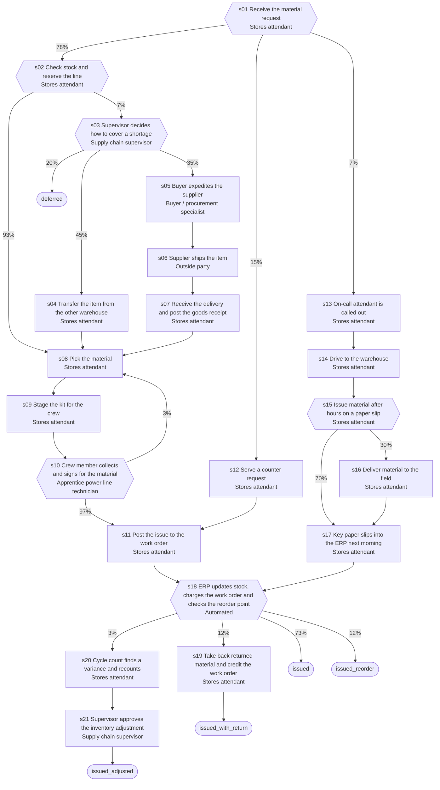

# Run stores and issue materials

`edu-fin-inventory-stores` · electricity distribution · supply chain · part of `electric-distribution-utility`

Stores attendants pick, stage and issue poles, cable, transformers, meters and hardware to line, cable and station crews and charge each line to a work order in the ERP. Most lines are picked from pick lists for scheduled jobs and staged for the crew's early start, some are served at the counter, and after hours an on-call attendant drives in to issue material for trouble and outages on paper slips that are keyed the next morning. Shortages, which grew in 2021 and 2022, send lines to transfers between warehouses or expediting, and mis-posted issues surface later as cycle count variances; during major storms stores run around the clock.

| | |
|---|---|
| Unit of work | one material issue line |
| Starts when | A scheduled work order's pick list, a counter request or an after-hours call-out asks for a stock item. |
| Done when | The material is in the crew's hands and the issue is posted to the work order (with any return or count adjustment), or the job is rescheduled for lack of material. |
| Organisation | A municipally owned Ontario electricity distributor with about 350,000 customers, two warehouses with a pole yard, and ten unionised stores attendants on extended hours with an on-call rota. (571 employees, 2019-2022) |
| Volume | 4,500 cases a month (range 3,000 to 6,500) |

## Where it sits

- Starts with **crew_schedule** from ops-work-scheduling (78% of cases)
- Starts with **restoration_work_order** from ops-outage-restoration (7% of cases)
- Starts with **service_request** from ops-field-service-orders (15% of cases)
- Relies on **materials** from supplier (a standing input; it does not start a case)
- Relies on **purchase_order** from fin-procurement (a standing input; it does not start a case)
- Relies on **major_event_declaration** from ops-major-event-response (a standing input; it does not start a case)
- Sends **material_issue** to ops-overhead-construction (outcome: any)
- Sends **material_issue** to ops-underground-construction (outcome: any)
- Sends **material_issue** to ops-outage-restoration (outcome: any)
- Sends **material_issue** to ops-pole-replacement (outcome: any)
- Sends **material_issue** to ops-cable-fault-repair (outcome: any)
- Sends **material_issue** to cs-meter-exchange (outcome: any)
- Sends **purchase_requisition** to fin-procurement (outcome: issued_reorder)
- Sends **journal_entries** to fin-month-end-close (outcome: any)
- Sends **material_issue** to ops-work-scheduling (outcome: deferred)

## Flow

## Roles

| Role | Department | Layer | FTE on this process | Loaded cost per hour | Evidence |
|---|---|---|---:|---:|---|
| Stores attendant | Supply Chain and Stores | individual contributor | 7 | 45 CAD | B [s1] |
| Supply chain supervisor | Supply Chain and Stores | supervisor | 0.6 | 64 CAD | C |
| Apprentice power line technician | Overhead Lines | individual contributor | 1 | 46 CAD | C |
| Buyer / procurement specialist | Supply Chain and Stores | individual contributor | 0.2 | 53 CAD | C |

## Steps

Hands-on time and the wait before each step show the most common value. Evidence tier A is a sourced number, B a sourced description, C the author's estimate.

| Step | Who | Kind | Hands-on | Wait before | Control | Evidence |
|---|---|---|---:|---:|---|---|
| **s01 Receive the material request.** The stores attendant opens the request queue: pick lists from work orders scheduled in the next few days, crews at the counter, and call-outs for trouble and outages. The attendant decides which path the request takes. | Stores attendant | intake | 0.5 min | 0 min |  | C |
| **s02 Check stock and reserve the line.** The attendant looks up the item in the ERP, checks on-hand quantity and bin location, and reserves the quantity for the work order, or flags the line as short. | Stores attendant | lookup | 0.7 min | 6.0 h |  | B [s2], [s3] |
| **s03 Supervisor decides how to cover a shortage.** The supply chain supervisor checks stock at the other warehouse, open purchase orders and substitutes, and decides to transfer, expedite, or tell the work planner to reschedule the job. | Supply chain supervisor | judgment | 10 min | 4.0 h |  | B [s2] |
| **s04 Transfer the item from the other warehouse.** An attendant drives to the second warehouse or pole yard, loads the item and brings it back, posting a stock transfer in the ERP. | Stores attendant | travel | 1.0 h | 1.0 d |  | C |
| **s05 Buyer expedites the supplier.** The buyer calls the supplier on the open order or places an urgent order, asks for the earliest ship date and tells stores and the work planner when to expect it. | Buyer / procurement specialist | coordination | 20 min | 4.0 h |  | C |
| **s06 Supplier ships the item.** The supplier ships the expedited item to the warehouse; the wait depends on whether the supplier has stock, from a day for hardware to weeks for transformers. | Outside party | external wait | 0 min | 5.0 d |  | B [s3] |
| **s07 Receive the delivery and post the goods receipt.** The attendant unloads the delivery, counts it against the packing slip and the purchase order, reports damage or short shipment to the supplier and supervisor, and posts the goods receipt in the ERP. | Stores attendant | physical | 20 min | 1.0 h | Lift truck operation by certified operators only (company forklift certification; Ontario Regulation 851, Industrial Establishments) | B [s1] |
| **s08 Pick the material.** The attendant walks the pick list, takes hardware from bins and uses the forklift or yard loader for poles, cable reels and transformers, checking item and quantity against the work order. | Stores attendant | physical | 2 min | 4.0 h | Lift truck operation by certified operators only (company forklift certification; Ontario Regulation 851, Industrial Establishments) | B [s1] |
| **s09 Stage the kit for the crew.** The attendant places the picked lines in the staging bay or on the crew's trailer, labelled with the work order and crew, so the crew can load quickly at the start of the shift. | Stores attendant | physical | 1 min | 0 min |  | C |
| **s10 Crew member collects and signs for the material.** On the job day a crew member, usually the apprentice, checks the staged kit against the work order, loads it on the truck and signs the pick list. | Apprentice power line technician | physical | 2 min | 1.0 d |  | C |
| **s11 Post the issue to the work order.** The attendant posts the issue transaction in the ERP, charging the quantity and cost to the work order and closing the reservation. | Stores attendant | data entry | 0.7 min | 2.0 h |  | B [s1] |
| **s12 Serve a counter request.** A crew member at the stores counter asks for an item for a job in progress; the attendant confirms the work order number, finds the item and hands it over with a counter slip. | Stores attendant | physical | 4 min | 10 min |  | C |
| **s13 On-call attendant is called out.** The control room or a crew supervisor phones the on-call stores attendant for material needed for a trouble call, outage or cable fault outside opening hours; the call covers all lines the crew needs. | Stores attendant | coordination | 3 min | 15 min |  | B [s1] |
| **s14 Drive to the warehouse.** The on-call attendant drives from home to the warehouse and opens it, which sets how fast after-hours material reaches the crew. A call-out averages about four lines, so the time shown is one line's share of the trip. | Stores attendant | travel | 9 min | 0 min |  | C |
| **s15 Issue material after hours on a paper slip.** The attendant picks the requested items, loads them for the trouble crew and writes a paper issue slip with the item, quantity and outage or work order number for later entry. | Stores attendant | physical | 5 min | 10 min | Lift truck operation by certified operators only (company forklift certification; Ontario Regulation 851, Industrial Establishments) | C |
| **s16 Deliver material to the field.** During outages and storms the attendant drives poles, transformers or conductor to the crew's site or a staging area, after a vehicle circle check, sometimes waiting out high winds or ice before travelling. The time shown is one line's share of a delivery run of about four lines. | Stores attendant | travel | 22 min | 1.0 h | Pre-trip vehicle circle check and storm work hazard assessment | C |
| **s17 Key paper slips into the ERP next morning.** The next business morning an attendant keys each after-hours paper slip into the ERP, chasing crews for missing work order numbers. | Stores attendant | data entry | 4 min | 10.0 h |  | C |
| **s18 ERP updates stock, charges the work order and checks the reorder point.** The ERP decrements on-hand stock, posts the cost to the work order for capital or maintenance accounting, and adds the item to the next MRP run if it has fallen below its reorder point. | Automated | system auto | 0 min | 0 min |  | C |
| **s19 Take back returned material and credit the work order.** When the crew brings back unused material, the attendant inspects it, returns good stock to its bin or tags damaged items, and posts a return credit to the work order. | Stores attendant | physical | 4 min | 5.0 d |  | B [s1] |
| **s20 Cycle count finds a variance and recounts.** During a scheduled cycle count the attendant finds the bin quantity differs from the ERP, recounts, traces recent issues, returns and slips, and records the likely cause. | Stores attendant | validation | 20 min | 30.0 d | Inventory cycle counting and year-end count under internal control over financial reporting | B [s1] |
| **s21 Supervisor approves the inventory adjustment.** The supply chain supervisor reviews the variance record and approves the ERP adjustment, escalating large or repeated variances to finance. | Supply chain supervisor | approval | 10 min | 2.0 d | Inventory adjustments approved by someone other than the counter | C |

## Exceptions

| Exception | Share of cases | What happens |
|---|---:|---|
| Stock shortage | 6% | The line is short; the supervisor transfers it from the other warehouse, has the buyer expedite it, or reschedules the job. |
| After-hours issue on paper | 7% | An on-call attendant drives in, issues on a paper slip, sometimes delivers to the field, and the slip is keyed the next morning. |
| Cycle count variance | 3% | A mis-posted issue, transfer or return shows up weeks later as a count variance that must be traced and adjusted. |
| Crew finds a wrong item at pickup | 2% | The crew checks the staged kit and sends a line back to be re-picked. |

## Benchmarks

| Metric | Value | Unit | Population | Evidence |
|---|---|---|---|---|
| cycle_time_days | p50 2.5, p90 8 | calendar days from request in the stores queue to issue posted | Issue lines at a mid-size Ontario distributor | C |

## Pain points

- Shortages of transformers, poles and some cable in 2021-2022 meant transfers, expediting and rescheduled jobs, with emergency stock near zero at many utilities. (steps s02, s03, s04, s05, s06; B [s2], [s3])
- After-hours issues on paper slips are keyed later and often lack a work order number, causing mis-charges that surface at cycle count or month end. (steps s15, s17, s20; C)
- During storms a small stores team must run around the clock, load poles and transformers and drive them to staging areas, which limits how fast crews can be resupplied. (steps s13, s14, s15, s16; C)

## Assumptions

- The unit of work is one issue line; receiving of routine replenishment deliveries is not a separate case here and appears only on the shortage path (s07), so attendant time on receiving, yard work and PCB and glove programs is outside the FTE counted.
- Branch shares, touch times and waits are the author's estimates for a utility of this size; no published stores benchmark for Ontario distributors was found.
- The forklift fleet (four units) is not in the organisation file and is added here.
- The cycle time counts the wait until the job day for scheduled pick lists, which is set by the work schedule rather than by stores.
- The on-call rota for after-hours issues is described in the steps; the role keeps the organisation file's extended_hours shift pattern.

## Sources

- [s1] [Job Bulletin: Storeskeeper (Purchasing and Stores Department)](https://synergynorth.ca/wp-content/uploads/2024/06/2024-Job-Bulletin-Storeskeeper.pdf) (Synergy North Corporation, 2024). Ontario distributor storeskeeper duties: physically receives, issues and stores tools, material and equipment; computerised entry of all receipts, issues, credits and returns through the MRP system; compares goods received to purchase orders and reports deficiencies to the vendor and supervisor; keeps transformer and protective rubber glove rotation files; physical cycle counts and year-end count; handles PCB-contaminated transformers and oil; must hold forklift certification, work after-hours call-outs and overtime; unionised outside-staff wage band $21.04 to $26.30 an hour (2024).
- [s2] [Scorecard - Hydro Ottawa Limited (2017-2021) and 2021 Scorecard Management Discussion and Analysis](https://www.oeb.ca/documents/scorecard/2021/Scorecard%20-%20Hydro%20Ottawa%20Limited.pdf) (Ontario Energy Board, 2022). Planned work deferred in 2021 partly because of material availability; emergency spending $8.57M against a $6.73M budget, mainly poles and underground transformers.
- [s3] [APPA survey of members shows distribution transformer production not meeting demand](https://www.publicpower.org/periodical/article/appa-survey-members-shows-distribution-transformer-production-not-meeting-demand) (American Public Power Association, 2022). Most of 95 responding utilities reported low or near-zero emergency transformer stock in August 2022, some within weeks of running out; transformer lead times rose from two to three months before 2021 to about 12 months in 2022.

Written by claude-opus on 2026-11-24.
