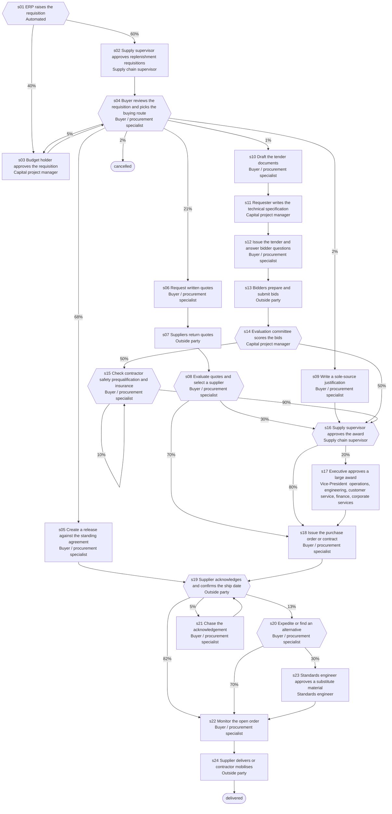

# Buy materials and services

`edu-fin-procurement` · electricity distribution · supply chain · part of `electric-distribution-utility`

Buyers in the supply chain team turn approved requisitions into purchase orders and contracts for poles, cable, transformers, meters, hardware and civil, tree and construction services. Most orders are releases against multi-year agreements, a fifth need written quotes, and a few go to formal tender or sole source with committee evaluation, contractor safety checks and approval by dollar limit. The slow parts are approvals, open tender periods and supplier lead times, which for transformers grew from a few months to about a year in 2021 and 2022 and forced expediting, substitutes and deferred work.

| | |
|---|---|
| Unit of work | one purchase order or contract |
| Starts when | An approved purchase requisition from stores replenishment, a capital project, fleet or operations reaches purchasing. |
| Done when | The purchase order or contract is issued, acknowledged and delivered (or the contractor has mobilised), or the requisition is cancelled. |
| Organisation | A municipally owned Ontario electricity distributor with about 350,000 customers and a supply chain team of six buyers and two supervisors. (571 employees, 2019-2022) |
| Volume | 600 cases a month (range 400 to 900) |

## Where it sits

- Starts with **purchase_requisition** from fin-inventory-stores (60% of cases)
- Starts with **purchase_requisition** from ae-capital-project-delivery (30% of cases)
- Starts with **purchase_requisition** from corp-fleet-maintenance (10% of cases)
- Relies on **standards** from ae-standards-maintenance (a standing input; it does not start a case)
- Sends **purchase_order** to supplier (outcome: delivered)
- Sends **purchase_order** to contractor (outcome: delivered)
- Sends **purchase_order** to fin-accounts-payable (outcome: delivered)
- Sends **purchase_order** to fin-inventory-stores (outcome: delivered)

## Flow

## Roles

| Role | Department | Layer | FTE on this process | Loaded cost per hour | Evidence |
|---|---|---|---:|---:|---|
| Buyer / procurement specialist | Supply Chain and Stores | individual contributor | 5.5 | 53 CAD | B [s1] |
| Supply chain supervisor | Supply Chain and Stores | supervisor | 0.8 | 64 CAD | C |
| Capital project manager | Capital Project Delivery | senior specialist | 2 | 74 CAD | C |
| Standards engineer | Standards and Records | senior specialist | 0.15 | 72 CAD | C |
| Vice-President (operations, engineering, customer service, finance, corporate services) | Office of the President and CEO | executive | 0.03 | 160 CAD | C |

## Steps

Hands-on time and the wait before each step show the most common value. Evidence tier A is a sourced number, B a sourced description, C the author's estimate.

| Step | Who | Kind | Hands-on | Wait before | Control | Evidence |
|---|---|---|---:|---:|---|---|
| **s01 ERP raises the requisition.** The ERP creates a purchase requisition, either from the overnight MRP run when a stock item falls to its reorder point or from a requester who keys a project, fleet or service need against a work order, and routes it for approval. | Automated | system auto | 0 min | 12.0 h |  | C |
| **s02 Supply supervisor approves replenishment requisitions.** The supply chain supervisor reviews the MRP replenishment suggestions in a weekly batch, adjusts quantities for planned projects and storm stock, and approves them for purchasing. | Supply chain supervisor | approval | 5 min | 2.0 d | Purchasing policy: the requester, the approver of the requisition and the buyer issuing the order are different people | C |
| **s03 Budget holder approves the requisition.** The project manager or supervisor who owns the work order checks the item, quantity, need date and budget, and approves the requisition in the ERP or sends it back. | Capital project manager | approval | 5 min | 1.0 d | Purchasing policy: the requester, the approver of the requisition and the buyer issuing the order are different people | C |
| **s04 Buyer reviews the requisition and picks the buying route.** The buyer checks the item against the item master and approved materials list, looks for an existing standing agreement or contract, checks the estimated value against the quote and tender thresholds, and decides how to buy. | Buyer / procurement specialist | lookup | 8 min | 1.0 d |  | C |
| **s05 Create a release against the standing agreement.** The buyer converts the requisition into a purchase order release at the agreed price and terms, checks the delivery address and need date and sends it to the supplier by email or EDI. | Buyer / procurement specialist | data entry | 8 min | 2.0 h |  | C |
| **s06 Request written quotes.** The buyer emails the specification and quantity to at least three registered suppliers, giving a closing date and delivery requirement, and logs the request. | Buyer / procurement specialist | communication | 30 min | 12.0 h | Purchasing policy: competitive written quotes between the low-value and public tender thresholds | C |
| **s07 Suppliers return quotes.** Suppliers price the request and reply with unit prices, lead times and exceptions to the terms; the buyer chases those who have not replied by the closing date. | Outside party | external wait | 0 min | 5.0 d |  | C |
| **s08 Evaluate quotes and select a supplier.** The buyer tabulates price, lead time and compliance with the specification, checks that each bidder is a registered supplier, and recommends the lowest compliant quote. | Buyer / procurement specialist | analysis | 30 min | 1.0 d |  | C |
| **s09 Write a sole-source justification.** The buyer and requester document why only one supplier can meet the need (proprietary relay or switchgear parts, compatibility with installed equipment, emergency), confirm the price is reasonable, and submit the justification for approval. | Buyer / procurement specialist | drafting | 2.0 h | 1.0 d | Purchasing policy: documented justification for non-competitive purchases | C |
| **s10 Draft the tender documents.** The buyer prepares the request for tender or proposal: instructions to bidders, commercial terms, pricing form, evaluation method, insurance and safety requirements, and the closing date. | Buyer / procurement specialist | drafting | 10.0 h | 5.0 d | Purchasing policy: open competitive tender above the public tender threshold | B [s1] |
| **s11 Requester writes the technical specification.** At the same time, the project manager or engineer writes the technical specification, scope of work, drawings and quantities, and the technical scoring criteria. | Capital project manager | drafting | 10.0 h | 0 min |  | C |
| **s12 Issue the tender and answer bidder questions.** The buyer posts the tender, runs any bidders' meeting, answers questions in writing and issues addenda so every bidder has the same information. | Buyer / procurement specialist | communication | 4.0 h | 3.0 d |  | C |
| **s13 Bidders prepare and submit bids.** Suppliers and contractors prepare bids during the open period; the tender closes at the stated time and the buyer opens the bids. | Outside party | external wait | 0 min | 21.0 d |  | C |
| **s14 Evaluation committee scores the bids.** A committee of the requester and two technical staff scores each compliant bid against the published criteria, with the buyer checking commercial compliance and pricing, and agrees a recommendation. | Capital project manager | analysis | 6.0 h | 4.0 d |  | C |
| **s15 Check contractor safety prequalification and insurance.** For construction and maintenance services, the buyer checks in ISNetworld that the recommended contractor holds at least a C grade, and confirms insurance and WSIB clearance before award. | Buyer / procurement specialist | validation | 30 min | 1.0 d | Contractor health, safety and environment prequalification through ISNetworld, minimum C grade for medium- and high-risk work | A [s1] |
| **s16 Supply supervisor approves the award.** The supply chain supervisor reviews the evaluation or justification, checks that the process followed policy and that the value is within delegated limits, and approves or escalates. | Supply chain supervisor | approval | 20 min | 1.0 d | Delegation of authority: award approval limits by dollar value | C |
| **s17 Executive approves a large award.** For awards above the supervisor's limit, the vice-president reviews the recommendation memo and approves the award, sometimes after questions to the buyer. | Vice-President (operations, engineering, customer service, finance, corporate services) | approval | 30 min | 5.0 d | Delegation of authority: award approval limits by dollar value | C |
| **s18 Issue the purchase order or contract.** The buyer creates the purchase order or contract in the ERP from the approved award, attaches terms and specifications, sends it to the supplier and notifies unsuccessful bidders. | Buyer / procurement specialist | data entry | 15 min | 2.0 h |  | C |
| **s19 Supplier acknowledges and confirms the ship date.** The supplier acknowledges the order and confirms a ship or start date; the buyer compares it with the need date on the requisition. | Outside party | external wait | 0 min | 2.0 d |  | B [s2] |
| **s20 Expedite or find an alternative.** The buyer asks the supplier to expedite, checks other suppliers and neighbouring utilities for stock, or proposes a substitute item to the requester, and agrees the change. | Buyer / procurement specialist | coordination | 45 min | 12.0 h |  | B [s2], [s3] |
| **s21 Chase the acknowledgement.** The buyer phones or emails the supplier about the missing acknowledgement, confirms the order was received and records the promised ship date in the ERP. | Buyer / procurement specialist | communication | 10 min | 3.0 d |  | C |
| **s23 Standards engineer approves a substitute material.** The standards engineer compares the substitute's ratings, dimensions and certification with the construction standard and the approved materials list and approves it, approves it with conditions, or rejects it. | Standards engineer | review | 45 min | 4.0 d | Approved materials list and construction standards: only approved items installed on the distribution system | C |
| **s22 Monitor the open order.** The buyer reviews the open-order report weekly, contacts suppliers whose orders are near their due date and updates promised dates so planners know when material will arrive. | Buyer / procurement specialist | coordination | 5 min | 1.0 d |  | C |
| **s24 Supplier delivers or contractor mobilises.** The supplier ships the goods to the warehouse or the contractor starts work on the agreed date; stores receiving or the project manager confirms receipt, which closes the purchasing side of the order. | Outside party | external wait | 0 min | 10.0 d |  | B [s2] |

## Exceptions

| Exception | Share of cases | What happens |
|---|---:|---|
| Lead time too long | 13% | The confirmed ship date misses the need date; the buyer expedites or looks for stock elsewhere, and in about three cases in ten proposes a substitute that the standards engineer must approve. |
| Requisition returned | 5% | The buyer sends the requisition back for a missing specification or wrong item code. |
| Contractor not prequalified | 0% | The recommended contractor lacks the required ISN grade and award waits until it completes the assessment. |

## Benchmarks

| Metric | Value | Unit | Population | Evidence |
|---|---|---|---|---|
| cycle_time_days | p50 35, p90 90 | calendar days from requisition to delivery or mobilisation | Purchase orders at a mid-size Ontario distributor, 2019-2022 | C |
| distribution_transformer_lead_time_months | before_2021 2.5, 2022 12 | months | 95 US public power utilities, August 2022 survey | A [s2] |
| planned_project_spend_completed | 0.92 | share of planned 2021 project spending | Hydro Ottawa 2021 | A [s3] |

## Pain points

- Long and growing lead times for transformers, switchgear and some poles in 2021-2022 meant orders had to be placed many months ahead, expedited or substituted, and some planned work was deferred. (steps s19, s20, s23, s24; A [s2], [s3])
- Requisitions wait in approvers' queues and sometimes come back for missing specifications, adding days before the buyer can act. (steps s02, s03, s04, s16, s17; C)
- Formal tenders take six to ten weeks end to end because specification writing, the open period and committee scoring all wait on busy engineers. (steps s10, s11, s13, s14; C)

## Assumptions

- Hydro Ottawa does not publish its purchasing thresholds or delegation limits; the quote, tender and approval routes and their shares are generic public-sector style practice and tier C.
- The supply chain page (s1) is current; the ISN prequalification rule is assumed to have applied in 2019-2022.
- Delivery time is included so that the cycle reflects when work can start; goods receipt and put-away belong to the stores process and invoice matching to accounts payable.
- The supplier lead-time range blends ordinary stock items with long-lead transformers and switchgear and the 2021-2022 shortage; a model of a single year should narrow it.
- The organisation file lists only buyer and supply-supervisor on this process; requesting project managers, the standards engineer and a vice-president also take part and are added here from the organisation file's roles.

## Sources

- [s1] [Supply chain (suppliers and contractors page)](https://hydroottawa.com/en/about-us/policies-and-terms/supply-chain) (Hydro Ottawa, 2026). Suppliers register through an intake form reviewed by the procurement team; contracts awarded on merit with a preference for local procurement; contractors doing medium- or high-risk construction or industrial maintenance work (work near energized apparatus over 300 V, at heights of 3 m or more, excavation deeper than four feet) must hold at least a C grade in an ISNetworld health, safety and environment assessment before starting and keep it throughout, whether or not the work was competitively awarded; separate terms and conditions for goods and services; payment by EFT on agreed terms. Current page, used as a description of practice that the author assumes applied in 2019-2022.
- [s2] [APPA survey of members shows distribution transformer production not meeting demand](https://www.publicpower.org/periodical/article/appa-survey-members-shows-distribution-transformer-production-not-meeting-demand) (American Public Power Association, 2022). August 2022 survey of 95 public power utilities: distribution transformer lead times averaged two to three months before 2021 and about 12 months in 2022 (up 429%), with some quotes over three years; most utilities had low or near-zero emergency stock; one in five projects deferred or cancelled for lack of transformers.
- [s3] [Scorecard - Hydro Ottawa Limited (2017-2021) and 2021 Scorecard Management Discussion and Analysis](https://www.oeb.ca/documents/scorecard/2021/Scorecard%20-%20Hydro%20Ottawa%20Limited.pdf) (Ontario Energy Board, 2022). In 2021 the utility completed 92% of planned project spending, short of target because of deferrals caused by labour availability, material availability and pandemic outage restrictions; emergency spending was $8.57M against a $6.73M budget, mainly for poles and underground transformers.

Written by claude-opus on 2026-11-24.
