# Prepare the rebasing rate application (five-year Custom IR)

`edu-fin-rate-application` · electricity distribution · regulatory affairs · part of `electric-distribution-utility`

Every five years the utility asks the Ontario Energy Board to reset its distribution rates on a five-year Custom Incentive Rate-setting plan. The regulatory affairs team runs a project of about two and a half years: customer engagement and benchmarking feed a business plan and Distribution System Plan, analysts turn them into exhibits and OEB workforms, and after filing the utility answers written interrogatories, sits a technical conference, negotiates a settlement with intervenors and argues any unsettled issue before the OEB issues a decision and rate order. It is slow because each stage waits for the one before it, for the OEB's procedural calendar and for eight or so intervenors, and error-prone because the same numbers must agree across thousands of pages and dozens of linked spreadsheets.

| | |
|---|---|
| Unit of work | one rate application |
| Starts when | The current rate plan is entering its last two years, and the capital plan and board direction call for a rebasing application for the next five-year term. |
| Done when | The OEB has issued a final rate order and approved tariff for the new term and the regulatory team has handed them to rate implementation. |
| Organisation | A municipally owned Ontario electricity distributor with about 350,000 customers, filing a five-year Custom IR application with a revenue requirement of about $200M. (571 employees, 2019-2022) |
| Volume | 0.0167 cases a month (range 0.0167 to 0.0167) |

## Where it sits

- Starts with **capital_plan** from ae-capital-plan (40% of cases)
- Starts with **board_decision** from exec-strategy-board (30% of cases)
- Starts with **rate_order** from oeb (30% of cases)
- Relies on **budget** from fin-budget (a standing input; it does not start a case)
- Relies on **financial_statements** from fin-month-end-close (a standing input; it does not start a case)
- Relies on **planning_study** from ae-system-planning (a standing input; it does not start a case)
- Relies on **asset_condition** from ae-asset-condition-assessment (a standing input; it does not start a case)
- Relies on **variance_balances** from fin-regulatory-accounts (a standing input; it does not start a case)
- Sends **rate_application** to oeb (outcome: any)
- Sends **rate_order** to fin-annual-rate-update (outcome: rate_order_issued)
- Sends **rate_order** to exec-strategy-board (outcome: rate_order_issued)
- Sends **rate_application** to corp-communications (outcome: any)

## Flow

```mermaid
flowchart TD
    s01["s01 Set up the rate application project<br/>Manager, regulatory affairs"]
    s02["s02 Executive approves strategy, budget and consultants<br/>Vice-President  operations, engineering, customer service, finance, corporate services"]
    s03["s03 Vendor runs first phase of customer engagement<br/>Outside party"]
    s04["s04 Planning engineers build the Distribution System Plan<br/>System planning engineer"]
    s05["s05 Finance builds OM&A, rate base and revenue requirement<br/>Accountant / financial analyst"]
    s06["s06 Vendor runs second phase of engagement on spending options<br/>Outside party"]
    s07["s07 Executive team settles the business plan<br/>Vice-President  operations, engineering, customer service, finance, corporate services"]
    s08{{"s08 Board of directors approves the business plan<br/>President and Chief Executive Officer"}}
    s09["s09 Regulatory analysts draft exhibits and OEB workforms<br/>Regulatory analyst"]
    s10{{"s10 Review exhibits for completeness and consistency<br/>Manager, regulatory affairs"}}
    s11["s11 Fix gaps and cross-references<br/>Regulatory analyst"]
    s12["s12 Executive signs off and files the application<br/>Vice-President  operations, engineering, customer service, finance, corporate services"]
    s13["s13 OEB checks completeness, issues notice and admits intervenors<br/>Outside party"]
    s14["s14 Update the application for prior-year actuals<br/>Regulatory analyst"]
    s15["s15 Receive interrogatories from OEB staff and intervenors<br/>Outside party"]
    s16["s16 Regulatory analysts coordinate and draft interrogatory responses<br/>Regulatory analyst"]
    s17["s17 Planning engineers answer capital and DSP interrogatories<br/>System planning engineer"]
    s18["s18 Accountants answer finance and OM&A interrogatories<br/>Accountant / financial analyst"]
    s19["s19 Review and file interrogatory responses<br/>Legal counsel and claims specialist"]
    s20["s20 Witness panels answer questions at the technical conference<br/>Vice-President  operations, engineering, customer service, finance, corporate services"]
    s21["s21 Answer technical conference undertakings<br/>Regulatory analyst"]
    s22{{"s22 Negotiate at the settlement conference<br/>Vice-President  operations, engineering, customer service, finance, corporate services"}}
    s23["s23 Draft and file the settlement proposal<br/>Legal counsel and claims specialist"]
    s24{{"s24 OEB reviews the settlement proposal<br/>Outside party"}}
    s25["s25 Prepare witnesses and attend the oral hearing<br/>Legal counsel and claims specialist"]
    s26["s26 Write argument on the unsettled issues<br/>Legal counsel and claims specialist"]
    s27["s27 OEB issues its Decision and Order<br/>Outside party"]
    s28["s28 Prepare the draft rate order and tariff sheets<br/>Regulatory analyst"]
    s29{{"s29 Parties comment and the OEB issues the final rate order<br/>Outside party"}}
    s30["s30 Hand the rate order to rate implementation and the board<br/>Manager, regulatory affairs"]
    s01 --> s02
    s02 --> s03
    s03 --> s04
    s04 --> s05
    s05 --> s06
    s06 --> s07
    s07 --> s08
    s08 -->|"90%"| s09
    s08 -->|"10%"| s07
    s09 --> s10
    s10 -->|"60%"| s11
    s10 -->|"40%"| s12
    s11 --> s10
    s12 --> s13
    s13 --> s14
    s14 --> s15
    s15 --> s16
    s16 --> s17
    s17 --> s18
    s18 --> s19
    s19 --> s20
    s20 --> s21
    s21 --> s22
    s22 -->|"85%"| s23
    s22 -->|"15%"| s25
    s23 --> s24
    s24 -->|"55%"| s26
    s24 -->|"40%"| s27
    s24 -->|"5%"| s25
    s25 --> s26
    s26 --> s27
    s27 --> s28
    s28 --> s29
    s29 -->|"90%"| s30
    s29 -->|"10%"| s28
    s30 --> end0
    end0(["rate_order_issued"])
```

## Roles

| Role | Department | Layer | FTE on this process | Loaded cost per hour | Evidence |
|---|---|---|---:|---:|---|
| Manager, regulatory affairs | Regulatory Affairs | manager | 0.15 | 100 CAD | C |
| Regulatory analyst | Regulatory Affairs | senior specialist | 0.8 | 66 CAD | B [s4] |
| Vice-President (operations, engineering, customer service, finance, corporate services) | Office of the President and CEO | executive | 0.05 | 160 CAD | C |
| President and Chief Executive Officer | Office of the President and CEO | executive | 0.005 | 230 CAD | C |
| System planning engineer | System Planning and Asset Management | senior specialist | 0.35 | 72 CAD | B [s5] |
| Accountant / financial analyst | Accounting, Payables and Payroll | individual contributor | 0.25 | 60 CAD | C |
| Legal counsel and claims specialist | Legal and Claims | senior specialist | 0.08 | 105 CAD | C |

## Steps

Hands-on time and the wait before each step show the most common value. Evidence tier A is a sourced number, B a sourced description, C the author's estimate.

| Step | Who | Kind | Hands-on | Wait before | Control | Evidence |
|---|---|---|---:|---:|---|---|
| **s01 Set up the rate application project.** The regulatory manager confirms that the current rate plan ends and that the utility will rebase on a five-year Custom IR, writes the workplan and timeline back from the target filing date, names a lead for each exhibit, and drafts the scope for outside benchmarking studies and the customer engagement vendor. | Manager, regulatory affairs | coordination | 1.7 d | 0 min |  | B [s5] |
| **s02 Executive approves strategy, budget and consultants.** The vice-president responsible for regulatory affairs reviews the proposed plan type, the budget for consultants and the engagement approach with the executive team, and approves the procurement of the benchmarking studies and the customer engagement vendor. | Vice-President (operations, engineering, customer service, finance, corporate services) | approval | 4.0 h | 10.0 d | Delegation of authority for consulting spend and corporate rate strategy | C |
| **s03 Vendor runs first phase of customer engagement.** The engagement vendor, procured and briefed by the regulatory team, runs focus groups and surveys on customers' priorities across rate classes. The regulatory team waits for results, reviews the draft report and passes the findings to the planners. | Outside party | external wait | 0 min | 200.0 d |  | A [s5] |
| **s04 Planning engineers build the Distribution System Plan.** System planning engineers turn asset condition, load forecasts and the capital plan into the five-year Distribution System Plan: investment categories, project lists, pacing options and the business cases that justify each program, using the asset analytics and GIS data. | System planning engineer | analysis | 14.6 d | 2.0 d |  | B [s5] |
| **s05 Finance builds OM&A, rate base and revenue requirement.** Accountants and budget analysts build the test-year OM&A by program, the five-year rate base and depreciation, cost of capital and taxes, and run the revenue requirement, load forecast and cost allocation models side by side with the planners' capital forecast. | Accountant / financial analyst | analysis | 12.5 d | 0 min |  | B [s2], [s5] |
| **s06 Vendor runs second phase of engagement on spending options.** The vendor surveys customers in every class on the reference plan and on faster or slower spending scenarios with their bill impacts, then reports support by class. The regulatory team reviews the questionnaire and the results. | Outside party | external wait | 0 min | 100.0 d |  | A [s5] |
| **s07 Executive team settles the business plan.** The vice-presidents compare the engagement results, benchmarking studies and bill impacts, decide the spending level for each program, and sign off the business plan and the numbers the application will carry. | Vice-President (operations, engineering, customer service, finance, corporate services) | judgment | 1.0 d | 14.0 d |  | B [s5] |
| **s08 Board of directors approves the business plan.** The CEO presents the business plan and rate strategy to the board of directors at a scheduled meeting. The board approves it or asks for changes to spending or rate impacts before the filing goes ahead. | President and Chief Executive Officer | approval | 6.0 h | 30.0 d | Board of directors approval of the business plan under the corporate governance framework | A [s5] |
| **s09 Regulatory analysts draft exhibits and OEB workforms.** Analysts write the exhibits in the order of the filing requirements (administration, rate base, OM&A, cost of capital, load forecast, cost allocation, rate design, deferral accounts) and complete the OEB Chapter 2 appendices, revenue requirement workform, cost allocation model and bill impact model. | Regulatory analyst | drafting | 18.8 d | 21.0 d | OEB Filing Requirements for Electricity Distribution Rate Applications, Chapters 2, 3 and 5 | B [s4], [s5] |
| **s10 Review exhibits for completeness and consistency.** The regulatory manager and legal counsel read every exhibit against the filing requirements checklist, trace each key number back to the models, and mark gaps, contradictions and wording that could create hearing risk. Exhibits with problems go back to their authors. | Manager, regulatory affairs | review | 3.3 d | 5.0 d |  | C |
| **s11 Fix gaps and cross-references.** Analysts and the exhibit authors correct the numbers, add missing filing-requirement items and update cross-references and the models, then return the exhibits for another review. | Regulatory analyst | drafting | 2.5 d | 3.0 d |  | C |
| **s12 Executive signs off and files the application.** The vice-president and CEO confirm the application, the regulatory team assembles the evidence, workbooks and attachments and files it electronically with the OEB, serving it on past intervenors. | Vice-President (operations, engineering, customer service, finance, corporate services) | approval | 4.0 h | 5.0 d | Ontario Energy Board Act, 1998, section 78: distribution rates require an OEB order | A [s1] |
| **s13 OEB checks completeness, issues notice and admits intervenors.** OEB staff check the application for completeness, the OEB issues a Notice of Hearing that the utility publishes and serves, parties apply to intervene, and the OEB issues Procedural Order No. 1 setting the interrogatory schedule. | Outside party | external wait | 0 min | 48.0 d | OEB Rules of Practice and Procedure: notice, intervention and procedural orders | A [s1], [s6] |
| **s14 Update the application for prior-year actuals.** Once the prior year's financial statements are audited, analysts replace bridge-year forecasts with actuals in the rate base, OM&A and deferral account schedules, rerun the workforms and file an updated application. | Regulatory analyst | drafting | 5.0 d | 30.0 d |  | A [s1] |
| **s15 Receive interrogatories from OEB staff and intervenors.** OEB staff and the intervenors send written interrogatories on every exhibit, and OEB staff file their own benchmarking expert evidence that the utility must also answer. The regulatory team logs and assigns each question. | Outside party | external wait | 0 min | 14.0 d |  | A [s1], [s3] |
| **s16 Regulatory analysts coordinate and draft interrogatory responses.** Analysts split the interrogatories by exhibit, draft responses on rates, deferral accounts and rate design, chase subject experts for the rest, and keep a tracker so every response is consistent with the evidence and with other responses. | Regulatory analyst | drafting | 6.7 d | 2.0 d |  | C |
| **s17 Planning engineers answer capital and DSP interrogatories.** Planning engineers answer the questions on project need, pacing, asset condition and unit costs, pulling data from the asset analytics tool and GIS, at the same time as the regulatory analysts work on the rest. | System planning engineer | drafting | 4.2 d | 0 min |  | C |
| **s18 Accountants answer finance and OM&A interrogatories.** Accountants answer the questions on OM&A variances, compensation, rate base, depreciation and taxes, at the same time as the other response teams, and reconcile every number to the updated application. | Accountant / financial analyst | drafting | 3.3 d | 0 min |  | C |
| **s19 Review and file interrogatory responses.** Legal counsel and the regulatory manager review every response for accuracy, consistency and confidential information, send weak responses back, and file the full set on the OEB record by the deadline. | Legal counsel and claims specialist | review | 2.5 d | 3.0 d | OEB procedural order deadlines for interrogatory responses | C |
| **s20 Witness panels answer questions at the technical conference.** Vice-presidents and senior staff sit as witness panels over several days while OEB staff and intervenor counsel ask follow-up questions, and note undertakings to provide more information. | Vice-President (operations, engineering, customer service, finance, corporate services) | communication | 1.2 d | 25.0 d |  | A [s1] |
| **s21 Answer technical conference undertakings.** Analysts and subject experts write answers to each undertaking from the technical conference, rerun models where asked, and file them before the settlement conference. | Regulatory analyst | drafting | 1.2 d | 3.0 d |  | C |
| **s22 Negotiate at the settlement conference.** Executives, counsel and the regulatory manager negotiate with intervenors over several days, trading reductions in OM&A and capital, ratepayer protection mechanisms and rate design, and test each offer against the revenue requirement model. | Vice-President (operations, engineering, customer service, finance, corporate services) | judgment | 2.0 d | 18.0 d |  | A [s1], [s2] |
| **s23 Draft and file the settlement proposal.** Legal counsel drafts the settlement proposal issue by issue with the intervenors' counsel, analysts update the models and bill impacts to match, and the signed proposal is filed with the OEB. | Legal counsel and claims specialist | drafting | 2.5 d | 10.0 d |  | A [s1] |
| **s24 OEB reviews the settlement proposal.** OEB staff file a submission on the proposal and the panel decides whether to accept it, and sets a written or oral process for any unsettled issue. | Outside party | external wait | 0 min | 14.0 d |  | A [s1], [s2] |
| **s25 Prepare witnesses and attend the oral hearing.** Counsel prepares witness panels, writes the opening, and the panels are cross-examined over several hearing days on the unsettled issues. | Legal counsel and claims specialist | communication | 5.0 d | 21.0 d |  | B [s6] |
| **s26 Write argument on the unsettled issues.** Counsel and the regulatory manager write the argument-in-chief on each unsettled issue, read the OEB staff and intervenor submissions that follow, and file a reply argument by the procedural deadline. | Legal counsel and claims specialist | drafting | 2.1 d | 14.0 d |  | B [s1], [s6] |
| **s27 OEB issues its Decision and Order.** The OEB panel writes its reasons for accepting the settlement and its findings on unsettled issues and orders the utility to file a draft rate order with bill impacts. | Outside party | external wait | 0 min | 45.0 d |  | A [s1] |
| **s28 Prepare the draft rate order and tariff sheets.** Analysts rerun the revenue requirement, cost allocation, rate design, retail transmission and deferral account workbooks to the decision, produce the five-year tariff sheets and bill impacts by class, and file the draft rate order. | Regulatory analyst | drafting | 2.1 d | 7.0 d |  | A [s4] |
| **s29 Parties comment and the OEB issues the final rate order.** OEB staff and intervenors comment on the draft rate order, the utility replies and corrects any errors, and the OEB issues the final rate order and approved tariff for the January 1 effective date. | Outside party | external wait | 0 min | 35.0 d |  | B [s6] |
| **s30 Hand the rate order to rate implementation and the board.** The regulatory manager circulates the final rate order and tariff to billing, customer service and communications for loading and customer notices, briefs the executive and board on the outcome, and opens the cost claims and annual update calendar. | Manager, regulatory affairs | communication | 8.0 h | 2.0 d |  | A [s1], [s3] |

## Exceptions

| Exception | Share of cases | What happens |
|---|---:|---|
| Board sends the business plan back | 10% | The board asks for lower spending or rate impacts, so the executive team reworks the plan before filing. |
| Exhibits fail internal review | 60% | Exhibits go back to authors for missing filing requirement items or inconsistent numbers, sometimes more than once. |
| No settlement on major issues | 17% | Settlement fails or the OEB rejects the proposal, so the case goes to an oral hearing with witness preparation and cross-examination. |
| Draft rate order needs corrections | 10% | Comments on the draft rate order find tariff or bill impact errors that must be fixed before the final order. |

## Benchmarks

| Metric | Value | Unit | Population | Evidence |
|---|---|---|---|---|
| cycle_time_days | p50 800, p90 950 | calendar days from project set-up to final rate order | Hydro Ottawa 2021-2025 Custom IR application | C |
| filing_to_decision_days | 282 | calendar days from filing to Decision and Order | Hydro Ottawa EB-2019-0261 | A [s1] |
| oeb_standard_completeness_to_final_rate_order_days | 275 | calendar days | OEB performance standard for cost-based applications under $500M revenue requirement | A [s6] |
| intervenors | 8 | intervenors with cost eligibility | Hydro Ottawa EB-2019-0261 | A [s1], [s3] |
| customers_engaged | 21000 | customers taking part in rate engagement | Hydro Ottawa 2021-2025 application | A [s5] |

## Pain points

- The same figures (capital, OM&A, rate base, load) live in many linked spreadsheets and exhibits, so a late change to the business plan or the prior-year actuals ripples through every schedule and causes review rework. (steps s07, s09, s10, s11, s14; B [s4])
- Most of the elapsed time is waiting: customer engagement fieldwork, board meeting dates and the OEB's procedural calendar set the pace, not the utility's work. (steps s03, s06, s08, s13, s24, s27, s29; A [s1], [s5])
- Interrogatories from eight intervenors and OEB staff arrive at once and must be answered in about three weeks, pulling engineers and accountants off their normal work. (steps s15, s16, s17, s18, s19; B [s1], [s3], [s6])

## Assumptions

- Labour figures cover internal staff only. Outside consultants (engagement vendor, benchmarking firms, outside counsel) appear as waits or are folded into internal steps; their fees are not in the labour cost.
- fte_on_process is averaged over the five-year cycle, because the process runs once every five years; in the two busy years the regulatory team spends most of its time on the application.
- touch_min on team steps is the working time of each person; the simulator counts it as elapsed time, so drafting steps that in practice spread over months have shorter waits to compensate. The cycle-time benchmark is a tier C estimate built from tier A milestones.
- The application is modelled on one real case (Hydro Ottawa 2021-2025), so branch shares for settlement and hearing outcomes are estimates for Ontario practice, drawn from the OEB's statement that nearly all major rate hearings include settlement conferences and many settle fully (s2).
- The final Decision and Rate Order date (about five weeks after the draft rate order) is an estimate; the document itself was not opened.
- Annual rate updates in years two to five are a separate process (fin-annual-rate-update) and are not part of this workflow.

## Sources

- [s1] [Decision and Order, EB-2019-0261, Hydro Ottawa Limited (2021-2025 rates)](https://rds.oeb.ca/CMWebDrawer/Record/694481/File/document) (Ontario Energy Board, 2020). Process dates: application filed February 11, 2020; Notice of Hearing March 4; Procedural Order No. 1 March 31 (interrogatories, expert evidence); updated application with 2019 actuals May 5; OEB staff expert (PEG) evidence June 19; issues list June 22; technical conference July 15-17 and 21; settlement conference August 10-14 and 17; settlement proposal accepted October 2; Decision and Order November 19, 2020; eight intervenors; 15 letters of comment; Custom IR framework components; draft rate order with bill impacts required.
- [s2] [Backgrounder: Decision and Order EB-2019-0261, Hydro Ottawa Limited](https://www.oeb.ca/sites/default/files/backgrounder-hydro-ottawa-20201119.pdf) (Ontario Energy Board, 2020). Settlement reached on all but one issue (fixed/variable rate design for three large commercial classes), which went to a written hearing; $5.4M reduction to the proposed 2021 base revenue requirement of $203.9M; $3.3M OM&A reduction; capital additions of $555.1M over the term; nearly all major rate hearings include settlement conferences, many reaching full settlement.
- [s3] [Decision and Order on Cost Awards, EB-2019-0261](https://www.rds.oeb.ca/CMWebDrawer/Record/704271/File/document) (Ontario Energy Board, 2021). Eight intervenors with cost eligibility (BOMA, CCC, DRC, Energy Probe, Environmental Defence, Pollution Probe, SEC, VECC); cost awards of about $24,000 to $66,000 per intervenor paid by the utility; dispute over hours claimed for interrogatory preparation; COVID-19 moved the proceeding to virtual and electronic-only filing.
- [s4] [Hydro Ottawa Limited Custom IR application, Draft Rate Order (EB-2019-0261), filed December 3, 2020](https://www.rds.oeb.ca/CMWebDrawer/Record/696174/File/document) (Hydro Ottawa Limited, 2020). Draft rate order filed two weeks after the decision, with live Excel workbooks: Chapter 2 appendices, tariff schedule and bill impacts model, revenue requirement workforms, deferral and variance account continuity schedule, RTSR workform, cost allocation model, PILs workforms, low voltage rate design; signed by the Director, Regulatory Affairs.
- [s5] [Hydro Ottawa 2021-2025 Custom IR Application, Updated Executive Summary (Exhibit 1-1-8, EB-2019-0261)](https://hydroottawa.com/sites/default/files/2020-05/Updated%20Executive%20Summary.pdf) (Hydro Ottawa Limited, 2020). Application prepared under OEB Chapter 2, 3 and 5 filing requirements; business plan approved by the board of directors on November 28, 2019; rate-specific customer engagement launched January 2019 and ran to September 2019 in two phases, with nearly 21,000 participants; third-party benchmarking studies (econometric total cost, unit cost, IT budget, market compensation) commissioned for the business plan; Distribution System Plan supports capital of about $100.8M a year.
- [s6] [Performance Standards for Processing Applications: Rates, Cost Based <$500 Million Annual Revenue Requirement](https://www.oeb.ca/sites/default/files/performance-standard-Rates-Less-Than-500M-20210401.pdf) (Ontario Energy Board, 2021). Standard schedule in calendar days from the completeness letter: interrogatories day 60, responses day 80, settlement conference day 90, settlement proposal day 115, decision day 230, draft rate order day 250, final rate order day 275; application filed 14 days before the completeness letter.

Written by claude-opus on 2026-11-24.
