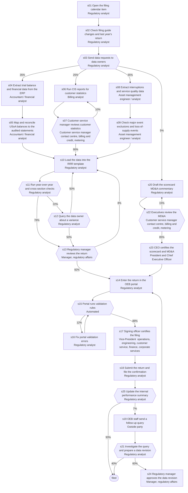

# File OEB Reporting and Record-keeping Requirements (RRR) returns and the scorecard MD&A

`edu-fin-rrr-reporting` · electricity distribution · regulatory affairs · part of `electric-distribution-utility`

The Ontario Energy Board requires every licensed distributor to file about twenty returns a year under its Reporting and Record-keeping Requirements: most are due on April 30 (audited statements, uniform-system-of-accounts trial balance, service quality and reliability, customer arrears, assistance programs, scorecard measures), with a market summary in February, quarterly generation connection data and the scorecard commentary later in the year. A regulatory analyst runs each return, collecting data from accounting, billing and the outage system, checking it against prior years, keying it into the OEB portal and getting it certified. It is slow because data owners give it low priority and financial returns wait for the audit, and error-prone because figures are re-keyed from several systems and must agree across returns.

| | |
|---|---|
| Unit of work | one RRR return (one section due on one deadline, or the scorecard MD&A) |
| Starts when | A deadline in the RRR compliance calendar approaches and the source data for the period (audited statements, year-end customer counts, interruption records) is available. |
| Done when | The return is submitted and certified in the OEB portal, and any OEB follow-up query is answered or the data revised. |
| Organisation | A municipally owned Ontario electricity distributor with about 350,000 customers and a small regulatory affairs team. (571 employees, 2019-2022) |
| Volume | 1.75 cases a month (range 1.5 to 2.5) |

## Where it sits

- Starts with **financial_statements** from fin-month-end-close (55% of cases)
- Starts with **reliability_report** from ae-reliability-analysis (45% of cases)
- Relies on **esa_report** from corp-public-safety-compliance (a standing input; it does not start a case)
- Relies on **assistance_credit** from cs-low-income-programs (a standing input; it does not start a case)
- Relies on **payment_arrangement** from cs-collections (a standing input; it does not start a case)
- Relies on **variance_balances** from fin-regulatory-accounts (a standing input; it does not start a case)
- Relies on **cia_report** from ae-der-connection (a standing input; it does not start a case)
- Relies on **survey_results** from cs-contact-centre (a standing input; it does not start a case)
- Sends **rrr_filing** to oeb (outcome: any)
- Sends **rrr_filing** to exec-strategy-board (outcome: filed)

## Flow

## Roles

| Role | Department | Layer | FTE on this process | Loaded cost per hour | Evidence |
|---|---|---|---:|---:|---|
| Regulatory analyst | Regulatory Affairs | senior specialist | 0.35 | 66 CAD | B [s1] |
| Manager, regulatory affairs | Regulatory Affairs | manager | 0.04 | 100 CAD | C |
| Accountant / financial analyst | Accounting, Payables and Payroll | individual contributor | 0.06 | 60 CAD | C |
| Billing analyst | Billing and Settlement | individual contributor | 0.03 | 47 CAD | C |
| Customer service manager (contact centre, billing and credit, metering) | Customer Service | manager | 0.01 | 88 CAD | C |
| Asset management engineer / analyst | System Planning and Asset Management | senior specialist | 0.05 | 68 CAD | C |
| Vice-President (operations, engineering, customer service, finance, corporate services) | Office of the President and CEO | executive | 0.005 | 160 CAD | B [s1] |
| President and Chief Executive Officer | Office of the President and CEO | executive | 0.002 | 230 CAD | B [s1] |

## Steps

Hands-on time and the wait before each step show the most common value. Evidence tier A is a sourced number, B a sourced description, C the author's estimate.

| Step | Who | Kind | Hands-on | Wait before | Control | Evidence |
|---|---|---|---:|---:|---|---|
| **s01 Open the filing calendar item.** The regulatory analyst opens the RRR compliance calendar, sees which return is due and when, creates a working folder for this year's return and notes who owns the source data. | Regulatory analyst | intake | 20 min | 0 min |  | B [s1] |
| **s02 Check filing guide changes and last year's return.** The analyst reads the OEB's current RRR filing guide and any letters changing the requirement, opens last year's filed return and working papers, and lists what is new, removed or redefined this year. | Regulatory analyst | lookup | 1.0 h | 1.0 d |  | B [s1], [s2] |
| **s03 Send data requests to data owners.** The analyst emails each data owner the template, definitions and due date for the figures needed. The path then depends on the kind of return: financial, customer, operational or the scorecard commentary. | Regulatory analyst | communication | 30 min | 12.0 h |  | B [s1] |
| **s04 Extract trial balance and financial data from the ERP.** After the external audit closes, the accountant runs the year-end trial balance, the uniform system of accounts sub-ledgers, Group 1 deferral and variance account principal and interest, and labour and FTE figures, and saves them to the RRR template. | Accountant / financial analyst | lookup | 6.0 h | 10.0 d |  | B [s1] |
| **s05 Map and reconcile USoA balances to the audited statements.** The accountant maps each ledger account to the OEB uniform system of accounts, reconciles the totals to the audited financial statements line by line and documents any reclassification so the return can be defended. | Accountant / financial analyst | validation | 5.0 h | 1.0 d | OEB RRR 2.1.13: USoA balances mapped and reconciled to the audited financial statements | A [s1] |
| **s06 Run CIS reports for customer statistics.** The billing analyst runs CIS queries for customers by class, accounts in arrears and arrears payment agreements, disconnections for non-payment, OESP and LEAP recipients, and retailer enrolments, and pastes the counts into the template. | Billing analyst | lookup | 3.0 h | 5.0 d |  | B [s1] |
| **s07 Customer service manager reviews customer statistics.** The customer service manager compares the counts with internal monthly reports and last year's figures and approves them or sends back queries. | Customer service manager (contact centre, billing and credit, metering) | review | 45 min | 3.0 d |  | C |
| **s08 Extract interruptions and service quality data.** The asset analyst exports the year's interruptions from the OMS by month and cause code and computes customer-hours and customers interrupted, and collects the Distribution System Code service quality counts (connections, appointments, call answering, reconnections) from the CIS and telephony reports. | Asset management engineer / analyst | analysis | 8.0 h | 7.0 d |  | B [s1] |
| **s09 Check major event exclusions and loss-of-supply events.** The analyst checks which days qualify as major events, separates loss of supply from the transmitter, and writes the required description of each major event and the actions taken, so that indices with and without them are reported correctly. | Asset management engineer / analyst | validation | 2.0 h | 12.0 h |  | B [s1] |
| **s10 Load the data into the RRR template.** The analyst copies the figures from each data owner into the RRR return workbook or the portal upload template, checks units and signs, and fills in definitions and notes. | Regulatory analyst | data entry | 2.0 h | 1.0 d |  | C |
| **s11 Run year-over-year and cross-section checks.** The analyst compares each figure with the last three years and with related returns (customer counts against the yearbook, financial statement totals against the trial balance, reliability against the scorecard) and flags any change beyond tolerance. | Regulatory analyst | validation | 1.5 h | 0 min | OEB RRR 2.2.3: adequate processes and controls to ensure filed information is accurate | B [s1] |
| **s12 Query the data owner about a variance.** The analyst emails the data owner the flagged figures and waits for either an explanation to note in the return or corrected data. | Regulatory analyst | communication | 1.0 h | 4.0 d |  | C |
| **s13 Regulatory manager reviews the return.** The regulatory manager reads the return and the variance notes, checks consistency with rate filings and public statements, and approves it or sends it back. | Manager, regulatory affairs | review | 45 min | 3.0 d |  | C |
| **s14 Enter the return in the OEB portal.** The analyst logs into the OEB RRR filing portal and keys or uploads each figure from the approved workbook, attaching documents such as the audited statements where required. | Regulatory analyst | data entry | 1.5 h | 1.0 d |  | B [s1] |
| **s15 Portal runs validation rules.** The OEB portal checks required fields, totals and ranges and lists errors or warnings for the analyst to resolve before submission. | Automated | system auto | 0 min | 5 min |  | C |
| **s16 Fix portal validation errors.** The analyst reads each portal error, corrects the keyed figure or adds an explanation for a warning, and resubmits for validation. | Regulatory analyst | data entry | 45 min | 1.0 h |  | C |
| **s17 Signing officer certifies the filing.** The vice-president acting as RRR signing officer (or the CEO for certifications that require the CEO) reviews the summary and signs the statement that the information is complete and accurate and that adequate controls are in place. | Vice-President (operations, engineering, customer service, finance, corporate services) | approval | 15 min | 2.0 d | OEB RRR 2.2.3 quarterly and annual certification by the CEO or RRR signing officer | A [s1] |
| **s18 Submit the return and file the confirmation.** The analyst submits the return in the portal, saves the confirmation and the working papers to the document store and marks the item complete in the compliance calendar. | Regulatory analyst | data entry | 10 min | 15 min |  | C |
| **s25 Update the internal performance summary.** The analyst adds the filed figures to the internal regulatory performance summary that goes to the executive team and board, highlighting measures that missed their target. | Regulatory analyst | drafting | 20 min | 1.0 d |  | C |
| **s19 OEB staff send a follow-up query.** OEB staff reviewing filings across distributors, or preparing the yearbook and scorecard, send a query about an outlier or an inconsistency between returns. | Outside party | external wait | 0 min | 30.0 d |  | C |
| **s20 Draft the scorecard MD&A commentary.** Once the OEB has populated the scorecard from the April filings, the analyst writes the management discussion and analysis for each measure (service quality, satisfaction, safety, reliability, asset management, cost control, financial ratios), explaining results, trends and actions. | Regulatory analyst | drafting | 1.0 d | 45.0 d |  | A [s2] |
| **s22 Executives review the MD&A.** The customer service manager and the vice-presidents responsible for each measure read the commentary for their area, correct facts and tone, and return comments to the analyst. | Customer service manager (contact centre, billing and credit, metering) | review | 2.0 h | 7.0 d |  | C |
| **s23 CEO certifies the scorecard and MD&A.** The CEO reads the final scorecard and MD&A and signs the statement that the information is complete and accurate in all material respects. | President and Chief Executive Officer | approval | 30 min | 4.0 d | OEB RRR 2.2.2: CEO certification of the scorecard including the MD&A | A [s1] |
| **s21 Investigate the query and prepare a data revision.** The analyst goes back to the working papers and the data owner, decides whether the figure was wrong, and either explains it to OEB staff or prepares a data revision request with the corrected figures. | Regulatory analyst | drafting | 3.0 h | 3.0 d |  | C |
| **s24 Regulatory manager approves the data revision.** The regulatory manager checks the corrected figures against the working papers, reads the explanation for OEB staff, and approves resubmission through the portal's data revision process. | Manager, regulatory affairs | approval | 30 min | 2.0 d |  | C |

## Exceptions

| Exception | Share of cases | What happens |
|---|---:|---|
| Unexplained variance | 22% | A figure moves beyond tolerance from last year and the analyst must query the owner and wait for an explanation or a correction. |
| Portal validation errors | 12% | The portal rejects totals or ranges and the analyst fixes and revalidates. |
| OEB follow-up and data revision | 7% | OEB staff question an outlier; about six in ten queries end in a data revision request and resubmission. |

## Benchmarks

| Metric | Value | Unit | Population | Evidence |
|---|---|---|---|---|
| cycle_time_days | p50 30, p90 65 | calendar days from opening the return to submission | One RRR return at a mid-size Ontario distributor | C |
| annual_filing_deadline_after_year_end_days | 120 | calendar days (April 30) | All Ontario electricity distributors | A [s1] |
| scorecard_mda_length | 11 | pages | Hydro Ottawa 2021 Scorecard MD&A | A [s2] |

## Pain points

- Financial returns cannot start until the audit closes, which squeezes the trial balance, USoA reconciliation and deferral account returns into the last weeks before April 30, when the month-end close is also running. (steps s04, s05; B [s1])
- Figures are pulled from the ERP, CIS, OMS and telephony reports into spreadsheets and then re-keyed into the portal, so transcription errors and inconsistent definitions between returns are common. (steps s06, s08, s10, s14, s16; C)
- Data owners in other departments treat RRR requests as low priority, so queries about variances wait days for answers. (steps s06, s08, s12; C)

## Assumptions

- The unit of work is one return: about fifteen annual sections due April 30, the February market monitoring summary, four quarterly generation connection returns and the scorecard MD&A, which gives about 21 cases a year (1.75 a month). Certification is modelled once per return, although in practice one certification can cover several returns filed on the same date.
- The OEB yearbook and scorecard are produced by the OEB from these returns; the utility's own scorecard work is the MD&A branch.
- Branch shares by return type follow the section count in s1 and are not weighted by effort.
- The OEB follow-up rate (7%) and the share of queries that lead to data revisions are estimates.
- fte_on_process covers RRR returns only; the same analysts also prepare annual rate updates and deferral account work, which are separate processes.

## Sources

- [s1] [Electricity Reporting and Record Keeping Requirements (RRR), revised March 31, 2020](https://www.oeb.ca/sites/default/files/RRR-Electricity-20200331.pdf) (Ontario Energy Board, 2020). Distributor filing sections and deadlines: market monitoring summary by the end of February (2.1.2); about fifteen annual returns due April 30 (2.1.4 service quality and reliability by month, 2.1.5 performance-based regulation data including FTEs and regulated ROE, 2.1.6 audited financial statements, 2.1.7 trial balance in uniform system of accounts and Group 1 deferral and variance account balances, 2.1.8 arrears and disconnections, 2.1.9 OESP, 2.1.13 USoA balances reconciled to audited statements, 2.1.14 net metering, 2.1.16 LEAP, 2.1.17 large customers, 2.1.19 scorecard measures, 2.1.20 publicly traded status, 2.1.22 cyber security readiness, 2.2.1 Affiliate Relationships Code certification); quarterly generation connection data due on the last day of the second month after quarter end (2.1.15); CEO certification of the scorecard and MD&A (2.2.2); quarterly and annual certification by the CEO or RRR signing officer that filings are complete and accurate and that controls are adequate (2.2.3); immediate reporting of material load loss (2.1.18).
- [s2] [Scorecard - Hydro Ottawa Limited (2017-2021) and 2021 Scorecard Management Discussion and Analysis](https://www.oeb.ca/documents/scorecard/2021/Scorecard%20-%20Hydro%20Ottawa%20Limited.pdf) (Ontario Energy Board, 2022). The scorecard page is dated August 31, 2022 and is followed by an 11-page utility-written Scorecard MD&A explaining each measure (service quality, customer satisfaction, safety, reliability, asset management, cost control, connection of renewable generation, financial ratios); a footnote notes a measure whose RRR filing requirement was removed in 2021; the utility commissioned a research firm for its public awareness of electrical safety survey.

Written by claude-opus on 2026-11-24.
