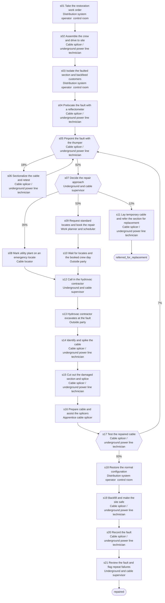

# Locate and repair underground cable faults

`edu-ops-cable-fault-repair` · electricity distribution · distribution operations · part of `electric-distribution-utility`

When an underground primary cable fails, a fuse blows and customers lose power. The control room and a cable crew isolate the faulted section and backfeed customers where the loop allows, then the crew finds the fault with a reflectometer and a thumper. If customers are still off the repair goes ahead at once on emergency locates; otherwise it is booked for a later day after standard locates, a hydrovac contractor exposes the cable, and two splicers cut out the failed length and splice in new cable. Finding the fault on old direct-buried cable is the slow, skilled part, and repeated faults on the same cable are flagged for the replacement program.

| | |
|---|---|
| Unit of work | one cable fault |
| Starts when | Outage restoration hands over a restoration work order after a trouble technician finds a blown fuse on an underground cable section. |
| Done when | The cable is repaired, tested and back in its normal configuration and the fault is recorded; or a temporary cable is in service and the section is referred for replacement. |
| Organisation | A municipally owned Ontario electricity distributor with about 346,000 customers and about 5,000 km of mostly XLPE underground cable, much of it direct-buried in 1970s to 1990 subdivisions. (571 employees, 2019-2022) |
| Volume | 20 cases a month (range 10 to 35) |

## Where it sits

- Starts with **restoration_work_order** from ops-outage-restoration (100% of cases)
- Relies on **locate_result** from ops-locates (a standing input; it does not start a case)
- Relies on **material_issue** from fin-inventory-stores (a standing input; it does not start a case)
- Relies on **work_protection** from ops-control-room-switching (a standing input; it does not start a case)
- Sends **inspection_findings** to ae-asset-condition-assessment (outcome: any)
- Sends **as_built** to ae-records-gis (outcome: repaired)
- Sends **purchase_order** to contractor (outcome: repaired)
- Sends **time_record** to fin-payroll (outcome: any)
- Sends **locate_request** to ontario-one-call (outcome: repaired)
- Sends **interruption_data** to ae-reliability-analysis (outcome: repaired)

## Flow

## Roles

| Role | Department | Layer | FTE on this process | Loaded cost per hour | Evidence |
|---|---|---|---:|---:|---|
| Distribution system operator (control room) | System Control Centre | individual contributor | 0.4 | 72 CAD | C |
| Cable splicer / underground power line technician | Underground and Cable | individual contributor | 3.5 | 66 CAD | B [jobbank_72203] |
| Apprentice cable splicer | Underground and Cable | individual contributor | 0.6 | 46 CAD | C |
| Underground and cable supervisor | Underground and Cable | supervisor | 0.3 | 80 CAD | C |
| Cable locator | Field Services | individual contributor | 0.15 | 45 CAD | C |
| Work planner and scheduler | Work Planning and Dispatch | individual contributor | 0.1 | 55 CAD | C |

## Steps

Hands-on time and the wait before each step show the most common value. Evidence tier A is a sourced number, B a sourced description, C the author's estimate.

| Step | Who | Kind | Hands-on | Wait before | Control | Evidence |
|---|---|---|---:|---:|---|---|
| **s01 Take the restoration work order.** The system operator receives the restoration work order from the trouble technician who found a blown riser or elbow fuse, checks the affected cable section and customers in the outage management system and GIS, and calls out the on-duty or on-call cable crew. | Distribution system operator (control room) | intake | 15 min | 10 min |  | B [mb_cable] |
| **s02 Assemble the crew and drive to site.** Two cable splicers (on shift, or called out from home after hours) load the fault locating set and drive the cable truck to the faulted section. | Cable splicer / underground power line technician | travel | 40 min | 1.0 h |  | C |
| **s03 Isolate the faulted section and backfeed customers.** The system operator directs switching on the underground loop; the crew opens elbows or switchgear on each side of the faulted cable and closes the normal open point so customers are fed from the other end. The operator issues a work protection permit on the isolated cable. | Distribution system operator (control room) | coordination | 45 min | 10 min | Utility Work Protection Code (IHSA): work protection permit and tags issued by the control room before work on isolated cable | B [mb_cable], [ihsa_uwpc] |
| **s04 Prelocate the fault with a reflectometer.** The crew confirms the cable is isolated, connects the time-domain reflectometer and reads the trace for the distance to the fault, comparing it with splice and tap positions on the GIS map. For high-resistance faults they use arc reflection with the thumper to get a distance. | Cable splicer / underground power line technician | analysis | 1.0 h | 0 min |  | B [ecm1999] |
| **s05 Pinpoint the fault with the thumper.** The crew connects the thumper, sets the lowest voltage that gives a clear discharge, and walks the route within the distance window with an acoustic or ground-gradient receiver until they hear the thump and mark the spot. | Cable splicer / underground power line technician | physical | 1.5 h | 0 min |  | B [ecm1999], [mb_cable] |
| **s06 Sectionalize the cable and retest.** The crew opens elbows at transformers along the run, tests each section with an insulation resistance tester to find the faulted one, and repeats the reflectometer and thumper work on that shorter section. | Cable splicer / underground power line technician | analysis | 2.5 h | 0 min |  | B [ecm1999] |
| **s07 Decide the repair approach.** The underground supervisor, by phone or at site, decides whether to repair now because customers are still off and cannot be backfed, to schedule the repair for a later day because customers are backfed, or to leave the cable out and refer it for replacement because it has failed repeatedly. | Underground and cable supervisor | judgment | 20 min | 30 min |  | B [mb_cable], [tdw2016] |
| **s08 Mark utility plant on an emergency locate.** A cable locator is called out to mark the utility's own cables around the dig spot within hours, while the emergency ticket goes to the gas, telecom and water owners through Ontario One Call. | Cable locator | physical | 45 min | 2.0 h | Ontario Underground Infrastructure Notification System Act, 2012 and Occupational Health and Safety Act: locate all buried plant before excavating (emergency locates allowed for outages) | B [mb_cable], [ho_locates] |
| **s09 Request standard locates and book the repair.** The work planner enters a locate request for the dig spot on the Ontario One Call portal and books the cable crew and excavation contractor for a day after the locates are due. | Work planner and scheduler | data entry | 25 min | 1.0 d | Ontario Underground Infrastructure Notification System Act, 2012 and Occupational Health and Safety Act: locate all buried plant before excavating (emergency locates allowed for outages) | B [ho_locates] |
| **s10 Wait for locates and the booked crew day.** The underground owners mark the site within five business days (often sooner for a single dig spot) and the job waits for its booked crew day. Customers stay on the backfeed, so the loop runs without its normal second supply. | Outside party | external wait | 0 min | 3.0 d |  | B [ho_locates], [mb_cable] |
| **s11 Lay temporary cable and refer the section for replacement.** Where the section cannot be backfed and the cable is not worth splicing, the crew lays a temporary cable on the surface or in a shallow trench between transformers, energizes it under switching, and records the cable for the replacement program. | Cable splicer / underground power line technician | physical | 5.0 h | 1.0 h |  | C |
| **s12 Call in the hydrovac contractor.** The underground supervisor calls the excavation contractor under its standing order with the location, locate ticket and urgency, and sends the release number. | Underground and cable supervisor | coordination | 15 min | 30 min |  | B [mb_cable], [ho_locates] |
| **s13 Hydrovac contractor excavates at the fault.** The contractor's hydrovac truck digs a pit over the marked spot with high-pressure water and vacuum, exposing the cable without mechanical digging near live services. The cable crew waits and guides the dig. | Outside party | external wait | 0 min | 3.0 h |  | B [mb_cable] |
| **s14 Identify and spike the cable.** The crew confirms the visible fault damage, uses a cable identifier to prove it is the isolated cable, and spikes it with the remote spiking tool before anyone cuts it. | Cable splicer / underground power line technician | validation | 30 min | 0 min | Electrical Utility Safety Rules (IHSA) and company cable identification procedure: identify and spike before cutting | B [ihsa_uwpc] |
| **s15 Cut out the damaged section and splice.** Two splicers cut out the failed length, prepare the cable ends and install two splices with a short new piece of cable, or one splice where the fault is at a joint, following the splice kit and company standard. | Cable splicer / underground power line technician | physical | 4.0 h | 0 min |  | B [mb_cable] |
| **s16 Prepare cable and assist the splicers.** The apprentice pumps water out of the pit, cleans and trains the cable ends, runs the generator and passes kit parts and tools while the splicers work. | Apprentice cable splicer | physical | 4.0 h | 0 min |  | C |
| **s17 Test the repaired cable.** The crew tests the repaired section with the insulation tester or a withstand test and reads a new reflectometer trace to check there is no second fault before handing back. | Cable splicer / underground power line technician | validation | 40 min | 0 min | Company standard: test repaired primary cable before re-energizing | B [ecm1999] |
| **s18 Restore the normal configuration.** The crew removes grounds and surrenders the permit; the system operator re-energizes the repaired cable and returns the loop to its normal open point, updating the outage system. | Distribution system operator (control room) | coordination | 30 min | 15 min | Utility Work Protection Code (IHSA): work protection permit and tags issued by the control room before work on isolated cable | B [ihsa_uwpc] |
| **s19 Backfill and make the site safe.** The crew backfills the pit with sand and native fill, places a plate or fencing where needed, and logs a request for sod or asphalt reinstatement by the contractor. | Cable splicer / underground power line technician | physical | 1.0 h | 0 min |  | B [mb_cable], [ho_fortune] |
| **s20 Record the fault.** The crew lead records the fault cause, cable type and age, the location and splices added, materials and hours on the work order and completes it in the mobile tool. | Cable splicer / underground power line technician | data entry | 25 min | 4.0 h |  | C |
| **s21 Review the fault and flag repeat failures.** The underground supervisor approves hours, checks the fault history of the cable segment, flags segments with repeated faults to asset management for replacement, and sends the splice location redline to records. | Underground and cable supervisor | review | 25 min | 1.0 d | Collective agreement and payroll policy: supervisor approval of crew time | B [ho_maint], [tdw2016] |

## Exceptions

| Exception | Share of cases | What happens |
|---|---:|---|
| Fault hard to find | 18% | No clear thump, several faults or an unclear route; the crew sectionalizes the cable and thumps again. |
| Scheduled repair on backfeed | 53% | Customers are restored by backfeed, so the repair waits days for standard locates and a booked crew. |
| Refer for replacement | 12% | A cable with repeated faults gets a temporary surface cable and is referred to the replacement program. |
| Second fault found after splicing | 6% | The repaired cable fails its test and the crew goes back to fault locating. |

## Benchmarks

| Metric | Value | Unit | Population | Evidence |
|---|---|---|---|---|
| cycle_time_days | p50 5, p90 10 | calendar days from restoration work order to the repaired cable being back in normal configuration and the fault reviewed | Primary underground cable faults at a Canadian distributor | B [mb_cable] |
| cable_failure_rate | cable 1.3, joints 0.4, terminations 0.2 | failures per 100 conductor miles per year (median) | EPRI survey of US utilities, third-party damage excluded | A [epri_fail] |
| tdr_accuracy | 0.01 | share of test range | Time-domain reflectometer prelocation | A [ecm1999] |

## Pain points

- Finding the fault on old direct-buried cable can take hours, needs experienced splicers and sometimes several digs when the trace or route map is unclear; thumping also stresses aged insulation. (steps s04, s05, s06; B [ecm1999])
- Backfed repairs wait days for locates and crew slots while the loop runs without its second supply, so a second fault in that time puts customers out again. (steps s09, s10; B [mb_cable], [ho_locates])
- Cause codes and splice locations are often missing from the work order, weakening the fault history used to rank cables for replacement. (steps s20, s21; C)

## Assumptions

- The process starts with the restoration work order after the trouble technician has found the blown fuse; the first response and customer restoration on overhead parts are in outage restoration.
- About 35% of faults are repaired immediately because customers cannot be backfed, 53% are repaired on a later booked day, and 12% are left out with temporary cable and referred for replacement.
- Hydrovac contractor time is folded into the wait at s13 because it is not this organisation's labour; the crew's standby time there is not counted.
- Crew work is recorded as elapsed crew time with people = 2 splicers plus a concurrent apprentice step for splicing.
- Loaded costs come from the organisation file (wage x 1.40); after-hours call-out premiums are not included.
- The simulated median (about 6 to 7 days) is a little above the 5-day benchmark reading because every scheduled repair waits for the full locate window and the supervisor's review; emergency repairs finish in under a day of field time.
- Volume is set below the organisation file's estimate on the strength of the EPRI failure-rate benchmark; see the volume note.

## Sources

- [mb_cable] [How we fix underground cable faults](https://www.hydro.mb.ca/articles/2025/07/how-we-fix-underground-cable-faults/) (Manitoba Hydro, 2025). Cable faults mostly from age and dig-ins, more frequent in spring and summer; fuse operates, crew uses a thumper to find the fault, customers switched to an alternate feed where possible, return visit a day or two later, other utilities located before digging, excavation with high-pressure water, cut out and splice, backfill; full repair takes several days depending on locates and excavation.
- [ecm1999] [Locating That Underground Cable Fault (Dennis Koep)](https://www.ecmweb.com/content/locating-underground-cable-fault) (EC&M (Electrical Construction & Maintenance), 1999). Fault-location sequence: sectionalizing, TDR prelocation accurate to about 1% of range, thumper to make the fault audible, narrow thumping window from the TDR distance; thumping and surge methods stress insulation; sectionalizing needs repeated excavation.
- [ihsa_uwpc] [Keys to the Utility Work Protection Code](https://www.ihsa.ca/IHSA-Health-Safety-Magazine/IHSAV232/Keys-to-the-Utility-Work-Protection-Code.aspx) (Infrastructure Health and Safety Association (IHSA) Health and Safety Magazine, vol. 23 issue 2, n.d.). The Electrical Utility Safety Rules govern worker conduct near hazards; the Utility Work Protection Code uses permits and tags to show when lines are safe to work on; issuers and workers must be trained and certified.
- [ho_locates] [Contractors: locates and safe digging](https://hydroottawa.com/en/contractors/locates-safe-digging) (Hydro Ottawa, 2025). Locate requests at least five business days before digging (ten for multi-address requests), legally required; hand digging or hydrovac near cables; stay 1.5 m from marked cables; re-locate when marks expire. Current page; the five-business-day rule applied in 2019-2022.
- [tdw2016] [Utility Proactively Tests Underground Cable (Alana Jones and Bill Bennett)](https://www.tdworld.com/electric-utility-operations/article/20966290/utility-proactively-tests-underground-cable) (T&D World, 2016). Hydro Ottawa has nearly 5,000 km of underground cable, more than 90% XLPE, much installed from the mid-1970s to 1990 and at or past its 30-year expected life; replacing on faults is a lagging approach; injection versus replacement depends on splice count and feasibility.
- [ho_maint] [An in-depth look at Hydro Ottawa's grid maintenance](https://hydroottawa.com/en/blog/depth-look-hydro-ottawas-grid-maintenance) (Hydro Ottawa, 2024). Critical pole program tests thousands of poles a year; replacements are driven by testing or by emergencies such as vehicle collisions; cable replacements are prioritised from fault histories, cable tests and estimated life; new cable goes in 4-inch PVC or HDPE conduit.
- [ho_fortune] [Fortune Cable Renewal](https://hydroottawa.com/en/community/major-projects/fortune-cable-renewal) (Hydro Ottawa, 2025). Cable renewal done by Hydro Ottawa crews and contractors: buried ducts and concrete-encased road crossings, cable and transformer replacement (46 and 30 transformers in two phases), multi-phase over two years, temporary backfill then reinstatement when weather allows.
- [epri_fail] [Failure Rates of Underground Cable Systems](https://distribution.epri.com/underground/public/failures) (EPRI Distribution (P180.002 Underground), n.d.). Median failure rates per 100 conductor miles per year: cable 1.3 (most utilities 0.7 to 2), joints 0.4, terminations 0.2; third-party damage excluded.
- [jobbank_72203] [Wages: Lineworker - Electrical Power Systems in Ontario (NOC 72203)](https://www.jobbank.gc.ca/marketreport/wages-occupation/27095/ON) (Government of Canada, Job Bank, 2025). Ontario hourly wage low 29.70, median 49.48, high 62.90; Ottawa region 32.93, 50.63, 63.29 (2024-2025 reference period).

Written by claude-opus on 2026-11-24.
